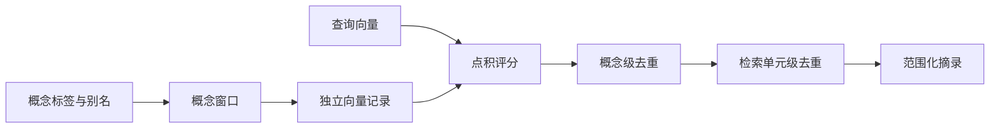

# 概念描述驱动的语义召回

将材料描述中的概念标签与别名单独向量化，在查询时把语义命中映射回原始材料的准确行段；通过独立版本标识、概念级与检索单元级去重，以及维度校验，为统一混合检索补充一条可解释的概念语义通道。

来源：gpt-5.6-sol 分析，gpt-5.6-sol 独立复核；模型解释仍可被原始证据纠正。

## 为什么单独建立概念向量

正文用词和用户提问可能不一致。该实现把材料描述里的概念标签及别名拼成独立的嵌入文本，让“旅途票据”一类问法可以命中“差旅凭证向财务登记”，同时把结果仍锚定到概念覆盖的原始行段。`CONCEPT_VECTOR_VERSION` 为这套表示提供独立身份，避免与正文向量缓存混用。参考 [独立概念向量身份 ↗](../../../apps/server/src/retrieval/concept-vectors.ts#L4 "支持概念文本使用独立版本标识、避免混入正文向量缓存的说明。")

`conceptWindows` 只处理 `source` 检索单元。它筛出与当前单元行区间相交的概念，把材料绝对行号换算为单元内字符偏移，并丢弃空范围。概念键还包含材料键、修订、标签、别名和行范围，因此同一修订中同一概念投影到多个 passage 时仍可被识别为同一张概念卡。参考 [概念窗口构造 ↗](../../../apps/server/src/retrieval/concept-vectors.ts#L7 "支持 source 限定、重叠筛选、概念键、嵌入文本和字符范围换算的说明。")

## 一次查询如何得到范围化结果

以“旅途票据应当交给谁”为例，索引阶段先调用 `conceptWindows`，对“差旅凭证向财务登记；registerExpense”生成向量，并用独立的概念模型标识写入向量表。参考 [概念向量索引 ↗](../../../apps/server/src/retrieval/unified.ts#L231 "证明统一检索在概念索引阶段调用 conceptWindows，并把窗口文本嵌入后写入独立模型命名空间。")

查询阶段读取指定模型的向量记录，用 `part` 找回对应窗口，再计算查询向量与存储向量的点积。相同概念卡先保留高分投影；分数相同时保留跨度更大的投影。随后每个检索单元只留下最高分候选，输出 `semantic-concept` 路由、原文摘录和匹配字符范围。参考 [评分与两级去重 ↗](../../../apps/server/src/retrieval/concept-vectors.ts#L57 "支持向量读取、维度检查、点积评分、概念卡去重及单元去重的流程说明。")

统一检索会先构造通过资格过滤的单元映射，再调用这里的 `conceptCandidates`；返回结果经过阈值、适用性排序与多路融合后进入最终选择。测试中的代表性调用确认，概念语义命中落在第 1—3 行，最终文本不包含范围外的 `repaint`。参考 [统一检索调用 ↗](../../../apps/server/src/retrieval/unified.ts#L713 "证明调用方先建立合格单元集合，再调用概念候选并对结果做阈值、排序与融合。") [范围化召回示例 ↗](../../../apps/server/tests/material-descriptions.test.ts#L329 "测试以语义不同的用户问法验证概念命中、原始行范围和范围外文本排除。")

## 边界条件与降级方式

没有材料描述、没有重叠概念、目标不是 `source`，或数据库记录对应不到当前单元及窗口时，该分支会跳过并返回较少或空候选。存储向量与查询向量维度不一致则直接抛错，提示概念表示发生变化却没有更新身份。参考 [候选跳过与维度保护 ↗](../../../apps/server/src/retrieval/concept-vectors.ts#L57 "支持缺失单元、无对应窗口时跳过，以及向量维度变化时抛错的边界说明。")

返回数组本身不负责阈值过滤或全局排序；这些工作由统一检索调用方完成。调用方把概念分支视为可选表示：概念向量损坏时清空该分支并记录错误，健康的正文向量仍继续召回。测试验证了此时结果保留 `semantic` 路由，同时不再带 `semantic-concept`。参考 [概念分支故障隔离 ↗](../../../apps/server/src/retrieval/unified.ts#L754 "证明统一检索捕获概念候选错误并清空该分支，不让它破坏正文语义召回。") [降级行为验证 ↗](../../../apps/server/tests/material-descriptions.test.ts#L371 "测试验证概念向量维度损坏后正文 semantic 结果仍保留，并报告概念分支错误。")
