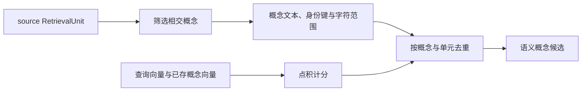

# 概念标签向量的窗口投影与候选召回

将材料描述中的概念标签与别名投影为检索单元内的字符窗口，并从 SQLite 概念向量索引计算点积候选。实现通过独立版本身份隔离正文向量缓存，按概念及检索单元两级去重；非 source 单元没有概念窗口，缺失映射会被跳过，向量维度变化则抛错。

来源：gpt-5.6-sol 分析，gpt-5.6-sol 独立复核；模型解释仍可被原始证据纠正。

## 为概念名称提供语义召回入口

检索查询可能没有命中正文原词，却能命中材料描述中的概念标签或别名。该实现给这种语义入口单独设定 `range-concepts-v1` 向量身份，避免概念文本进入正文向量缓存。参考 [独立概念向量身份 ↗](../../../apps/server/src/retrieval/concept-vectors.ts#L4 "支持概念向量采用独立版本标识、避免与正文向量缓存混用的说明。")

`conceptWindows` 只接受 `source` 类型单元，并从材料描述中选择与单元行段有交集的概念；其他单元或没有交集时返回空数组。参考 [概念窗口适用范围 ↗](../../../apps/server/src/retrieval/concept-vectors.ts#L7 "支持只处理 source 单元并筛选与当前行段相交概念的边界说明。")

## 从概念行段生成可定位窗口

代表性调用（示意）从一个覆盖第 10—20 行的 source 单元开始。若概念覆盖第 15—25 行，函数先把交集截到单元范围，再通过逐行累计的字符偏移得到摘录区间。概念标签与别名用分号连接为概念文本；身份键包含材料键和修订，还记录概念名、别名及原始行范围，使同一概念在重复投影中可被识别。空字符区间会被删除。参考 [窗口投影与概念身份 ↗](../../../apps/server/src/retrieval/concept-vectors.ts#L17 "支持行号到字符范围的换算、概念文本构造、稳定身份键及空窗口过滤。")

流程中的窗口构造、点积计分和两级去重均由目标实现直接给出。参考 [窗口投影与概念身份 ↗](../../../apps/server/src/retrieval/concept-vectors.ts#L17 "支持行号到字符范围的换算、概念文本构造、稳定身份键及空窗口过滤。")、[向量读取与点积计分 ↗](../../../apps/server/src/retrieval/concept-vectors.ts#L57 "支持按模型读取向量、跳过缺失映射、还原 Float32Array、校验维度并计算点积。")、[两级候选去重 ↗](../../../apps/server/src/retrieval/concept-vectors.ts#L78 "支持按概念保留高分或同分长跨度投影、再按检索单元保留最高分候选及其输出字段。")

## 计分、去重与失败边界

`conceptCandidates` 的调用方负责先提供合格单元集合；本函数按 `modelId` 读取 SQLite 中已存向量，并忽略集合中不存在的 `unit_id` 或无对应窗口的 `part`。向量字节被还原为 `Float32Array`；维度和查询不一致会直接抛错，匹配分数是点积。参考 [候选召回输入契约 ↗](../../../apps/server/src/retrieval/concept-vectors.ts#L40 "支持调用方提供合格检索单元，以及数据库、模型身份和查询向量构成函数输入的说明。")、[向量读取与点积计分 ↗](../../../apps/server/src/retrieval/concept-vectors.ts#L57 "支持按模型读取向量、跳过缺失映射、还原 Float32Array、校验维度并计算点积。")

结果先按概念身份去重：分数较高者优先；同分时保留跨度较长的投影。随后每个检索单元只保留最高分概念。输出候选携带 `unit` 与 `score`，并标注 `semantic-concept` 路由、摘录及字符匹配范围。该数组未在这里排序，向量生成、持久化与后续多路排序也不属于此文件。参考 [两级候选去重 ↗](../../../apps/server/src/retrieval/concept-vectors.ts#L78 "支持按概念保留高分或同分长跨度投影、再按检索单元保留最高分候选及其输出字段。")
