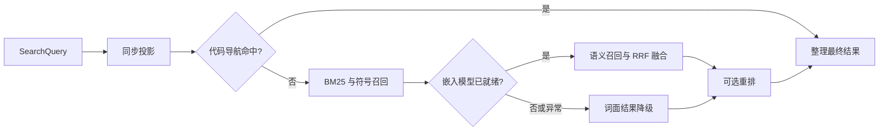

# 统一混合检索：从索引单元到可读证据

UnifiedRetrieval 以结构化检索单元为中心，组合词面搜索、代码导航、向量召回、交叉编码重排和可选选择器，并在模型不可用时保留可工作的降级路径。它还负责范围过滤、结果多样化、诊断跟踪，以及向旧版证据接口的兼容投影。

来源：gpt-5.6-sol 分析，gpt-5.6-sol 独立复核；模型解释仍可被原始证据纠正。

## 职责与索引准备

UnifiedRetrieval 是阅读端与 Agent 共用的检索入口，继承 `KeywordRetrieval`，并在构造时接入 `RetrievalProjection` 和 `CodeNavigation`。嵌入模型、重排模型及最终选择器由外部注入。结构化检索单元是各条检索路径共用的中间层，旧版 source 接口只把同一批结果投影回不可变证据。参考 [统一入口与依赖装配 ↗](../../../apps/server/src/retrieval/unified.ts#L56 "支持统一检索类的职责、继承关系、注入模型以及投影和代码导航组件的装配方式。")

后台 `start()` 先同步投影，再分批补向量；没有嵌入加载器时，`indexBatch()` 只同步投影。每个单元按窗口切分，以 16 个窗口为一批生成向量。写库前会在事务锁内复查单元仍存在，随后一起提交窗口向量与模型 head，避免为同步期间已被替换的单元留下索引。参考 [批量索引入口 ↗](../../../apps/server/src/retrieval/unified.ts#L167 "支持无嵌入加载器时仅同步投影，以及并发索引任务复用和错误记录行为。") [窗口向量写入 ↗](../../../apps/server/src/retrieval/unified.ts#L181 "支持窗口批处理、向量校验、事务内存活复查及向量 head 提交机制。")

## 一次查询如何穿过多条检索路径

**教学示例**

调用 `search({ text: "如何更新索引", purpose: "implementation", limit: 5 })` 后，系统先同步检索单元，再判断能否走代码定义或调用方导航。显式 `codeIntent` 会直接采用对应快捷路径；从自然语言推断“查调用方”时，只有找到候选才提前返回，否则继续普通召回。参考 [代码导航快捷路径 ↗](../../../apps/server/src/retrieval/unified.ts#L366 "支持显式代码意图和自然语言调用方意图的分支，以及推断路径无结果时回到普通召回的边界。")

普通问题分别构造 BM25 词面候选和代码符号候选。嵌入模型已就绪时，查询最多取 400 个字符生成向量，以点积保留每个单元的最佳窗口，再用 RRF 合并词面、符号和语义排名；嵌入计算异常会记录错误并回退。参考 [混合召回主流程 ↗](../../../apps/server/src/retrieval/unified.ts#L537 "支持词面、符号与语义召回的组合方式、向量筛选阈值、RRF 融合及异常降级流程。")

## 重排、选择与范围边界

交叉编码器最多处理融合结果前 40 个单元，并从每个单元生成若干 passage。每个单元保留最高 passage 分，相关度低于 0.1 的普通候选被移除，代码符号候选不受该阈值淘汰；新相关度与原召回分按 0.7 和 0.3 合成。模型加载或打分失败时保留原候选。参考 [交叉编码重排 ↗](../../../apps/server/src/retrieval/unified.ts#L629 "支持重排候选池、passage 打分、过滤阈值、分数合成和失败回退行为。")

外部选择器只会看到已经过范围过滤的候选池；它失败时回到内置 `finish()`。最终排序会结合查询目的、代码定义优先级、知识新鲜度与材料适用性，并默认限制同一来源最多两条、同一知识章节一条，同时去除重复文本。调用方查询改用跨文件轮转展示入口广度。参考 [外部选择与回退 ↗](../../../apps/server/src/retrieval/unified.ts#L722 "支持选择器只读取已整理候选池、选择后去重，以及选择异常时回到内置完成逻辑。") [最终排序与多样化 ↗](../../../apps/server/src/retrieval/unified.ts#L777 "支持按查询目的调整优先级、定义提升、知识新鲜度处理、来源和章节去重，以及调用方结果轮转。")

`eligible()` 是统一边界门。它检查材料角色和有效期，也检查任务状态、可信项目下的记忆作用域、结果种类与主题前缀；可见性谓词及时间范围同样在这里生效。参考 [检索范围过滤 ↗](../../../apps/server/src/retrieval/unified.ts#L252 "支持材料角色、有效期、任务状态、项目记忆作用域、种类、主题、可见性和时间范围等准入条件。")

## 旧版证据接口与资源收尾

同步的 `searchSources()` 只使用代码导航、BM25 和符号路线，异步版本则复用完整 `search()`。`sources()` 沿命中的 references 查找可见且非空的 fragment，并按片段对命中文本及查询词的覆盖程度排序；一个结构化 passage 只占一个结果位，重叠存储片段只充当证据锚点。参考 [证据结果投影 ↗](../../../apps/server/src/retrieval/unified.ts#L911 "支持同步与异步 source 搜索的差异，以及从结构化命中映射到可见证据 fragment 的规则。")

关闭实例时会停止后台定时器，等待投影、索引和模型加载中的工作结束，再关闭嵌入模型与重排模型。参考 [资源关闭 ↗](../../../apps/server/src/retrieval/unified.ts#L966 "支持停止定时任务、等待在途工作并关闭两个模型的收尾顺序。")
