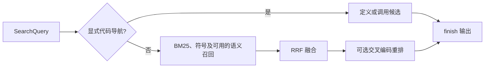

# 统一检索的召回、融合与证据输出

UnifiedRetrieval 将结构化检索单元上的词面搜索和代码导航，与可选语义召回及重排串成统一入口，并按可见性与时间范围以及查询用途等约束输出可阅读结果；它还维护向量索引，并为旧处理器投影不可变证据片段。

来源：gpt-5.6-sol 分析，gpt-5.6-sol 独立复核；模型解释仍可被原始证据纠正。

## 统一入口解决什么问题

`UnifiedRetrieval` 是阅读器和 Agent 共用的检索编排层。它继承词面检索基类，在同一个 SQLite 数据库上装配检索单元投影与代码导航，并按配置接入向量模型、交叉编码重排器和额外排序回调。对新调用方，它返回带目标和上下文、记录命中路线与来源引用的 `RetrievalHit`；旧处理器仍可取得不可变证据片段。参考 [统一检索类与构造依赖 ↗](../../../apps/server/src/retrieval/unified.ts#L39 "支持统一检索面向阅读器和 Agent、继承词面基类并装配投影、导航及可选模型的说明。")

从依赖关系看，本文件负责协调各专门模块：`RetrievalProjection` 准备统一检索单元，`embeddingWindows` 切分语义窗口，`CodeNavigation` 核验名称级调用位置，`rerankPassages` 生成重排段落。具体算法留在各自模块，本类控制它们何时参与、失败后走哪条路径。参考 [检索协作模块 ↗](../../../apps/server/src/retrieval/unified.ts#L1 "支持本文件协调词面、语义窗口、代码导航、段落重排和检索单元投影等专门模块。")

## 一次查询如何穿过检索流水线

下面是一条说明性调用：`search({ text: "谁调用 schedule_shipment?", codeIntent: "callers", purpose: "implementation", limit: 20 })`。显式 `codeIntent` 会让 `navigationCandidates` 直接选择调用者分支；候选先按名称缩小到代码单元，再由 `CodeNavigation.matches` 给出名称级调用位置，随后交给 `finish`。这些位置是候选关系，不能当作跨文件、类型解析后的调用图。参考 [代码导航候选 ↗](../../../apps/server/src/retrieval/unified.ts#L349 "说明显式代码意图的分流，以及自然语言推断 callers 意图时仅在有候选的情况下采用导航捷径。")

普通自然语言查询会先取 BM25 与符号候选；语义模型已经就绪、文本非空且查询不是精确查找时，再计算查询向量与已存窗口的余弦分数。各路线量纲不同，因此用基于名次的 RRF 合并；配置了交叉编码器时，只对前 40 个单元生成段落并重排。参考 [RRF 路线融合 ↗](../../../apps/server/src/retrieval/unified.ts#L412 "支持不同分支按名次融合、合并路线且保留已有相关摘要的机制。") [混合召回主流程 ↗](../../../apps/server/src/retrieval/unified.ts#L484 "说明代码导航捷径、词面与符号召回、语义窗口打分、阈值筛选和异常回退。") [交叉编码重排 ↗](../../../apps/server/src/retrieval/unified.ts#L549 "支持候选池规模、段落生成、交叉编码打分及重排失败时保留原结果的说明。")

参考 [代码导航候选 ↗](../../../apps/server/src/retrieval/unified.ts#L349 "说明显式代码意图的分流，以及自然语言推断 callers 意图时仅在有候选的情况下采用导航捷径。") [混合召回主流程 ↗](../../../apps/server/src/retrieval/unified.ts#L484 "说明代码导航捷径、词面与符号召回、语义窗口打分、阈值筛选和异常回退。")

## 过滤、排序与降级边界

候选进入排序前会经过 `eligible`。材料角色与生效日期可显式限制范围；跟进查询只保留开放或等待中的任务。可信项目上下文只约束带不同项目作用域的记忆，`kinds` 与主题路径也在这里执行，可见性和时间范围同样如此。参考 [候选资格过滤 ↗](../../../apps/server/src/retrieval/unified.ts#L235 "支持材料角色、生效时间、任务状态、可信项目、类型、主题、可见性和时间范围过滤。")

`finish` 再按查询用途调整知识与代码、任务与记忆的优先级，并降低待复核知识的权重。默认浏览会限制同一来源的重复结果，并去掉同文结果；调用者查询改用轮次排序，让多个文件的入口先出现。最终结果保留实际命中的路线与目标，以及引用和来源信息。参考 [最终排序与结果组装 ↗](../../../apps/server/src/retrieval/unified.ts#L639 "说明用途权重、定义与新鲜度权重、多样化、调用者轮次排序以及输出字段。")

精确查找、空文本或语义模型未就绪时，流程直接使用词面与符号结果。向量计算异常会回退到这条路径；可选排序回调抛错时也回到内置 `finish`，所以增强能力失效不会中断基本检索。参考 [混合召回主流程 ↗](../../../apps/server/src/retrieval/unified.ts#L484 "说明代码导航捷径、词面与符号召回、语义窗口打分、阈值筛选和异常回退。") [可选排序回退 ↗](../../../apps/server/src/retrieval/unified.ts#L610 "支持外部排序回调异常时回到内置 finish，并说明排序前候选池不消耗最终阅读名额。")

## 语义索引与旧证据接口

`start` 在 HTTP 监听器启动后异步追赶投影和向量索引，正常时每秒检查一次，出错后等待 30 秒；`health` 分别报告语义索引和重排器状态。参考 [后台维护与健康状态 ↗](../../../apps/server/src/retrieval/unified.ts#L88 "说明后台同步节奏、失败退避，以及语义索引和重排器的健康状态。")

`indexBatch` 防止并发批次重叠。每个待索引单元按窗口切分，每 16 个窗口调用一次 passage embedding，去掉知识引用标记后归一化向量。嵌入计算完成后，写入阶段才取得事务锁，并在锁内再次确认该单元 id 仍然存在；如果维护进程在嵌入期间替换了单元，这项检查会阻止向量结果写回已经不存在的旧单元。参考 [窗口向量生成 ↗](../../../apps/server/src/retrieval/unified.ts#L150 "支持批次互斥、窗口切分、每 16 个窗口嵌入、引用标记清理和向量归一化。") [事务化向量写入 ↗](../../../apps/server/src/retrieval/unified.ts#L194 "说明嵌入完成后取得写锁，锁内复核单元是否仍存在，并以事务写入窗口向量与索引头。")

同步 `searchSources` 不走语义召回和重排。显式 `codeIntent` 无论导航是否命中，都会直接完成导航分支并投影结果；零命中也不会回退到词面与符号路线。只有从自然语言推断出 callers 意图且实际找到候选时，才走导航捷径；推断后没有候选则回到词面与符号路线。异步版本复用完整 `search` 后再投影。投影按命中的每条 `reference` 分别处理：在该引用的 `fragmentIds` 中选择一个最相关且可见的原始 fragment，因此一个含多条引用的结构化命中可能产生多个 `SourceCandidate`。同一结构化段落下重叠的存储 fragment 仍只作证据锚点，不额外占结果名额。参考 [代码导航候选 ↗](../../../apps/server/src/retrieval/unified.ts#L349 "说明显式代码意图的分流，以及自然语言推断 callers 意图时仅在有候选的情况下采用导航捷径。") [原始证据投影 ↗](../../../apps/server/src/retrieval/unified.ts#L772 "支持同步接口按 navigationCandidates 的返回值决定是否直接投影，并说明词面与符号回退及每条引用选择一个可见证据 fragment 的规则。")
