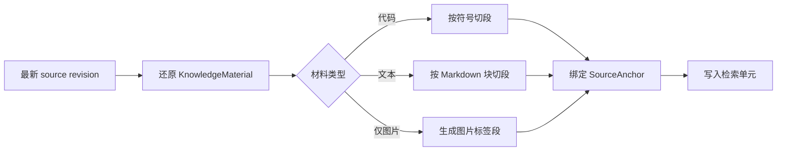

# 统一检索单元的生成与增量投影

该模块把原始材料、知识文章以及任务和记忆转换为统一检索单元，保留定位、可见性与来源信息，并通过签名和事务维护 SQLite 正文索引及上下文层级。

来源：gpt-5.6-sol 分析，gpt-5.6-sol 独立复核；模型解释仍可被原始证据纠正。

## 为何需要检索投影

持久层保存的是材料修订、知识产物和业务状态，搜索侧需要的是可替换、可评分的统一记录。这里定义的 `RetrievalUnit` 在检索命中的基础字段之外，补充 owner、证据可见范围、主题路径和子类型；文件开头也明确把这种投影与不可变存储、阅读页面分开。参考 [检索单元定义 ↗](../../../apps/server/src/retrieval/units.ts#L1 "支持可替换检索投影的定位，以及 owner、可见性、主题路径和子类型字段。")

投影覆盖四类内容。原始材料保留标题、正文片段和来源锚点；任务把详情、下一步、期限与状态组成一条记录。参考 [任务检索单元 ↗](../../../apps/server/src/retrieval/units.ts#L751 "支持任务详情、后续步骤、期限、状态、证据引用和版本目标的投影。") 处于 active 状态的记忆会被转成可读文本，并携带证据片段、作用域和有效时间。参考 [记忆检索单元 ↗](../../../apps/server/src/retrieval/units.ts#L819 "支持 active 记忆的正文、证据片段、范围、类型与有效时间投影。")

## 一条原始材料如何进入搜索

代表性调用是 `RetrievalProjection.sync()` 处理某个 source 的最新 revision。数据库行先由 `materialFromRow` 还原：派生内容被排除，文本与链接按捕获格式拼接，图片单独保存，同时计算稳定摘要并加载 fragment。参考 [材料行还原 ↗](../../../apps/server/src/retrieval/units.ts#L199 "支持派生材料排除、正文与图片还原、摘要计算及 fragment 加载。")

代码路径调用 `parseFile`，保留函数或方法的完整控制流，并把未被符号覆盖的导入和顶层配置也作为检索内容；无符号时退回整文件。参考 [代码分段 ↗](../../../apps/server/src/retrieval/units.ts#L92 "支持代码材料调用 parseFile、保留操作控制流与顶层未覆盖内容。") Markdown 路径维护标题层级；说明句以冒号结束时，紧随的表格、列表、代码块或引用会并入同一段，只有标题的文档也能被找到。参考 [Markdown 分段 ↗](../../../apps/server/src/retrieval/units.ts#L33 "支持标题路径、相邻说明块合并及标题-only 回退行为。")

每个 passage 随后绑定行号、修订摘要和相交 fragment；没有 fragment 的 passage 会被丢弃。生成的单元还汇入概念描述、标题层级、会话或发言上下文，并以 fragment ID 作为可见性边界。参考 [来源锚点与分流 ↗](../../../apps/server/src/retrieval/units.ts#L263 "支持锚点绑定 fragment，以及代码、文本、仅图片三种 passage 路径。")、[来源单元生成 ↗](../../../apps/server/src/retrieval/units.ts#L343 "支持无 fragment 时跳过，并说明检索上下文、可见性、类型与来源字段。") 想调整切分规则，应改 `markdownPassages` 或 `codePassages`；想调整检索上下文和来源元数据，应改 `sourceUnits`。

## 增量更新、知识约束与索引落库

`sync` 同步执行；`syncAsync` 复用同一个进行中的 Promise，并在每个变更批次间让出事件循环。参考 [同步与异步刷新 ↗](../../../apps/server/src/retrieval/units.ts#L443 "支持同步刷新、异步复用进行中任务及批次间让出事件循环。") `changes` 对页面状态、材料描述版本、source head、知识 head、失效记录、任务、记忆和材料别名求签名；签名未变就直接返回。参考 [变更签名 ↗](../../../apps/server/src/retrieval/units.ts#L470 "支持投影以多个上游表状态生成签名，并在签名不变时跳过刷新。") 对 source，owner 由 source ID 确定，identity 包含单元版本、revision 和描述版本；只有 identity 改变才重建单元，层级版本单独变化时只回填上下文树，不改变单元或向量 ID。参考 [来源增量替换 ↗](../../../apps/server/src/retrieval/units.ts#L530 "支持 source owner 和 identity 的构成，以及仅层级版本变化时的上下文回填。")

知识文章还有一层准入约束：调查材料与递归依赖必须存在，章节状态必须为 current，note、retired 和 planned 不进入有效文章集合。其可见范围递归汇总依赖材料的 fragment；正文里的双中括号引用标记会被递归解析为原始 `SourceAnchor`，并用集合阻止依赖环重复展开。参考 [知识文章准入 ↗](../../../apps/server/src/retrieval/units.ts#L601 "支持依赖可用性、生命周期状态、发布角色和递归可见范围的判断。")、[引用递归解析 ↗](../../../apps/server/src/retrieval/units.ts#L656 "支持从知识正文引用递归还原原始来源锚点，并通过 seen 集合去重。") 通过筛选的章节再按 Markdown 分段，记录 review 状态、引用和 provenance。参考 [知识章节投影 ↗](../../../apps/server/src/retrieval/units.ts#L684 "支持有效章节的切段、review 状态、可见性、引用与 provenance 字段。")

`replace` 在一个 `BEGIN IMMEDIATE` 事务中删除 owner 的旧单元、FTS 条目和上下文，再写入新记录；失败会回滚。正文进入 FTS 前会去掉引用标记，并由中文 ICU 分词器拆词、小写化。材料投影还会调用层级模块保存行范围上下文；数据库行读回时，`decodeUnit` 负责反序列化各 JSON 字段。参考 [事务化替换 ↗](../../../apps/server/src/retrieval/units.ts#L903 "支持清理失效 owner，并在事务内替换关系表、FTS 条目与层级上下文。")、[中文索引与解码 ↗](../../../apps/server/src/retrieval/units.ts#L980 "支持 ICU 中文分词、小写化和数据库 JSON 字段反序列化。")
