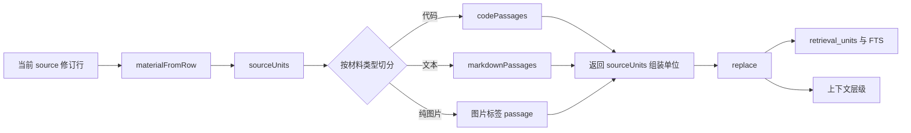

# 可检索内容的统一投影与增量刷新

该模块把原始材料、知识文章、事项和记忆转换为带固定证据锚点的统一检索单位，并按 owner 增量替换 SQLite 与 FTS 投影。它同时控制结构切分、知识可用性、证据可见范围和中文分词。

来源：gpt-5.6-sol 分析，gpt-5.6-sol 独立复核；模型解释仍可被原始证据纠正。

## 把异构内容变成统一检索单位

这个模块把数据库中的异构内容整理成同一种 `RetrievalUnit`，供后续检索与回答上下文读取。单位在普通命中字段之外保存 `owner`、可见证据 ID、主题路径和子类型；原始修订仍留在权威表中，投影可以整体替换。参考 [检索单位字段 ↗](../../../apps/server/src/retrieval/units.ts#L20 "支持统一检索单位在普通命中信息之外保存 owner、可见范围、主题路径和子类型。") [可替换投影定位 ↗](../../../apps/server/src/retrieval/units.ts#L443 "说明投影按 owner 增量维护，旧版本仍保留在原始表中。")

它与相邻模块的分工由导入关系直接体现。`parseFile` 提供代码符号，`fragmentPositions` 把行区间映射回不可变 fragment，`saveContextHierarchy` 保存父子结构，生命周期函数判断知识章节能否进入索引。参考 [相邻模块依赖 ↗](../../../apps/server/src/retrieval/units.ts#L9 "展示代码解析、fragment 定位、上下文层级、知识生命周期和材料描述等直接依赖。")

## 一份 TypeScript 材料如何进入索引

统一检索层的启动和后台轮询走 `syncAsync()`，异步搜索也先等待 `syncAsync()`；词面检索与同步 source 搜索则走 `sync()`。参考 [后台异步刷新入口 ↗](../../../apps/server/src/retrieval/unified.ts#L68 "支持统一检索层封装同步与异步投影入口，并在 start 的后台 tick 中等待 syncAsync。") [词面与异步搜索刷新 ↗](../../../apps/server/src/retrieval/unified.ts#L431 "支持 lexical 在检索前调用 sync，而异步 search 在检索前等待 syncAsync。") [同步与异步 source 搜索 ↗](../../../apps/server/src/retrieval/unified.ts#L772 "支持同步 searchSources 调用 sync，以及 searchSourcesAsync 复用异步 search。") `changes()` 先对发布状态和描述版本求稳定签名，并纳入 source head、知识 head，以及任务与记忆状态；签名未变便直接结束。随后它读取每个 source 的当前修订，并以版本和描述版本组成 identity，只重建发生变化的 owner。参考 [投影同步入口与变更签名 ↗](../../../apps/server/src/retrieval/units.ts#L456 "支持同步与异步投影入口的互斥行为，以及 changes 对各类状态计算签名并跳过未变化投影。") [当前材料增量刷新 ↗](../../../apps/server/src/retrieval/units.ts#L513 "支持读取 source 当前 head、组成 owner identity、由 sourceUnits 生成单位并仅替换变化 owner，同时回填上下文层级。")

输入行先由 `materialFromRow` 还原为材料。派生内容会被排除，文本与链接按捕获格式拼接，图片单独保留，同时生成稳定摘要并加载 fragment。参考 [修订行还原材料 ↗](../../../apps/server/src/retrieval/units.ts#L199 "支持排除派生内容、组合文本链接、保存图片、计算摘要并载入 fragment 的过程。") 对 TypeScript 文件，`codePassages` 以 AST 符号为边界，把操作内部的局部常量留在所属函数或方法中；类入口只保留到首个操作之前，未被符号覆盖的导入与顶层配置也会形成片段。参考 [代码结构切分 ↗](../../../apps/server/src/retrieval/units.ts#L92 "支持按符号切分代码、保留操作内部局部声明、缩短容器入口并补齐未覆盖顶层内容。")

`sourceUnits` 在内部按材料类型调用 `codePassages` 或 `markdownPassages`，纯图片材料则用图片标签生成可检索文本；这些分支返回的 passage 随后由 `sourceUnits` 组装成检索单位，再交给 `replace`。参考 [材料切分选择 ↗](../../../apps/server/src/retrieval/units.ts#L284 "支持 sourceUnits 内部选择代码、Markdown 与纯图片三种切分分支并继续组装检索单位。") [当前材料增量刷新 ↗](../../../apps/server/src/retrieval/units.ts#L513 "支持读取 source 当前 head、组成 owner identity、由 sourceUnits 生成单位并仅替换变化 owner，同时回填上下文层级。") 每段通过行号生成固定 source anchor；找不到任何 fragment 的段落会被丢弃。输出单位携带标题和层级，也记录会话或发言上下文、可见 fragment 以及 provenance。参考 [原始材料检索单位 ↗](../../../apps/server/src/retrieval/units.ts#L343 "支持 source anchor、无 fragment 过滤、上下文、可见范围和 provenance 的组装。")

## 知识、事项与记忆的准入规则

知识文章进入投影前，会递归确认调查材料和依赖文章仍可取得，并只保留状态为 current 的章节；note、retired 和 planned 页面不参与检索。参考 [知识准入条件 ↗](../../../apps/server/src/retrieval/units.ts#L604 "支持递归检查输入可用性，并按发布角色、页面状态和章节 current 状态筛选文章。") 单位的 `visibilityIds` 覆盖写作时使用的全部原始材料，`references` 则只沿正文实际出现的引用标签追到 source anchor，并能继续展开文章引用。参考 [知识可见范围与引用 ↗](../../../apps/server/src/retrieval/units.ts#L644 "支持递归收集全部依赖材料的可见 fragment，并从正文引用标签解析固定 source anchor。") 每个合格章节再按 Markdown 块拆成知识单位，部分章节过期时目标会标为 `needs-review`。参考 [知识章节单位 ↗](../../../apps/server/src/retrieval/units.ts#L684 "支持按合格章节生成知识检索单位，以及 needs-review、引用和主题路径字段。")

事项按当前版本生成一个单位，正文包含详情以及已有的下一步、到期时间和跟进数据；若事项绑定证据 fragment，也会附上 source anchor。参考 [事项投影 ↗](../../../apps/server/src/retrieval/units.ts#L751 "支持事项正文、状态上下文、版本目标与绑定证据锚点的组装。") 记忆只读取 active 记录，把结构化正文递归展开为文本，并把 fragment 或整份 source revision 的证据集合转成可见范围与引用。参考 [活动记忆投影 ↗](../../../apps/server/src/retrieval/units.ts#L819 "支持只读取 active 记忆、展开结构化正文并从证据集合生成可见范围与引用。")

## 替换事务与可调整边界

`replace` 以 owner 为原子范围，在同一事务中删除旧普通索引、FTS、上下文层级和 head，再写入新单位；任何异常都会回滚。同步结束后，不再存在的 owner 会被清除，材料缓存也只保留当前 source head。参考 [按 owner 事务替换 ↗](../../../apps/server/src/retrieval/units.ts#L903 "支持清理失效 owner 和缓存，并在事务内删除旧投影、写入新单位及上下文层级。")

需要调整检索粒度时，可修改 `markdownPassages` 或 `codePassages`。Markdown 切分会保留标题路径，并把冒号结尾的引导段与紧随的表格、列表、代码块或引用块合并；空文档不产出片段，只有标题的文档仍可检索。参考 [Markdown 块切分 ↗](../../../apps/server/src/retrieval/units.ts#L34 "支持标题路径、引导段合并、空文档与仅标题文档的边界行为。") 需要改变中文词面索引时，则修改 `indexText`：它用 `Intl.Segmenter("zh")` 取出 word-like 片段、转小写并用空格连接。数据库行返回业务层时由 `decodeUnit` 还原 JSON 字段。参考 [中文索引与行解码 ↗](../../../apps/server/src/retrieval/units.ts#L979 "支持 ICU 中文分词以及从 SQLite 行恢复 RetrievalUnit 字段。")
