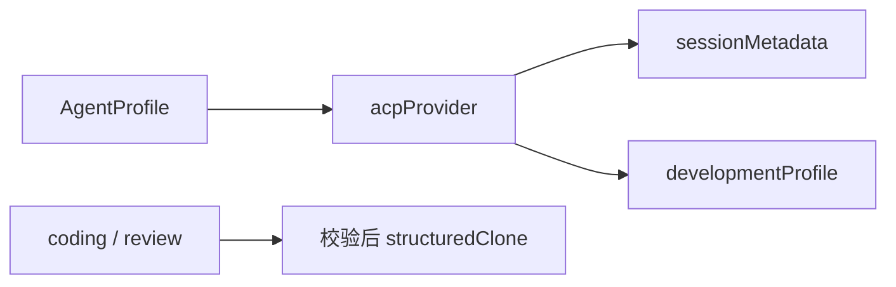

# ACP Provider 识别、会话隔离与开发配置冻结

该模块把统一的 AgentProfile 转换为 provider 身份、ACP 会话元数据和开发执行配置，并在冻结 coding/review 配置前完成合法性校验与深拷贝。需要注意：冻结函数保存原始 profile 的副本，TraeX 的只读参数改写体现在 developmentProfile 的返回值中。

来源：gpt-5.6-sol 分析，gpt-5.6-sol 独立复核；模型解释仍可被原始证据纠正。

## 统一配置如何识别 Provider

`acpProvider` 为同一种 `AgentProfile` 提供统一的 provider 判定入口。它先排除非 ACP transport，再优先返回显式的 `acpProvider`。没有显式字段时，函数只取 `command` 的文件名并移除末尾 `.exe`，随后兼容三组旧命令名：`traex`/`traecli` 对应 TraeX，`codex-acp` 对应 Codex，`claude-agent-acp` 对应 Claude；其余命令返回 `null`。包装脚本如果不使用这些旧文件名，需要显式声明 provider。参考 [Provider 身份识别 ↗](../../../apps/server/src/agent-providers.ts#L4 "支持 ACP transport 门槛、显式 provider 优先级、旧命令名兼容规则及未知命令返回 null。")

`sessionMetadata` 和 `developmentProfile` 都调用这一入口，因此身份判定规则只维护一份。`freezeDevelopmentProfiles` 则分别验证 coding 与 review 配置，再深拷贝保存。参考 [会话元数据分支 ↗](../../../apps/server/src/agent-providers.ts#L15 "支持 sessionMetadata 复用 provider 判定，以及 Claude、Codex 和默认分支的元数据结构。") [开发配置安全转换 ↗](../../../apps/server/src/agent-providers.ts#L43 "支持 ACP 限制、Claude/Codex 参数约束、TraeX 参数清理与只读配置注入，以及未知 provider 报错。") [开发配置校验与深拷贝 ↗](../../../apps/server/src/agent-providers.ts#L81 "支持 review 默认值、双角色校验、保留传入 profile 并通过 structuredClone 生成副本。")

## 会话元数据按适配器隔离能力

`sessionMetadata` 根据识别出的 provider 返回不同元数据。Claude 分支清空原生工具，只允许 `mcp__omem__*`，不加载设置源，启用严格 MCP 配置，禁用 hooks，并保持默认权限模式且不允许跳过权限。Codex 分支返回空对象。其余情况沿用旧式 Trae 元数据结构，只传入 profile 的 skills，并把 MCP server 列表设为空。参考 [会话元数据分支 ↗](../../../apps/server/src/agent-providers.ts#L15 "支持 sessionMetadata 复用 provider 判定，以及 Claude、Codex 和默认分支的元数据结构。")

这里的“其余情况”是 `switch` 的默认分支，也包括 `acpProvider` 返回 `null` 的配置。该函数本身不会为未知 provider 报错；需要开发配置时，严格校验发生在 `developmentProfile`。参考 [Provider 身份识别 ↗](../../../apps/server/src/agent-providers.ts#L4 "支持 ACP transport 门槛、显式 provider 优先级、旧命令名兼容规则及未知命令返回 null。") [会话元数据分支 ↗](../../../apps/server/src/agent-providers.ts#L15 "支持 sessionMetadata 复用 provider 判定，以及 Claude、Codex 和默认分支的元数据结构。") [开发配置安全转换 ↗](../../../apps/server/src/agent-providers.ts#L43 "支持 ACP 限制、Claude/Codex 参数约束、TraeX 参数清理与只读配置注入，以及未知 provider 报错。")

## 开发任务的只读参数与配置快照

`developmentProfile` 只接受 ACP 配置。Claude 与 Codex 都要求启动参数为空，因为模型和思考强度通过会话协商。TraeX 分支会移除 `--yolo`，也会移除 `-c` 或 `--config` 后紧跟的 `sandbox_mode=...` 配置对，再在参数开头写入 `-c sandbox_mode="read-only"`；其他参数保持原顺序。未知 provider 会直接报错。参考 [开发配置安全转换 ↗](../../../apps/server/src/agent-providers.ts#L43 "支持 ACP 限制、Claude/Codex 参数约束、TraeX 参数清理与只读配置注入，以及未知 provider 报错。")

**教学示例**

输入 TraeX profile，参数为 `--yolo -c sandbox_mode="danger-full-access" acp serve`，`developmentProfile` 返回的参数为 `-c sandbox_mode="read-only" acp serve`，profile 的其他字段通过展开运算保留。参考 [开发配置安全转换 ↗](../../../apps/server/src/agent-providers.ts#L43 "支持 ACP 限制、Claude/Codex 参数约束、TraeX 参数清理与只读配置注入，以及未知 provider 报错。")

`freezeDevelopmentProfiles(coding, review)` 在 review 缺省时复用 coding，先分别调用 `developmentProfile` 做合法性校验，再通过 `structuredClone` 深拷贝传入的原始 profile。它没有保存 `developmentProfile` 的返回值，所以冻结结果保留真实身份和原始参数；需要 TraeX 只读参数的调用方仍要使用 `developmentProfile` 返回的执行配置。参考 [开发配置校验与深拷贝 ↗](../../../apps/server/src/agent-providers.ts#L81 "支持 review 默认值、双角色校验、保留传入 profile 并通过 structuredClone 生成副本。")
