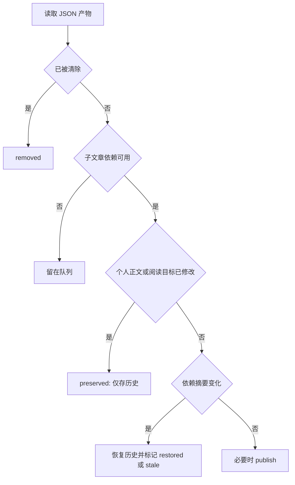

# 知识文章的文件导出、恢复与显式退役

该模块连接知识仓库与磁盘产物：把已审核文章稳定写成 JSON 和可阅读 Markdown，在启动时按依赖顺序恢复文章，并通过显式退役清单阻止已删除成果被旧文件重新带回。恢复过程区分 removed、preserved、stale、restored、rejected 和 missing，既保护个人修改，也避免把临时文件损坏误判为删除。

来源：gpt-5.6-sol 分析，gpt-5.6-sol 独立复核；模型解释仍可被原始证据纠正。

## 解决磁盘产物与仓库状态之间的同步问题

这个文件处在文件系统、知识合同与 `KnowledgeRepository` 的交界处。它接收结构化的知识文章，负责生成可携带的产物，也负责把已有产物恢复进仓库；文档结构由共享合同校验，版本与状态操作交给仓库实现。参考 [依赖边界 ↗](../../../apps/server/src/knowledge/artifacts.ts#L1 "说明模块直接依赖文件系统、共享知识合同和知识仓库，支持其作为磁盘产物与仓库之间适配层的定位。")

删除采用显式审计：只有 `.retirements.json` 中通过 schema 校验的条目才会清理文章保留记录、登记指定修订墓碑，并在当前文章已不存在时把页面标为 `retired`、关闭维护。文件缺失、导入失败或路径猜测都不会触发这条删除路径。参考 [显式退役处理 ↗](../../../apps/server/src/knowledge/artifacts.ts#L14 "支持退役清单的校验、保留记录清理、修订墓碑登记和页面维护关闭规则。")

## 一次发布如何生成可读和可恢复的文件

代表性调用是 `writeKnowledgeArticle(directory, article, materialHref)`。输入包含目标目录、已带生成与复核信息的文章，以及可选的材料链接解析器。函数先以文档 key 的摘要作为稳定文件名，再去掉仓库运行态字段 `current` 和 `revision`，输出同名 `.json` 与 `.md`；只有内容变化时才写盘，因此重复发布不会无条件改写文件。参考 [双格式产物写出 ↗](../../../apps/server/src/knowledge/artifacts.ts#L46 "支持稳定文件名、运行态字段剥离、JSON 与 Markdown 双输出以及内容相同时不重写。")

Markdown 渲染会把各节拼成带锚点的二级标题，并将正文中的 `[[引用键]]` 替换为链接。文章引用指向另一篇摘要命名的 Markdown，可附章节锚点；材料引用交给 `materialHref`，没有解析器时落到 `#source-evidence`。引用不存在时显示“引用不可用”，标签会去方括号，悬浮说明中的引号和换行也会被清理。参考 [Markdown 引用渲染 ↗](../../../apps/server/src/knowledge/artifacts.ts#L33 "支持章节拼接、引用占位符替换、链接回退和展示文本清理的说明。")

## 启动恢复的决策顺序与边界

恢复先应用退役清单，再读取目录中除退役清单外的 JSON。无法解析的文件记为 `rejected`，其余文件进入待处理队列；同时记录本次目录拥有的文档 key 与产物摘要。只要出现解析失败，就不会执行最终的导入归属对账，避免临时损坏导致原有文章被当作“目录中已删除”。参考 [恢复扫描与防误删 ↗](../../../apps/server/src/knowledge/artifacts.ts#L57 "支持先处理退役、读取 JSON、记录解析失败及仅在目录完全可解析时允许归属对账的前置条件。")

队列最多处理 100 轮，使子文章可以先于父文章恢复；一轮没有进展就停止，剩余项记为 `missing`。每个可处理产物还必须是版本 1、复核结论为 `accepted`，且生成与复核模型信息齐全，正文也必须通过合同校验。若现有页面含个人修改，导入物仅保存为历史；若材料或文章依赖摘要已变，则恢复后依据状态读取得出 `stale` 或 `restored`；其余新修订才发布为当前版本。最后记录每个文件的导入状态，条件允许时对账目录归属，并刷新仓库。参考 [依赖排序与恢复分支 ↗](../../../apps/server/src/knowledge/artifacts.ts#L71 "支持多轮依赖恢复、来源校验、个人修改保护、陈旧状态判断、导入记录、缺失结果和最终刷新流程。")
