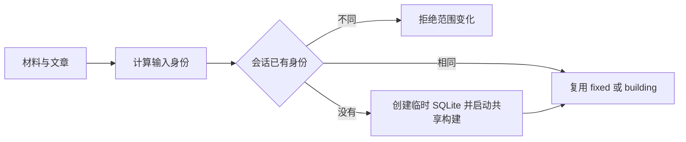

# 单次工作流的固定研究快照

ResearchSession 为一次知识研究工作流建立并复用固定的 SQLite 快照：它以材料与文章版本识别输入范围，合并同范围请求，并将单个调用方的等待取消与整个会话的构建中止分开处理。

来源：gpt-5.6-sol 分析，gpt-5.6-sol 独立复核；模型解释仍可被原始证据纠正。

## 为什么需要研究会话

`ResearchSession` 让一次工作流始终读取同一个固定视图，避免连续问题或正在运行的任务共享可变缓存。实例保存临时目录、已完成快照、输入身份、构建中的 Promise、关闭状态和会话级 `AbortController`；构造时只注入知识仓储。参考 [会话职责与内部状态 ↗](../../../apps/server/src/knowledge/research-session.ts#L1 "支持单工作流固定视图、会话保存的状态以及仓储注入方式。")

它用摘要模块判定输入范围是否相同，调用快照构建器写出研究数据，并从研究运行时、仓储和知识合同取得类型。这些是本文件直接呈现的模块关系；当前原件没有给出创建该类的上层入口。参考 [跨模块依赖 ↗](../../../apps/server/src/knowledge/research-session.ts#L6 "支持摘要、快照构建、研究快照、仓储和知识材料类型之间的直接代码依赖。")

## 一次 snapshot 调用如何完成

代表性入口是 `snapshot(materials, articles, signal)`。方法先拒绝已关闭的会话，并让已经取消的调用在改变会话状态前立即失败。随后，它把每份材料的 `key/revisionId/digest` 与每篇文章的文档键和修订版本分别排序，再计算稳定摘要。数组顺序不参与身份判定。参考 [输入检查与快照复用 ↗](../../../apps/server/src/knowledge/research-session.ts#L20 "支持关闭与预取消检查、输入身份组成、范围变化错误以及 fixed/building 复用逻辑。")

会话已有身份时，新摘要不同会抛出 `KNOWLEDGE_INPUT_CHANGED`；摘要相同则把已完成快照或正在构建的 Promise 交给 `wait`。首次调用会创建带专用前缀的系统临时目录，以其中的 `snapshot.sqlite` 为目标，将仓储、输入集合、文件路径、`includeUnanchoredState: true` 和会话级取消信号交给 `buildResearchSnapshot`。构建完成且会话仍开放时，结果包含新的随机快照身份、文件路径、两组输入的浅拷贝和构建耗时。参考 [输入检查与快照复用 ↗](../../../apps/server/src/knowledge/research-session.ts#L20 "支持关闭与预取消检查、输入身份组成、范围变化错误以及 fixed/building 复用逻辑。") [共享快照构建 ↗](../../../apps/server/src/knowledge/research-session.ts#L28 "支持临时 SQLite 路径、构建器参数、会话级取消信号和 ResearchSnapshot 返回结构。")

参考 [输入检查与快照复用 ↗](../../../apps/server/src/knowledge/research-session.ts#L20 "支持关闭与预取消检查、输入身份组成、范围变化错误以及 fixed/building 复用逻辑。") [共享快照构建 ↗](../../../apps/server/src/knowledge/research-session.ts#L28 "支持临时 SQLite 路径、构建器参数、会话级取消信号和 ResearchSnapshot 返回结构。")

## 调用取消与会话关闭

`wait` 没有收到调用方信号时直接等待原 Promise；收到信号时，它在共享 Promise 和一个取消 Promise 之间竞速，并在结束后移除事件监听器。构建器使用的是会话内部控制器的信号，因此某个调用方在等待期间取消，只会让该调用方的 `wait` 拒绝，不会中止共享构建。参考 [共享快照构建 ↗](../../../apps/server/src/knowledge/research-session.ts#L28 "支持临时 SQLite 路径、构建器参数、会话级取消信号和 ResearchSnapshot 返回结构。") [单次等待的取消处理 ↗](../../../apps/server/src/knowledge/research-session.ts#L37 "支持 wait 对调用方信号与共享 Promise 的竞速，以及事件监听器清理行为。")

例如，两个调用方复用同一个 `building` Promise，其中一个调用方取消后，另一个调用方仍可继续等待构建结果。这个例子说明的是代码中的隔离关系，不代表已经发生过一次实际运行。参考 [输入检查与快照复用 ↗](../../../apps/server/src/knowledge/research-session.ts#L20 "支持关闭与预取消检查、输入身份组成、范围变化错误以及 fixed/building 复用逻辑。") [单次等待的取消处理 ↗](../../../apps/server/src/knowledge/research-session.ts#L37 "支持 wait 对调用方信号与共享 Promise 的竞速，以及事件监听器清理行为。")

`close()` 会把会话标为关闭，用 `Research session has ended` 错误中止会话级控制器，再递归强制删除临时目录。正在进行的构建会收到该中止信号；如果构建器仍然返回，完成回调中的关闭检查也会阻止交付快照。此后再调用 `snapshot` 会在入口处立即失败。参考 [共享快照构建 ↗](../../../apps/server/src/knowledge/research-session.ts#L28 "支持临时 SQLite 路径、构建器参数、会话级取消信号和 ResearchSnapshot 返回结构。") [关闭与资源清理 ↗](../../../apps/server/src/knowledge/research-session.ts#L48 "支持关闭标志、会话级构建中止和临时目录删除行为。")

输入身份在首次启动构建前写入，代码没有在构建失败后清空 `identity` 或 `building`。因此，同一输入的后续调用仍会取得原来的 Promise，换一组输入则触发范围变化错误。参考 [输入检查与快照复用 ↗](../../../apps/server/src/knowledge/research-session.ts#L20 "支持关闭与预取消检查、输入身份组成、范围变化错误以及 fixed/building 复用逻辑。") [共享快照构建 ↗](../../../apps/server/src/knowledge/research-session.ts#L28 "支持临时 SQLite 路径、构建器参数、会话级取消信号和 ResearchSnapshot 返回结构。")
