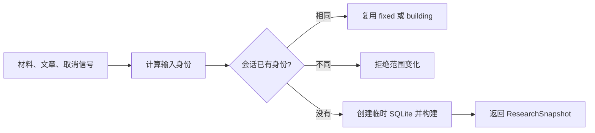

# 单次工作流的固定研究快照

ResearchSession 为一次知识研究工作流建立并复用固定的 SQLite 快照：它用材料与文章版本计算输入身份，合并同范围的并发请求，拒绝会话中的范围漂移，并在关闭时删除临时目录。

来源：gpt-5.6-sol 分析，gpt-5.6-sol 独立复核；模型解释仍可被原始证据纠正。

## 为什么需要研究会话

`ResearchSession` 保证一次工作流只观察一个固定视图，避免连续问题或正在运行的任务共享可变缓存。实例保存临时目录、已完成快照、输入身份、构建中的 Promise 和关闭状态；构造时只注入知识仓储。参考 [会话职责与状态 ↗](../../../apps/server/src/knowledge/research-session.ts#L1 "支持单工作流固定视图、会话内部状态以及仓储注入方式的说明。")

它依赖摘要模块判定输入是否相同，调用快照构建器写出研究数据，并从研究运行时、仓储和知识合同取得类型。这些是本文件能够确认的模块关系；当前材料没有给出创建该类的上层入口。参考 [跨模块依赖 ↗](../../../apps/server/src/knowledge/research-session.ts#L6 "支持摘要、快照构建、研究快照、仓储和知识材料类型之间的直接代码依赖。")

## 一次 snapshot 调用如何完成

代表性调用是 `snapshot(materials, articles, signal)`。方法先把每份材料的 `key/revisionId/digest` 与每篇文章的文档键和版本排序后求稳定摘要。会话已有身份时，新摘要不同就抛出 `KNOWLEDGE_INPUT_CHANGED`；相同则返回完成的快照，或复用仍在构建的 Promise，因此同范围并发调用不会重复创建快照。参考 [身份检查与并发复用 ↗](../../../apps/server/src/knowledge/research-session.ts#L19 "支持输入身份的组成、范围变化错误以及 fixed/building 复用逻辑。")

参考 [身份检查与并发复用 ↗](../../../apps/server/src/knowledge/research-session.ts#L19 "支持输入身份的组成、范围变化错误以及 fixed/building 复用逻辑。") [临时快照构建 ↗](../../../apps/server/src/knowledge/research-session.ts#L26 "支持临时 SQLite 路径、构建器参数、关闭检查和 ResearchSnapshot 返回结构。")

首次调用会创建带专用前缀的系统临时目录，将目标设为 `snapshot.sqlite`，再把仓储、输入集合、文件路径、`includeUnanchoredState: true` 和取消信号交给 `buildResearchSnapshot`。构建完成且会话仍开放时，返回值包含新的随机快照身份、文件路径、两组输入的浅拷贝以及构建耗时。参考 [临时快照构建 ↗](../../../apps/server/src/knowledge/research-session.ts#L26 "支持临时 SQLite 路径、构建器参数、关闭检查和 ResearchSnapshot 返回结构。")

## 生命周期与边界条件

`close()` 先把会话标为关闭，再以递归且强制的方式删除临时目录；未创建目录时只更新状态。关闭后再次请求快照会立即失败，构建期间关闭则会让完成回调拒绝交付结果。参考 [会话关闭清理 ↗](../../../apps/server/src/knowledge/research-session.ts#L35 "支持关闭标志设置以及临时目录的递归强制删除行为。") [关闭状态检查 ↗](../../../apps/server/src/knowledge/research-session.ts#L19 "支持关闭后的 snapshot 调用会抛错，以及构建完成时再次检查关闭状态。")

输入身份一旦在首次构建前写入，代码没有在构建失败后清空它：同一输入的后续调用仍取得原来的 `building` Promise，换一组输入则触发范围变化错误。材料输入的身份只取键、修订 ID 和摘要，文章输入只取文档键和修订；数组顺序因排序而不参与身份判定。参考 [身份检查与并发复用 ↗](../../../apps/server/src/knowledge/research-session.ts#L19 "支持输入身份的组成、范围变化错误以及 fixed/building 复用逻辑。") [临时快照构建 ↗](../../../apps/server/src/knowledge/research-session.ts#L26 "支持临时 SQLite 路径、构建器参数、关闭检查和 ResearchSnapshot 返回结构。")
