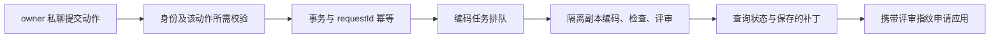

# 需求跟进、持续理解与开发任务的受控编排

AssistantWork 把项目持续理解和需求跟进放在同一协调边界，也连接个人行动、仓库准备与编码交付，并接入消息采集和定时安排。经 apply 或 applyRequested 提交的 WorkAction 只接受 owner 私聊。除 maintain_context 外，经 apply 提交且携带 delegation 的动作还会核对当前消息里的交办原话，并按操作分支核对对应动词；maintain_context 走 applyRequested 路径，先做独立交办判断，再进入事务。其他动作按各自分支校验本人原话、页面版本或评审指纹。成功处理的这些动作保存幂等回执；编码结果明确区分隔离副本、已评审版本与是否已应用。知识页发布后，服务比较前后需求状态，并对真实变化和阻塞决策去重通知。

来源：gpt-5.6-sol 分析，gpt-5.6-sol 独立复核；模型解释仍可被原始证据纠正。

## 解决什么问题：把身份授权与操作校验分层

`AssistantWork` 把项目理解和需求跟进放在同一协调边界，也连接个人行动，并涵盖仓库准备与编码交付，同时接入消息采集和定时安排。它提供当前状态的只读入口；用户动作经 `apply` 或 `applyRequested` 提交并处理后，会返回持久回执。模型生成的方向、材料内容或快速判断分数本身不构成操作权限。参考 [协调器职责与持久状态 ↗](../../../apps/server/src/assistant/work.ts#L148 "说明 AssistantWork 连接能力回执、行动关联、仓库准备、编码处理和可选的定时能力，并创建关注、反馈、回执及通知状态。")、[写操作入口与请求幂等 ↗](../../../apps/server/src/assistant/work.ts#L627 "支持 schema 解析、授权检查、事务执行，以及同一 requestId 仅在动作与操作者摘要相同时返回既有回执。")、[持续理解的独立交办判断 ↗](../../../apps/server/src/assistant/work.ts#L632 "说明 maintain_context 必须走 applyRequested，核对本人原话并通过独立判断后才进入事务。")、[统一状态目录 ↗](../../../apps/server/src/assistant/work.ts#L385 "说明目录汇总需求跟进、项目、编码记录、仓库准备、能力状态、消息采集健康度和定时安排。")

调用方通过 `apply` 提交动作时，第一层门槛对所有 `WorkAction` 都相同：操作者必须是 `owner`，会话必须是私聊。`maintain_context` 会在这个入口被直接拒绝。除它以外，第二层只处理结构中带有 `delegation` 的动作：`assertWorkDelegation` 要求交办引文出现在当前消息中，并按具体操作核对对应动词。否定检查由各分支按源码列出的模式执行。仓库准备、项目配置和开始开发各有自己的模式；通用分支覆盖继续/恢复/重试、应用/合入/放回，以及跟进/关注/待办。该模式不能用于推断它会拦截“不要取消开发”，而且 `unfollow_action` 显式跳过通用否定检查。参考 [分层授权与按分支校验 ↗](../../../apps/server/src/assistant/work.ts#L54 "说明 apply 先要求 owner 私聊；maintain_context 在此入口直接被拒绝，其余携带 delegation 的动作按分支校验当前消息中的引文、对应动词及源码明确列出的否定模式。")

消息采集和定时动作同样要求本人私聊及当前消息中的交办引文，还要出现设置或运行这类动词。开启采集、订阅、自动关注、定时任务或恢复运行时，会额外检查否定表达；通过后才交给相应能力执行并保存回执。参考 [采集与定时操作授权 ↗](../../../apps/server/src/assistant/work.ts#L64 "说明会话采集和定时动作需要明确动词，并在开启类操作中检查否定表达。")、[采集与定时动作执行回执 ↗](../../../apps/server/src/assistant/work.ts#L672 "说明能力可用时执行相应动作，保存请求回执后返回结果。")

`maintain_context` 是单独入口。直接调用 `apply` 会在授权检查阶段拒绝它；`applyRequested` 会核对本人私聊和交办原话，再读取指定项目的当前理解与维护状态，调用独立判断并校验判断结果，最后才进入事务。返回消息会区分暂停、刷新或开启持续整理，也会明确排队尚未表示内容已经更新。参考 [持续理解的独立交办判断 ↗](../../../apps/server/src/assistant/work.ts#L632 "说明 maintain_context 必须走 applyRequested，核对本人原话并通过独立判断后才进入事务。")

除 `delegation` 校验外，各动作还有自己的保护条件。回答问题要求答案逐字来自当前本人消息，且问题仍开放；行动项关联使用需求页的 `expectedRevision`，防止基于旧页面修改。反馈及撤销、范围调整，以及暂停和恢复或刷新都会先校验 `expectedVersion`，通过后再执行对应分支。反馈还检查文本来自当前消息，关注类反馈要求给出调整内容，撤销反馈要求目标仍可撤销。`scope` 保存请求给出的上下文和材料键，并合并仍活跃的纠正材料；恢复和刷新会安排重新调查。参考 [回答必须来自本人原话 ↗](../../../apps/server/src/assistant/work.ts#L823 "说明 answer_question 校验回答原话和问题当前状态。")、[行动项修订保护 ↗](../../../apps/server/src/assistant/work.ts#L791 "支持行动项关联前校验 expectedRevision，防止基于过期需求页修改。")、[需求操作的版本门槛与分支行为 ↗](../../../apps/server/src/assistant/work.ts#L856 "支持需求操作统一校验 expectedVersion，再按反馈、范围或维护状态分支处理。")

## 代表性调用：从明确交办到可核验开发结果

以 `start_development` 为例，调用方传入 `WorkAction` 与 `WorkActor`，后者包含请求 ID、用户原话和会话身份。`apply` 先做 schema 解析和授权检查，再进入事务；同一个 `requestId` 会用动作与操作者的完整摘要做幂等检查，摘要相同则返回旧回执，不同则拒绝。动作成功处理后会保存回执。这里的保证针对经写操作入口处理的动作，不涵盖发布回调等内部更新。参考 [写操作入口与请求幂等 ↗](../../../apps/server/src/assistant/work.ts#L627 "支持 schema 解析、授权检查、事务执行，以及同一 requestId 仅在动作与操作者摘要相同时返回既有回执。")、[动作回执持久化 ↗](../../../apps/server/src/assistant/work.ts#L965 "说明需求分支完成后统一写入回执并返回。")

通过校验后，`start_development` 确认需求页存在，可选地保存项目配置，然后把需求键、项目、操作者、能力和输入回执交给编码流程；即时回执只表示已经交办，当前尚未完成。参考 [编码任务入队 ↗](../../../apps/server/src/assistant/work.ts#L752 "支持 start_development 校验需求、保存可选配置、交给编码流程并返回尚未完成的回执。")

参考 [写操作入口与请求幂等 ↗](../../../apps/server/src/assistant/work.ts#L627 "支持 schema 解析、授权检查、事务执行，以及同一 requestId 仅在动作与操作者摘要相同时返回既有回执。")、[编码任务入队 ↗](../../../apps/server/src/assistant/work.ts#L752 "支持 start_development 校验需求、保存可选配置、交给编码流程并返回尚未完成的回执。")、[继续与应用编码结果 ↗](../../../apps/server/src/assistant/work.ts#L773 "支持 resume 和 apply 都进入继续处理接口，且应用时传递 reviewedFingerprint。")

后续状态会显示任务阶段，并列出检查与评审结果、变更计划和交付位置，同时明确 `ready` 仍位于隔离副本，登记仓库尚未改变。参考 [隔离副本交付语义 ↗](../../../apps/server/src/assistant/work.ts#L300 "支持状态输出区分任务阶段、检查、评审、隔离副本和是否已应用。") `result` 读取保存的评审补丁并重新计算当前副本指纹；`matchesReviewed` 为 `false` 或 `null` 时，不能声称当前文件仍是已评审版本。申请 `apply_development` 时，该评审指纹会传入继续处理接口。参考 [补丁与评审指纹核验 ↗](../../../apps/server/src/assistant/work.ts#L338 "支持读取已保存补丁、重新计算当前副本指纹，并说明不匹配时不能声称仍是已评审版本。")、[继续与应用编码结果 ↗](../../../apps/server/src/assistant/work.ts#L773 "支持 resume 和 apply 都进入继续处理接口，且应用时传递 reviewedFingerprint。")

## 边界条件：仓库范围、并发、反馈与通知

仓库准备不会自行扩大代码读取范围：若 URL 或非 `HEAD` 版本不同于已知配置，它们必须逐字出现在本人消息中；该动作只排队读取指定版本，不代表编码、安装依赖或推送。参考 [仓库读取范围约束 ↗](../../../apps/server/src/assistant/work.ts#L698 "支持新 URL 和指定版本必须来自本人原话，且仓库准备只表示后台读取。") 对需求页的可变操作采用乐观并发控制：行动项用 `expectedRevision`；反馈、撤销反馈和范围调整，以及暂停、恢复与刷新等操作用 `expectedVersion`。状态过期就要求重新读取。纠正类反馈会保存为新的原始材料，关注类反馈会更新关注策略；范围、维护状态与重新调查则在通过版本门槛后按各自分支处理。参考 [行动项修订保护 ↗](../../../apps/server/src/assistant/work.ts#L791 "支持行动项关联前校验 expectedRevision，防止基于过期需求页修改。")、[需求操作的版本门槛与分支行为 ↗](../../../apps/server/src/assistant/work.ts#L856 "支持需求操作统一校验 expectedVersion，再按反馈、范围或维护状态分支处理。")

知识页发布后的通知与写操作回执分属两条流程。当前版本、需求结构和自动维护同时满足条件，才会进入发布通知；服务比较前后需求状态，记录目标与非目标，以及验收项或行动项的真实变化，并排队通知本人。状态摘要完全相同就直接返回；通知策略为 `all` 时，即使细分变化列表为空，也会用文章摘要作为变化内容。参考 [需求变更通知 ↗](../../../apps/server/src/assistant/work.ts#L998 "支持发布时的前置条件、前后状态比较、变化持久化和本人通知。")

需要本人选择的阻塞决策先从状态结果中选取；状态结果只保留仍开放的问题，随后又筛选标记为 `decision` 且 `blocking` 的条目。系统用这些问题的 `id`、`question` 和 `why` 计算去重签名；签名相同便停止处理，因此只有 `nextStep` 变化不会触发新提醒。签名变化且仍有问题时，一次通知最多发送前三项。参考 [开放问题状态过滤 ↗](../../../apps/server/src/assistant/work.ts#L255 "支持状态结果只保留当前仍为 open 的问题，再为其补齐问题类型和阻塞标记。")、[阻塞决策签名去重 ↗](../../../apps/server/src/assistant/work.ts#L1091 "支持只处理标记为 decision 且 blocking 的状态问题，以 id、question 和 why 计算签名去重，并在签名变化且问题非空时一次最多发送前三项。")
