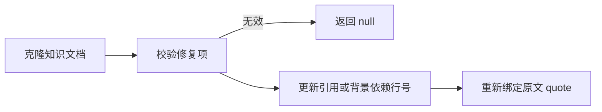

# 引用行号修复与局部复核摘录

该模块接收独立复核给出的精确行号调整，在不改正文、引用来源和关系的前提下修复材料引用及章节背景依赖；它还从完整知识文档中裁出受影响章节与这些章节实际使用的引用，供下一轮局部复核。

来源：gpt-5.6-sol 分析，gpt-5.6-sol 独立复核；模型解释仍可被原始证据纠正。

## 只修复复核指定的定位范围

该模块解决知识稿件证据行号不准、又不需要重写论断的场景。`RangeRepair` 直接取自复核结论的类型；`repairCitationRanges` 接收知识文档、修复项和材料表，先克隆文档，再在副本上操作。注释明确限定宿主只能修改独立复核指定的精确范围，新增论断、来源或关系仍要走正常写作流程。参考 [精确范围修复约束 ↗](../../../apps/server/src/knowledge/citation-repair.ts#L4 "支持模块只允许修改独立复核指定范围、先克隆文档再处理的说明。")

它依赖知识契约中的文档、材料和复核类型，并把修复后的文档交给仓储层重新绑定原文 quote；这两项是目标文件能够直接确认的跨模块关系。参考 [契约与仓储依赖 ↗](../../../apps/server/src/knowledge/citation-repair.ts#L1 "支持该文件使用知识契约类型并依赖仓储层 quote 绑定函数的跨模块关系。")

## 校验、改行号并重新绑定原文

代表性调用可以这样理解：文档中已有材料引用 `c1`，复核要求把它改到新的起止行，材料表提供对应材料。函数按引用键找到原引用，只接受材料型目标，并校验修复键未重复、引用与材料存在、行号为整数、顺序和边界有效，同时要求材料正文非空；任一条件失败就返回 `null`。通过后只更新副本中的起止行。参考 [材料引用校验流程 ↗](../../../apps/server/src/knowledge/citation-repair.ts#L12 "支持材料引用的查找、合法性检查及起止行更新流程。")

章节 `reviewSources` 还必须由章节键、材料键及旧起止行唯一定位。没有实际变化、没有处理任何修复项也会返回 `null`；成功路径调用 `bindKnowledgeQuotes`，因此输出是行号与 quote 同步后的新文档，原输入不被改写。参考 [背景依赖修复与输出 ↗](../../../apps/server/src/knowledge/citation-repair.ts#L22 "支持背景依赖的唯一旧范围匹配、无变化拒绝及成功后重新绑定 quote。")

## 为下一轮复核裁出相关章节

`citationReviewExcerpt` 接收文档、引用键列表和可选章节键。它保留显式点名的章节，以及正文中包含目标引用标记的章节；随后从这些正文提取所有双方括号形式的引用键，只保留实际出现的引用定义。输出沿用文档其他字段，但 `sections` 与 `citations` 已缩小到复核所需范围。参考 [局部复核摘录 ↗](../../../apps/server/src/knowledge/citation-repair.ts#L39 "支持按章节或引用标记筛选章节，并按正文实际标记筛选引用定义的行为及边界。")

一个边界是：传入的引用键若未出现在任何章节正文中，不会凭空带入引用定义；显式选中的章节里若还使用其他引用，这些引用会随章节一起保留。该函数只缩小待复核稿件，固定原始材料仍由相同研究工具提供。参考 [局部复核摘录 ↗](../../../apps/server/src/knowledge/citation-repair.ts#L39 "支持按章节或引用标记筛选章节，并按正文实际标记筛选引用定义的行为及边界。")
