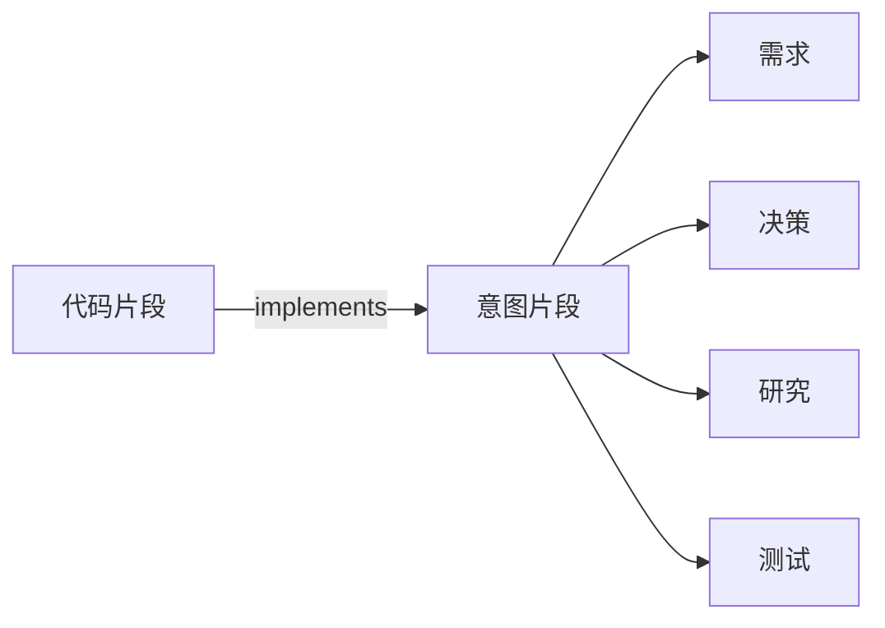

# 仓库评审数据的隔离存储与证据关系追踪

仓库评审复用 omem 的 Store、捕获和检索基础，但使用独立运行目录；文件以路径维持稳定身份，旧快照保留为不可变历史，代码与需求、决策、研究和测试之间通过可失效的确定性关系连接。当前实现仍有两个需要行为测试确认的边界：空 seed 集合不会触发旧关系失效，代码路径查询也没有实际应用已构造的目标端过滤条件。

来源：gpt-5.6-sol 分析，gpt-5.6-sol 独立复核；模型解释仍可被原始证据纠正。

## 隔离评审数据，同时复用通用存储

repo-review 面向仓库代码评审，复用 omem 的 Store、捕获和检索基础，但数据库与状态位于仓库自己的运行目录，不接触个人工作区的 SQLite 或状态，也不读取密钥和运行无关 worker。参考 [评审存储隔离边界 ↗](../../../apps/server/src/review/store.ts#L1 "支持 repo-review 复用通用捕获和检索能力，同时隔离个人数据库、worker 与密钥的说明。")

`createReviewStore` 将 Store 绑定到 `.repo-review/runtime/data`。默认启动不依赖旧数据目录；只有 `REVIEW_IMPORT_LEGACY` 等于 `1` 时，才会先导入旧历史。参考 [评审 Store 创建入口 ↗](../../../apps/server/src/review/store.ts#L100 "支持 Store 绑定独立运行目录，以及只在显式环境开关下导入旧历史的结论。")

导入仅在运行数据库尚不存在且旧数据库存在时执行。它把数据库及 WAL、SHM 文件复制到临时目录，再通过 `VACUUM INTO` 生成一致快照；失败时清理不完整的运行数据库，旧档案保持不变。随后，已有的同步状态、迁移标记和资源文件也会投影到运行目录。参考 [一致快照导入 ↗](../../../apps/server/src/review/store.ts#L51 "支持导入前置条件、临时复制、一致快照、失败清理以及状态和资源投影流程。")

## 稳定文件身份与历史迁移

文件来源使用 `omem:<仓库相对路径>` 作为稳定身份。同一路径内容变化时累积 revision，内容相同但路径不同的文件仍属于不同来源。评审侧表记录删除、移动、迁移和旧来源别名；检索可读取删除标记，用于默认排除已删除证据。参考 [路径稳定身份 ↗](../../../apps/server/src/review/store.ts#L29 "支持同一路径跨内容修改累积 revision、不同路径保持独立来源的身份规则。") [来源状态元数据 ↗](../../../apps/server/src/review/store.ts#L115 "支持删除、移动、迁移和旧来源别名由评审侧表维护的说明。") [删除来源过滤集合 ↗](../../../apps/server/src/review/store.ts#L227 "支持读取已删除来源集合以供检索排除旧证据。")

旧内容哈希来源迁移时，系统从每个来源的最新 revision 正文中读取 `context.filePath`，按路径分组。正文无法解析或缺少该路径的来源不会进入迁移分组。参考 [旧来源分组 ↗](../../../apps/server/src/review/store.ts#L290 "支持从最新 revision 提取文件路径并分组，以及忽略无法取得路径的来源。")

若路径身份尚不存在，系统按 revision 版本和创建时间选出最新快照，让它取得路径身份；同组其余旧来源会清除当前 head 并登记为该路径的历史别名。若路径身份已经存在，所有对应旧来源都按历史别名处理。这个降级过程不删除 revision 或 fragment。参考 [路径身份选择与迁移 ↗](../../../apps/server/src/review/store.ts#L332 "支持选择最新快照取得路径身份，并将其余旧来源降为历史别名的流程。") [历史来源降级 ↗](../../../apps/server/src/review/store.ts#L246 "支持降级操作只清除当前 head、记录路径别名，并保留 revision 与 fragment。")

迁移完成后会写入标记。后续运行通常直接返回；若仍有内容哈希身份关联着当前 head，系统会再次扫描。参考 [迁移标记与快速返回 ↗](../../../apps/server/src/review/store.ts#L269 "支持迁移标记避免常规重复扫描，同时允许异常遗留的活动旧来源再次迁移。")

## 从代码追到需求、决策与测试

评审关系保存 `implements`、`requires`、`decided_by`、`researched_by`、`tested_by` 和 `candidate_for` 等正向类型，反向名称在查询时派生。关系 ID 由 seed 身份确定，重复同步会更新同一行；缺少 `seed_identity` 的旧派生表可以重建。参考 [关系类型与反向名称 ↗](../../../apps/server/src/review/store.ts#L375 "支持评审关系保存正向类型，并在反向查询时派生名称。") [确定性关系写入 ↗](../../../apps/server/src/review/store.ts#L416 "支持旧派生表重建、关系 ID 由 seed 身份确定，以及重复同步幂等更新。")

代码路径查询先取得文件当前 revision 的片段及其出边，再沿 `implements` 到达意图片段，并补充这些意图片段的一层出边。查询因此提供代码到背景证据的两层追踪链，遍历深度到此为止。参考 [代码路径追踪与过滤实现 ↗](../../../apps/server/src/review/store.ts#L699 "支持两层代码证据追踪流程，也支持目标端条件虽被构造却未用于最终 SQL 的边界判断。")

## 关系过期规则与待确认边界

读取单个片段的关系时，系统同时检查存储状态、另一端是否仍属于来源当前 head，以及另一端来源是否已删除。数据库中的关系即使仍为 `confirmed`，另一端过期或被删除后，对外的 `relationStatus` 也会变为 `stale`；默认查询过滤这类关系，但保留无法解析另一端的 `missing` 关系。参考 [关系有效状态计算 ↗](../../../apps/server/src/review/store.ts#L525 "支持依据另一端当前性与删除状态计算有效状态，以及片段查询默认过滤 stale、保留 missing 的行为。")

同步前的失效函数会检查关系两端。任一非空端点不再属于当前 revision、来源没有 head，或另一端来源已删除时，关系会被标为 `stale`；未解析的空端点保持原状态，等待重建处理。参考 [同步前关系失效 ↗](../../../apps/server/src/review/store.ts#L772 "支持关系任一端失去当前性或来源被删除时标记 stale，并保留未解析空端点的规则。")

当前实现有两个需要行为测试确认的边界。`invalidateRemovedSeeds` 收到空的有效 seed 集合时直接返回，因此该函数不会把现存的 seed 派生关系标为 `stale`。参考 [空 seed 集合分支 ↗](../../../apps/server/src/review/store.ts#L504 "支持有效 seed 集合为空时 removed-seed 失效函数直接返回的边界判断。")

`relationsForCodePath` 构造了包含目标端当前性和删除状态的 `where` 条件数组，但最终 SQL 没有使用该数组。实际查询在默认模式下直接限制代码源为当前 head，并过滤存储状态为 `stale` 的行；映射结果后也没有再按有效 `relationStatus` 过滤。因此，目标端已过期或已删除、但存储状态仍未失效的关系仍可能出现在默认结果中。参考 [代码路径追踪与过滤实现 ↗](../../../apps/server/src/review/store.ts#L699 "支持两层代码证据追踪流程，也支持目标端条件虽被构造却未用于最终 SQL 的边界判断。")
