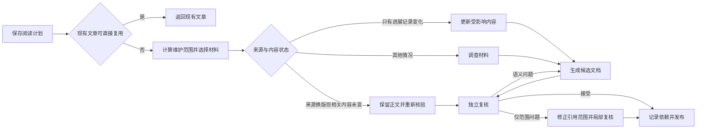

# 可信知识生成与发布流水线

KnowledgePipeline 把固定版本的原始材料组织成可发布知识。它负责目录提议和材料导航说明，也负责逐材料分析及按阅读目标写页，并在同一编排层检查原件版本、运行持久角色，再校验输出和执行独立复核，必要时修复局部引用后发布。页面维护还能在来源换版但相关内容未变时保留正文，或只更新受影响的进展信息。

来源：gpt-5.6-sol 分析，gpt-5.6-sol 独立复核；模型解释仍可被原始证据纠正。

## 解决的问题与入口

KnowledgePipeline 把固定版本的原始材料变成可追踪的知识产物。它目前承接四类入口。`proposeOutline` 调查读者选定的完整范围，返回可编辑的页面候选，但不保存正式页面计划；可延续的既有页面也必须落在所选材料范围内。`describeMaterials` 为没有用户说明覆盖的材料生成并保存导航元数据。`analyze` 逐份材料生成或刷新知识文档，`writePage` 则按既定阅读目标组织并发布页面。参考 [目录提议入口 ↗](../../../apps/server/src/knowledge/pipeline.ts#L71 "支持目录提议会调查选定范围、筛选可延续页面并返回可编辑候选，而不保存正式页面计划。")、[材料导航说明入口 ↗](../../../apps/server/src/knowledge/pipeline.ts#L106 "支持为未由用户说明覆盖的材料生成、校验并保存导航元数据。")、[逐材料分析与刷新 ↗](../../../apps/server/src/knowledge/pipeline.ts#L416 "支持待处理材料筛选、独立批次、补充上下文、来源绑定刷新、历史反馈使用和受限并发。")、[页面状态与复用条件 ↗](../../../apps/server/src/knowledge/pipeline.ts#L453 "支持 writePage 的计划保存、状态变化，以及现有文章的直接复用条件。")

`analyze` 会先刷新仓储视图，只处理没有当前文章，或在原生研究模式下分析角色版本、复核角色版本已经变化的材料。每个目标单独成批，批内先放目标原件，再合入已保存的回答和调用方提供的补充材料；原生研究模式还会把其余仓储材料加入可调查范围。合格旧文可以先尝试把来源绑定更新到当前版本，其余情况带着可用的旧稿或历史反馈进入写作与复核。并发只限制处理成本，最终依赖仍按实际引用记录。参考 [逐材料分析与刷新 ↗](../../../apps/server/src/knowledge/pipeline.ts#L416 "支持待处理材料筛选、独立批次、补充上下文、来源绑定刷新、历史反馈使用和受限并发。")

材料分析角色由材料形态决定。含图片时使用视觉分析，聊天或会话来源使用会话分析，代码扩展名使用代码分析，其余交给通用材料分析。参考 [材料分析角色选择 ↗](../../../apps/server/src/knowledge/pipeline.ts#L30 "支持按图片、会话来源和代码扩展名选择分析角色。")

## 一次页面写作如何完成

`writePage(brief)` 的输入描述页面身份、读者目标和材料选择。方法先保存计划并把页面标为 `writing`，成功后标为 `published`，异常则记录 `failed`。只有没有 `retryTag`，现有文章仍是当前版本，并且阅读计划与 `writerVersion` 均相同；使用 `contextIds` 选材时，`materialKeys` 也必须相同，才会直接复用现有文章。参考 [页面状态与复用条件 ↗](../../../apps/server/src/knowledge/pipeline.ts#L453 "支持 writePage 的计划保存、状态变化，以及现有文章的直接复用条件。")

原生研究模式先把选定材料作为完整可读范围，并只提供该范围允许引用的既有文章。若已有页面的选材和阅读字段没有变化、写作者版本也一致，且当前原件中相关语法与引用上下文保持不变，流水线会保留正文并独立检查新版本绑定。若变化只涉及已保存的执行进展，则沿用原解释，只更新实际进度和受影响的行动。其余情况交给研究角色；只有研究结果标记为就绪且没有遗留请求，才进入写作。参考 [原生页面维护与调查 ↗](../../../apps/server/src/knowledge/pipeline.ts#L481 "支持原生模式的文章范围、来源换版正文保留、仅进展变化维护分支，以及研究完成条件。")

受限上下文模式会预读材料变化范围、新增材料和仍可复用的旧引用。没有初始证据时先搜索，仍无结果才读取最多三份材料的开头。研究最多运行三轮，末轮提出的读取请求仍会执行，因此写作者和复核者能看到最后取回的材料。参考 [受限上下文调查 ↗](../../../apps/server/src/knowledge/pipeline.ts#L509 "支持变更范围预读、初始搜索与兜底读取、最多三轮研究及末轮请求执行。")

## 发布门禁、恢复与模块协作

`runRole` 在角色执行前和读取结果时检查原件仍是来源的当前版本。角色通过持久作业队列和 `RoleRuntimeGateway` 运行；已经成功的作业可复用，失败、取消或需要用户处理的作业会停止本次流程。原生研究还把同一次工作流的读取固定在一致的研究会话中，局部引用复核只开放读取既有引用与背景范围所需的工具和材料。参考 [持久角色执行 ↗](../../../apps/server/src/knowledge/pipeline.ts#L178 "支持原件版本检查、成功作业复用、网关运行、局部复核读取限制、结果保存和中断处理。")

模型输出通过 `checkBatch` 后才能进入复核。文档键必须与目标一一对应；跟进类页面必须给出结构化验收项和行动项，其证据只能指向原件引用。随后系统绑定精确引文并校验文档，材料引用及 `reviewSources` 还必须落在本轮实际提供的范围内。参考 [候选文档校验 ↗](../../../apps/server/src/knowledge/pipeline.ts#L236 "支持目标键、跟进事项证据、精确引文绑定、引用可见范围和背景复核来源校验。")

写作与复核循环会再次检查阅读计划没有变化。带 `workflow` 的页面最多复核两轮，其余流程最多四轮；多文档批次允许已接受项先发布，仍被拒的目标继续修订。若问题只涉及已有引用或背景依赖的行范围，系统直接修正范围，下一轮只检查相关摘录。研究结论要求重写时，维护流程会放弃旧结构，但仍保留文章身份与历史。轮次耗尽后，流程抛出语义复核错误。参考 [独立复核与发布循环 ↗](../../../apps/server/src/knowledge/pipeline.ts#L266 "支持旧结构退出条件、阅读计划复查、复核轮次、接受项发布、语义修订和引用范围局部复核。")

重试时，`previousFeedback` 只复用与当前阅读目标及维护版本匹配的反馈；研究结构、材料版本与文章版本也必须匹配。局部引用复核保存的是章节摘录，恢复时会沿持久父复核链重建完整候选稿；来源换版复核则从指定旧版本重新绑定当前材料。这样可以继续处理准确的旧反馈，同时避免把旧批次中已经缺失的上下文带入新稿。参考 [历史反馈恢复 ↗](../../../apps/server/src/knowledge/pipeline.ts#L370 "支持按当前阅读与依赖版本筛选反馈，并从父复核链或来源换版记录恢复完整候选稿。")

文件顶部的依赖展示了模块分工。仓储负责材料和计划，也负责依赖与发布，角色网关负责模型运行，持久 worker 负责作业生命周期，研究组件负责证据选取，合同 schema 与引用修复组件负责输出门禁。上述编排集中在 KnowledgePipeline 中。参考 [流水线依赖边界 ↗](../../../apps/server/src/knowledge/pipeline.ts#L1 "支持仓储、角色运行、持久作业、研究、来源刷新和引用修复组件的职责关系。")
