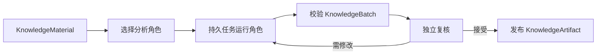

# 可信知识生成与发布管线

KnowledgePipeline 从材料分类开始，经角色执行和结构校验进入独立复核，再处理引用范围修复并发布知识产物；它同时支持按材料自动分析与按阅读目标生成页面。

来源：gpt-5.6-sol 分析，gpt-5.6-sol 独立复核；模型解释仍可被原始证据纠正。

## 它解决什么问题

这条管线负责把固定材料整理成可发布、可追溯的知识产物。按材料自动分析时，`analystFor` 会先看是否有图片或来自会话，再用代码扩展名判断；它由此选择视觉或会话角色，也可能选择代码或通用材料分析角色。`nativeResearch` 可显式配置，未配置时由 ACP transport 自动启用。参考 [分析角色与调查模式 ↗](../../../apps/server/src/knowledge/pipeline.ts#L26 "支持按材料类型选择分析角色，并说明原生调查模式的默认判定。")

对读者页面，`writePage` 先保存阅读计划并把状态置为 `writing`，成功后标记为 `published`，失败则记录错误。规划阶段还会按普通知识页或需求跟进页选择不同的研究者和写作者，并在阅读目标、角色版本与材料选择均未变化时直接复用当前文章。参考 [页面状态与角色选择 ↗](../../../apps/server/src/knowledge/pipeline.ts#L398 "支持页面写入状态变化、研究写作角色分流及未变化文章复用。")

## 一条代表性调用如何完成发布

以 `analyze([material])` 为例，输入是一组 `KnowledgeMaterial`。方法先排除仍可复用的当前文章，再把每份待处理材料单独成批；它加入已回答问题对应的材料和调用方补充材料，并在原生调查模式下开放仓库内材料，随后选择分析角色并调用 `writeAndVerify`。返回值汇总输入总数、复用数和逐项失败信息。参考 [自动分析入口 ↗](../../../apps/server/src/knowledge/pipeline.ts#L366 "支持代表性 analyze 调用的待处理筛选、单材料批次、补充上下文和返回摘要。")

每次角色运行都会加载角色包，将任务与材料版本写入持久任务，再由 `DurableJobWorker` 调用运行时网关；模型输出及 trace 保存后才作为结果读取。参考 [持久角色执行 ↗](../../../apps/server/src/knowledge/pipeline.ts#L155 "支持角色包加载、任务入队、运行时网关调用、输出与 trace 持久化，以及运行前和结果读取时的原件一致性核对。") 输出进入下一阶段前，`checkBatch` 校验文档键和需求证据，同时检查引用对象及可见行范围，并绑定引用原文。参考 [候选文档校验 ↗](../../../apps/server/src/knowledge/pipeline.ts#L196 "支持批次键、结构化需求证据、引用对象与材料可见范围的校验。")

## 复核、修复与一致性边界

`writeAndVerify` 先写候选稿，再调用独立的 `knowledge-verifier`。复核拒绝时，只涉及范围的问题会直接修正已有正文引用或章节背景依赖，并仅复查变动引用及相应背景依赖章节；语义问题通常把旧稿和意见交给刷新角色重写，但 `implementation-planner` 继续使用原角色并收到返修意见。普通材料分析最多尝试四轮，带页面工作流的发布最多两轮，仍未通过就报错。参考 [独立复核与重试 ↗](../../../apps/server/src/knowledge/pipeline.ts#L240 "支持全文复核、正文引用与背景依赖的范围修复及局部复查、语义返修角色例外和轮数上限。")

只有被接受的文档才会组装为 `KnowledgeArtifact`。产物记录实际引用依赖、调查读取过的材料和生成 trace，还记录复核轮次，然后交给 `KnowledgeRepository.publish`；这也说明仓储负责最终持久化，角色网关负责模型执行，引用修复模块只处理已有引用或背景依赖的范围。参考 [发布产物与范围修复 ↗](../../../apps/server/src/knowledge/pipeline.ts#L283 "支持接受稿的依赖及 trace 组装、发布前原件核对、仓储发布和拒绝稿的修复分流。")

管线在角色运行前、读取结果时和发布前都会核对材料 revision 是否仍是 source head；阅读计划也以摘要再次比较。参考 [输入与阅读目标一致性 ↗](../../../apps/server/src/knowledge/pipeline.ts#L41 "支持原件 revision 与 source head 的一致性判断；正文同时引用执行和发布位置说明三个调用时点。") 参考 [持久角色执行 ↗](../../../apps/server/src/knowledge/pipeline.ts#L155 "支持角色包加载、任务入队、运行时网关调用、输出与 trace 持久化，以及运行前和结果读取时的原件一致性核对。") 参考 [发布产物与范围修复 ↗](../../../apps/server/src/knowledge/pipeline.ts#L283 "支持接受稿的依赖及 trace 组装、发布前原件核对、仓储发布和拒绝稿的修复分流。") 材料被替换或计划变化，以及停止请求、复核状态失效都会中断本轮，并保留已有文章。一般历史反馈只有在阅读计划与维护版本匹配、文章版本未变、composition 一致且材料 digest 匹配时才会复用；局部复核稿沿父复核记录重建完整候选稿时，才要求材料 revisionId 与 digest 同时匹配。参考 [历史反馈复用条件 ↗](../../../apps/server/src/knowledge/pipeline.ts#L325 "支持一般反馈按阅读、维护、composition、文章版本和材料 digest 复用，并限定局部父链重建需同时匹配 revisionId 与 digest。")
