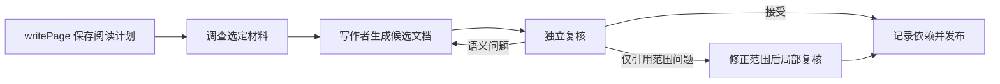

# 可信知识生成与发布流水线

KnowledgePipeline 把固定版本的原始材料组织成可发布知识。它覆盖材料分析与按阅读目标写页两条入口，共用持久角色作业与输出校验，以及独立复核和发布门禁，并针对原件变化与页面目标变化，以及引用范围错误和历史修订反馈设置恢复机制。

来源：gpt-5.6-sol 分析，gpt-5.6-sol 独立复核；模型解释仍可被原始证据纠正。

## 解决的问题与入口

KnowledgePipeline 负责把固定版本的原始材料变成可追踪的知识文章。单材料入口 `analyze` 会过滤仍可复用的现有文章，为每个待更新材料建立独立批次。每个批次先放入目标原件，再合入该目标已保存的回答和调用方明确提供的补充材料；原生研究模式还会遍历仓储材料，把尚未出现在 `offers` 中的其余材料全部加入。并发只限制处理成本，最终依赖仍按实际引用记录，不会因批次共享上下文而把无关材料固化为依赖。参考 [单材料分析入口 ↗](../../../apps/server/src/knowledge/pipeline.ts#L393 "支持待更新材料筛选、逐材料批次、回答与补充材料合入、原生模式仓储材料扩展和受限并发的流程说明。")

分析角色由材料形态决定：含图片时使用视觉分析，聊天或会话来源使用会话分析，代码扩展名使用代码分析，其余交给通用材料分析。这样，同一条发布管线可以处理不同材料类型，同时保留各自的解释方式。参考 [材料分析角色选择 ↗](../../../apps/server/src/knowledge/pipeline.ts#L28 "支持按图片、会话来源和代码扩展名选择分析角色的说明。")

## 一次页面写作如何完成

代表性调用是 `writePage(brief)`。输入 `brief` 描述页面身份、读者目标和材料选择；方法先保存计划并把页面标为 `writing`，成功后返回 `KnowledgeArticle[]` 并标为 `published`，异常则记录 `failed`。只有没有 `retryTag`、现有文章为 `current`、阅读计划摘要与 `writerVersion` 均相同，并且使用 `contextIds` 选材时 `materialKeys` 也相同，才会直接复用现有文章。参考 [页面状态与复用 ↗](../../../apps/server/src/knowledge/pipeline.ts#L423 "支持 writePage 的输入计划保存、状态变化、输出以及未变化文章复用条件。")

原生研究模式要求研究角色自行完成工具调查，且只能在 `ready` 为真、没有遗留请求时交给写作者；受限上下文模式最多运行三轮研究，最后一轮请求仍会执行，使写作者和复核者能看到新取回的材料。参考 [原生页面调查 ↗](../../../apps/server/src/knowledge/pipeline.ts#L451 "支持原生研究的材料选择、研究角色执行、完成条件和写作交接。")、[受限上下文调查 ↗](../../../apps/server/src/knowledge/pipeline.ts#L475 "支持变更范围预读、最多三轮研究、末轮请求执行和写作交接。")

写作后，复核者逐文档给出结论。已接受文档会立即补入复核问题、计算材料与文章依赖，并连同生成和复核轨迹发布；被拒文档进入下一轮。若问题仅是已有引用或背景依赖的行范围，宿主直接修正范围，下一轮只复核相关摘录。参考 [独立复核与发布 ↗](../../../apps/server/src/knowledge/pipeline.ts#L267 "支持复核轮次、接受项发布、依赖记录、语义修订和引用范围局部复核。")

## 发布门禁、恢复与模块协作

`runRole` 在排队前和读取结果时都检查材料修订仍是来源当前版本；角色执行通过持久作业队列和 `RoleRuntimeGateway` 完成，已成功作业可复用，失败、取消或等待用户的作业会停止本次流程。原生调查还用 `ResearchSession` 固定一次工作流所见的快照。参考 [持久角色作业 ↗](../../../apps/server/src/knowledge/pipeline.ts#L164 "支持原件版本检查、作业复用、网关运行、结果保存和中断处理。")

模型输出不能直接发布。`checkBatch` 要求文档键与目标一一对应，需求证据必须指向原始材料引用，所有引用及 `reviewSources` 必须落在本轮实际提供的材料范围内；随后仓储层绑定精确引文并做文档校验。参考 [候选文档校验 ↗](../../../apps/server/src/knowledge/pipeline.ts#L222 "支持目标键、需求证据、引用可见范围和背景复核来源的发布前校验。")

带 `workflow` 的页面最多复核两轮，其余流程最多四轮。多文档批次允许已接受项先发布，仍被拒的目标继续修订；轮次耗尽会抛出语义复核错误。重试时，`previousFeedback` 只在阅读目标、维护版本和研究结构均匹配，且材料和文章版本也匹配时复用旧草稿；局部引用复核留下的摘录会沿持久父复核链还原成完整候选稿。参考 [独立复核与发布 ↗](../../../apps/server/src/knowledge/pipeline.ts#L267 "支持复核轮次、接受项发布、依赖记录、语义修订和引用范围局部复核。")、[历史反馈恢复 ↗](../../../apps/server/src/knowledge/pipeline.ts#L352 "支持从持久复核链还原完整草稿，并仅在阅读目标及依赖版本匹配时复用反馈。")

文件顶部的依赖展示了职责边界：仓储负责材料与计划，并处理依赖和发布，角色网关负责模型运行，持久 worker 负责作业生命周期，研究组件负责选取证据，合同 schema 与引用修复组件负责输出门禁。实际调用均集中在上述编排方法中。参考 [流水线依赖边界 ↗](../../../apps/server/src/knowledge/pipeline.ts#L1 "支持仓储、角色网关、持久作业、研究和引用修复组件的职责关系。")
