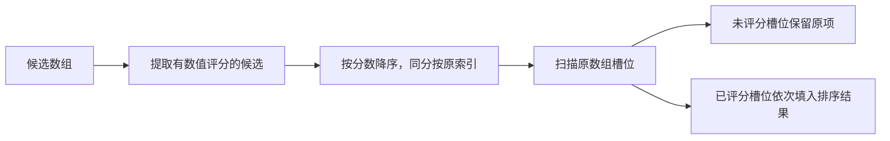

# 部分评估结果的安全排序

解释候选只有一部分获得模型评分时，如何仅重排已评分槽位，以及如何用分组提升让符合条件的候选越过未读槽位；同时说明稳定同分规则、未评分项保护和回调稳定性要求。

来源：gpt-5.6-sol 分析，gpt-5.6-sol 独立复核；模型解释仍可被原始证据纠正。

## 解决部分评分下的排序冲突

检索流水线可能只来得及评估一部分候选。`evaluatedOrder` 把 `undefined` 视为“未评估”，只比较同一个评分回调已经给出数值的候选。原有顺序充当回退顺序，未评估项继续留在原槽位；实现不需要为它们虚构零分，也不需要把模型分数和其他检索分数混合。数值 `0` 仍属于已评估结果。参考 [部分评分设计约束 ↗](../../../apps/server/src/retrieval/evaluated-order.ts#L1 "支持只比较已评估子集、保留未评估槽位，并避免虚构零分或混合不同评分尺度。")

函数通过 `flatMap`、`sort` 和 `map` 返回一个新数组，候选对象本身仍沿用输入对象。它改变的是已评估候选在原有已评估槽位中的排列。参考 [已评估槽位回填实现 ↗](../../../apps/server/src/retrieval/evaluated-order.ts#L8 "支持提取有分候选、按分数和原索引排序，再把结果回填到已评分槽位的流程与回调调用方式。")

## 从评分子集到完整顺序

参考 [已评估槽位回填实现 ↗](../../../apps/server/src/retrieval/evaluated-order.ts#L8 "支持提取有分候选、按分数和原索引排序，再把结果回填到已评分槽位的流程与回调调用方式。")

教学示例：候选依次为 `a(0.2)`、`unread`，然后是 `b(0.9)` 和 `tail`，其中后两者里只有 `b` 有评分。函数先提取 `a` 与 `b`，排序为 `b, a`；回填时只替换原数组中的两个已评分槽位，结果为 `b, unread, a, tail`。评分回调对所有候选都返回 `undefined` 时，没有槽位会被替换，输入顺序保持不变。参考 [已评估槽位回填实现 ↗](../../../apps/server/src/retrieval/evaluated-order.ts#L8 "支持提取有分候选、按分数和原索引排序，再把结果回填到已评分槽位的流程与回调调用方式。")

## 分组提升与使用边界

`promotedOrder` 先用 `promote` 把候选分成提升组和普通组，各组分别执行 `evaluatedOrder`，最后把提升组整体放到普通组之前。符合条件的候选因此可以越过普通组中的未读槽位；未读候选仍会保留在各自分组内。是否进入提升组完全由 `promote` 回调决定。参考 [提升分组实现 ↗](../../../apps/server/src/retrieval/evaluated-order.ts#L20 "支持按提升条件分组、分别进行部分评分排序，再把提升组置于普通组之前。")

同分候选按原索引保持先后。实现会在收集评分和回填槽位时分别调用 `score`，也会在两次分组过滤中调用 `promote`，所以这两个回调应对同一候选稳定返回相同结果，并避免依赖调用次数产生副作用。参考 [已评估槽位回填实现 ↗](../../../apps/server/src/retrieval/evaluated-order.ts#L8 "支持提取有分候选、按分数和原索引排序，再把结果回填到已评分槽位的流程与回调调用方式。") [提升分组实现 ↗](../../../apps/server/src/retrieval/evaluated-order.ts#L20 "支持按提升条件分组、分别进行部分评分排序，再把提升组置于普通组之前。")
