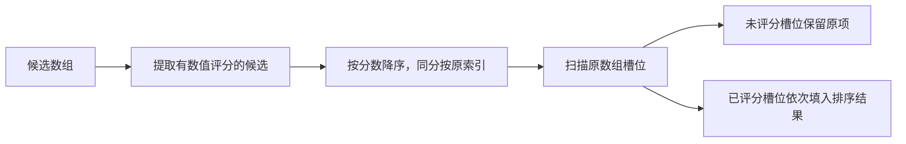

# 部分评估结果的安全排序

解释检索候选只有一部分获得模型评分时，如何仅重排已评分槽位，并在有强答案判定时进行分组提升；同时说明稳定同分规则、未评分项保护、真实调用链和回调约束。

来源：gpt-5.6-sol 分析，gpt-5.6-sol 独立复核；模型解释仍可被原始证据纠正。

## 解决部分评分下的排序冲突

检索流水线可能只来得及评估一部分候选。`evaluatedOrder` 把 `undefined` 视为“未评估”，只比较同一评分回调已经给出数值的候选，避免把模型分数与原有检索分数混在一起。未评估项继续占据原位置，函数返回新数组，不改动候选对象。参考 [部分评分设计约束 ↗](../../../apps/server/src/retrieval/evaluated-order.ts#L1 "支持只比较已评估子集、保留未评估槽位且不混合其他评分尺度的目的。")

统一检索的最终整理会先按宿主分数建立回退顺序，再把 `reranking.relevance` 交给该函数；因此模型只影响已评估槽位，后续仍会执行去重、来源分散和数量截断。参考 [统一检索评分接入 ↗](../../../apps/server/src/retrieval/unified.ts#L1119 "说明统一检索把宿主回退排序与模型相关度分别交给 evaluatedOrder。") [最终候选整理 ↗](../../../apps/server/src/retrieval/unified.ts#L1044 "支持排序之后还会执行去重、来源或章节分散以及数量截断。")

## 从评分子集到完整顺序

参考 [评分槽位回填实现 ↗](../../../apps/server/src/retrieval/evaluated-order.ts#L4 "支持提取有分候选、按分数与原索引排序，再回填已评分槽位的完整流程。")

代表性调用输入为 `a(0.2)、unread、b(0.9)、tail`。提取后得到 `a` 与 `b`，排序为 `b、a`；回填时只替换第 1、3 个已评分槽位，输出 `b、unread、a、tail`。评分回调始终返回 `undefined` 时，输出顺序与输入一致。参考 [部分评分示例 ↗](../../../apps/server/tests/retrieval-model-admission.test.ts#L40 "测试给出四个候选的代表性输入输出，并验证全未评分时保持原顺序。")

## 强答案提升与使用边界

`promotedOrder` 先按 `promote` 分成提升组和普通组，各组分别执行上述槽位重排，再将提升组整体放在前面。这样，符合条件的强答案可以越过未读候选，同时未读候选仍保留在结果中；测试中的 `answer` 因 `strong=true` 被移到首位，结果为 `answer、unread、partial、tail`。参考 [强答案提升示例 ↗](../../../apps/server/tests/retrieval-model-admission.test.ts#L56 "测试验证强答案可移动到未读槽位之前，未读与尾部候选仍保留。") [提升分组实现 ↗](../../../apps/server/src/retrieval/evaluated-order.ts#L20 "支持先拆分提升组与普通组、分别排序后拼接，以及 promote 回调参与两次过滤。")

统一检索以 `assessment.judgment === "strong_answer"` 决定提升，并用评估优先级排序；段落决策也采用同一规则，随后把未参与评估的尾部候选接回结果。参考 [统一检索强答案排序 ↗](../../../apps/server/src/retrieval/unified.ts#L1035 "证明统一检索用 assessment 优先级和 strong_answer 判定调用 promotedOrder。") [段落决策结果回流 ↗](../../../apps/server/src/decision/passages.ts#L233 "证明段落决策调用 promotedOrder，并将未参与评估的尾部候选追加回返回结果。")

边界上，只有 `undefined` 表示未评估，数值 `0` 仍会参与排序；同分通过原索引保持先后。`score` 在收集和回填阶段都会调用，`promote` 也用于两次过滤，因此调用方应提供结果稳定且无副作用的回调。参考 [部分评分设计约束 ↗](../../../apps/server/src/retrieval/evaluated-order.ts#L1 "支持只比较已评估子集、保留未评估槽位且不混合其他评分尺度的目的。") [提升分组实现 ↗](../../../apps/server/src/retrieval/evaluated-order.ts#L20 "支持先拆分提升组与普通组、分别排序后拼接，以及 promote 回调参与两次过滤。")
