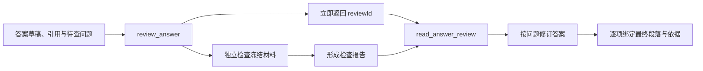

# 助手答案的独立复核与提交约束

该模块为存在明确疑问的助手回答提供可追踪的独立检查。调查者先记录事实与缺口；未解决的推断或材料冲突会改变答案时，可提交带引用的草稿以及 1–6 个待查问题。系统按草稿、问题和既有问题编号共同生成指纹，在同一批冻结材料上执行检查。报告中的问题会继续保留，最终答案必须逐项给出能唯一定位的处理段落及其引用依据或未解决原因；只有针对同一段落和引用绑定完成额外检查，处理状态才会记为未发现问题。

来源：gpt-5.6-sol 分析，gpt-5.6-sol 独立复核；模型解释仍可被原始证据纠正。

## 什么时候需要独立检查

这个模块位于助手调查与最终回答之间，用来处理会改变答案的未解决推断或材料冲突。`answerInvestigation` 为一次调查传递取消信号，记录是否已经要求检查，并保留本次调查启动的全部检查及其问题。状态结果会汇总这些尚待处理的问题。参考 [调查状态与问题汇总 ↗](../../../apps/server/src/assistant/answer-review.ts#L46 "说明取消信号、检查记录、问题编号汇总、修正范围以及状态返回的内容。")

调查者可用 `investigation_notes` 保存读者问题、已确认事实、必要条件和剩余缺口。只有具体疑问会改变结果时，才把 `reviewRequired` 标为真；代码不按关键词决定哪些问题必须检查。记录只供调查过程使用，不直接成为用户答案。参考 [事实记录与检查触发条件 ↗](../../../apps/server/src/assistant/answer-review.ts#L125 "说明调查记录包含的内容、reviewRequired 的适用条件及其累计方式。")

调查记录一旦要求检查，提交前就必须取得完成的报告。原文能够直接回答且没有实质疑问的查询，可以不启动这条流程。

## 一条代表性调用如何完成检查

下面是一个教学示例。假设调查者准备回答“周五登记就会当天配送吗？”，他先形成包含正文和引用的 `AnswerDraft`，再列出 1–6 个确实尚未解决的问题作为 `focus`。`answerReviewEvidence` 会从同一批冻结材料中按材料键和版本匹配引用；范围有效时，附上摘要值以及带行号的原文。它只预载被引片段，检查者仍可通过原件补读上下文或缺失来源。参考 [冻结引用原文 ↗](../../../apps/server/src/assistant/answer-review.ts#L27 "说明如何按材料与版本匹配引用，并在有效行范围内附上摘要值、原文行和阅读范围提示。")

首次调用 `review_answer` 时，代码对草稿、`focus` 和既有问题编号的组合计算 SHA-256 指纹。已有检查仍在运行时，调用会直接返回该任务；任务已经结束且指纹相同时也会复用结果，只有失败任务收到显式的 `retry=true` 才会重新启动。新任务立即返回 `reviewId` 和当前状态，检查在后台继续；有效报告发布后状态改为 `completed`，异常则记为 `failed` 或 `cancelled`。参考 [检查启动、复用与聚焦修正 ↗](../../../apps/server/src/assistant/answer-review.ts#L143 "说明 focus 数量、既有问题编号、组合指纹、任务复用、失败重试以及异步状态变化。")

报告指出问题后，调查者可以只提交受影响的最终段落，并通过既有问题编号发起一次聚焦检查。运行时会把每个编号对应的问题附加到检查范围中，并明确告知检查者：草稿只含修正段落，其他已经确认的部分是有意省略，不能据此判定最终答案不完整。这样可以验证具体修正，无需重新检查整篇答案。参考 [检查启动、复用与聚焦修正 ↗](../../../apps/server/src/assistant/answer-review.ts#L143 "说明 focus 数量、既有问题编号、组合指纹、任务复用、失败重试以及异步状态变化。") [独立检查的输入与修正范围 ↗](../../../apps/server/src/assistant/answer-review.ts#L283 "说明检查接收草稿、问题范围、材料集合和角色配置，并在修正模式下只检查列出的旧问题及其最终段落。")

作者随后把同一 `reviewId` 交给 `read_answer_review`。它一次最多等待 20 秒，只读取现有任务，不会发起另一轮模型调用；若仍在运行，可以继续读取。完成结果第一次经状态函数返回时会标记为已取回，并带回带编号的完整问题列表。参考 [按任务编号读取报告 ↗](../../../apps/server/src/assistant/answer-review.ts#L209 "说明最多等待 20 秒、校验 reviewId、只等待现有任务并在完成后标记为已取回。")

`reviewAssistantAnswer` 负责实际检查。它向检查者提供原问题、明确的 `focus`、先前对话、时间信息、草稿和预载证据，并以同一批材料与文章准备只读研究环境。额外工具也只保留只读项。检查者围绕这些疑问补读必要上下文，最后按 `AnswerReview` 合同交回结果；研究环境无论成功还是失败都会关闭。参考 [独立检查的输入与修正范围 ↗](../../../apps/server/src/assistant/answer-review.ts#L283 "说明检查接收草稿、问题范围、材料集合和角色配置，并在修正模式下只检查列出的旧问题及其最终段落。") [独立角色执行与收尾 ↗](../../../apps/server/src/assistant/answer-review.ts#L371 "说明检查者围绕 focus 补读材料、按角色配置运行、取得合同结果并关闭研究环境。")

## 引用授权、问题处理与提交闸门

检查报告中的每条问题引用都会先经过合同解析，再核对材料授权。当前版本之外的指定版本可以从仓储解析，但必须与当前授权材料属于同一来源；引用还要满足起止行顺序、末行不超过材料总行数，以及全部材料片段对当前读者可见。任一条件不成立，报告提交就会失败。参考 [报告引用授权校验 ↗](../../../apps/server/src/assistant/answer-review.ts#L341 "说明历史版本解析、同源身份、行范围和材料可见性的校验条件。")

提交闸门先检查最近任务的运行和读取状态。检查仍在运行、已经要求检查却没有完成结果、完成结果尚未取回，或报告指出实质问题而正文与受检草稿完全相同时，答案都不能提交。任何一份含问题的完成报告尚未取回，也会阻止提交。参考 [基础提交闸门与关闭流程 ↗](../../../apps/server/src/assistant/answer-review.ts#L239 "说明运行中、未完成、未取回、正文未修改等阻断条件，以及调查结束时的取消收尾。")

所有检查报告提出的问题都会累计。最终回复要为每个问题提供一条处理记录，并让最终段落的原文在答案中唯一出现。每条记录还要给出最终引用依据；如果依据不足，则必须写出未解决原因，而且该原因要出现在对应的最终段落中。引用编号必须指向最终回复实际携带的引用。参考 [逐项处理记录与校验状态 ↗](../../../apps/server/src/assistant/answer-review.ts#L263 "说明每个问题的最终段落、引用依据或未解决原因如何校验，以及聚焦复查如何决定记录状态。")

问题与最终段落完成绑定，并不代表修正已经得到语义认可。只有另一份已完成且已读取的聚焦检查明确包含该问题编号、没有再报告问题，同时检查草稿包含同一最终段落且引用绑定完全一致，记录状态才会成为 `no_issue_found`。写明未解决原因时状态为 `unresolved`，其他情况记为 `unverified`。参考 [逐项处理记录与校验状态 ↗](../../../apps/server/src/assistant/answer-review.ts#L263 "说明每个问题的最终段落、引用依据或未解决原因如何校验，以及聚焦复查如何决定记录状态。")

失败不会自动触发新模型调用。调查者需要查看错误，并以 `retry=true` 明确重试失败任务。报告没有发现实质问题时，状态提示只允许继续提交，不承诺答案已经完整。调查结束时，`close` 会取消仍由本次调查持有的后台检查并等待收尾；已经验证并保存的报告即使随后收到取消也会保持完成状态。参考 [检查启动、复用与聚焦修正 ↗](../../../apps/server/src/assistant/answer-review.ts#L143 "说明 focus 数量、既有问题编号、组合指纹、任务复用、失败重试以及异步状态变化。") [基础提交闸门与关闭流程 ↗](../../../apps/server/src/assistant/answer-review.ts#L239 "说明运行中、未完成、未取回、正文未修改等阻断条件，以及调查结束时的取消收尾。")
