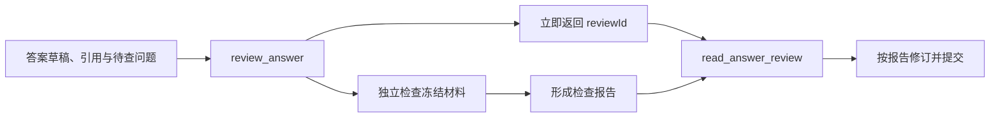

# 助手答案的独立复核与提交约束

该模块为存在明确疑问的助手回答提供一次可追踪的独立检查。调查者先记录事实与缺口；若某项未解决的推断或冲突会改变答案，可提交带引用的草稿以及 1–6 个待查问题。系统按草稿和问题共同生成指纹，在同一批冻结材料上启动独立检查，并预载引用原文。调查者通过任务 ID 取得报告后再修改答案。任务仍在运行、要求检查却没有完成结果、完成结果尚未取回，或报告指出实质问题但正文未改时，答案不能提交。

来源：gpt-5.6-sol 分析，gpt-5.6-sol 独立复核；模型解释仍可被原始证据纠正。

## 什么时候需要独立检查

这个模块位于助手调查与最终回答之间，用来处理会改变答案的未解决推断或材料冲突。`answerInvestigation` 为一次调查维护取消信号、是否已经要求检查，以及最近一项检查的状态。参考 [单次调查的检查状态 ↗](../../../apps/server/src/assistant/answer-review.ts#L45 "说明调查函数维护取消信号、检查必要性和最近任务状态。")

调查者可用 `investigation_notes` 保存读者问题、已确认事实、必要条件和剩余缺口。只有具体疑问会改变结果时，才把 `reviewRequired` 标为真；代码不按关键词决定哪些问题必须检查。记录只供调查过程使用，不直接成为用户答案。参考 [事实记录与检查触发条件 ↗](../../../apps/server/src/assistant/answer-review.ts#L110 "说明调查记录的内容、reviewRequired 的适用条件及其累计方式。")

一旦调查记录要求检查，或调查者主动调用 `review_answer`，提交前就必须取得一份完成的报告。原文能够直接回答且没有实质疑问的查询，可以不启动这条流程。

## 一条代表性调用如何完成检查

下面是一个教学示例。假设调查者准备回答“周五登记就会当天配送吗？”，他先形成包含正文和引用的 `AnswerDraft`，再列出 1–6 个确实尚未解决的问题作为 `focus`。`answerReviewEvidence` 会从同一批冻结材料中按材料键和版本匹配引用；范围有效时，附上摘要值以及带行号的原文。它只预载被引片段，检查者仍可通过原件补读上下文或缺失来源。参考 [冻结引用原文 ↗](../../../apps/server/src/assistant/answer-review.ts#L26 "说明如何按材料与版本匹配引用，并为有效行范围附上原文、摘要值和阅读范围提示。")

调用 `review_answer` 后，代码对草稿与 `focus` 的组合计算 SHA-256 指纹。已有检查仍在运行时直接返回该任务；已有任务结束后，相同指纹也会复用，只有失败任务收到显式的 `retry=true` 才会重新启动。新任务会立即返回 `reviewId` 和当前状态，独立检查继续执行；有效报告发布后，状态改为 `completed`，异常则记录为 `failed` 或 `cancelled`。参考 [草稿与问题共同去重 ↗](../../../apps/server/src/assistant/answer-review.ts#L128 "说明 focus 数量、组合指纹、运行任务复用、失败重试以及异步报告状态变化。")

作者随后把同一 `reviewId` 交给 `read_answer_review`。它一次最多等待 20 秒，只读取现有任务，不会发起另一轮模型调用；若仍在运行，可以继续读取。完成状态经状态函数返回时会标记为已取回，并带回完整报告。参考 [按任务 ID 读取报告 ↗](../../../apps/server/src/assistant/answer-review.ts#L189 "说明最多等待 20 秒、校验 reviewId、只等待现有任务并返回当前状态。")

`reviewAssistantAnswer` 负责实际的独立检查。它向检查者提供原问题、明确的 `focus`、先前对话、时间信息、草稿和预载证据，并以同一批材料与文章准备只读研究环境。额外工具也只会保留只读项。检查者按独立角色配置运行，可以围绕这些疑问补读必要上下文，最后按 `AnswerReview` 合同交回结果；研究环境无论成功还是失败都会关闭。参考 [独立检查的输入与研究环境 ↗](../../../apps/server/src/assistant/answer-review.ts#L248 "说明独立检查接收的问题范围、草稿、预载证据和冻结材料，并仅接入只读附加工具。") [独立角色执行与收尾 ↗](../../../apps/server/src/assistant/answer-review.ts#L334 "说明检查者围绕 focus 补读材料、按角色配置运行、取得合同结果并关闭研究环境。")

## 引用授权、失败处理与提交闸门

检查报告中的每条问题引用都会先经过合同解析，再核对材料授权。当前版本之外的指定版本可以从仓储解析，但必须与当前授权材料属于同一来源；引用还要满足起止行顺序、末行不超过材料总行数，以及全部材料片段对当前读者可见。任一条件不成立，报告提交就会失败。参考 [报告引用授权校验 ↗](../../../apps/server/src/assistant/answer-review.ts#L304 "说明历史版本解析、同源身份、行范围和材料可见性的校验条件。")

提交闸门覆盖四种情况：检查仍在运行；调查已要求检查但没有完成结果；结果已经完成却未取回；报告指出实质问题后，最终正文仍与受检草稿完全相同。`close` 会取消这次调查拥有的后台检查并等待它们收尾。已经验证并保存的报告即使在收尾阶段遇到取消也会保持 `completed`，但报告只提供修改依据，不会替调查者发布答案。参考 [草稿与问题共同去重 ↗](../../../apps/server/src/assistant/answer-review.ts#L128 "说明 focus 数量、组合指纹、运行任务复用、失败重试以及异步报告状态变化。") [关闭流程与提交闸门 ↗](../../../apps/server/src/assistant/answer-review.ts#L220 "说明后台检查的取消收尾，以及运行中、未完成、未取回和正文未修改时的提交阻断。")

失败不会自动触发新模型调用。调查者需要查看错误，并以 `retry=true` 明确重试失败任务。报告没有发现实质问题时，状态提示也只允许继续提交，不承诺答案已经完整。等待上限和读取协议在 `read_answer_review` 中调整，去重与重试规则位于 `review_answer`，引用授权由 `reviewAssistantAnswer.validate` 控制，最终提交条件集中在 `beforeSubmit`。参考 [状态返回与下一步提示 ↗](../../../apps/server/src/assistant/answer-review.ts#L87 "说明完成结果会标记为已取回，并区分继续等待、按问题修订、直接提交和显式重试。") [按任务 ID 读取报告 ↗](../../../apps/server/src/assistant/answer-review.ts#L189 "说明最多等待 20 秒、校验 reviewId、只等待现有任务并返回当前状态。") [关闭流程与提交闸门 ↗](../../../apps/server/src/assistant/answer-review.ts#L220 "说明后台检查的取消收尾，以及运行中、未完成、未取回和正文未修改时的提交阻断。")
