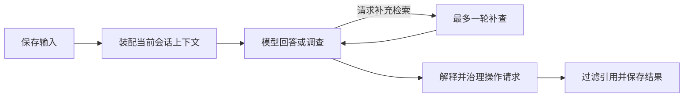

# 助手回合如何装配上下文并受控执行操作

AssistantRuntime 是 Web 与飞书共用的服务端回合协调层。它先保存输入并装配当前会话可见的上下文，再驱动普通回答或自主调查；模型提出的项目选择、工作操作和事项请求都要经过服务端范围检查、请求解释与持久化回执确认。运行时还负责引用过滤、取消栅栏、失败降级和未完成回合恢复。

来源：gpt-5.6-sol 分析，gpt-5.6-sol 独立复核；模型解释仍可被原始证据纠正。

## 它在助手链路中的位置

`AssistantRuntime` 把一次自然语言交互组织成可持久化、可取消和可恢复的服务端回合。Web 与飞书共用这个入口；它连接会话路由、检索接口、模型适配器与记忆服务，并在服务端掌握证据可见性和低风险写操作的执行权。模型由 `AssistantModelPort` 注入，运行时本身不直接绑定具体模型。参考 [统一助手运行时职责 ↗](../../../apps/server/src/assistant/runtime.ts#L245 "说明 Web 与飞书共用运行时，以及上下文、检索、服务端治理、持久化和模型注入边界。")

## 代表性回合：从用户输入到保存结果

以“提醒我 10 月 2 日上午 9 点复习英语”为例，调用方提交会话、原文、可选的外部事件 ID，以及本回合的模式和检索目的。运行时先保存输入；同一外部事件再次送达时直接复用已有回合。每个会话内的执行按链串行，新消息会中断当前进程仍持有的旧执行链。参考 [回合入队与串行执行 ↗](../../../apps/server/src/assistant/runtime.ts#L288 "说明先保存、按外部事件去重、记录模式与目的，并中断同会话当前执行链。")

上下文策略取决于模型适配器。使用宿主证据的适配器会先检索，原生调查适配器则从空的初始证据集开始，自行读取获准的原件、历史和状态。两种策略都会合并上一已完成回合的工作证据，并提供同会话历史、本人纠正、当前项目、可见事项和时钟。参考 [初始上下文装配 ↗](../../../apps/server/src/assistant/runtime.ts#L572 "说明两类上下文策略、上一回合证据、纠正、项目、事项和时钟的装配。")

模型首轮可以提出至多 3 个补充检索请求；运行时合并新证据后只再生成一次。原生调查返回的证据也要带固定来源位置，并通过当前会话的可见性检查后才能进入本回合。参考 [补充检索与调查证据 ↗](../../../apps/server/src/assistant/runtime.ts#L632 "说明模型输入、最多 3 个补查请求、第二次生成及调查证据的可见性过滤。")

## 项目选择只收窄阅读范围

私人会话会把可用项目和当前项目交给模型。模型返回项目选择后，运行时先解析结构并确认目标确实属于本次可用项目；回合完成时，项目选择和最终结果在同一事务中保存。参考 [初始上下文装配 ↗](../../../apps/server/src/assistant/runtime.ts#L572 "说明两类上下文策略、上一回合证据、纠正、项目、事项和时钟的装配。") [项目选择校验 ↗](../../../apps/server/src/assistant/runtime.ts#L775 "说明项目选择只能落在本次可用项目中。") [回执决定最终文案 ↗](../../../apps/server/src/assistant/runtime.ts#L882 "说明事项与工作操作的最终答复依据执行回执和已保存状态生成。")

已保存的项目会在宿主检索排序前过滤材料成员，同时继续叠加会话可见性规则。这个范围用于聚焦阅读，不会扩大证据可见性或操作权限；原生调查工具仍可按问题读取其他项目或必要背景。参考 [项目阅读范围 ↗](../../../apps/server/src/assistant/runtime.ts#L1090 "说明项目成员过滤与会话可见性叠加，并限定该范围只用于宿主检索。")

## 模型请求如何变成真实操作

模型的结构化请求只是候选。对于普通事项的创建和更新，运行时先调用独立的请求解释器，把本轮原文、候选操作、目标事项或新事项、可见事项、最近 4 个已完成回合、当前项目和可推断的上一事项一起交给解释器。解释结果返回后还要再次通过断言校验；身份、事项版本和持久化仍由服务端检查。参考 [事项请求进入独立解释 ↗](../../../apps/server/src/assistant/runtime.ts#L840 "说明每个普通事项调用都先解释，再进入创建或更新治理。") [请求解释上下文 ↗](../../../apps/server/src/assistant/runtime.ts#L1140 "说明解释器使用的身份、候选操作、目标、最近回合、项目与上一事项信息，以及返回后的断言检查。")

创建事项时，运行时会捕获本轮已确认本人的原话，并把解释器识别出的指令片段作为精确证据。提案号取自外部事件 ID或回合请求 ID，再加标题摘要；`MemoryService.evaluate` 返回真实事项回执后，创建才成立。若模型引用了当前或上一回合材料，这些引用也要先解析成功。参考 [创建事项的直接证据 ↗](../../../apps/server/src/assistant/runtime.ts#L1399 "说明材料引用校验、本轮本人原话捕获和提案号构造。") [创建事项提案与回执 ↗](../../../apps/server/src/assistant/runtime.ts#L1503 "说明精确指令证据、时间与跟进校验，以及 MemoryService 返回真实事项回执的条件。")

更新事项会再次核对事项 ID 和预期版本。改期时间与跟进设置要通过各自校验，随后本轮原话被保存为变更证据，`MemoryService.commandTask` 以回合 ID 作为请求身份执行更新。参考 [事项更新命令 ↗](../../../apps/server/src/assistant/runtime.ts#L1174 "说明版本检查、改期与跟进校验、原话证据捕获和 commandTask 请求身份。")

较大的工作操作走另一条入口。研究模式没有工作操作权限，工作操作也不能与普通事项工具在同一回复里同时执行；执行结果或拒绝原因以工作回执返回。参考 [工作操作分流 ↗](../../../apps/server/src/assistant/runtime.ts#L803 "说明工作操作在研究模式下被拒绝，且不能与普通事项工具同时执行。")

只要回复请求了事项变更，最终文案就从已保存事项及回执重建，不采用模型自报的成功文本。普通回答的引用也只保留运行时确实提供或认可的证据 ID。工具治理前和最终保存前各有一次取消检查；完成结果、引用、操作记录及项目选择随后一起落库。参考 [回执决定最终文案 ↗](../../../apps/server/src/assistant/runtime.ts#L882 "说明事项与工作操作的最终答复依据执行回执和已保存状态生成。") [引用过滤与最终事务 ↗](../../../apps/server/src/assistant/runtime.ts#L928 "说明引用白名单、最终取消栅栏，以及回合与项目选择的事务保存。")

## 可见性、失败与恢复边界

未注入自定义可见性策略时，私人会话可读证据，群聊默认不暴露证据。生产接入方若要让群聊读取材料，需要提供基于来源和会话范围的策略。参考 [群聊证据默认拒绝 ↗](../../../apps/server/src/assistant/runtime.ts#L1391 "说明没有自定义策略时私人会话可见、群聊默认不可见。")

模型明确不可用时，回合回到待重试状态；取消或超时会终止回合。其他模型生成异常会改用降级答复，并在后续步骤成功时正常保存；执行链中未被内部处理的其他异常会把回合标为失败。参考 [模型生成失败分流 ↗](../../../apps/server/src/assistant/runtime.ts#L745 "说明取消、模型明确不可用和其他模型异常分别进入取消、待重试与降级答复。") [执行链终态 ↗](../../../apps/server/src/assistant/runtime.ts#L950 "说明最终保存之后的取消和其他未处理异常分别标为取消或失败。")

公开重试入口只接受待重试回合。重启恢复会枚举未完成回合：已识别到提交回执的回合直接补齐完成状态，其余回合重新执行。参考 [公开重试与回执检查 ↗](../../../apps/server/src/assistant/runtime.ts#L371 "说明重试只接受待重试回合，并限定恢复前的已提交回执识别条件。") [未完成回合恢复 ↗](../../../apps/server/src/assistant/runtime.ts#L443 "说明重启后对未完成回合的回执补齐与重新执行。")

这里的回执识别范围很具体。回合必须带外部事件 ID，数据库里还要存在 `assistant-task:${eventId}:%` 形式的创建事项提案回执。没有外部事件 ID、事项更新回执或其他形式的工作回执，都不会被这项恢复前检查识别为已提交。参考 [公开重试与回执检查 ↗](../../../apps/server/src/assistant/runtime.ts#L371 "说明重试只接受待重试回合，并限定恢复前的已提交回执识别条件。")
