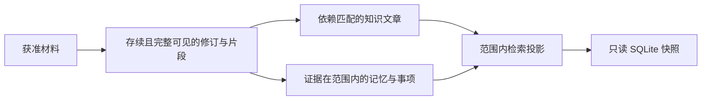

# 为自主研究构造最小只读证据快照

该实现从一个源 SQLite 数据库导出调查专用快照：按材料范围、修订存续状态和片段可见性裁剪原件，递归验证知识依赖，再按证据范围筛选记忆与事项。它会复用仍满足版本与可见性约束的检索数据，最后将数据库封存为只读；另有函数可向既有快照追加一份已捕获材料。

来源：gpt-5.6-sol 分析，gpt-5.6-sol 独立复核；模型解释仍可被原始证据纠正。

## 解决的问题与代表性调用

`researchSnapshot` 把源知识库裁剪成一次调查专用的 SQLite 数据库，使研究工具只能读取本次获准的证据与状态；凭据、会话、发件箱和无关的个人捕获不属于快照内容。参考 [快照内容边界 ↗](../../../apps/server/src/knowledge/research-snapshot.ts#L1 "说明研究快照只包含获准证据与状态，并排除凭据、会话、发件箱和无关捕获。")

调用方必须提供获准材料、候选文章和输出文件。源数据库可以通过 `original` 直接传入，也可以从可选的 `repository` 取得；两者都没有时函数会报错。调用方还可设置片段可见性、是否纳入无锚点状态、是否包含完整分组目录，以及阶段计时回调。参考 [快照输入与源数据库选择 ↗](../../../apps/server/src/knowledge/research-snapshot.ts#L34 "支持必选输入、可选控制参数，以及从 original 或 repository 取得源数据库并在缺失时报错的说明。")

教学示例：把一份已授权材料放入 `materials`，用 `visible` 拒绝其中不可见的片段，并将临时数据库路径传给 `file`。函数完成筛选和索引同步后关闭写连接，再以只读模式重新打开该文件；后续查询面对的是这份固定快照。参考 [向量复用与只读封存 ↗](../../../apps/server/src/knowledge/research-snapshot.ts#L314 "支持按最终检索单元筛选向量、流式事务写入，以及完成 WAL 检查点后只读重开数据库的说明。")

## 证据与派生状态如何进入快照

快照先迁移数据库结构，并移除原生研究不会使用的旧片段全文索引，避免每次导出重复执行三元分词；调查使用的是后续生成的范围内上下文投影。参考 [数据库结构与旧索引处理 ↗](../../../apps/server/src/knowledge/research-snapshot.ts#L54 "支持迁移数据库并移除旧片段全文索引，以免导出时重复分词的说明。")

参考 [修订准入条件 ↗](../../../apps/server/src/knowledge/research-snapshot.ts#L98 "支持来源范围、删除标记、全片段可见性、无片段修订开关，以及只按真正准入修订确定来源主体的说明。") [知识依赖递归准入 ↗](../../../apps/server/src/knowledge/research-snapshot.ts#L162 "支持按调查材料、材料版本摘要和知识依赖递归筛选知识修订，并说明页面、head 与失效记录的复制条件。") [记忆与事项证据约束 ↗](../../../apps/server/src/knowledge/research-snapshot.ts#L219 "支持记忆修订的证据集合筛选，并区分事项主体的 evidence_id 与事项修订的证据集合条件。") [检索投影预热与同步 ↗](../../../apps/server/src/knowledge/research-snapshot.ts#L261 "支持按来源 head、可见片段和引用修订筛选预热 owner，再同步范围内检索投影的说明。") [向量复用与只读封存 ↗](../../../apps/server/src/knowledge/research-snapshot.ts#L314 "支持按最终检索单元筛选向量、流式事务写入，以及完成 WAL 检查点后只读重开数据库的说明。")

修订必须属于输入材料的来源，不能出现在 `revision_tombstones` 中，而且它的全部片段都要通过 `visible`。没有片段的修订仅在启用 `includeUnanchoredState` 时准入。`sources` 只复制至少有一个准入修订的来源；修订、材料描述和片段按准入集合复制，`source_state` 与材料别名则仍按输入材料的来源范围复制。参考 [修订准入条件 ↗](../../../apps/server/src/knowledge/research-snapshot.ts#L98 "支持来源范围、删除标记、全片段可见性、无片段修订开关，以及只按真正准入修订确定来源主体的说明。") [原件相关表的复制范围 ↗](../../../apps/server/src/knowledge/research-snapshot.ts#L120 "说明材料描述和片段按准入集合复制，而来源状态与材料别名按输入来源范围复制。")

知识文章采用递归准入。文章声明的调查材料必须出现在输入中；材料依赖的 key 与 digest 必须匹配准入版本，知识依赖也必须递归通过。通过检查的知识修订及其有效 head 会进入快照；输入候选文章对应的页面和失效记录也按文档 key 复制。参考 [知识依赖递归准入 ↗](../../../apps/server/src/knowledge/research-snapshot.ts#L162 "支持按调查材料、材料版本摘要和知识依赖递归筛选知识修订，并说明页面、head 与失效记录的复制条件。")

记忆修订只有在证据集合全部落入准入片段或来源修订时才可进入，空证据集合需要 `includeUnanchoredState`。事项主体使用单个 `evidence_id` 判断，缺少该锚点时同样依赖 `includeUnanchoredState`；事项修订还要同时属于已准入事项，并让整个证据集合通过检查。参考 [记忆与事项证据约束 ↗](../../../apps/server/src/knowledge/research-snapshot.ts#L219 "支持记忆修订的证据集合筛选，并区分事项主体的 evidence_id 与事项修订的证据集合条件。")

## 边界条件、索引复用与增量追加

`includeUnanchoredState` 决定个人工作区的材料分组是否成为候选。候选分组的成员只保留本次已准入材料；默认只复制实际拥有这些成员的分组，`includeGroupCatalog` 开启后才复制全部候选分组。评审关系的两端都必须位于准入片段集合。参考 [分组目录与评审关系 ↗](../../../apps/server/src/knowledge/research-snapshot.ts#L141 "支持个人分组候选、成员范围、完整目录开关和评审关系双端准入条件。")

检索层只预热 head 修订已准入的来源。它会检查每个候选检索单元的可见片段和引用修订；某个 owner 有一项不合格，其整体就退出预热集合。随后 `RetrievalProjection.sync()` 根据快照内的版本和说明身份补建或刷新投影。向量只按同步后的检索单元 ID 复用，通过流式读取筛选，并在一个事务中写入。参考 [检索投影预热与同步 ↗](../../../apps/server/src/knowledge/research-snapshot.ts#L261 "支持按来源 head、可见片段和引用修订筛选预热 owner，再同步范围内检索投影的说明。") [向量复用与只读封存 ↗](../../../apps/server/src/knowledge/research-snapshot.ts#L314 "支持按最终检索单元筛选向量、流式事务写入，以及完成 WAL 检查点后只读重开数据库的说明。")

封存时函数执行 WAL 检查点、切换到 `DELETE` 日志模式并关闭写连接，最终返回只读数据库。参考 [向量复用与只读封存 ↗](../../../apps/server/src/knowledge/research-snapshot.ts#L314 "支持按最终检索单元筛选向量、流式事务写入，以及完成 WAL 检查点后只读重开数据库的说明。")

`appendResearchMaterial` 用于向既有快照追加一份已经捕获的材料。它复制对应来源、指定修订及其片段，更新来源 head 和材料别名，然后同步检索投影；此前的证据、记忆以及无关来源保持不变。参考 [追加单份已捕获材料 ↗](../../../apps/server/src/knowledge/research-snapshot.ts#L12 "支持追加指定材料时复制来源、修订与片段，更新 head 和别名并同步检索投影，同时保持其他调查内容不变。")
