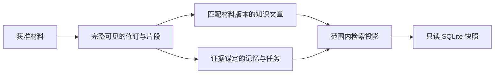

# 为自主研究构造最小只读证据快照

该实现从主知识库导出一次调查可用的 SQLite 快照：按材料与片段权限裁剪原件，递归验证知识依赖，以证据锚点筛选状态，再复用范围内的检索索引和向量。封存后的数据库只读；宿主仍可单独追加一次新捕获。

来源：gpt-5.6-sol 分析，gpt-5.6-sol 独立复核；模型解释仍可被原始证据纠正。

## 解决的问题与代表性调用

`researchSnapshot` 把主知识库裁剪成一次调查专用的 SQLite 数据库，让研究工具只能读取本次获准的证据和状态。调用方传入仓库与输出文件，并给出获准材料和候选文章；还可设置片段可见性、是否纳入无锚点状态、是否包含完整分组目录以及阶段计时回调。参考 [快照调用参数 ↗](../../../apps/server/src/knowledge/research-snapshot.ts#L35 "支持代表性调用的必选输入、可见性开关、无锚点状态开关、分组目录开关与计时回调说明。")

一条代表性调用是：向 `materials` 放入某份已授权材料，以 `visible` 拒绝其中不可见片段，并把临时文件路径交给 `file`。函数在该文件完成筛选与索引后关闭写连接，以只读 `DatabaseSync` 返回；后续工具查询的是这份固定快照。参考 [只读封存结果 ↗](../../../apps/server/src/knowledge/research-snapshot.ts#L340 "支持完成 WAL 检查点、切换日志模式、关闭写连接并返回只读数据库的结论。")

## 证据与派生状态如何进入快照

快照先迁移空库结构，并移除不会被原生研究使用的旧片段全文索引，避免每次导出重复做三元分词。参考 [快照索引初始化 ↗](../../../apps/server/src/knowledge/research-snapshot.ts#L54 "支持迁移数据库并移除旧片段全文索引以避免重复分词的说明。")

修订只有在来源已获准、其全部片段都通过 `visible` 时才进入；无片段修订默认排除。随后复制对应的来源、修订、描述、片段、来源状态与材料别名。参考 [修订准入条件 ↗](../../../apps/server/src/knowledge/research-snapshot.ts#L97 "支持来源范围、全片段可见性以及无片段修订默认排除的边界。") [原件关联数据复制 ↗](../../../apps/server/src/knowledge/research-snapshot.ts#L112 "支持只复制准入来源、修订、材料描述、片段、来源状态与别名的说明。")

知识文章采用递归准入：调查材料必须出现在输入中，材料依赖的 key 与 digest 必须匹配已准入版本，知识依赖也必须递归通过。记忆修订的证据集合必须全部落在准入片段或修订中；任务及其修订采用同类约束。参考 [知识依赖递归准入 ↗](../../../apps/server/src/knowledge/research-snapshot.ts#L163 "支持按调查材料、材料版本摘要和知识修订依赖递归筛选文章。") [记忆与任务证据约束 ↗](../../../apps/server/src/knowledge/research-snapshot.ts#L218 "支持按片段或来源修订证据集合筛选记忆、任务及任务修订。")

## 边界条件、索引复用与增量追加

`includeUnanchoredState` 放宽两类边界：允许无片段修订或空证据集合进入，也让个人工作区的材料分组目录成为候选；分组成员仍只保留已准入来源，评审关系两端也都必须在准入片段集合内。参考 [分组与评审关系边界 ↗](../../../apps/server/src/knowledge/research-snapshot.ts#L138 "支持个人分组目录受无锚点状态开关控制、成员限制到准入来源以及评审关系两端均须获准。")

检索层会复用主库中属于完整准入来源的单元，但逐项核对其可见片段和引用修订；不合格的 owner 整体退出预热集合，之后 `RetrievalProjection.sync()` 重建缺失或陈旧内容。向量按最终单元 ID 流式复制，并在一个事务中写入。参考 [检索投影预热校验 ↗](../../../apps/server/src/knowledge/research-snapshot.ts#L260 "支持仅复用完整准入来源，并校验检索单元的可见片段与引用修订后再同步投影。") [范围内向量流式复制 ↗](../../../apps/server/src/knowledge/research-snapshot.ts#L313 "支持按最终检索单元 ID 筛选向量、流式读取并用单一事务写入。")

`appendResearchMaterial` 用于宿主在既有快照中追加一次已捕获观察。它只复制该材料的来源、指定修订及片段，更新来源 head 和材料别名，再同步检索投影；旧证据、记忆和无关来源保持冻结。参考 [单次材料追加 ↗](../../../apps/server/src/knowledge/research-snapshot.ts#L13 "支持追加宿主捕获材料时只复制相关原件、更新别名并同步检索投影的说明。")
