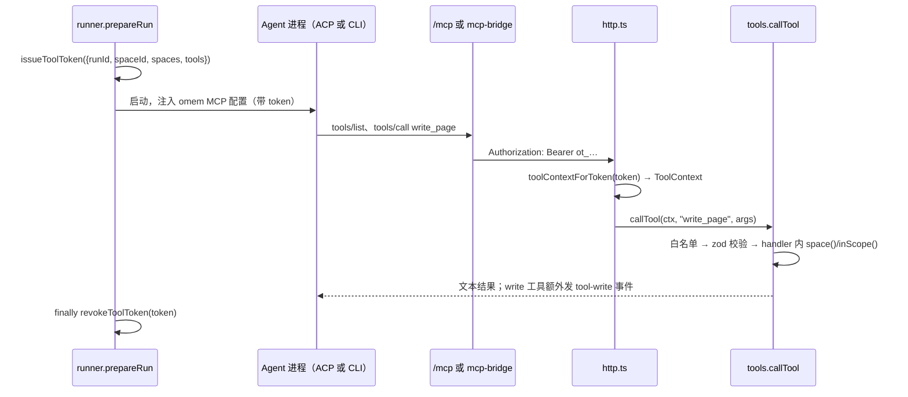

omem 自己不理解、不写作，这些交给外部 Agent（Codex、Claude Code 等）。宿主要解决的问题是：怎样让一个别人的进程只能用我们允许的工具、只能碰允许的空间，并且每一次写入都留下痕迹。读完这页，你能说清一个 token 从发放到失效的全过程，知道权限在哪一层被拦，也知道要加一个工具、换一种权限策略时该改哪里。

## 一个例子：wiki-writer 写出一页

Wiki 生成时，`wiki-write` 任务把页面计划拼成任务文本，再调用 `agent(ctx, "wiki-writer", spaceId, task)`（[jobs.ts:185](../../../src/agents/jobs.ts#L185)）。这条路径最终进入 `runRole`，先走 `prepareRun`。



**1. 发 token。** `prepareRun` 取角色的工具清单（wiki-writer 的 frontmatter 列了 `search、scan、read_source、source_outline、list_sources、find_symbol、list_pages、read_page、write_page`，见 [wiki-writer.md:1-6](../../../roles/wiki-writer.md#L1-L6)），再无条件加上 `list_skills`、`read_skill`。可触及的空间 `spaces`：assistant 角色为 `null`（全部），其他角色只有当前空间。随后：

```ts
const token = issueToolToken({ runId: input.runId, spaceId: space.id, spaces, tools, actor: "agent" });
```

见 [runner.ts:150-156](../../../src/agents/runner.ts#L150-L156)。token 是 `ot_` 加随机串，对应的 `{runId, spaceId, spaces, tools, actor}` 只存在服务进程的内存 Map 里（[tools.ts:806-811](../../../src/agents/tools.ts#L806-L811)）。Agent 拿到的只是这个不透明字符串，改不了其中的范围。

**2. 生成 MCP 接入信息。** `prepareRun` 返回的 `mcp` 同时备好两种连法：HTTP 地址 `${app.baseUrl}/mcp`，和 stdio 桥（`node mcp-bridge.ts/js`，优先用编译后的 js）（[runner.ts:73-77](../../../src/agents/runner.ts#L73-L77)、[runner.ts:174](../../../src/agents/runner.ts#L174)）。类型见 [types.ts:62-69](../../../src/agents/types.ts#L62-L69)。用哪种由下游的 ACP/CLI 代码按 Agent 的能力决定。

**3. 注入并调用。** 后面分 ACP 和 CLI 两节讲。无论哪种，Agent 的每次工具调用最终都变成带 `Bearer <token>` 的 HTTP 请求打到 omem 服务。

**4. 服务端查 token，调用工具。** `/mcp` 处理器用 `toolContextForToken` 取出上下文，没有就回 401，然后用该上下文创建一个 MCP Server，`tools/list` 返回 `toolSchemas(ctx.tools)`，`tools/call` 转给 `callTool(ctx, …)`（[http.ts:69-87](../../../src/server/http.ts#L69-L87)）。传输用 `sessionIdGenerator: undefined`，即无状态，每个请求自成一轮，身份完全靠 token。

**5. 收尾。** `runRole` 在 `finally` 里 `revokeToolToken`（[runner.ts:198-200](../../../src/agents/runner.ts#L198-L200)），从此这个 token 再也换不到上下文。

## “模型没有直接写库权限”靠哪几道检查

写库的唯一入口是 `callTool`（[tools.ts:790-802](../../../src/agents/tools.ts#L790-L802)）。依次发生：

1. **工具白名单**：工具不存在，或 `ctx.tools` 不含该名字，返回 `工具 X 不可用`。列表接口也按 `ctx.tools` 过滤，所以 Agent 一开始就看不到不该有的工具；这里是第二道。
2. **zod 校验**：`tool.schema.safeParse(args)` 失败返回 `参数错误：…`，handler 不会收到未校验的参数。
3. **空间范围**：handler 里用两个辅助函数。`space(ctx, requested)` 把可选的 `space` 参数解析为空间 id，空间不存在报 400，不在 `ctx.spaces` 里报 403（[tools.ts:45-50](../../../src/agents/tools.ts#L45-L50)）；`inScope(ctx, spaceId, what)` 用于“按对象 id 修改”的工具，先查出对象所在空间再检查（[tools.ts:52-54](../../../src/agents/tools.ts#L52-L54)）。`write_page` 的第一行就是 `space(ctx, a.space)`（[tools.ts:536](../../../src/agents/tools.ts#L536)）；`supersede`、`forget` 这类用记忆 id 的工具走 `inScope`。
4. **记录**：工具声明了 `write: true` 且有 `runId` 时，成功后发出 `tool-write` 事件，带上工具名和参数（[tools.ts:797](../../../src/agents/tools.ts#L797)）。`write_page` 另外发一个 `change` 事件指向页面 id，并写页面 Git 历史，message 里带 run id（[tools.ts:539-541](../../../src/agents/tools.ts#L539-L541)）。

有现成测试覆盖前三条：[library.test.ts:109-121](../../../test/library.test.ts#L109-L121) 构造 `spaces: ["personal"]`、`tools: {read_source, search}` 的上下文，断言读 `secret` 空间的原件失败、`search` 指定 `secret` 返回“不能访问”、`remember` 返回“不可用”；换成 `tools: null` 后，`supersede`/`forget` 仍因 `inScope` 被拒。

两点要看清，别高估这套机制：

- **tool-write 是否落库**：从实现看，它用 `app.emit` 并且 `seq: -1`，是广播给实时监听者的事件；真正落到 `run_events` 表的路径是 `runs.ts` 里的 `writeEvent`（带递增 seq）（[runs.ts:151-153](../../../src/agents/runs.ts#L151-L153)）。我没有在 `src`、`web/src` 里找到把 `seq: -1` 事件另存的代码，所以“写入记录在运行里”目前更像实时可见，而不是持久审计。要做审计，需要在这里补落库。
- **工具内部的写**：权限判断散在各 handler 里，靠每个工具作者记得调 `space()`/`inScope()`。`callTool` 本身不替你检查空间，只检查白名单和参数。

另外 `toolContextForToken` 还有一个后门：token 等于 `app.internalToken` 时返回 `tools: null、spaces: null、actor: "user"` 的全权限上下文（[tools.ts:820-825](../../../src/agents/tools.ts#L820-L825)），给宿主自己和界面用。

## 工具怎么注册

每个工具是一次 `def({...})` 调用，往模块级数组 `tools` 里 push（[tools.ts:32-43](../../../src/agents/tools.ts#L32-L43)）：

```ts
def({
  name: "write_page", description: "…", write: true,
  schema: z.object({ page: z.string(), title: z.string(), … }),
  handler: (ctx, a) => { const id = space(ctx, a.space); … return "已创建页面 …"; },
});
```

`schema` 是 `z.object`，同一份定义既用来校验，也通过 `z.toJSONSchema` 生成 MCP 的 `inputSchema`（[tools.ts:786-788](../../../src/agents/tools.ts#L786-L788)）。handler 的 `args` 类型由 `z.infer` 推出，返回字符串，抛异常会被 `callTool` 捕获成 `isError: true` 的文本。`write` 只影响事件记录，不会自动阻止任何调用——是否允许由角色的 `tools` 清单决定。

## ACP 路径

`runRole` 在 `profile.transport === "acp"` 时调 `runAcp`，它打开会话、发一次 prompt、关闭（[acp.ts:279-291](../../../src/agents/acp.ts#L279-L291)）；线程里会话要保留，直接用 `openAcp`。`openAcp` 里和权限、工具相关的步骤：

- **选 MCP 连法**。`initialize` 返回的能力里 `mcpCapabilities.http` 为真，就用 `{type: "http", url, headers: [Authorization: Bearer token]}`；否则退回 stdio 桥，把 `OMEM_URL`、`OMEM_TOKEN` 放进环境变量（[acp.ts:153-166](../../../src/agents/acp.ts#L153-L166)）。测试里的假 Agent 声明 `http: false`，所以会走桥这条路（[fake-acp-agent.ts](../../../test/fake-acp-agent.ts#L23)）。`extraMcp`（Agent 档案自带的 MCP 服务）也在这里并入，不支持 HTTP 的 Agent 会跳过 URL 型并给出状态提示。
- **把 `mcpServers` 交给会话**：新会话是 `connection.newSession({cwd, mcpServers})`，恢复旧会话时 `resumeSession`/`loadSession` 同样要传（[acp.ts:177-197](../../../src/agents/acp.ts#L177-L197)）。
- **权限回调** `requestPermission`：Agent 想执行带权限的操作时问宿主。规则只有一条——工具 `kind` 是 `edit`、`delete`、`move` 之一，且 `allowWrites` 为假，就选 `reject_once`，其余选 `allow_once`（[acp.ts:85-92](../../../src/agents/acp.ts#L85-L92)）。注意它限制的是 Agent 自己的文件改动。wiki-writer 是 `writes: false`，不能改工作目录里的文件，但它能调 `write_page`，因为那是 MCP 工具，写入走 omem 服务而不是 Agent 的文件系统。MCP 工具调用在适配器那边具体报什么 `kind`，我没有从 omem 代码里确认，只能从“没有被拦”的现象推断它不在那三类里。
- **模式** `modes`：角色或档案给一个偏好列表（只读角色是 `["read-only","default","plan"]`，可写是 `["acceptEdits","default"]`，见 [runner.ts:177](../../../src/agents/runner.ts#L177)）；会话报告的可用模式里取第一个匹配的，调用 `setSessionMode`（[acp.ts:199-202](../../../src/agents/acp.ts#L199-L202)）。这让 Agent 自己的沙箱也配合收紧，是在宿主回调之外的第二层。
- **idleWatchdog**：一个“静默超时”计时器。初始化阶段和每轮 `prompt` 各开一个，收到任何事件（`sessionUpdate`、权限请求）就 `touch()` 重置；超时就让当前等待失败并杀进程（[spawn.ts:78-90](../../../src/agents/spawn.ts#L78-L90)、[acp.ts:248-252](../../../src/agents/acp.ts#L248-L252)）。它只看“有没有动静”，不限总时长。
- 宿主不给 Agent 提供文件系统：`clientCapabilities.fs` 都是 false，`readTextFile`/`writeTextFile` 直接抛错（[acp.ts:124-129](../../../src/agents/acp.ts#L124-L129)）。

## CLI 路径

没有 ACP 的 Agent 走 `runCli`，一次性启动子进程，prompt 从 stdin 灌入，从 stdout 读 JSON 行（[cli.ts:49-124](../../../src/agents/cli.ts#L49-L124)）。参数在两个函数里拼：

- **claude -p**：`--mcp-config` 里放 `omem` 的 stdio 桥（带 `OMEM_URL`/`OMEM_TOKEN`）。只读时 `--allowedTools` 取 `READ_TOOLS = Read/Grep/Glob/LS/WebFetch/WebSearch/TodoWrite/mcp__omem`，并 `--disallowedTools Edit,Write,MultiEdit,NotebookEdit`；可写时改用 `acceptEdits` 并加上 `Edit/Write/MultiEdit/Bash`（[cli.ts:5-20](../../../src/agents/cli.ts#L5-L20)）。`mcp__omem` 是整个 omem 服务器的前缀，放行的是“能调 omem 服务”，具体哪些工具仍由服务端 token 的白名单决定。
- **codex exec**：用 `-c mcp_servers.omem.command/args/env=…` 注入同一个桥，沙箱 `workspace-write` 或 `read-only` 二选一（[cli.ts:26-46](../../../src/agents/cli.ts#L26-L46)）。

CLI 路径永远用 stdio 桥，不用 HTTP。

两条路径的差别归纳：

| | ACP | CLI |
|---|---|---|
| 进程 | 可常驻，多轮 prompt（线程用） | 每次一个子进程 |
| 工具接入 | 能力协商：HTTP 优先，否则桥 | 固定 stdio 桥 |
| 写权限 | 宿主回调 `requestPermission` 逐次判断，再加会话 `mode` | 启动参数静态决定（允许/禁止清单、沙箱） |
| 会话延续 | 同进程继续，或 resume/load | 靠 Agent 自己的 session 文件 `--resume` / `resume` |
| 防卡死 | `idleWatchdog` 超时让该轮失败并杀进程 | 同一个 `idleWatchdog` |

## retargetToolToken：常驻会话为什么要换 runId

线程里的 ACP Agent 进程会保留到下一条消息，进程启动时已经把 token 写进了它的 MCP 配置，改不了。但 `ToolContext.runId` 决定了 `tool-write`、`change` 事件和 Git message 记到哪次运行，而线程每收到一轮消息就是一个新的 run。`threadTurn` 命中现成会话时，把本轮 `prepareRun` 新发的 token 作废，把旧 token 指向新 run：

```ts
revokeToolToken(prep.token);
retargetToolToken(l.token, ctx.run.id);
```

见 [sessions.ts:192-196](../../../src/agents/sessions.ts#L192-L196)。`retargetToolToken` 直接改 Map 里那份上下文的 `runId`（[tools.ts:812-816](../../../src/agents/tools.ts#L812-L816)），而 `toolContextForToken` 每次请求都复制一份，所以下一次工具调用立刻按新的 run 记账。从实现看，这个旧 token 的工具清单和空间范围沿用会话创建时的值；会话键 `profile|label|cwd` 变了就会换新会话（[sessions.ts:139](../../../src/agents/sessions.ts#L139)、[187-190](../../../src/agents/sessions.ts#L187-L190)），但键里没有空间，改线程空间后是否复用我没有验证。会话释放时 token 一并撤销。CLI 路径每轮是新进程，所以直接在 `finally` 里撤销新 token，不需要 retarget（[sessions.ts:180-182](../../../src/agents/sessions.ts#L180-L182)）。

## 为什么这样设计

AGENTS.md 里的约定是“模型没有直接写库权限：所有写入走工具，工具层校验空间范围和角色允许的工具清单，并记录在运行里”。对照代码：

- 凭据按次发放，范围绑定在服务端内存里，Agent 无法自行扩权；这一点是代码事实。
- 用 token + HTTP 而不是在 Agent 进程里直接开数据库，从实现看是为了让 Codex、Claude Code 等不同 Agent 用同一套标准 MCP 接入，并让所有校验集中在一个进程内；这是推断，仓库里没找到专门的设计说明。
- 两层防线分工明确：Agent 自身的文件改动靠 ACP 回调、模式、CLI 参数这些“外壳”管；对知识库的改动靠工具层管。外壳只是辅助，不能代替工具层。

## 要改这里，从哪下手

- **加一个工具**：在 `src/agents/tools.ts` 加 `def({...})`。写入类标 `write: true`，handler 里必须自己调 `space()` 或 `inScope()`；然后把名字加进需要它的 `roles/*.md` 的 `tools:` 清单。参考 `test/library.test.ts` 里的 `tools` 用例补测试。
- **改某个角色能用什么**：改 `roles/*.md` 的 frontmatter（`tools`、`writes`、`modes`），不要在 `callTool` 里按角色名分支。
- **改空间范围的默认规则**：`prepareRun` 里的 `spaces` 计算（[runner.ts:154-155](../../../src/agents/runner.ts#L154-L155)）。
- **改 ACP 权限策略**：`acp.ts` 的 `requestPermission` 和 `modes` 选择。改完要保持 `test/fake-acp-agent.ts` 相关测试通过，它走真实的 ACP 与 stdio 桥路径（AGENTS.md 也要求这一点）。
- **改 CLI 参数**：`cli.ts` 的 `claudeArgs`/`codexArgs` 与 `READ_TOOLS`；上游 CLI 参数变了先在这里查。
- **加运行记录/审计**：`callTool` 末尾的 `tool-write` 事件。若要持久化，需要接到 `runs.ts` 的 `writeEvent`，并留意界面是否按 `seq` 排序读取。
- **相关页面**：消息进来到回复发出的整条链路见 [flows/message-to-reply](../flows/message-to-reply.md)；本地跑起来和调试见 [howto/run-and-develop](../howto/run-and-develop.md)；整体组成见 [overview](../overview.md)。
