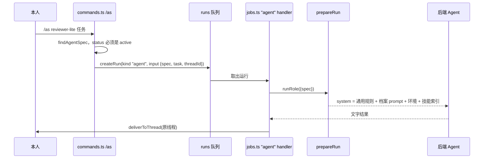

这页回答四个问题：Agent 档案（spec）和角色（role）差在哪；技能（skill）怎么创建、怎么被 Agent 发现并使用；档案怎么被交办任务；谁可以改它们。读完你能手写一个档案、判断它运行时拿到哪些工具和空间，并知道要改行为该动哪个文件。运行时与工具权限的总体机制在 [Agent 运行时与 MCP 工具权限](./agent-runtime-and-tools.md)，内置角色和任务队列在 [任务队列、Run 与角色](./run-queue-and-roles.md)，这里不重复。

## 一个例子：/as reviewer-lite

假设库里有这样一个档案 `library/_agents/reviewer-lite.md`（示例，字段取自 schema）：

```markdown
---
description: 只读审阅改动，给出风险清单
agent: claude
effort: low
space: omem
skills: [review-checklist]
---

你负责审阅……（system prompt 正文）
```

在聊天里发 `/as reviewer-lite 看下 runner.ts 的改动`，发生的事：



`/as` 先查档案，草稿直接拒绝并提示 `/approve agent <名>`；带任务时只建一个 `agent` 类型的 run，不改线程设置，返回“已交给……”后命令就结束了（[commands.ts:183-207](../../../src/agents/commands.ts#L183-L207)）。run 由 `registerHandler("agent")` 执行：读出档案，用 `runRole` 跑，把答案以“**档案名** 完成了「任务」：……”发回原线程（[jobs.ts:68-85](../../../src/agents/jobs.ts#L68-L85)）。`/as reviewer-lite` 不带任务则相反：把 `thread.settings.spec` 设为该档案，之后这个线程的每条消息都由它回答（见后文“线程级默认”）。

## 档案与角色的区别

两者最终都走 `prepareRun`，区别在来源和谁能改：

| | 角色（role） | 档案（spec） |
|---|---|---|
| 位置 | 仓库里的 `roles/*.md`，随代码发布 | 知识库 `library/_agents/<name>.md`，是数据 |
| 谁改 | 开发者，改代码仓库 | 本人（网页或命令）或 Agent（`save_agent` 工具） |
| 工具清单 | 角色 frontmatter 的 `tools` | 档案的 `tools`，缺省为 `DEFAULT_SPEC_TOOLS` |
| 后端 | `profileFor(角色)` 按配置选 | 档案的 `agent`/`model`/`effort` 覆盖 |
| 用途 | 宿主内部流程：wiki-writer、dreamer、summarizer…… | 本人或助理想要的“专门做某类事的 Agent” |

`loadRole` 从 `roles/` 读 frontmatter 的 `description/tools/writes/modes` 和正文（[runner.ts:25-46](../../../src/agents/runner.ts#L25-L46)）。档案没有 `modes` 字段，`prepareRun` 按 `writes` 推出：可写时 `["acceptEdits","default"]`，否则 `["read-only","default","plan"]`（[runner.ts:176-178](../../../src/agents/runner.ts#L176-L178)）。

## agentSpecSchema 的字段

schema 是 zod 定义（[specs.ts:32-52](../../../src/agents/specs.ts#L32-L52)）：

- `name`：只能是小写字母、数字、连字符，最长 48（正则 `NAME`）；文件名即名称，frontmatter 里不存。
- `description`：必填，“做什么、什么时候该用它”。助理靠它挑档案，所以要写成触发条件。
- `status`：`active`（默认）或 `draft`。
- `agent`、`model`、`effort`：后端 profile id 与覆盖项；不填则 `agent` 用助理的后端，`model`/`effort` 用 profile 自带的。
- `tools`：允许的 omem 工具，缺省空数组，运行时展开为 `DEFAULT_SPEC_TOOLS`（只读检索、读页面、`recall`、读会话、`list_skills/read_skill` 等，[specs.ts:55](../../../src/agents/specs.ts#L55)）。
- `writes`：能否改工作目录文件，默认否。
- `space` / `spaces`：默认空间 / 额外可读空间，`["*"]` 表示全部。
- `cwd`：工作目录。
- `skills`：只在提示里列出这些技能。
- `mcp`：额外 MCP 服务，stdio（`command/args/env`）或 HTTP（`url/headers`）二选一。
- `instructions`：类似 AGENTS.md 的长期约定，拼进 system prompt。

正文是 system prompt，不在 schema 里，类型 `AgentSpec` 把它加成 `prompt`（[specs.ts:53](../../../src/agents/specs.ts#L53)）。

## 存储：文件 + Git

档案是 `library/_agents/<name>.md`（frontmatter + 正文），技能是 `library/_skills/<name>/SKILL.md`，旁边可放模板、脚本等附带文件（[specs.ts:9-22](../../../src/agents/specs.ts#L9-L22)）。库目录是 Git 仓库，每次保存都 `commitLibrary`，提交信息带操作者：`user: edit agent x`、`agent: create skill y (draft)`。网页的 `agentSpecHistory` 读的就是这份文件历史。

`saveAgentSpec` 是“合并写”：读出旧档案，用传入的非 undefined 字段覆盖，再过一遍 schema；正文为空直接报错；写文件前删掉空数组、空对象、`status: active`、`writes: false`，让文件保持简短（[specs.ts:99-115](../../../src/agents/specs.ts#L99-L115)）。因此 `/approve` 只需传 `{name, status:"active"}` 就能启用，不会丢其他字段（[commands.ts:224-233](../../../src/agents/commands.ts#L224-L233)）。

## 创建：save_agent 与 save_skill

助理想建档案时调用 `save_agent`，工具描述写明规矩：本人明确要求时直接建；自己觉得有用时 `draft=true` 起草，等本人 `/approve`（[tools.ts:325-351](../../../src/agents/tools.ts#L325-L351)）。handler 的状态逻辑是：`draft` 为真 → 草稿；否则沿用已有档案的状态，新建则为 `active`。所以“agent 创建的默认草稿”靠的是工具说明和角色提示，不是代码强制：schema 默认值是 `active`，助理不传 `draft` 就会直接生效。`save_skill` 同理，且校验 description 与正文非空，附带文件名不得含 `..`、不得以 `/` 开头、不得覆盖 `SKILL.md`（[specs.ts:165-182](../../../src/agents/specs.ts#L165-L182)）。

哪些角色有这些工具由角色 frontmatter 决定：`assistant` 同时有 `list_agents/save_agent/run_agent/save_skill`，`dreamer` 有 `save_skill/save_agent` 但没有 `run_agent`（从 `roles/assistant.md`、`roles/dreamer.md` 的 `tools` 行看）。dreamer 的提示要求同类多步骤工作出现两次以上才起草。起草出的东西不会被任何 Agent 使用，直到本人启用：`listAgentSpecs`/`listSkills` 默认只返回 `active`，`run_agent` 和 `/as` 都拒绝草稿。

本人启用有三条路：`/approve agent|skill <名>`；网页 Agents 页点“启用”，它只是把原文里的 `status: draft` 行删掉再保存（[Agents.vue:112-116](../../../web/src/views/Agents.vue#L112-L116)）；或直接编辑文件。

## 校验：解析失败不写入

网页编辑器走 `saveRaw`：先拆 frontmatter，档案用 `agentSpecSchema.parse` 校验并要求正文非空，技能要求 `description` 非空，通过了才 `writeFileSync` 和提交（[specs.ts:218-235](../../../src/agents/specs.ts#L218-L235)）。不合法会抛错，磁盘上的旧文件不变。已经在盘上的坏文件（比如手工改坏）则由 `listAgentSpecs` 跳过并打印警告，不影响其他档案（[specs.ts:72-85](../../../src/agents/specs.ts#L72-L85)）。

注意 `saveRaw` 不检查 `status` 的来源：谁都可以在网页里把 draft 改成 active，这正是“本人审批”的实现方式，不是权限控制。

## prepareRun 的 spec 分支

`prepareRun` 里凡是涉及 `spec` 的地方（[runner.ts:134-180](../../../src/agents/runner.ts#L134-L180)）：

1. 后端：`input.profileId` 优先，其次 `spec.agent`，再回落到助理的配置；`model`/`effort` 用档案值覆盖。
2. 空间：调用方没给空间时用 `spec.space`。工作目录依次取调用方传入、`spec.cwd`、空间的 `rootPath`、空间的库目录。
3. 工具：`spec.tools` 为空则用 `DEFAULT_SPEC_TOOLS`；无论哪种，都强制加上 `list_skills` 和 `read_skill`。
4. 空间范围：档案默认 `[自己的空间, ...spec.spaces]`；含 `"*"` 则不限（`null`）。角色里只有助理不限空间，其他角色只能在自己的空间。
5. 令牌：`issueToolToken` 把上面的工具集合、空间范围、`runId` 绑在一起，MCP 桥接按它放行或拒绝调用（细节见 [concepts/agent-runtime-and-tools](./agent-runtime-and-tools.md)）。
6. system prompt：`commonGuide()` + 档案（`# 角色：<description>`、`prompt`、`instructions`）+ 环境（时间、空间、SPACE.md、偏好与经验记忆、技能索引）。助理角色另外附上档案索引，档案本身看不到其他档案。
7. `extraMcp = spec.mcp` 原样交给后端；`allowWrites = spec.writes`。

读代码时注意两点：`DEFAULT_SPEC_TOOLS` 没有任何写入工具，所以不配 `tools` 的档案只能读；而 `writes` 只管文件系统，不管 omem 写工具，要让档案写记忆、页面，必须把 `remember`、`write_page` 等列进 `tools`。

## 技能：渐进披露

技能不会整篇塞进 prompt。`skillIndex` 只输出每个技能一行：`- 名称：description（全文：read_skill，或读取 …/SKILL.md）`；档案配了 `skills` 就只列这些，没配则列全部 active 技能（[specs.ts:196-202](../../../src/agents/specs.ts#L196-L202)）。环境段里标题是“可用技能（做对应的事之前先读全文并照做）”（[runner.ts:167](../../../src/agents/runner.ts#L167)）。Agent 判断匹配后调用 `read_skill` 拿正文和附带文件列表，需要时再用 `file` 参数读附带文件（[tools.ts:377-389](../../../src/agents/tools.ts#L377-L389)）。所以 `description` 的质量决定技能会不会被用上，它要写成“做什么、什么时候用”。

`skills` 只限制索引，不限制 `read_skill`：因为 `list_skills/read_skill` 始终在工具集里，档案仍可以按名字读到未列出的技能（从实现看，没有对 `read_skill` 做名单过滤）。

仓库自带的 [skills/omem/SKILL.md](../../../skills/omem/SKILL.md#L1-L41) 是同一格式（`name` + `description` frontmatter，Markdown 正文），但用途不同：它是给外部 Agent（Claude Code、Codex 等）看的“怎么使用 omem”，讲 MCP 接入和 `omem` 命令行，放在仓库里随代码发布；`library/_skills/` 里的是 omem 自己的 Agent 在运行时读的做法，属于用户数据。两者的 `description` 都是触发条件（前者写“当问题涉及‘我之前…’……时使用”），区别只在谁来发现它。

## 交办与线程级默认

交办有两种入口，都落到同一个 `agent` run：命令 `/as 名 任务`，和助理调用的 `run_agent`。后者从当前 run 的输入里取线程 id，找不到则没有回传目标；档案是草稿时抛错；空间取参数、档案 `space`、当前空间中的第一个可用（[tools.ts:353-365](../../../src/agents/tools.ts#L353-L365)）。run 的 `parentId` 指向发起它的 run，方便追溯。

线程级默认是 `thread.settings.spec`。`/as 名` 设置它，`/as off` 清除，同时清掉群级 `chat_settings.spec`（[commands.ts:189-193](../../../src/agents/commands.ts#L189-L193)）。新线程在 `resolveThread` 里从群设置继承 `spec`（[threads.ts:152](../../../src/agents/threads.ts#L152)）；`/new` 也把当前线程的 `spec` 带到新线程（[commands.ts:63](../../../src/agents/commands.ts#L63)）。每轮回答时 `actorFor` 重新读档案，只有仍是 `active` 才使用，否则悄悄回落到助理（[sessions.ts:85-90](../../../src/agents/sessions.ts#L85-L90)）。

注意 `/agent` 不是设档案：它选的是后端 profile（codex、claude……），写入 `settings.profile`。设档案用 `/as`。另外从当前代码看，`chat_settings.spec` 只有读取和 `/as off` 的清除，没有找到写入它的地方；`/as 名` 只更新线程设置，所以群级默认档案目前没有入口设置（推断，未查到其他调用方）。线程与 Agent 会话的关系见 [concepts/threads-and-agent-sessions](./threads-and-agent-sessions.md)。

## 谁能改

- 本人：网页 Agents 页（`PUT /api/library-files/...`、`/api/agents`、`/api/skills`）、聊天里的命令、直接编辑库文件再提交。
- 助理：`save_agent`/`save_skill`，提交者记为 `agent`。保存已存在的档案时沿用它当前的状态，所以助理改一个已启用的档案会立刻生效，不会重新变回草稿（从 `save_agent` 的状态逻辑推断）。
- dreamer：只能起草，且没有 `run_agent`。
- 任何 Agent 若被某档案的 `tools` 列入 `save_agent`，也能改档案；`DEFAULT_SPEC_TOOLS` 不含它。

所有改动都在库的 Git 历史里，可回看、回滚。

## 要改这里从哪下手

- 新增档案字段：先改 `agentSpecSchema`（[specs.ts:32](../../../src/agents/specs.ts#L32)），再在 `prepareRun` 里用上；`save_agent` 的 zod 参数（[tools.ts:329-345](../../../src/agents/tools.ts#L329-L345)）、`list_agents` 的展示、`Agents.vue` 顶部的 `Spec` 类型要同步。`saveAgentSpec` 会自动保存新字段，但工具层和网页类型不会。
- 改默认工具：`DEFAULT_SPEC_TOOLS`；注意工具名必须是 `tools.ts` 里实际注册的。
- 改“agent 创建默认草稿”的策略：目前只在 `save_agent` handler 与 `roles/assistant.md`；要强制就在 handler 里对 `ctx.actor === "agent"` 的新建固定写 `draft`。
- 改技能被发现的方式：`skillIndex` 和 `prepareRun` 的“可用技能”段。
- 测试：`test/threads.test.ts` 的“answers with an agent spec”用例覆盖了建技能、建档案、`/as` 接管、`/as 名 任务` 回传（[threads.test.ts:125-142](../../../test/threads.test.ts#L125-L142)）；改运行时后还要跑 `test/fake-acp-agent.ts` 的真实 ACP/MCP 路径（见 [howto/run-and-develop](../howto/run-and-develop.md)）。
- 没有数据库迁移：档案和技能都是文件，旧文件字段缺失时靠 zod 默认值兜底。
