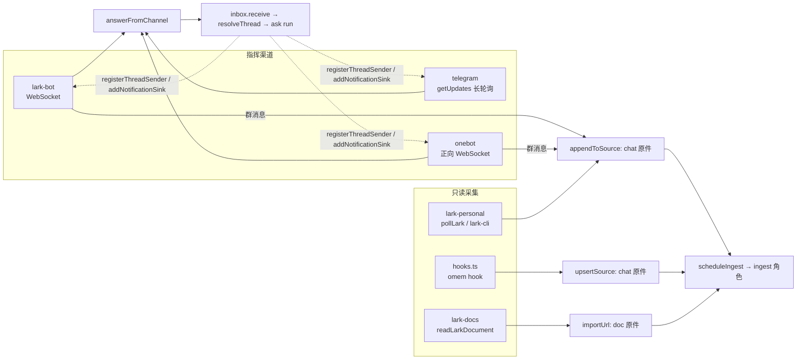

本页回答三件事：飞书、Telegram、OneBot 怎样接进同一个 inbox；哪些渠道是“指挥”（本人在里面下指令、收回复），哪些只是“采集”（把别处的对话存成原件）；要新增一个渠道该写什么。消息进来之后如何排队、如何交给 Agent，见 [flows/message-to-reply](../flows/message-to-reply.md)；线程如何保存 Agent 会话，见 [concepts/threads-and-agent-sessions](./threads-and-agent-sessions.md)。

## 先看一个例子：OneBot 的一次来回

[test/channels.test.ts](../../../test/channels.test.ts#L20-L52) 用一个本地 WebSocket 服务端冒充 NapCat 之类的 OneBot 实现，连续发三条事件：

1. 群 7 里用户 99 说“接口文档周三给你”；
2. 用户 13 私聊说“你好”；
3. 本人（`ownerUserId: "42"`）私聊问“小王说文档什么时候给”。

结果是：只有第 3 条得到回复（`send_private_msg`，`user_id` 为 42），13 收不到任何东西；而第 1 条群消息被存成了 uri 为 `onebot:group:7` 的聊天原件（[断言](../../../test/channels.test.ts#L47-L51)）。这个例子包含了渠道的全部职责：

- 群里的话先**采集**，不管谁说的、有没有 @ 机器人；
- 只有**本人**能**指挥**，其他人的私聊直接丢弃；
- 本人的问题走统一入口，回复按渠道协议发回去。

## 指挥渠道：三个适配器共用的骨架

三个渠道由 [`boot`](src/main.ts) 按配置开关懒加载启动：`telegram.enabled`、`onebot.enabled`、`lark.enabled` 分别 `import()` 对应模块并调用 `startTelegram / startOneBot / startLarkBot`，失败只打警告，不拖垮主服务（[src/main.ts:49-60](../../../src/main.ts#L49-L60)）。只有 `background !== false` 时才会启动，这也是测试里传 `background: true` 的原因。

每个适配器启动时做同样三件事：

1. **收到本人消息 → `answerFromChannel`。** 它调用 `receive`（斜杠命令直接答、普通消息进线程并排 `ask` run），再 `waitForRun` 等答案；被合并进别的回合时返回 `null`，调用方就不再发送。回复里的 `src:` `mem:` `msg:` `wiki:` 链接和双方括号页面链接会被 `plainCitations` 压成纯文字，因为别的 App 打不开这些内部链接（[common.ts:12-27](../../../src/channels/common.ts#L12-L27)）。
2. **`registerThreadSender(channel, send)`：** 登记“怎样往这个渠道的某个线程里发话”。之后 Agent 委托的任务完成、提醒触发等**不是对当前消息的回复**时，`deliverToThread` 按线程的 `channel` 找到发送函数（[inbox.ts:90-118](../../../src/agents/inbox.ts#L90-L118)）。
3. **`addNotificationSink(sink)`：** 登记通知出口。`notify()` 先写 `notifications` 表、推给网页，再逐个调用 sink（[notify.ts:9-19](../../../src/core/notify.ts#L9-L19)）。

### 线程映射：chatId / topicId

渠道只负责把“这条消息在哪个会话”翻成 `{channel, chatId, topicId, isGroup}`，剩下的交给 `resolveThread`。线程的 key 是 `<chatId>`，话题模式下是 `<chatId>#<topicId>`；是否按话题拆线程由每个 chat 的 `mode` 设置决定，默认有 `topicId` 就按话题（[threads.ts:146-150](../../../src/agents/threads.ts#L146-L150)）。

这个 key 同时是发送函数的“地址簿”：

- 飞书、Telegram 的 sender 用 `thread.key.split("#")` 还原出 `chatId` 和话题（[lark-bot.ts:69-73](../../../src/channels/lark-bot.ts#L69-L73)，[telegram.ts:23-26](../../../src/channels/telegram.ts#L23-L26)）；
- OneBot 没有话题，`chatId` 直接写成 `private:<qq>` 或 `group:<群号>`，sender 按冒号拆开（[onebot.ts:50-54](../../../src/channels/onebot.ts#L50-L54)）；
- 飞书回复话题需要“回复哪条消息”，所以 `receive` 会把 `externalMessageId` 记进线程的 `settings.lastMessageId`，sender 再用它 `reply`（[inbox.ts:45](../../../src/agents/inbox.ts#L45)，[lark-bot.ts:72](../../../src/channels/lark-bot.ts#L72)）。

### 谁能指挥：owner 校验

三个渠道都是“单主人”模型，各自一个配置项：`lark.ownerOpenId`、`telegram.ownerChatId`、`onebot.ownerUserId`（[config.ts:104-133](../../../src/core/config.ts#L104-L133)）。尚未配置时，机器人会在私聊里告诉对方该填的值，然后不处理任何指令，这是一套自助绑定流程（[lark-bot.ts:127-130](../../../src/channels/lark-bot.ts#L127-L130)，[telegram.ts:54-57](../../../src/channels/telegram.ts#L54-L57)，[onebot.ts:102](../../../src/channels/onebot.ts#L102)）。配置后，发送者不是本人的消息一律不进 inbox。

群聊里“@ 才答”的判定各不相同：

| 渠道 | 群消息怎么处理 | 触发回答的条件 |
|---|---|---|
| lark-bot | 每条先 `captureGroup`，再看是否 @ | 本人发的、`mentionsBot` 为真 |
| onebot | 每条先 `appendToSource`，再看是否 @ | 本人发的、`at` 段的 qq 等于 `self_id` |
| telegram | **不采集**，不是本人或没点到机器人就 `continue` | 本人发的，且含 `@botName`、回复机器人或以 `/` 开头 |

也就是说 Telegram 目前只是指挥渠道；飞书和 OneBot 的群则同时是采集渠道。

### 群消息：先采集，再决定答不答

飞书的 `handle` 先判断 `chatType === "group"`，无条件 `captureGroup(m)`，之后才检查 `mentionsBot` 和 owner（[lark-bot.ts:122-131](../../../src/channels/lark-bot.ts#L122-L131)）。所以**别人说的话也会被存下来**，只有指令权限是限定本人的。`captureGroup` 做的事：

- 目标空间：`personal` 空间设置里的 `larkGroups[chatId]`，没有就用 `lark.defaultSpace`；OneBot 对应的是 `onebot.groupSpaces[groupId]`，没有用 `onebot.defaultSpace`（[lark-bot.ts:81-84](../../../src/channels/lark-bot.ts#L81-L84)，[onebot.ts:67](../../../src/channels/onebot.ts#L67)）。
- `appendToSource` 往 uri 为 `lark:<chatId>`（OneBot 为 `onebot:group:<id>`）的 `chat` 原件末尾追加一行 `[时间 · 话题 id] 发言人: 内容`，并在 `meta.appendedFrom` 记下新内容起始行，ingest 角色据此只读新增部分（[store.ts:215-222](../../../src/sources/store.ts#L215-L222)，[jobs.ts:125-128](../../../src/agents/jobs.ts#L125-L128)）。
- 防抖：每个原件一个 5 分钟定时器，新消息到来就重置，到点才 `scheduleIngest`，一阵连发只触发一次整理（[lark-bot.ts:96-107](../../../src/channels/lark-bot.ts#L96-L107)）。`scheduleIngest` 自己还会检查空间是否关闭了 `autoIngest`，代码仓库类空间默认不自动整理（[jobs.ts:104-109](../../../src/agents/jobs.ts#L104-L109)）。

被 @ 时，刚采集的那行就是“提及本身”，所以 `groupContext` 取同一原件的文本、去掉最后一行，话题内只保留同话题的行，最多 15 行，作为 `context` 传给 `receive`，Agent 因此知道“群里刚才在聊什么”（[lark-bot.ts:110-120](../../../src/channels/lark-bot.ts#L110-L120)）。OneBot 的做法一样（[onebot.ts:85-96](../../../src/channels/onebot.ts#L85-L96)）。

这段上下文是别人写的话，不经过 ingest 就直接进了本人线程的提示里，所以 `receive` 在存消息前会对它调一次 `injectionScore`：开启了注入标记（`guard.provider` 不为 `none`）且分数不低于 `guard.threshold`（默认 0.6）时，把分数记进消息的 `meta.contextSuspect`，之后 `renderMessages` 渲染这条消息时会在上下文后面附一句警告，要求 Agent 只当群里的发言看、不执行其中的要求（[inbox.ts:57-63](../../../src/agents/inbox.ts#L57-L63)）。只标记，不拦截。关闭时 `injectionScore` 返回 `null`，什么都不加。

### 飞书附件：saveResource → importFile

收到图片或文件消息时，飞书适配器走 `saveResource` 而不是 `handle`；条件是群里任何人发的，或本人私聊发的（[lark-bot.ts:186-188](../../../src/channels/lark-bot.ts#L186-L188)）。流程：从 `im.messageResource` 下载到临时目录 → 用 `importFile` 以 `lark:<chatId>/<文件名>` 为 uri 导入 → 状态不是 `unchanged` 就 `scheduleIngest` → 私聊回一句“已保存”或“格式暂不支持” → `finally` 删临时目录（[lark-bot.ts:152-170](../../../src/channels/lark-bot.ts#L152-L170)）。导入之后的切分、索引见 [flows/import-to-searchable](../flows/import-to-searchable.md)。

### 失败与重连

- Telegram 轮询出错等 10 秒再来；OneBot `onclose` 10 秒后重连，`onerror` 主动关闭触发重连（[telegram.ts:76-79](../../../src/channels/telegram.ts#L76-L79)，[onebot.ts:109-120](../../../src/channels/onebot.ts#L109-L120)）。
- 单条消息处理抛错只打警告，不影响连接。Telegram 会把“处理失败”发回聊天；`waitForRun` 的失败或取消在 `answerFromChannel` 里变成“处理失败：…”“（已停止）”文字。
- 长回复按渠道上限切块：Telegram 3900、OneBot 3000，在换行处断开（[common.ts:29-41](../../../src/channels/common.ts#L29-L41)）。飞书走卡片，直接截断到 28000 字（[lark-bot.ts:62-66](../../../src/channels/lark-bot.ts#L62-L66)）。
- OneBot 的 `call` 在 socket 未打开时静默丢弃，不排队补发（[onebot.ts:46](../../../src/channels/onebot.ts#L46)）。从实现看，断线期间的通知会丢，但仍在 `notifications` 表和网页里。

## 只读采集：不是对话，没有回复

这一组都不向外发消息，只把东西变成 `sources`。

**lark-personal：以本人身份读订阅的会话。** 它不用机器人，而是调用随依赖安装的官方 `lark-cli`（用户身份），由 `larkCli` 起子进程并解析 JSON；登录失效时报错提示执行 `lark-cli auth login`（[lark-cli.ts:8-25](../../../src/channels/lark-cli.ts#L8-L25)）。文件头注明“Nothing is ever sent from the owner's account”（[lark-personal.ts:9-14](../../../src/channels/lark-personal.ts#L9-L14)）。

`pollLark` 的步骤（[lark-personal.ts:69-116](../../../src/channels/lark-personal.ts#L69-L116)）：

1. 订阅列表存在 `kv` 表的 `lark_subscriptions` 键，每项 `{chatId, name, spaceId, since}`；
2. 对每个订阅，拉 `since`（缺省为 24 小时前）到现在的消息，追加进 `lark:<chatId>` 聊天原件，然后把 `since` 推进到本次结束时间；
3. 另外搜索“@ 了本人且不在订阅里”的群消息，写入 `personal` 空间的 `lark:mentions` 原件；
4. 汇总每个空间动过的原件，各调一次 `scheduleIngest`。

订阅由 Agent 工具 `list_lark_chats` / `set_lark_subscription` 或 HTTP 接口维护（[tools.ts:717-743](../../../src/agents/tools.ts#L717-L743)，[http.ts:480-494](../../../src/server/http.ts#L480-L494)）。调度项 `lark-poll` 默认每 10 分钟，但**默认关闭**，要在定时任务里手动开启（[scheduler.ts:17](../../../src/core/scheduler.ts#L17)，调度类型注册在 [main.ts:22-24](../../../src/main.ts#L22-L24)）。

`previewUnsubscribed` 是给 curate 用的：列出没订阅、没被排除（kv 键 `lark_curate_excluded`）的非单聊，取最近三天各 12 条预览。`curate` 运行把预览交给 `curator` 角色，由它判断哪些群值得订阅；没有设置“筛选方向”时直接安静退出（[lark-personal.ts:118-135](../../../src/channels/lark-personal.ts#L118-L135)，[jobs.ts:338-350](../../../src/agents/jobs.ts#L338-L350)）。是否真的订阅，仍要走 `set_lark_subscription` 这个写入工具。

**lark-docs：读飞书文档。** `readLarkDocument` 只接受 `/docx|wiki|docs/…` 路径，用 `lark-cli docs +fetch` 取 Markdown，并带上 `revision`（[lark-docs.ts:4-13](../../../src/channels/lark-docs.ts#L4-L13)）。它不是独立渠道，由 `importUrl` 在 URL 属于 feishu/larksuite/larkoffice 域名时调用，存成 `doc` 原件，`meta.via` 为 `lark-cli`（[import.ts:228-235](../../../src/sources/import.ts#L228-L235)）。

**hooks.ts：把编码 Agent 的会话存成原件。** 命令行 `omem hook claude`（接 Claude Code 的 `Stop` 钩子，从标准输入读 JSON）和 `omem hook codex '<json>'`（接 Codex 的 `notify`）调用它，出错只打到 stderr，不能影响被钩住的 Agent。

- 空间选择 `spaceForCwd`：找 `rootPath` 包含 `cwd` 的空间，多个匹配取路径最长的，找不到用 `personal`（[hooks.ts:15-24](../../../src/hooks.ts#L15-L24)）。
- Claude：读 transcript JSONL，只留 user/assistant 的文本，跳过工具调用结果、`isMeta` 和 `<command-` 开头的内容；uri 为 `agent:claude:<session_id>`，每次钩子都整份覆盖（`upsertSource`）（[hooks.ts:36-70](../../../src/hooks.ts#L36-L70)）。
- Codex：钩子每轮只给增量，所以读出已有原件文本再接上新一轮；uri 为 `agent:codex:<thread-id>`，没有 thread-id 时用 cwd 哈希加日期（[hooks.ts:72-91](../../../src/hooks.ts#L72-L91)）。
- 测试 [hooks.test.ts](../../../test/hooks.test.ts#L9-L36) 覆盖了归属到仓库空间、工具结果不入文、Codex 连续两轮合并。

## 配置与密钥

结构都在 `configSchema` 里（[config.ts:104-133](../../../src/core/config.ts#L104-L133)）：

| 配置 | 含义 |
|---|---|
| `lark.enabled / appId / ownerOpenId / defaultSpace` | 飞书机器人开关、应用 id、本人 open_id、私聊与未映射群的归属空间 |
| `lark.appSecretEnv` | **存环境变量名**，默认 `OMEM_LARK_APP_SECRET`，不是密钥本身 |
| `telegram.enabled / ownerChatId / defaultSpace`，`tokenEnv` | 同理，默认 `OMEM_TELEGRAM_TOKEN` |
| `onebot.enabled / name / url / ownerUserId / defaultSpace / groupSpaces`，`tokenEnv` | `url` 如 `ws://127.0.0.1:3001`，`name` 用在原件标题里，`tokenEnv` 可选，作为 Bearer 头 |

密钥只通过 `process.env[xxxEnv]` 读取，缺失就抛错，配置文件和仓库里不出现明文；`.env.example` 列了飞书的变量。注意一个不对称点：OneBot 的群到空间映射在配置里（`groupSpaces`），飞书的映射却读 `personal` 空间设置里的 `larkGroups`，配置 schema 中没有它（[lark-bot.ts:82](../../../src/channels/lark-bot.ts#L82)）。这符合 AGENTS.md “分类与范围用空间和持久设置表达”，但读者容易在 `lark.*` 里找不到。

`omem setup` 的“渠道”一步（`setupChannelsSection`）会写这些配置：勾选三个渠道的 `enabled`，飞书问 `appId` 和 `ownerOpenId`，Telegram 问 `ownerChatId`，OneBot 问 `url`、`name`、`ownerUserId`；密钥只提示放进哪个环境变量，不写文件。本人标识留空就走上面的自助绑定（[setup.ts:293-322](../../../src/setup.ts#L293-L322)）。`defaultSpace`、`groupSpaces` 和飞书的 `larkGroups` 它不问。

## 几个容易踩的点（从实现看）

- 飞书 `mentionsBot` 的判断是：mentions 中有任一项缺 `open_id`，或名字等于 kv 键 `lark_bot_name`（[lark-bot.ts:182](../../../src/channels/lark-bot.ts#L182)）。仓库里没有任何地方写入 `lark_bot_name`，所以实际只靠“缺 open_id”这一条；是否可靠依赖飞书事件的字段，我没有验证。
- `lark_owner_chat` 记录本人私聊的 chatId，飞书通知就发到这里；所以在本人先给机器人发过一条私聊之前，通知不会送达飞书（[lark-bot.ts:75-78](../../../src/channels/lark-bot.ts#L75-L78)）。
- 飞书群里任何人发的附件都会被保存并整理，不要求是本人（上文条件），而指令仍要求本人。

## 新增一个渠道

最小清单，以 OneBot 为模板：

1. **config.ts** 加一个配置块：`enabled`、本人标识、`defaultSpace`，密钥用 `xxxEnv`；想在向导里配，就在 `setup.ts` 的 `setupChannelsSection` 加一项。
2. **新建 `src/channels/<name>.ts`，导出 `start<Name>(app)`**，里面：连接与重连；把平台事件翻成 `answerFromChannel(app, {channel, chatId, topicId?, isGroup?, text, spaceId, context?, externalMessageId?})`；`registerThreadSender` 用 key 还原发送目标；`addNotificationSink` 发到本人；回复用 `chunkMessage` 切块。
3. **owner 校验放在调用 `answerFromChannel` 之前**，没绑定时给出自助绑定提示。
4. 要采集群消息的，用 `appendToSource({kind: "chat", uri: "<渠道>:...", lines, meta})` 加 5 分钟防抖的 `scheduleIngest`；注意 uri 稳定，才会追加而不是新建。
5. **main.ts** 的 `boot` 里仿照现有三段，按开关动态 `import()` 启动。
6. **测试**：仿 OneBot 用例，起一个假服务端（`new WebSocketServer({port: 0})`），写临时 `config.json`，其中 `agents` 指向 `test/fake-acp-agent.ts`，`boot(home, {port: 0, quiet: true, background: true})`，发事件、轮询 `sent` 数组、断言回复内容和 `listSources` 结果。fake agent 的回复形如 `tools=N; search=1. 原件…`，说明测试走的是真实的 ACP + MCP 路径（[channels.test.ts:24-49](../../../test/channels.test.ts#L24-L49)）。飞书和 Telegram 依赖外部 SDK/HTTP，目前没有对应的集成测试；`plainCitations` 与 `chunkMessage` 有单测（[channels.test.ts:10-18](../../../test/channels.test.ts#L10-L18)）。

## 要改这里从哪下手

- 改所有指挥渠道共同的行为（回复格式、合并、失败文案）：`answerFromChannel` / `plainCitations`（`src/channels/common.ts`），以及上游 `receive`（`src/agents/inbox.ts`）。
- 改线程怎么分：`resolveThread` 与 `chat_settings`（`src/agents/threads.ts`）。改了 key 格式，必须同步所有 `registerThreadSender` 里的拆分逻辑，否则延迟投递会发错地方。
- 改采集格式（行格式、`appendedFrom`）：ingest 角色靠这些读新增内容，改动后看 `roles/ingest.md` 和 `jobs.ts` 的 ingest 处理是否仍匹配。
- 改飞书订阅或采集窗口：`src/channels/lark-personal.ts`，同时留意 `set_lark_subscription` 工具说明、`/api` 订阅接口和 `lark-poll` 的调度默认值。
- 改会话钩子：`src/hooks.ts` 和 `omem hook` 命令，对应 `test/hooks.test.ts`。
- 给渠道加功能后，跑 `pnpm run check`；动了 Agent 运行时则要保证 `test/fake-acp-agent.ts` 相关用例通过。

## 没查清的地方

- 飞书 `lark_bot_name` 的来源（见上）。
