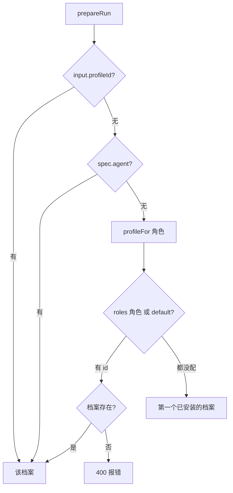
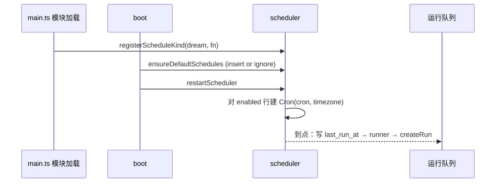

这页回答四件事：哪些东西可配置、存在哪；`omem setup` 到底改了什么；怎样给不同角色指定不同模型；定时任务怎么注册和触发。读完你可以自己改 `config.json`、判断改动要不要重启，也知道新增一个定时任务或设置项该动哪几处。

## 先看一个目标：日常问答用 codex 低 effort，Wiki 和评审用 claude

设置分两层：**config.json** 放宿主级的东西（Agent、向量、渠道、并发），**数据库**放会变化的东西（空间的 `settings`、`schedules` 表）。上面这个目标只涉及 config.json 的 `agents`，写成下面这样（示例是按 schema 写的，不是仓库里的现成文件）：

```json
{
  "agents": {
    "default": "codex",
    "roles": {
      "wiki-planner": "claude", "wiki-writer": "claude", "wiki-linter": "claude",
      "reviewer": "claude", "coder": "claude", "dreamer": "claude", "tutor": "claude"
    }
  }
}
```

没列出的角色（assistant、ingest、heartbeat 等）走 `default`，也就是 codex。内置的 codex 档案已经是 `gpt-6.1-sol` + `low`（[config.ts:125-136](../../../src/core/config.ts#L125-L136)），所以不用再写 `profiles`；内置的 claude 档案没有指定 model 和 effort，用 Agent 自己的默认（[config.ts:148-156](../../../src/core/config.ts#L148-L156)）。

不想手写的话，`omem setup` 的 agents 分区问的就是这件事：选默认 Agent，再回答“按任务分开指定？”，分别给“日常”和“深度”各选一个后端（[setup.ts:232-237](../../../src/setup.ts#L232-L237)）。

## config.json 里有什么

`loadConfig` 读 `$OMEM_HOME/config.json`（默认 `~/.omem`），文件不存在就当 `{}`，再用 `configSchema` 解析补全默认值；环境变量 `OMEM_PORT` 会覆盖端口（[config.ts:188-195](../../../src/core/config.ts#L188-L195)）。`saveConfig` 把解析后的完整对象整个写回（[config.ts:197-200](../../../src/core/config.ts#L197-L200)），所以 setup 或网页保存一次之后，文件里会出现所有默认值。

按块看 [configSchema](../../../src/core/config.ts#L38-L121)：

- 基础：`host`、`port`、`token`（非回环地址时需要）、`timezone`（默认取系统时区，也是 cron 的时区）、`language`。
- 并发：`concurrency`（后台运行，1～8，默认 2）和 `interactiveConcurrency`（会话轮次，默认 4）。队列怎么用这两个数见 [任务队列、Run 与角色](./run-queue-and-roles.md)。
- `sessions`：`liveMinutes`、`maxLive`、`maxTurns`、`idleHours`、`mergeMs`，控制 Agent 进程保活、会话重开和连发合并，含义见 [线程与 Agent 会话](./threads-and-agent-sessions.md)。
- `agents`：`default`、`roles`（角色名 → 档案 id）、`profiles`（自定义档案）。
- `embeddings`：`provider`（none / local / openai）、`model`、`family`、`url`、`apiKeyEnv`。检索侧怎么用见 [检索](./retrieval.md)。
- `documents`：自定义 `converter`、`engines` 尝试顺序、`doclingArtifacts` 模型目录。
- `lark`、`telegram`、`onebot`：各自的 `enabled`、所有者 id、`defaultSpace`，以及密钥所在的环境变量名。

**密钥不进 config.json，只写环境变量名。** `lark.appSecretEnv`（默认 `OMEM_LARK_APP_SECRET`）、`telegram.tokenEnv`、`onebot.tokenEnv`、`embeddings.apiKeyEnv` 都是“变量名”，渠道启动时才用 `process.env[名字]` 取值，取不到就报错（[lark-bot.ts:58-59](../../../src/channels/lark-bot.ts#L58-L59)、[telegram.ts:12-13](../../../src/channels/telegram.ts#L12-L13)）。[.env.example](../../../src/core/config.ts#L1) 里列的就是这些变量加 `OMEM_HOME`。

## Agent 档案：内置、覆盖与选择

一个档案（[agentProfileSchema](../../../src/core/config.ts#L6-L18)）包含 `transport`（acp / claude-cli / codex-cli）、`command`、`args`、可选的 `model` 与 `effort`、额外 `env` 和空闲超时。内置五个：`codex`、`traex`、`claude`（以上 ACP）、`claude-cli`、`codex-cli`。

**覆盖规则是按 id 整体替换，不是字段合并。** `allProfiles` 先放内置，再让 `config.agents.profiles` 里同 id 的条目覆盖，新 id 追加（[config.ts:202-206](../../../src/core/config.ts#L202-L206)）。所以想只把 codex 的 effort 改成 medium，`profiles` 里要写一份完整的 codex 档案（`transport`、`command` 是必填）。setup 的做法就是 `{ ...base, model, effort }` 后整条替换（[setup.ts:238-245](../../../src/setup.ts#L238-L245)）。

`profileFor(app, role)` 的选择顺序（[runner.ts:60-71](../../../src/agents/runner.ts#L60-L71)）：

1. `agents.roles[role]`，没有就用 `agents.default`；
2. 如果这一步得到了 id 但档案列表里没有，直接抛 400，**不会**回退；
3. 两者都没配，取档案列表里第一个“命令在 PATH 上”的（顺序即内置顺序：codex、traex、claude…），都没装则抛 503。

`prepareRun` 在它之上还有两个更高优先级的来源：调用方传入的 `profileId`，以及自定义 Agent spec 里的 `agent`；spec 还可以覆盖 `model` 和 `effort`（[runner.ts:138-144](../../../src/agents/runner.ts#L138-L144)）。线程上记的 `agent_profile` 也是这类“人为指定”，见 [concepts/threads-and-agent-sessions](./threads-and-agent-sessions.md)。



## omem setup 改了什么

入口是 CLI 的 `setup` 命令：不带参数调用 `setupInteractive`；`setup embeddings`、`setup documents` 是给脚本用的非交互形式（[cli-main.ts:355-398](../../../src/cli-main.ts#L355-L398)）。`setupInteractive` 先让你勾选要设置的分区，逐个执行，**每个分区跑完立刻 `saveConfig`**，所以中途退出，已完成的分区已经保存（[setup.ts:306-336](../../../src/setup.ts#L306-L336)）。六个分区：

| 分区 | 改动 |
| --- | --- |
| agents | `agents.default`、`agents.roles`、某个档案的 model/effort |
| embeddings | `embeddings` 整块；可能经 osdk 下载模型 |
| documents | `documents.engines`、`converter`、`doclingArtifacts` |
| channels | 三个渠道的 `enabled`、id；提示密钥该放哪个环境变量 |
| sessions | `sessions.*` 与两个并发数 |
| schedules | **数据库** `schedules` 表的 `enabled`，不在 config.json |

**QUICK_ROLES / DEEP_ROLES 分组。** `QUICK_ROLES` 是 assistant、ingest、heartbeat、summarizer、brief、curator，`DEEP_ROLES` 是 `roleNames` 里的其余角色（wiki-planner、wiki-writer、wiki-linter、dreamer、coder、reviewer、tutor）（[setup.ts:214-215](../../../src/setup.ts#L214-L215)）。选“跟随默认”会把对应角色从 `roles` 里删掉，而不是写空串（[setup.ts:235-236](../../../src/setup.ts#L235-L236)）。分组本身是 setup 的约定，`profileFor` 并不知道它。

**osdk 管理模型。** 仓库根的 `osdk.toml` 声明工具链（node、pnpm）和三个模型：`memory-zh`（bge-small-zh）和两个 Docling 模型，都锁定到具体 commit（[osdk.toml:31-65](../../../src/core/config.ts#L1)）。setup 里选 osdk 下载时调用 `osdk model sync <alias>`，再用 `osdk model path <alias> --stable` 取本地目录，把这个目录写进 `embeddings.model`（[setup.ts:86-98](../../../src/setup.ts#L86-L98)）。`memory-zh` 以外的向量模型（base、m3）在 toml 里没有，setup 会先 `osdk model use` 临时登记。没装 osdk 就改为首次使用时从 Hugging Face 下载，不锁版本（[setup.ts:136-139](../../../src/setup.ts#L136-L139)）。

**换 embedding 模型的后果。** setup 本身不清向量。清除发生在 `embedPending`：它比较数据库 `kv` 里记录的 `embedding_model` 和当前嵌入器的 id，不一致就 `update chunks set embedding = null` 并更新记录（[embeddings.ts:85-90](../../../src/search/embeddings.ts#L85-L90)）。setup 结束时如果 `embeddings` 变了且不是 none，会问“现在为已有材料生成向量？”，同意就循环调用 `embedPending` 直到补完（[setup.ts:337-347](../../../src/setup.ts#L337-L347)）；不同意则由服务启动后每 30 秒的后台循环慢慢补（[main.ts:37-48](../../../src/main.ts#L37-L48)）。在补完之前，向量路召回只有部分片段。

## 定时任务

定时任务有两部分：**数据**在 `schedules` 表（id、kind、cron、space_id、config、enabled、last_run_at，[db.ts:188-196](../../../src/server/http.ts#L1)），**行为**在代码里按 kind 注册的函数。

1. **默认行**：`DEFAULTS` 列出六个内置任务，`ensureDefaultSchedules` 在 `boot` 时用 `insert or ignore` 写入（[scheduler.ts:11-24](../../../src/core/scheduler.ts#L11-L24)）。只有 `heartbeat`（每 15 分钟）默认启用，其余 brief、dream、repo-sync、lark-curate、lark-poll 默认关闭。因为是 `insert or ignore`，**以后改 `DEFAULTS` 里的 cron 不会影响已有数据库**，只有新 id 会被补进去。
2. **注册行为**：`main.ts` 在模块顶层调用 `registerScheduleKind(kind, runner)`，把 kind 映射到一个函数（[main.ts:11-24](../../../src/main.ts#L11-L24)）。多数 runner 只是 `createRun` 入队（如 dream、brief），所以真正的工作在运行队列里执行；heartbeat 会先检查有没有排队或运行中的同类 run，避免堆积；repo-sync 对每个有 `rootPath` 的空间调 `scheduleSpaceSync`；lark-curate 从 `schedule.config.direction` 取筛选方向。
3. **启动调度**：`boot` 在 `background !== false` 时调用 `restartScheduler`，它停掉旧 job，对每个启用且已注册 runner 的行建一个 `croner` 的 `Cron`，时区取 `config.timezone`，并开 `protect: true` 防止上一次没跑完时重叠触发。触发时先写 `last_run_at`，再在 try/catch 里执行 runner（[scheduler.ts:55-73](../../../src/core/scheduler.ts#L55-L73)）。已启用但没注册 runner 的 kind 会被静默跳过。
4. **手动触发与修改**：`triggerSchedule` 立即运行一次（不检查 enabled，也不 try/catch），网页对应 `POST /api/schedules/:id/run`；`upsertSchedule` 先用 croner 校验 cron 表达式，写库后调用 `restartScheduler`，所以通过网页 `PUT /api/schedules/:id` 改 cron 或开关**立即生效**（[scheduler.ts:30-46](../../../src/core/scheduler.ts#L30-L46)、[scheduler.ts:75-81](../../../src/core/scheduler.ts#L75-L81)、[http.ts:468-476](../../../src/server/http.ts#L468-L476)）。

setup 的 schedules 分区只是一组勾选框，直接 `update schedules set enabled`，**没有**调用 `restartScheduler`（[setup.ts:294-302](../../../src/setup.ts#L294-L302)）。它是另一个进程，改的是库；正在运行的服务要重启，或者在网页里再保存一次，才会按新开关建 job。

从实现看，现有 runner 全部把任务建在 `personal` 空间，没有读 `schedule.spaceId`；表里有 `space_id` 列，但内置 kind 还用不上它。



## 空间设置 space.settings

每个空间在 `spaces.settings` 里存一段 JSON（[spaces.ts:15](../../../src/core/spaces.ts#L15)）。网页 `PUT` 空间时是和旧值合并（[http.ts:130](../../../src/server/http.ts#L130)），但 `updateSpace` 本身是整体替换（[spaces.ts:92-106](../../../src/core/spaces.ts#L92-L106)）。目前代码里用到的键：

- `autoIngest`：新材料入库后是否自动排一个 ingest。设为 `false` 关闭；`repo` 类空间默认**不**自动整理，必须显式设为 `true`（[jobs.ts:105](../../../src/agents/jobs.ts#L105)）。
- `autoLint`：目录同步发现改动后，是否自动排 wiki-lint 检查过期页面；只有显式 `false` 才关闭（[jobs.ts:217](../../../src/agents/jobs.ts#L217)）。
- `checkCommand`：交办编码在 worktree 里跑的检查命令；任务本身带 `checkCommand` 时优先用任务的（[code.ts:68](../../../src/agents/code.ts#L68)）。见 [flows/delegated-coding](../flows/delegated-coding.md)。
- `larkGroups`：只读 **personal** 空间上的这个映射，把飞书群 chatId 对应到空间，没有映射的群落到 `lark.defaultSpace`（[lark-bot.ts:82-83](../../../src/channels/lark-bot.ts#L82-L83)）。它每条消息都从库里读，改了不用重启。

## 什么时候要重启

`loadConfig` 只在 `App.open` 时读一次。网页的 `PUT /api/settings` 会写文件并 `Object.assign` 进内存里的 `app.config`，但仍返回 `restartNeeded: true`（[http.ts:509-513](../../../src/server/http.ts#L509-L513)）。原因从实现看有几处：渠道机器人在 `boot` 里按 `enabled` 启动一次；向量循环按启动时的 provider 决定是否开；嵌入器对象是缓存的。因此改渠道、向量、并发之后重启服务最稳。空间设置和用网页改的定时任务不属于这一类，它们在库里，立刻生效。

## 取舍

- 配置分文件和数据库：宿主级、需要手改和进版本管理的放 config.json；随运行改变、有 UI 编辑的放库。代价是“设置在哪”要记两处，setup 的 schedules 分区就是例子。
- 档案按 id 整体覆盖，规则简单，但覆盖时要写全字段。
- `profileFor` 对“配了但不存在”的 id 直接报错，宁可失败也不悄悄换成别的模型。

## 要改这里从哪下手

- **加一个配置项**：在 `configSchema` 里加字段并给默认值（[config.ts:38](../../../src/core/config.ts#L38)），读的地方用 `app.config`；要在 setup 里问，就在 `setup.ts` 对应分区加一问；网页设置页在 `web/src/views/Settings.vue`。密钥只加 `xxxEnv` 变量名，并补到 `.env.example`。
- **加一个角色**：在 `roleNames` 加名字、写 `roles/<名字>.md`，再决定归 QUICK 还是 DEEP（它会自动进 DEEP，除非加入 `QUICK_ROLES`）。
- **加一个内置 Agent 后端**：往 `builtinProfiles` 加一项，并确认 setup 列表和 `commandExists` 能识别。
- **加一个定时任务**：在 `DEFAULTS` 加一行（给 `label`，setup 和网页靠它显示），在 `main.ts` 注册同名 kind 的 runner；记住已有数据库不会因此改 cron。若 runner 里要做重活，用 `createRun` 入队而不是在回调里直接跑。
- **验证**：改 Agent 运行时后跑 `pnpm run check`，让 `test/fake-acp-agent.ts` 的链路保持通过，做法见 [howto/run-and-develop](../howto/run-and-develop.md)。改嵌入模型相关的东西，对比检索指标用 `scripts/eval-retrieval.ts`。

没查清的地方：Settings.vue 与 setup 的字段是否完全一致我没有逐项核对；`.env.example` 没有说明谁来加载它，这里没有追进启动脚本确认。
