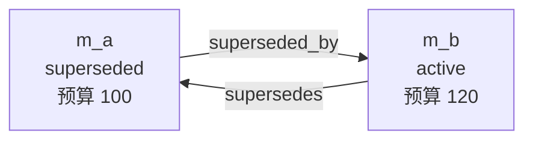
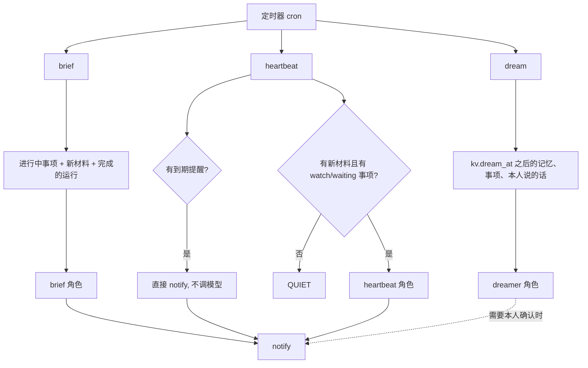

本页回答三个问题：用户说“不对，预算改成 120”时，记忆怎么变；事项的状态和时间线怎么记；巡检（heartbeat）、做梦（dream）、简报（brief）分别在什么时候做什么。读完你能判断一条纠正会在哪张表留下什么、一次后台运行会不会调用模型，以及要改这套行为时从哪个文件下手。

## 一个例子：预算从 100 改成 120

前提：库里已有一条记忆 `m_a`，kind=agreement，subject“项目A 预算”，内容“预算上限 100 元”，status=active。本人在聊天里说：“不对，预算改成 120。”

这条消息经 [一条消息从进来到回复发出](../flows/message-to-reply.md) 到达 assistant 角色。角色说明要求先 `recall` 查同主题，已有旧版本就用 `supersede` 更正，并在新内容里写清变化，例如“预算由 80 元改为 120 元（2026-10-12 本人更正）”（[roles/assistant.md:30](../../../roles/assistant.md#L30)）。所以模型的动作序列是：

1. `recall(query="项目A 预算")`：只返回 status=active 的记忆，每条带 id、有效期和来源（[tools.ts:444-468](../../../src/agents/tools.ts#L444-L468)）。
2. `supersede(memory_id="m_a", content="项目A 预算上限由 100 元改为 120 元（2026-10-13 本人更正）")`。
3. 回答末尾写一行“已更新：…”，让本人看到后可以再纠正（[roles/assistant.md:62](../../../roles/assistant.md#L62)）。

工具层先用 `inScope` 检查旧记忆所属空间在本次运行允许的范围内，不在就 403，然后才调 store（[tools.ts:569-578](../../../src/agents/tools.ts#L569-L578)）。权限与工具清单的机制见 [concepts/agent-runtime-and-tools](./agent-runtime-and-tools.md)。

store 里的 `supersede` 在一个事务里做两件事（[memory/store.ts:108-134](../../../src/memory/store.ts#L108-L134)）：

```ts
// 插入新版本，supersedes 指回旧版本
insert into memories(... status, valid_from, supersedes ...) values(... 'active', ?, oldId ...)
// 旧版本不删，只改状态并指向新版本
update memories set status='superseded', valid_to=?, superseded_by=?, updated_at=? where id=oldId
```

结果是两行：

| id | status | valid_from → valid_to | supersedes / superseded_by |
|---|---|---|---|
| m_a | superseded | 创建时间 → 更正时间 | superseded_by = m_b |
| m_b | active | 更正时间 → 至今 | supersedes = m_a |

旧版的 `valid_to` 等于新版的 `valid_from`，默认都是 `now()`，调用方传了 `valid_from` 就用传入值。测试直接断言了这一点（[library.test.ts:54-70](../../../test/library.test.ts#L54-L70)）。新版的 kind 和 subject 默认沿用旧版，所以版本链上的主题保持一致。



### 版本链的几条规则

- **只能更正有效版本。** 对已经不是 active 的记忆再 `supersede` 会抛 409，信息里带着 `superseded_by` 指向的最新版 id，提示先读最新版（[memory/store.ts:110](../../../src/memory/store.ts#L110)）。这挡住的情形是：模型拿着一个过期的 id 再改一次，会在链上分叉出两个 active 版本。
- **读历史。** `memoryHistory` 先沿 `supersedes` 往回走到链头，再沿 `superseded_by` 往前走，返回从旧到新的数组；往回走时用 `guard` 集合防止环（[memory/store.ts:161-172](../../../src/memory/store.ts#L161-L172)）。`recall(include_history=true)` 会把这条链拼成“版本链：m_a(superseded) … → m_b(active) …”附在结果后面（[tools.ts:462-465](../../../src/agents/tools.ts#L462-L465)）。assistant 回答“之前怎么约定的、什么时候改的”就靠这个（[roles/assistant.md:19](../../../roles/assistant.md#L19)）。
- **检索默认只看有效版本。** 记忆的全文索引查询里拼了 `m.status = 'active'`，只有 `includeHistory` 才去掉这个条件（[search.ts:168-172](../../../src/search/search.ts#L168-L172)）。测试里搜“项目A 预算”默认只返回 m2，带 `includeHistory` 返回两条（[library.test.ts:66-69](../../../test/library.test.ts#L66-L69)）。融合与排序见 [concepts/retrieval](./retrieval.md)。
- **`reason` 参数目前不落库。** 工具 schema 接收 `reason` 并传给 store，但 `supersede` 的实现没有用它。从实现看，“为什么改”只能写进新内容，这也是角色说明要求在内容里写清“由 X 改为 Y、何时、谁说的”的原因。

### 撤回与遗忘

模型认为一条记忆本来就不该有（重复、记错、不再需要）时用 `forget`，对应 store 的 `retract`：status 改成 `retracted`，`valid_to` 设为当前时间，撤回原因追加到 content 末尾，行不删（[memory/store.ts:136-141](../../../src/memory/store.ts#L136-L141)）。它和 supersede 的区别是没有“替代者”：`superseded_by` 为空，历史链里它就是终点。`retract` 没有检查当前 status，从代码看对一条已被 superseded 的旧版调用也会生效。

还有一条不走版本链的路径：网页里本人直接编辑记忆，走 `updateMemoryText` 原地改 content/subject/kind，并把 `created_by` 改成 `user`（[memory/store.ts:143-149](../../../src/memory/store.ts#L143-L149)）。模型没有这个工具，它只在 HTTP 接口里被调用。这是“记忆更正保留版本链”原则里的一个人工例外。

## 事项：状态与时间线

事项（`items` 表）是要做、要等、要提醒的东西。`kind` 有五种：todo 待办、waiting 等某人回复、reminder 定时提醒、watch 持续关注、decision 需要本人决定；`status` 有 open / waiting / snoozed / done / cancelled（[items/store.ts:5-6](../../../src/items/store.ts#L5-L6)）。每次变化都写进 `item_events`，所以事项表里只有“现在”，过程在时间线里。

### 新建

`upsertItem` 不带 id 就是新建：必须有标题，kind 默认 todo，status 默认 open，kind 为 waiting 时默认 waiting，priority 默认 2，space 默认 personal。事务里插入事项，再写一条 `created` 事件，文本取 `note`，没有就用“创建：标题”（[items/store.ts:93-123](../../../src/items/store.ts#L93-L123)）。

### 更新与差异

带 id 就是更新。代码把输入里非 undefined 的字段合并到旧值上，再按 `FIELD_LABEL` 里的八个字段（标题、详情、状态、优先级、截止、提醒、等待对象、类型）逐个比较，不同就拼成“提醒：2026-10-19T09:00 → 2026-10-20T09:00”这样的一段（[items/store.ts:81-90](../../../src/items/store.ts#L81-L90)，[125-129](../../../src/items/store.ts#L125-L129)）。有差异或有 `note` 才写事件：有字段变化记 `updated`，只有 note 记 `note`，note 和差异拼在同一条文本里（[items/store.ts:150](../../../src/items/store.ts#L150)）。`watch` 和 `source_refs` 不在差异表里，其中来源引用会与旧的合并去重，不会丢。

测试走了一遍完整生命周期：用户创建提醒，agent 改期并带 note“本人改期”，再标记 done，时间线是 `created / updated / updated`，第二条文本同时含“本人改期”和“提醒”，完成后 `active` 列表为空且 `closedAt` 有值（[library.test.ts:73-87](../../../test/library.test.ts#L73-L87)）。

### closing 与 reopening

状态是否“进入已关闭”由两个布尔值决定：新状态是 done/cancelled 而旧状态不是，是 closing，写入 `closed_at = now`；反过来是 reopening，把 `closed_at` 清成 null；其他情况保持原值（[items/store.ts:130-131](../../../src/items/store.ts#L130-L131)，[147](../../../src/items/store.ts#L147)）。done 改成 cancelled 不会改动已有的 `closed_at`。

每条事件有 `actor`（agent 或 user），所以时间线能区分是本人在网页里改的，还是模型改的。工具层把 `ctx.actor` 传下去（[tools.ts:593-642](../../../src/agents/tools.ts#L593-L642)）。

和记忆的对比：记忆更正产生新行并串成链，事项更新是原行改字段加时间线。从设计上看，事项是“同一件事的进展”，记忆是“某一刻成立的断言”，两者的更正方式因此不同（这是从实现推断的说法，代码里没有注释说明）。

## 三类后台运行

三者都是 `runs` 表里的一次运行，由定时器按 cron 创建，运行机制见 [concepts/run-queue-and-roles](./run-queue-and-roles.md)。默认计划在 [scheduler.ts:12-14](../../../src/core/scheduler.ts#L12-L14)：heartbeat 每 15 分钟一次，默认开启；dream 每天 03:30，brief 工作日 08:45，这两个默认关闭，要在设置里启用。



### heartbeat：先不调模型

`heartbeat` 处理函数分两段（[jobs.ts:236-266](../../../src/agents/jobs.ts#L236-L266)）。

第一段处理到期提醒，**不经过模型**：`dueReminders` 查出状态为 open/waiting/snoozed 且 `remind_at` 已过的事项（[items/store.ts:178-181](../../../src/items/store.ts#L178-L181)），对每条直接 `notify`，写一条 `reminded` 事件，再用 `upsertItem` 把 `remind_at` 清空（snoozed 的顺便改回 open）（[jobs.ts:238-244](../../../src/agents/jobs.ts#L238-L244)）。清空 `remind_at` 是不重复提醒的保证。这样做的好处从实现看很直接：时间到了就发，不依赖模型是否在线、是否花费 token。

第二段处理关注和等待：读 `kv.heartbeat_at` 作为上次巡检时间（没有就取 24 小时前），查这之后更新过的 chat/doc/note/web 原件，最多 60 条；再取 kind 为 watch 或 waiting 的活跃事项。两者缺一，就直接返回 `quiet: true`，不调模型（[jobs.ts:246-255](../../../src/agents/jobs.ts#L246-L255)）。注意 `heartbeat_at` 在调用模型**之前**就写入了，所以若这一次模型运行失败，这个时间窗内的材料下一轮不会再被看到。这是从代码顺序看出的行为，没有文档说明是有意为之。

两者都有时才调 `heartbeat` 角色。任务里放三样东西：上次巡检以来已经发给本人的通知标题（要求不要重复）、关注/等待事项清单、新增材料清单，运行范围是全部空间（[jobs.ts:256-265](../../../src/agents/jobs.ts#L256-L265)）。角色说明要求：等待的事项看新材料里有没有对方回复，关注的事项看有没有需求变化、阻塞、点名本人或与约定冲突，有就通知并在时间线记一笔，其余保持安静，结尾没发通知就只回 `QUIET`（[roles/heartbeat.md:12-18](../../../roles/heartbeat.md#L12-L18)）。

**QUIET 约定**：`QUIET` 是各后台角色共用的“没事”暗号。宿主用正则 `/^\s*QUIET\s*$/i` 判断整个回复是不是只有这个词，是就在运行输出里标 `quiet: true`（[jobs.ts:21](../../../src/agents/jobs.ts#L21)，[jobs.ts:265](../../../src/agents/jobs.ts#L265)）。heartbeat、ingest、wiki-lint、curate 的处理函数都做这个判断。

角色说明里有一处与代码不一致：heartbeat.md 开头说任务里列了“到期的提醒”（[roles/heartbeat.md:10](../../../roles/heartbeat.md#L10)），但代码构造的任务里没有这一项，到期提醒已经在第一段处理完。从实现看这是角色说明没跟上代码，对行为影响不大，改 heartbeat 时可以顺手对齐。

### dream：补漏记、清冲突、提炼经验

`dream` 先从 `kv.dream_at` 取上次整理时间（没有就从 1970 年起），然后收集四样东西（[jobs.ts:270-290](../../../src/agents/jobs.ts#L270-L290)）：

- 这之后有变化的记忆，最多 80 条；
- 有变化的事项，以及虽没变化但已过了截止或提醒时间的活跃事项，最多 80 条；
- 这之后的后台运行（不含 dream 自己），用来提炼经验；
- 这之后**本人说过的话**（`messages` 里 role=user），最多 60 条，每条带 `msg:<id>`。

最后一项是“二次检查”：assistant 在实时对话里可能漏记计划或承诺，dreamer 对照 `recall` 和 `list_items` 补上；角色说明规定只补本人明确说过的，已记过的跳过（[roles/dreamer.md:12](../../../roles/dreamer.md#L12)）。记忆、事项、本人的话三样都为空就直接返回 quiet，不调模型（[jobs.ts:292](../../../src/agents/jobs.ts#L292)）。同样，`dream_at` 在调用模型前已更新（[jobs.ts:291](../../../src/agents/jobs.ts#L291)）。

dreamer 的处理顺序写在角色说明里：漏记、重复、冲突、过期、页面、经验、技能与 Agent，每类最多改十几处，“宁缺毋滥”（[roles/dreamer.md:10-18](../../../roles/dreamer.md#L10-L18)）。有几处要点：重复记忆用 `forget` 并写“与 m_xxx 重复”；两条有效记忆互相矛盾时，能从原文判断新旧就 `supersede`，不能判断就新建一个 kind=decision 的事项请本人确认；只有存在需要本人确认的事才 `notify`。它的工具清单里有 `write_page` 和 `save_skill`，所以也会补页面、起草技能草稿，草稿要等本人 `/approve`。

### brief：给本人看的摘要

`brief` 用 `kv.brief_at`（没有就取 24 小时前）划时间窗，收集活跃事项、新增材料（排除代码和会话）、窗口内完成的 code/wiki/ingest 运行，有学习卡片到期时再加一行到期数量（`studyStats`），让简报提一句（[jobs.ts:309-331](../../../src/agents/jobs.ts#L309-L331)）。它**没有** quiet 短路：即使没有新内容也会调模型。角色说明要求按“今天必须处理的、在等别人的、期间的重要变化、后台完成的工作”写，长度一两屏，发现事项状态过时（已完成没关闭）就顺手更新，最后用 `notify` 发送，标题“简报 · 日期”（[roles/brief.md:23](../../../roles/brief.md#L23)）。

### 平时：实时对话与 ingest

除了这三类定时运行，记忆和事项在两个场合被写入。一是实时对话：assistant 被要求在回答之外“主动留意”，把本人明确说出的长期事实记成记忆，把隐含的计划、等待、承诺、日期记成事项（[roles/assistant.md:39-40](../../../roles/assistant.md#L39-L40)）。二是新材料进入后的 `ingest` 运行：先 `recall` 同主题，更正就 `supersede`，新信息就 `remember`，每条带 `source_refs`；等待的回复到了，就在事项上加 note（[roles/ingest.md:14-24](../../../roles/ingest.md#L14-L24)）。`scheduleIngest` 创建这个运行，空间把 `autoIngest` 设为 false 时不创建，repo 类空间必须显式设为 true 才创建（[jobs.ts:104-109](../../../src/agents/jobs.ts#L104-L109)）。

ingest 是别人写的内容进入记忆的主要入口，所以处理函数在拼任务文本前会对每个原件调 `guardSource`（开启注入标记时才有效）。有标记的原件，任务里这一行后面会多一段“⚠ 注入检测”，要求 Agent 把这些内容只当材料记录、不执行、不据此改记忆事项页面，必要时 `notify` 本人，同时在运行里发一条 status 事件（[jobs.ts:112-130](../../../src/agents/jobs.ts#L112-L130)）。这只是提示，不阻止 ingest 继续运行。

这几条路径会重叠：新材料先由 ingest 处理，heartbeat 之后又会扫到同一批材料，所以 heartbeat 角色被告知先看事项时间线，已记录或通知过的变化不要重复（[roles/heartbeat.md:15](../../../roles/heartbeat.md#L15)）。

## 经验与偏好怎样回灌

dreamer 的第五步：近期运行里反复出现同类问题或操作时，用 `remember(kind=experience)` 记下可复用的做法；已有经验被证实或推翻要更新或撤回，“不要只增不减”（[roles/dreamer.md:17](../../../roles/dreamer.md#L17)）。偏好来自本人：对工作方式提的长期要求，assistant 记成 kind=preference（[roles/assistant.md:32](../../../roles/assistant.md#L32)）。

回灌发生在组装系统提示时。`learnedContext` 查 active 记忆：preference 取 personal 空间和当前空间的，experience 只取当前空间的，preference 排在前面，再按更新时间倒序，最多 24 条（[runner.ts:85-99](../../../src/agents/runner.ts#L85-L99)）。结果作为“本人的偏好与以往经验”段放进环境部分，说明“与本次要求冲突时以本次为准”（[runner.ts:158-166](../../../src/agents/runner.ts#L158-L166)）。因此所有角色的后续运行（包括 heartbeat、wiki-writer）都会看到它们，这是 AGENTS.md 里“理解与写作交给 Agent、宿主只做数据和调度”的一个具体落点：宿主不改 prompt 规则，只把这段记忆注入进去。

由于 `learnedContext` 只取 `status = 'active'`，一条经验被 `supersede` 或 `forget` 后，下一次运行就不会再看到它；这是纠正错误经验的方式。

## 通知

`notify` 做三件事（[core/notify.ts:21-27](../../../src/core/notify.ts#L21-L27)）：写 `notifications` 表；发一个 `notification` 事件，供网页实时显示；遍历已注册的 sink 并忽略各自的失败（只打警告）。sink 是外部渠道的挂载点：飞书机器人、Telegram、OneBot 在启动时各调用 `addNotificationSink`，例如飞书把标题加粗后发给 `lark_owner_chat` 记录的会话（[lark-bot.ts:75-78](../../../src/channels/lark-bot.ts#L75-L78)）。heartbeat 的到期提醒直接调 `notify` 函数，模型发通知则通过 `notify` 工具，链接默认指向当前运行 `#/runs/<id>`（[tools.ts:650-658](../../../src/agents/tools.ts#L650-L658)）。

## 为什么这样设计

- 记忆用版本链而不是覆盖，是 AGENTS.md 的明确原则：“记忆更正用 supersede 保留版本链，不覆盖；事项变化写时间线”。代码里 `supersede` 的注释给出理由：既能回答“之前约定了什么”，也能回答“现在什么成立”（[memory/store.ts:103-107](../../../src/memory/store.ts#L103-L107)）。
- 提醒不经模型、关注事项才调模型，从实现看是为了让每 15 分钟的巡检在多数时候零成本：两个短路条件都在调模型之前。
- 宿主只准备“上次以来变了什么”的清单，判断留给角色：dream 和 heartbeat 的任务文本都是事实清单加一句指引，没有规则堆叠。

## 要改这里从哪下手

- **记忆字段或版本规则**：`src/memory/store.ts` 的 `supersede`、`retract`、`memoryHistory`；表结构在 `src/core/db.ts` 的 `memories`，改列要写迁移。同步改 `test/library.test.ts` 的 “supersedes without losing history”。要让 `reason` 真正落库，改 `supersede` 的 insert 或写入内容，并同步工具描述。
- **检索是否看到旧版本**：`src/search/search.ts` 记忆分支的 status 条件，以及 `recall` 的 `include_history` 参数。
- **事项状态与时间线**：`src/items/store.ts` 的 `upsertItem`、`FIELD_LABEL`（加字段要同时加进这里，否则变化不会进时间线）和 closing/reopening 逻辑；工具 schema 在 `src/agents/tools.ts` 的 `upsert_item`。
- **后台运行行为**：窗口与短路条件在 `src/agents/jobs.ts` 的 `heartbeat`、`dream`、`brief` 处理函数；做什么、怎么判断在 `roles/heartbeat.md`、`roles/dreamer.md`、`roles/brief.md`。按 AGENTS.md，改行为优先改角色说明，其次才改处理函数。改了角色允许的工具要同时改文件头的 `tools:` 清单。默认调度时间在 `src/core/scheduler.ts` 的 `DEFAULTS`。
- **经验回灌**：`src/agents/runner.ts` 的 `learnedContext`，条数、kind、空间范围都在这条查询里。
- **新增通知渠道**：新写一个 channel，启动时 `addNotificationSink`；参考 `src/channels/telegram.ts`。
- 改动后跑 `pnpm run check`；改了角色说明或工具，按 AGENTS.md 用真实 Agent 跑一两个问题确认行为，见 [howto/run-and-develop](../howto/run-and-develop.md)。
