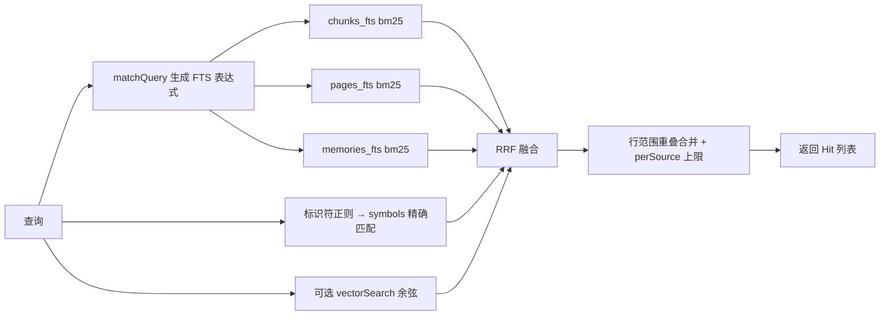

这页回答三个问题：Agent 调 `search` 拿到的排序是怎么算出来的；中文怎么分词；向量检索怎么开、换模型会发生什么。读完你能判断一条结果为什么排在前面，也知道调检索质量该动哪里。

## 一次查询走一遍：“记忆更正 supersede”

假设 Agent 调用 `search({query: "记忆更正 supersede"})`。工具层只做参数转换，然后调 `search()`，默认 `limit` 为 12，`scope: "all"` 对应 chunk、page、memory、symbol 四种类型 ([tools.ts:104-121](../../../src/agents/tools.ts#L104-L121))。`search()` 内部分几步：

### 1. 生成 FTS 查询

`matchQuery` 先调 `terms()` 把查询切成词项，去掉停用词，再用 `OR` 连接成 FTS5 的 MATCH 表达式 ([tokenize.ts:55-64](../../../src/search/tokenize.ts#L55-L64))。“记忆更正 supersede”得到：

- CJK 连续片段切成重叠双字：`记忆`、`忆更`、`更正`；
- 英文标识符保留整词小写 `supersede`（没有 camelCase 边界，不再拆分）。

最终表达式是 `"记忆" OR "忆更" OR "更正" OR "supersede"`。多出来的 `忆更` 看似噪声，但索引端用同样的切法，所以文档里出现“记忆更正”时三个双字都命中，BM25 自然偏向同时包含它们的片段。

切分规则由 [test/tokenize.test.ts](../../../test/tokenize.test.ts#L4-L18) 固定：

| 输入 | 词项 |
| --- | --- |
| `预算上限` | `预算` `算上` `上限` |
| `猫` | `猫`（单字原样保留） |
| `parseVueFile` | `parsevuefile` `parse` `vue` `file`（整词 + 驼峰拆分） |
| `snake_case_name` | `snakecasename` `snake` `case` `name` |
| `用 RRF 融合` | `用` `rrf` `融合` |

设计动机在文件头注释里写明：FTS5 的 unicode61 分词会把一整串 CJK 当成一个词，也不拆驼峰，所以先预处理成显式词项；双字不需要词典，也不会像三字索引那样漏掉两字词 ([tokenize.ts:1-10](../../../src/search/tokenize.ts#L1-L10))。

**写入端必须用同一套切法。** 原件入库时，每个 chunk 的正文经 `indexText`（`terms().join(" ")`）写进 `chunks_fts`；标题列则是“原件标题 + 章节标题 + 路径 + uri”的词项 ([store.ts:114-118](../../../src/sources/store.ts#L114-L118))。页面和记忆同理：`pages_fts` 写标题（含摘要、slug）与正文，`memories_fts` 写 subject 与 content ([wiki/store.ts:105](../../../src/wiki/store.ts#L105)，[memory/store.ts:60](../../../src/memory/store.ts#L60))。`chunks_fts` 是 `content=''` 的无内容表，原文只存在 `chunks.text` 里 ([db.ts:53](../../../src/core/db.ts#L53))。从实现看，改了 `terms()` 的规则后旧索引不会自动变，需要重建索引才能让新旧一致。

停用词表很短：英文功能词，加上一批中文疑问词的双字切片，如 `什么`、`怎么`、`是什`、`么时`。作用是让“预算是什么时候改的”的表达式里不出现 `什么`，测试里有断言 ([tokenize.test.ts:20-25](../../../test/tokenize.test.ts#L20-L25))。若过滤后一个词也不剩，则退回不过滤的词项；标点之类切不出词项时返回 `null`，全文三路直接跳过 ([tokenize.ts:56-59](../../../src/search/tokenize.ts#L56-L59))。

### 2. 四路（加一路可选）召回

每一路各自取前 `pool = max(60, limit×4)` 条，按名次编号 ([search.ts:68-71](../../../src/search/search.ts#L68-L71))。

1. **原件片段**：`chunks_fts` 配 `bm25(chunks_fts, 4.0, 1.0)` 排序，标题列权重 4，正文 1。排除已删除（墓碑）的原件，并按空间和 `source_kind` 过滤 ([search.ts:76-89](../../../src/search/search.ts#L76-L89))。标题列包含路径和 uri，因此查询里的文件名、章节名能拿到权重 4。
2. **符号**：用 `/[A-Za-z_$][\w$]{2,}/g` 从**原始查询**里抠标识符（至少 3 个字符），转小写后与 `symbols.name` 精确比对，按“已导出优先、跨度越长越前”取前 30 ([search.ts:112-124](../../../src/search/search.ts#L112-L124))。例子里的 `supersede` 若恰好是某个函数名，它的定义会作为一条 `symbol` 命中出现；中文部分不参与这一路。
3. **Wiki 页面**：`pages_fts`，同样标题权重 4 ([search.ts:148-157](../../../src/search/search.ts#L148-L157))。
4. **记忆**：`memories_fts`，subject 权重 2；默认只看 `status = 'active'`，传 `includeHistory` 才含已被取代或撤回的版本 ([search.ts:168-178](../../../src/search/search.ts#L168-L178))。
5. **向量（可选）**：下文展开。取回 chunk id 后回表，丢掉已删除原件和不符合 `sourceKinds` 的行 ([search.ts:189-225](../../../src/search/search.ts#L189-L225))。向量调用被 `.catch(() => [])` 包住，失败等于没有这一路。

### 3. RRF 融合

每条命中的得分是它在各路名次的倒数和：`1 / (RRF_K + rank + 1)`，`RRF_K = 60` ([search.ts:40](../../../src/search/search.ts#L40)，[search.ts:234-242](../../../src/search/search.ts#L234-L242))。同一个 key（`chunk:<id>`、`page:<id>` 等）出现在多路里就累加，并把各路名字记进 `via`——这就是工具输出里 `[全文+语义]` 的来源 ([tools.ts:131](../../../src/agents/tools.ts#L131))。

只有存在向量列表时，`via === "全文"` 的列表权重才乘 `ftsWeight`（默认 0.5）；没有向量时全文权重为 1 ([search.ts:231-232](../../../src/search/search.ts#L231-L232))。代码只给 `"全文"` 降权，页面、记忆和符号三路始终全权重。用 RRF 的理由写在注释里：稳健、参数少、能自己解释来源。

### 4. 去重与限额

按分数降序走一遍，对 chunk 和 symbol 做两件事 ([search.ts:243-265](../../../src/search/search.ts#L243-L265))：

- **行范围重叠合并**：若已选结果里有同一原件且行范围相交的条目，不再新增，而是把这条分数的一半加给已有条目，并合并 `via`；若被合并的是符号、已有的是 chunk，则把 chunk 的 `path` 换成符号名。这样一个函数定义和覆盖它的代码块算同一份证据。
- **每个原件最多 `perSource` 条**，默认 3（HTTP 接口用 2，评测用 1），防止一个大文件占满列表。页面和记忆不受此限。

凑够 `limit` 条就停。

## 向量检索

### 开关

`config.embeddings.provider` 有三个值：`none`（默认）、`local`、`openai` ([config.ts:70-78](../../../src/core/config.ts#L70-L78))。设成 `none` 时 `vectorSearch` 直接返回空，行为就是纯全文 ([embeddings.ts:121-123](../../../src/search/embeddings.ts#L121-L123))。

开启的命令是 `omem setup embeddings [--model …]`：它把配置改成 `provider: "local"`，立刻循环调 `embedPending` 补完所有向量，最后保存配置 ([cli-main.ts:383-397](../../../src/cli-main.ts#L383-L397))。`--model` 可以是模型 id、本地目录，或 bge-small-zh / bge-base-zh / bge-m3（有 osdk 时经 osdk 下载）([cli-main.ts:368](../../../src/cli-main.ts#L368)，[cli-main.ts:385-387](../../../src/cli-main.ts#L385-L387))。交互式 `omem setup` 里也有这一节。

- **local**：用 `@huggingface/transformers` 加载 q8 量化模型；`cfg.model` 是已存在的目录时离线加载（osdk 管理的模型走这条）。按 `family` 决定池化：bge 系 CLS，其它 mean；`bge-zh` 的**查询**（不是文档）前面加检索指令前缀 ([embeddings.ts:39-61](../../../src/search/embeddings.ts#L39-L61))。加载失败只打一条警告并退回纯全文 ([embeddings.ts:62-65](../../../src/search/embeddings.ts#L62-L65))。
- **openai**：向 `<url>/embeddings` POST，key 取自 `apiKeyEnv` 指定的环境变量，返回后自行归一化 ([embeddings.ts:21-38](../../../src/search/embeddings.ts#L21-L38))。`url` 可指向其它兼容该协议的服务。

### 向量怎么存、怎么搜

向量是 `chunks.embedding` 这个 Float32 BLOB 列 ([db.ts:50](../../../src/core/db.ts#L50))。查询时 `load()` 把符合空间范围且有向量的所有 chunk 读进内存缓存（按空间集合做 key），对查询向量逐个做点积（向量已归一化，点积即余弦），排序取前 `pool` 条 ([embeddings.ts:107-136](../../../src/search/embeddings.ts#L107-L136))。没有 ANN 索引；文件头注释给的理由是个人库在几十万 chunk 以内可整个放进内存 ([embeddings.ts:6-11](../../../src/search/embeddings.ts#L6-L11))。从实现看，规模再大时耗时会线性增长，那时需要换近似索引。

### 补向量

新原件入库时 chunk 的 `embedding` 为空。`embedPending(app, batch)` 每次取 `embedding is null` 的一批 chunk，把 `路径或标题 + "\n" + 正文`（截到 2000 字）作为 passage 嵌入后写回，返回处理条数 ([embeddings.ts:82-105](../../../src/search/embeddings.ts#L82-L105))。服务启动 3 秒后开始循环：一批接一批补到没有为止，之后每 30 秒再查一次 ([main.ts:38-48](../../../src/main.ts#L38-L48))。补完之前，新内容只能靠全文检索找到——向量路对它们是沉默的，而不是报错。

### 换模型会怎样

`embedPending` 开头把当前 embedder 的 id（`local:<model>` 或 `openai:<model>`）与 `kv` 表里记录的 `embedding_model` 比较；不同就 `update chunks set embedding = null`，写入新 id，并清缓存 ([embeddings.ts:85-90](../../../src/search/embeddings.ts#L85-L90))。因此换模型之后所有向量作废、从头重算，目的是不让两个模型的向量混在一个排序里（文件头注释）。几点要留意：

- 清空发生在**下一次 `embedPending` 运行时**，不是改配置的瞬间。走 `omem setup embeddings` 时它紧接着就跑，窗口很短；若是手动改配置文件，则要等服务的后台循环。从实现看，这段时间库里仍是旧模型的向量而查询已用新模型编码，向量路结果不可信；我没有找到代码在此窗口内屏蔽向量路。
- 从实现看，embedder 结果缓存在进程内模块变量 `embedder` 里，改配置后大概率需要重启服务才会换（我没有实际验证）。
- 导出的 `invalidateVectors()` 只清缓存，当前仓库没有调用方；缓存实际靠 `embedPending` 的两处 `cache.clear()` 失效。原件被更新后旧 chunk 被删、新 chunk 向量为空，缓存里残留的旧 chunk id 回表时查不到，被 `byId` 过滤掉，所以不会返回过期内容 ([search.ts:199-204](../../../src/search/search.ts#L199-L204))。

## scan：另一种问题用的另一个工具

`search` 返回的是“最像的前几条”，适合找线索；“一共去过几次”“列出所有……”需要的是**不漏**。`scan` 为此存在：不排序，对空间内所有未删除原件的全文做不区分大小写的子串匹配（`instr(lower(text), ?)`，任一关键词命中即可），逐行列出命中，并附上有效记忆里的命中；可按 `since`/`until` 限定时间，默认最多显示 150 行 ([tools.ts:177-235](../../../src/agents/tools.ts#L177-L235))。开头一行会写“N 个原件共 M 行命中，显示前 K 行”，让 Agent 知道有没有被截断。

| | `search` | `scan` |
| --- | --- | --- |
| 匹配 | 分词后 OR + 向量语义 | 原文子串，不分词、不做语义 |
| 结果 | 排序后的前 N 个片段 | 所有命中行（受 `limit` 截断时会声明） |
| 用途 | 找出处、定位 | 计数、汇总、核对 |

`scan` 的关键词要自己给全同义词、单复数和中英文写法，工具描述里就是这样要求的。评测文档记录了动机：跨会话计数题在只用检索时会漏掉分散的条目；加上 `scan` 并改写助理的汇总步骤后，LongMemEval 的 multi-session 前 6 题答对 5 题（此前前 3 题 1/3）。样本太小，只能说明方向 ([evaluation.md:46-55](../../../docs/v2/evaluation.md#L46-L55))。

## 怎么评测

`scripts/eval-retrieval.ts` 是 BEIR 风格的评测：输入 `corpus.jsonl`（`{id,text}`）和 `queries.jsonl`（`{id,text,rels:{docId:grade}}`），把语料写入独立的库（`--home`，已有就复用），用 `search()` 的 chunk 路线跑每个问题，按原件折叠成文档级排名，报告 nDCG@10、Recall@10/@50、MRR@10 和平均耗时 ([eval-retrieval.ts:1-10](../../../scripts/eval-retrieval.ts#L1-L10)，[eval-retrieval.ts:59-77](../../../scripts/eval-retrieval.ts#L59-L77))。评测里 `perSource: 1`，每个文档只占一个名次。

对照组靠参数切换：不加参数是纯全文；`--vector` 是全文 + 向量 RRF；`--vector-only` 关掉全文与符号两路；`--fts-weight N` 改融合权重 ([eval-retrieval.ts:28-37](../../../scripts/eval-retrieval.ts#L28-L37)，[eval-retrieval.ts:63](../../../scripts/eval-retrieval.ts#L63))。

`docs/v2/evaluation.md` 里的实际数字（2026-10-12，C-MTEB/T2Retrieval 随机 400 题，语料 17,086 篇，向量为 bge-small-zh-v1.5 q8）：

| 方式 | nDCG@10 | Recall@50 |
| --- | --- | --- |
| 全文 | 69.01 | 78.17 |
| 向量 | 87.25 | 94.95 |
| 等权 RRF | 84.90 | 94.53 |
| 全文权重 0.5（默认） | 86.76 | 95.57 |
| 全文权重 0.3 | 87.30 | 95.42 |

文档的解释是：自然语言问题上向量远强于全文，等权会被较弱的全文拖低；取 0.5 是因为 Recall@50（交给 Agent 的候选覆盖）最高，同时保留全文对精确名称、罕见词和代码标识符的作用，而 T2 评不到这些，所以没有继续往下调 ([evaluation.md:9-17](../../../docs/v2/evaluation.md#L9-L17))。这些数字只对应该数据、该模型和该日期，换模型或改检索后要重跑。

## 要改这里从哪下手

- **改分词规则**：`src/search/tokenize.ts` 的 `terms`。它同时服务索引和查询，改完旧索引与新查询不对齐，需要重建三张 FTS 表。同步改 `test/tokenize.test.ts`，并用评测脚本跑全文基线对比。
- **改停用词或查询表达式**：`matchQuery`。
- **改召回路线、权重、去重、每源上限**：`src/search/search.ts` 的 `search()`；`RRF_K`、`ftsWeight` 默认值、`perSource` 默认值都在这里。页面、记忆、符号几路不降权，加路线时要想清这个平衡。
- **改向量**：`src/search/embeddings.ts`。新增 provider 需同时改 `config.ts` 的枚举和 `src/setup.ts` 的向导；换 pooling 或前缀后要清空旧向量。
- **改给 Agent 的检索工具**：`src/agents/tools.ts` 里的 `search` 与 `scan`，描述文字就是模型看到的说明。改后用真实 Agent 跑一两个问题；工具权限与运行机制见 [Agent 运行时与 MCP 工具权限](./agent-runtime-and-tools.md)。
- **验证**：改检索后用 `scripts/eval-retrieval.ts` 在公开数据上对比 nDCG@10 并报告对照组（项目约定）；本地怎么跑、测试见 [跑起来、调试、测试](../howto/run-and-develop.md)。整体背景见 [omem 是什么、怎么组成](../overview.md)。
