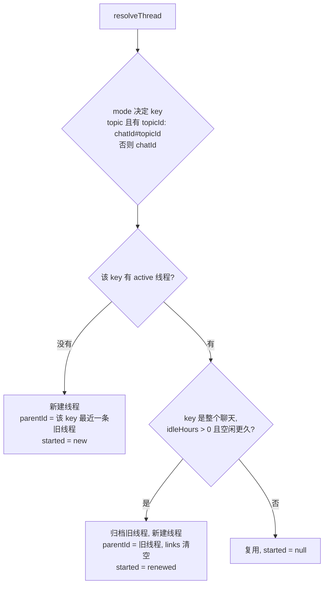
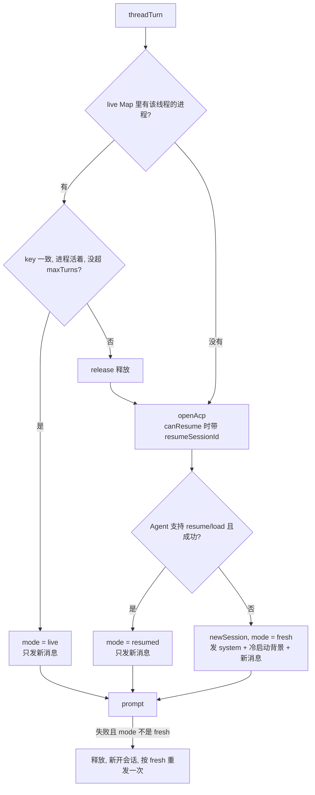

这页回答三个问题：线程和 Agent 会话是什么关系；同一个线程的下一条消息，什么时候接着用还活着的进程、什么时候恢复旧会话、什么时候带着摘要重新开始；要改这些行为该从哪下手。消息怎么进来、怎么排队、怎么发出，见 [flows/message-to-reply](../flows/message-to-reply.md)，这里只讲会话连续性。

## 先记住两层

- **线程（thread）** 是 omem 自己的账：数据库 `conversations` 表里的一行，对应一个私聊、一个群、一个群话题或一个网页对话。它保存消息、滚动摘要和设置，长期存在。
- **Agent 会话（session）** 是外部 Agent（Codex、Claude Code 等）自己的上下文：它读过的文件、工具结果、推理过程。它在 Agent 进程里或 Agent 自己的会话文件里，omem 只记住它的 id。

线程是主，会话是缓存：会话丢了，线程凭摘要和最近消息还能让一个新会话接上话题。代码顶部的注释把这件事写成三级连续性，由便宜到贵：live（进程还在）、resumed（按 id 恢复）、cold start（从摘要重来）（[sessions.ts:12-28](../../../src/agents/sessions.ts#L12-L28)）。

## 一个例子走完三级

`test/threads.test.ts` 的第一个用例用假 ACP Agent 把三级走了一遍（[threads.test.ts:35-55](../../../test/threads.test.ts#L35-L55)）：

1. 飞书私聊 `oc_dm` 发“第一句”：没有线程，新建；Agent 会话也是新的，断言 `turn: 1, cold: true`。
2. 发“第二句”：同一个线程，`session` 与第一轮相同，`turn: 2, cold: false`。这是 **live**——进程没退出，Agent 手里还有上一轮的全部上下文，prompt 里只需要新消息。
3. 调 `releaseThreadSession` 模拟进程被释放，再发“第三句”：session id 不变，`resumed: true`。这是 **resumed**——重新拉起进程，用保存的 id 让 Agent 加载旧会话。
4. 再释放，并把 `agentSession` 清空、写入一份摘要，发“第四句”：新 session id，`cold: true`，Agent 在 prompt 里看到那份摘要。这是 **cold start**。

## 线程里存了什么

`conversations` 在 [db.ts:236-255](../../../src/core/db.ts#L236-L255) 里加了会话相关的列，对应 TypeScript 的 `Thread` 类型（[threads.ts:26-43](../../../src/agents/threads.ts#L26-L43)）：

| 字段 | 含义 |
|---|---|
| `key` | 库里叫 `external_id`。整个聊天用 `chatId`，话题用 `chatId#topicId` |
| `status` / `parentId` | `active` 或 `archived`；`parentId` 指向上一段线程 |
| `summary` / `summaryAt` | 滚动摘要，以及摘要覆盖到哪条消息的时间 |
| `agentSession` | Agent 的会话 id |
| `agentProfile` | 名字有误导，存的是 `sessionKey`，格式 `profile|label|cwd`（见下） |
| `agentCwd`、`agentTurns` | 会话所在目录；这个会话已经跑了几轮 |
| `settings` | `spec`（用哪个 Agent 档案回答）、`profile`（后端覆盖）、`links`（关联线程）、`lastMessageId` |

`settings.links` 是用户用 `/link` 挂上的其他线程，冷启动时它们的摘要会被拼进背景（[sessions.ts:116-119](../../../src/agents/sessions.ts#L116-L119)）。

另有按聊天（而不是按线程）存的 `chat_settings` 表，类型是 `ChatSettings`：`mode`（`chat` 整个聊天一个线程，`topic` 每个话题一个线程）、`spaceId`、`idleHours`、`spec`（[threads.ts:91-109](../../../src/agents/threads.ts#L91-L109)）。它由 `/mode`、`/idle`、`/space`、`/as` 写入，作用于该聊天以后新建的线程。

## 消息落到哪个线程：resolveThread

渠道消息进入 `receive` 后，如果带了 `channel` 和 `chatId`，就调 `resolveThread`；带 `conversationId`（网页）的直接按 id 找或建，不经过它（[inbox.ts:31-43](../../../src/agents/inbox.ts#L31-L43)）。它有三种结果：



- `mode` 没设置时，有 `topicId` 就按话题分，否则整个聊天一个线程；`idleHours` 优先取聊天设置，没有才用配置（[threads.ts:146-160](../../../src/agents/threads.ts#L146-L160)）。
- **renewed 只对 chat 级 key 生效**：条件里有 `key === addr.chatId`，话题线程不会因为空闲被换掉（[threads.ts:161-164](../../../src/agents/threads.ts#L161-L164)）。空闲按 `updatedAt` 算，而 `addMessage` 每次都会更新它，命令消息也算（[threads.ts:272-280](../../../src/agents/threads.ts#L272-L280)）。新线程继承旧线程的 `settings`（所以 `spec` 还在），只把 `links` 清空；旧线程靠 `parentId` 接上，冷启动时它的摘要会进背景（[sessions.ts:112-115](../../../src/agents/sessions.ts#L112-L115)）。测试把 `updated_at` 改到 13 小时前来验证（[threads.test.ts:95-101](../../../test/threads.test.ts#L95-L101)）。
- 没有 active 线程时，`parentId` 取该 key 下最近的任意线程。代码注释说这是为 `/resume` 之后的情形留的；从实现看，只有该 key 下线程全被归档时才会走到这里。

用户可以手动干预三个命令（[commands.ts](../../../src/agents/commands.ts#L56-L155)）：

- `/new`：释放进程，归档当前线程，请求一次摘要（至少 2 条新消息），新建线程。**`parentId` 是 null**，只带走 `spec` 和 `profile`，也就是不自动接上旧线程；旧的用 `/resume` 找回（[commands.ts:56-66](../../../src/agents/commands.ts#L56-L66)）。
- `/resume <id>`：释放当前进程，`reattachThread` 把同 key 的其他 active 线程归档，再把目标线程改成 active 并挂到这个 key 上（[threads.ts:173-178](../../../src/agents/threads.ts#L173-L178)）。它不动目标线程的 `agentSession`，所以只要 `sessionKey` 没变，下一条消息就会走 resumed——“包括它的 Agent 会话”正是命令帮助里的话（[commands.ts:107-118](../../../src/agents/commands.ts#L107-L118)）。
- `/link <id>`：把目标线程加进 `settings.links`，同时 `resetAgentSession`（清掉会话 id、cwd、轮数）并释放进程，所以下一条一定是冷启动，这样新背景才会进 prompt（[commands.ts:119-134](../../../src/agents/commands.ts#L119-L134)、[threads.ts:215-217](../../../src/agents/threads.ts#L215-L217)）。`/compact` 同理：释放、重置、请求摘要（[commands.ts:146-155](../../../src/agents/commands.ts#L146-L155)）。

## 每一轮怎么选：threadTurn

`ask` 运行最终调用 `threadTurn(ctx, threadId, messages)`（[jobs.ts:54-66](../../../src/agents/jobs.ts#L54-L66)）。同一个线程同一时间只有一轮，靠 run 的 `lane = thread.id` 保证（[inbox.ts:74-81](../../../src/agents/inbox.ts#L74-L81)）。进入后先算三个量（[sessions.ts:139-143](../../../src/agents/sessions.ts#L139-L143)）：

```ts
const sessionKey = `${prep.profile.id}|${label}|${prep.cwd}`;
const tooLong = t.agentTurns >= app.config.sessions.maxTurns;
const canResume = !!t.agentSession && t.agentProfile === sessionKey
  && t.agentCwd === prep.cwd && !tooLong;
```

`sessionKey` 把“哪个后端、哪个回答者（Agent 档案名或 `assistant`）、哪个目录”拼在一起。换了后端、用 `/as` 换了档案、或空间目录变了，key 就对不上，旧会话不能用，因为里面的系统提示和工具范围是按旧设置建的（这是从实现推断的理由）。`maxTurns` 默认 40，配置下限 4（[config.ts:49-62](../../../src/core/config.ts#L49-L62)）。

### ACP 路径



对应代码：

- 先看 `live` Map：key 不一致、进程已死或 `tooLong` 就 `release`，随后走重开（[sessions.ts:185-190](../../../src/agents/sessions.ts#L185-L190)）。仍可用就把本轮新生成的工具令牌作废，换用旧进程令牌并 `retargetToolToken` 到本次 run，保证工具调用记在本轮 run 上，`mode = "live"`（[sessions.ts:192-196](../../../src/agents/sessions.ts#L192-L196)）。
- 否则 `openAcp`，`canResume` 为真时传 `resumeSessionId`。`openAcp` 里：Agent 声明支持 `session/resume` 就用它；只支持 `loadSession` 就用它，并在加载期间把 `replaying` 置真，丢弃 Agent 回放的历史输出；两者都没有，或者恢复抛错，就发一条状态消息并回落到 `newSession`（[acp.ts:177-197](../../../src/agents/acp.ts#L177-L197)）。返回的 `handle.resumed` 决定 `mode` 是 `resumed` 还是 `fresh`（[sessions.ts:198-211](../../../src/agents/sessions.ts#L198-L211)）。所以“要恢复”只是请求，实际结果由 Agent 能力和现场决定。
- prompt 内容取决于 `mode`：`fresh` 时是 `system + 会话背景 + 新消息`；其余只有时间戳加新消息（[sessions.ts:215](../../../src/agents/sessions.ts#L215)、[sessions.ts:141](../../../src/agents/sessions.ts#L141)）。
- **失败自动降级**：`prompt` 抛错，且不是用户取消、本轮也不是 `fresh`（live 或 resumed 的会话坏了），就释放、重新 `prepareRun`、开全新会话，用冷启动 prompt 再发一次，`mode` 改成 `fresh`；`fresh` 自己失败则直接抛出（[sessions.ts:217-230](../../../src/agents/sessions.ts#L217-L230)）。
- 收尾：`save` 把 `sessionKey`、会话 id、cwd 和轮数写回线程，`fresh` 记 1，否则 +1（[sessions.ts:146-147](../../../src/agents/sessions.ts#L146-L147)、[sessions.ts:231](../../../src/agents/sessions.ts#L231)）。非取消的错误会释放进程，取消则保留（[sessions.ts:233-235](../../../src/agents/sessions.ts#L233-L235)）；`finally` 里把 `busy` 置假并调 `keepAlive`。

`mode` 最后会写进助手消息的 `meta.session`，所以可以事后看到每条回复是 live、resumed 还是 fresh（[jobs.ts:63](../../../src/agents/jobs.ts#L63)）。

### CLI 路径

`transport` 不是 `acp` 时没有常驻进程，每轮起一个子进程，所以没有 live，只有 resumed 和 fresh（[sessions.ts:149-183](../../../src/agents/sessions.ts#L149-L183)）。它始终传 `persistSession: true`，让 Agent 把会话文件留下；`canResume` 为真就传 `resumeSessionId`，Claude CLI 变成 `--resume <id>`，Codex 变成 `exec … resume <id> -`（[cli.ts:9-10](../../../src/agents/cli.ts#L9-L10)、[cli.ts:43](../../../src/agents/cli.ts#L43)）。会话 id 从输出流里读：`session_id` 或 Codex 的 `thread.started.thread_id`（[cli.ts:78-79](../../../src/agents/cli.ts#L78-L79)）。恢复这一次出错（非取消）就发状态消息，不带 resume 重跑一遍并按 fresh 记账（[sessions.ts:168-178](../../../src/agents/sessions.ts#L168-L178)）。

## 进程什么时候被释放

live 进程占内存，所以有两条回收规则，都在每轮结束后的 `keepAlive` 里（[sessions.ts:54-72](../../../src/agents/sessions.ts#L54-L72)）：

- `sessions.liveMinutes`（默认 20）：设一个定时器，到点释放；设为 0 则每轮后立即释放，完全靠 resumed 接续。
- `sessions.maxLive`（默认 3）：超出时，在不忙的进程里按最近使用时间从旧到新淘汰。

被动释放不丢数据：线程里已经存着会话 id，下一条消息会走 resumed。两条规则触发时都会顺手 `maybeSummarize(…, 3)`。

## 换会话时怎么有摘要

摘要由独立的 `thread-summary` 运行生成，不占用线程自己的 Agent 会话。`maybeSummarize` 数出 `summaryAt` 之后的非命令消息，不足 `minNew` 条就不做；同一线程已有摘要运行在排队时也不重复排（[sessions.ts:75-83](../../../src/agents/sessions.ts#L75-L83)）。处理器读最多 80 条新消息，连同旧摘要交给 `summarizer` 角色，得到的全文替换旧摘要，`summaryAt` 推进到最后一条新消息的时间（[jobs.ts:87-98](../../../src/agents/jobs.ts#L87-L98)）。角色要求不超过 500 字，并保留 `msg:<id>` 以便回查原话（[roles/summarizer.md](../../../roles/summarizer.md#L1-L21)）。

触发点有好几处，门槛不同：每轮回答后 10 条（默认值）；进程超时或被淘汰时 3 条；`/new`、`/link` 目标是 2 条；`/summary refresh`、`/compact` 是 1 条。

**这不是严格的保证**，要看清边界（以下是从实现的推断）：

- `threadTurn` 在 `tooLong` 时只是换会话，并不先等一次摘要；摘要靠前面这些触发点平时保持新鲜。
- 冷启动 prompt 除摘要外，还总会塞入最近 12 条非命令消息（每条截到 1500 字）（[sessions.ts:120-121](../../../src/agents/sessions.ts#L120-L121)）。摘要最多落后不到 10 条，被这 12 条盖住，这个窗口比阈值大应该是有意的。
- `/compact` 和 `/new` 只是把摘要运行排进队列，下一条消息可能先于它执行，那时用的是旧摘要加最近 12 条。
- `liveMinutes = 0` 时 `keepAlive` 直接释放就返回，不触发摘要，只剩每轮回答后的 10 条门槛。
- renewed 换线程时也不触发对旧线程的摘要；一般靠之前的触发点已经更新过。

## 为什么这样设计

注释和文档没有专门写动机，下面是从实现看的：

- 记 `sessionKey` 而不只是会话 id，让“能不能恢复”是一个纯比较，不需要问 Agent。
- 摘要放在 omem 自己的库里而不是依赖 Agent 的会话文件，所以换后端、换档案、会话文件丢了都能接上。
- 用 `maxTurns` 强制换会话，防止上下文无限增长；代价是要靠摘要重建，所以才有摘要的多个触发点。
- 降级路径只重试一次，且只在“旧会话”失败时重试，新开的会话失败就直接报错，避免无限重试。

## 要改这里从哪下手

- **改“用不用旧会话”的判断**：`threadTurn` 开头的 `sessionKey`/`tooLong`/`canResume`（[sessions.ts:139-143](../../../src/agents/sessions.ts#L139-L143)）。ACP 与 CLI 两条分支各有一份降级逻辑，改一边要对照另一边；ACP 还有一份几乎相同的冷启动 prompt 拼接（[sessions.ts:229](../../../src/agents/sessions.ts#L229)），改 `freshPrompt` 时别漏。
- **改冷启动带什么背景**：`coldContext`（[sessions.ts:108-123](../../../src/agents/sessions.ts#L108-L123)）。
- **改空闲换线程、话题分线规则**：`resolveThread`（[threads.ts:146-166](../../../src/agents/threads.ts#L146-L166)）与 `/mode`、`/idle` 命令。
- **改进程保留策略**：`keepAlive` 和 `sessions.*` 配置（[config.ts:49-62](../../../src/core/config.ts#L49-L62)）；`src/setup.ts` 里的交互设置也要同步。
- **改恢复能力**：`openAcp` 的 `caps` 判断（[acp.ts:153](../../../src/agents/acp.ts#L153)、[acp.ts:177-193](../../../src/agents/acp.ts#L177-L193)）和 `cli.ts` 的参数拼接。
- **改摘要质量**：先改 `roles/summarizer.md`，其次才是 `thread-summary` 处理器。
- **加字段**：需要在 `db.ts` 追加迁移，并同步 `Row`、`toThread`、`updateThread`。
- **测试**：`test/threads.test.ts`（三级连续性、burst 合并、话题与 renewed、命令）和 `test/fake-acp-agent.ts`；改动 Agent 运行时后两者都要保持通过，这是项目约定。
