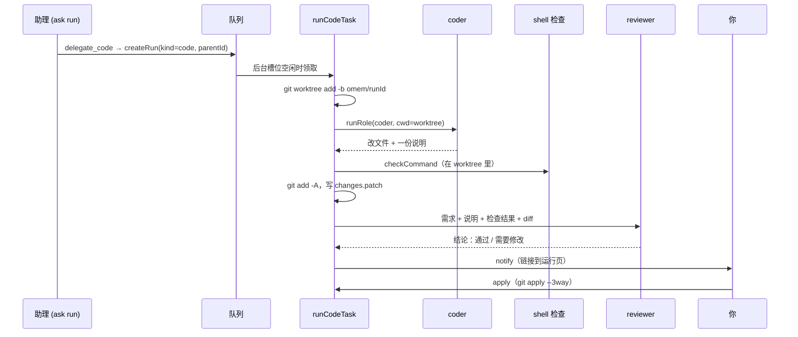

这页回答三个问题：交办之后代码是在哪里改的，检查和评审怎么进行，以及改动什么时候才真正落到你的工作区。结论先说：编码 Agent 只在 `~/.omem/runs/<runId>/worktree` 这个独立 Git worktree 里写文件；检查和评审都针对这份副本；只有你（或你明确要求助理）触发“应用”，补丁才会进入你的仓库，而且不会提交。

下面的例子是按代码推演的，没有真的跑过这个任务：你在飞书里对助理说“给 omem 加一个 /ping 命令，回复 pong”。

## 一条链路走完



**1. 助理交办。** 助理角色的工具清单里有 `delegate_code` 和 `apply_code_run`（[assistant.md:3](../../../roles/assistant.md#L3)），并被要求“明确要求实现或修改代码才交办，背景、验收标准写完整”（[assistant.md:49-50](../../../roles/assistant.md#L49-L50)）。工具本身只做三件事：校验空间在本次任务范围内且有 `rootPath`，创建一条 `kind: "code"` 的 run，把 `parentId` 设为当前问答 run，然后立刻返回“已交办，运行 r_…”（[tools.ts:699-715](../../../src/agents/tools.ts#L699-L715)）。它不等结果，所以对话不会被几分钟的编码卡住。输入里只有 `task` 和可选的 `checkCommand`。

网页“运行”页的“交办”按钮走 `POST /api/delegate`，命令行 `omem delegate <空间> <任务> --check "pnpm test"` 直接 `createRun`，都建同样的 run，只是没有 `parentId`（[http.ts:397-403](../../../src/server/http.ts#L397-L403)，[cli-main.ts:305-313](../../../src/cli-main.ts#L305-L313)）。

**2. 排队。** `code` 不在“交互”类里，占的是后台并发槽（`config.concurrency`），不会挤掉对话回复（[runs.ts:207-208](../../../src/agents/runs.ts#L207-L208)，细节见 [任务队列、Run 与角色](../concepts/run-queue-and-roles.md)）。处理器注册在 [jobs.ts:364](../../../src/agents/jobs.ts#L364)：`registerHandler("code", runCodeTask)`。

**3. 建 worktree。** `runCodeTask` 先要求空间有 `rootPath` 且是 Git 仓库，否则直接失败。然后：

```ts
const worktree = join(dir, "worktree");
const branch = `omem/${run.id}`;
if (!existsSync(worktree)) {
  const base = git(root, ["rev-parse", "HEAD"]).stdout.trim();
  git(root, ["worktree", "add", "-q", "-b", branch, worktree, base]);
  ctx.output({ worktree, branch, base });
}
```

位置是 [code.ts:43-55](../../../src/agents/code.ts#L43-L55)。基线是你仓库当前 HEAD，所以你工作区里**未提交**的改动不在这份副本里。`worktree`、`branch`、`base` 写进 run 的 output，后面的应用和丢弃都靠它们找回现场。

**4. 编码。** `runRole(coder, cwd=worktree)`，任务文字是你的需求，加上检查命令（如果有）和一句“工作目录是独立 worktree”（[code.ts:57-65](../../../src/agents/code.ts#L57-L65)）。coder 的角色说明规定了做法：先读仓库的 AGENTS.md 等约定，做最小而完整的改动，自己跑检查直到通过，不 push、不提交、不碰 worktree 以外的文件，最后写一份“做了什么、怎么验证、还有什么风险”的说明（[coder.md:7-15](../../../roles/coder.md#L7-L15)）。它有 `writes: true`，所以可以编辑文件；omem 工具只给只读的那几个（search、read_source、find_symbol 等，[coder.md:3](../../../roles/coder.md#L3)），并且工具令牌只覆盖当前空间。这套令牌和工具白名单机制见 [Agent 运行时与 MCP 工具权限](../concepts/agent-runtime-and-tools.md)。

对 `/ping` 这个例子，从实现看，coder 会读 [commands.ts](../../../src/agents/commands.ts#L1) 里已有的命令定义（每条有 `usage`，如 `/status`、`/runs`），照样加一条，并补测试，再跑 `pnpm run check`（AGENTS.md 要求的检查）。

**5. 宿主跑检查。** coder 自己跑过检查，宿主还会再独立跑一次：命令取交办参数，没有就取 `space.settings.checkCommand`（设置页“检查命令（交办编码后运行）”，[Settings.vue:327](../../../web/src/views/Settings.vue#L327)）。用 `sh -c` 在 worktree 里执行，环境带 `CI=1`，20 分钟超时，退出码和输出都记下，输出只留**末尾** 8000 字符（[code.ts:68-76](../../../src/agents/code.ts#L68-L76)，[shell 实现](../../../src/agents/code.ts#L12-L33)）。检查失败不会中止流程：失败结果会原样交给评审。

**6. 生成补丁。** `git add -A` 把 worktree 里所有改动（含新文件）放进暂存区，`git diff --cached HEAD` 得到补丁并写到 `runs/<id>/changes.patch`；同时记下 `diffStat`。如果 diff 为空，直接发“交办未产生改动”的通知，run 以 `verdict: "no-changes"` 结束，不进评审（[code.ts:78-86](../../../src/agents/code.ts#L78-L86)）。被 `.gitignore` 忽略的文件不会进补丁。

**7. 独立评审。** reviewer 拿到的任务由五段拼成：原始需求、coder 的说明、检查结果（命令、退出码、输出末尾 4000 字符；没配命令就写“没有配置检查命令”）、改动统计、完整 diff（最多 80000 字符）（[code.ts:92-98](../../../src/agents/code.ts#L92-L98)）。它的 cwd 也是 worktree，所以可以读 diff 之外的上下文；角色是 `writes: false`、只读模式，工具比 coder 更少（[reviewer.md:2-5](../../../roles/reviewer.md#L2-L5)）。要求第一行写 `结论：通过` 或 `结论：需要修改`，随后按严重程度列问题（[reviewer.md:16](../../../roles/reviewer.md#L16)）。

“独立”体现在后端可以不同：评审调用时显式传 `profileId: app.config.agents.roles.reviewer`（[code.ts:103](../../../src/agents/code.ts#L103)）。在 `config.json` 的 `agents.roles` 里给 `reviewer` 配另一个 Agent，就由另一个模型审 coder 的改动。没配的话，`profileId` 为空，回退到 `agents.default`（[runner.ts:60-71](../../../src/agents/runner.ts#L60-L71)），也就是和 coder 同一个后端；这时评审只是“另一轮上下文干净的会话”，不是另一个模型。

**8. 判定与通知。** verdict 的判定只有一行正则：`/结论[：:]\s*通过/` 命中就是 `approved`，否则 `changes-requested`（[code.ts:105-106](../../../src/agents/code.ts#L105-L106)）。然后 `notify` 一条通知，标题含评审结论，正文是 diffStat 的最后一行加“检查：通过/失败”，链接指向 `#/runs/<id>`（[code.ts:107-112](../../../src/agents/code.ts#L107-L112)）。通知会推到已注册的渠道（比如飞书私聊）。注意这里没有像 `agent` 类 run 那样把结果发回原会话的线程，你是通过通知，或者追问助理“刚才的交办怎么样了”（助理用 `list_runs` / `read_run`）得知的。

## 什么时候才改到你的工作区

到第 8 步为止，你的仓库只多了两样东西：一个 `omem/<runId>` 分支和一个登记在 `.git/worktrees` 里的 worktree，工作区文件一个字没动。

应用有两个入口，都落到 `applyCodeRun`：运行页的“应用到仓库”按钮（先 `confirm`，[Runs.vue:53](../../../web/src/views/Runs.vue#L53)）→ `POST /api/runs/:id/apply`（[http.ts:393](../../../src/server/http.ts#L393)）；或者你对助理说“应用吧”→ `apply_code_run`（[tools.ts:768-779](../../../src/agents/tools.ts#L768-L779)，描述要求“只在本人明确要求时使用”）。

```ts
if (r.kind !== "code" || r.status !== "done") throw new HttpError(400, …);
const check = git(root, ["apply", "--check", "--3way", patch]);
if (!check.ok) throw new HttpError(409, `无法干净应用：…`);
git(root, ["apply", "--3way", patch]);
```

见 [code.ts:121-133](../../../src/agents/code.ts#L121-L133)。要点：

- 先 `--check` 再真正应用，冲突时返回 409 并带 git 的报错，工作区不会被改成半截。
- `--3way` 让补丁在你的 HEAD 已经往前走、或相关文件有改动时仍有机会合并。从实现看，这能工作是因为 worktree 和主仓库共用对象库，补丁里记的基线 blob 在主仓库里找得到（这是推断）。
- 应用不提交。我在本机 git 上试过同样的补丁：`--3way` 隐含 `--index`，所以改动出现在**暂存区**（`git status` 显示 `M `/`A `），而不是纯工作区修改。工具返回的话是“未提交，请检查后提交”，准确说是“已暂存、未提交”。
- 应用成功后只写 `appliedAt`；分支和 worktree 都**不会**自动删除，运行页上“应用”和“丢弃”两个按钮随后消失（[Runs.vue:119-121](../../../web/src/views/Runs.vue#L119-L121)）。

放弃则走 `discardCodeRun`：`git worktree remove --force` 删掉副本，`git branch -D omem/<runId>`，写 `discardedAt`（[code.ts:135-142](../../../src/agents/code.ts#L135-L142)）。`changes.patch` 留在 `runs/<id>/` 里。

## 评审结论不是闸门

`applyCodeRun` 只检查 run 已 `done`，不看 `verdict`，也不看检查是否通过。运行页同样只要求“done 且有补丁且没应用/丢弃过”就显示应用按钮，评审只是一个徽标（[Runs.vue:151](../../../web/src/views/Runs.vue#L151)）。只有 `apply_code_run` 的工具描述写着“已完成并通过评审”，那是对模型的提示，不是代码里的约束。设计意图是“应用需本人确认”（[architecture.md 第 5 节](../../../docs/v2/architecture.md#L98-L99)），人才是最后一道关。

## 重启、失败与取消

- **重启后可重入。** 服务启动时，所有 `running` 的 run 被改回 `queued`，注释写明“处理器按可重跑来写”（[runs.ts:218-220](../../../src/agents/runs.ts#L218-L220)）。`runCodeTask` 靠 `existsSync(worktree)` 复用已有副本，不会重复 `worktree add`，也就不会因为分支已存在而失败。
- 复用的代价（从实现看）：coder 会**从头再跑一次**，任务文字没变，但 worktree 里已经带着上次的半成品，它得自己从现状判断做到哪了。另外，`worktree` 路径只在新建那一次写进 output；如果恰好死在 `worktree add` 之后、`ctx.output` 之前，丢弃时找不到路径，需要手动 `git worktree remove`。
- **失败。** 抛异常的 run 变成 `failed` 并记错误事件（[runs.ts:162-168](../../../src/agents/runs.ts#L162-L168) 一带，即 `kick` 里的 `catch`）。此时没有 changes.patch 或评审，应用会被 400 拒绝（状态不是 done）。从运行页点“重试”会建一条**新** run（新 id、新分支、新 worktree），旧的需要自己丢弃（[http.ts:388-391](../../../src/server/http.ts#L388-L391)）。
- **取消。** `cancelRun` 对排队中的直接标 cancelled，对运行中的触发 AbortSignal；`signal` 同时传给 Agent 和检查命令，二者都会被杀（[code.ts:23-25](../../../src/agents/code.ts#L23-L25)）。

## 取舍与要留意的地方

- **隔离靠 worktree，而不是沙箱。** 宿主只负责把 `cwd` 设成 worktree，防止 coder 改到主仓库靠的是角色说明和任务里那句话。而 `prepareRun` 生成的环境段会写“工作目录是该空间关联的目录：`<rootPath>`”（[runner.ts:167](../../../src/agents/runner.ts#L167)），也就是你真实的检出路径。在 code.ts 和 runner.ts 里我没有看到路径限制；能否真正写到 worktree 之外，取决于所选 Agent 后端自己的权限模式。这是已知的薄弱点，不是已验证的问题。
- **补丁是文本 diff。** 生成时没带 `--binary`（[code.ts:79](../../../src/agents/code.ts#L79)），含真正二进制文件的改动能否原样应用我没验证。
- **宿主不做修复循环。** 检查失败、评审要求修改，都不会自动把意见送回 coder；你看到结果后再发起一次新的交办，或者自己接手。这样每次交办的流程是线性的、容易回看。
- **外部 MCP 看不到 `delegate_code`。** `omem mcp` 暴露工具时会去掉它和 `submit_plan`（[cli-main.ts:332](../../../src/cli-main.ts#L332)），防止外部编码 Agent 反过来派活；`apply_code_run` 没被去掉，非只读模式下可用。
- 仓库里没有覆盖 `code.ts` 的测试（`test/` 下检索不到相关用例），行为靠 `docs/v2/acceptance.md` 的手工验收（第 17、18 条）。

## 要改这里从哪下手

| 想改什么 | 入口 |
| --- | --- |
| 编码流程本身（加步骤、改 verdict 判定、让评审意见回灌 coder） | `src/agents/code.ts` 的 `runCodeTask` |
| 编码/评审的做事标准 | `roles/coder.md`、`roles/reviewer.md`；质量问题先改这里，再考虑改代码 |
| 谁来评审、用什么模型 | `config.json` 的 `agents.roles.reviewer`；解析逻辑在 `runner.ts` 的 `profileFor` / `prepareRun` |
| 交办的入口与参数 | `src/agents/tools.ts` 的 `delegate_code`；`src/server/http.ts` 的 `/api/delegate`；`src/cli-main.ts` 的 `delegate` |
| 应用/丢弃的规则（比如要求评审通过才可应用，应用后清理 worktree） | `applyCodeRun` / `discardCodeRun`，同时改 `Runs.vue` 的按钮条件和 `apply_code_run` 的描述 |
| 重启后的行为 | `runs.ts` 的 `startWorker`，以及 `runCodeTask` 里 `existsSync(worktree)` 这一段 |

改动时同时注意：run 的 `output` 字段（`worktree`、`branch`、`verdict`、`appliedAt` 等）被运行页和助理的 `read_run` 直接读，改名要一起改 `web/src/views/Runs.vue`；改了运行时或工具后按 AGENTS.md 要保持 `test/fake-acp-agent.ts` 的 ACP/MCP 桥接测试通过，并用真实 Agent 跑一个小交办看行为；`code.ts` 目前没有测试，改流程时最好补一个用临时 Git 仓库和假 Agent 的用例。相关背景见 [concepts/run-queue-and-roles](../concepts/run-queue-and-roles.md)、[flows/message-to-reply](./message-to-reply.md)（助理一轮是怎么跑的）、[howto/run-and-develop](../howto/run-and-develop.md)（本地跑起来和测试）。
