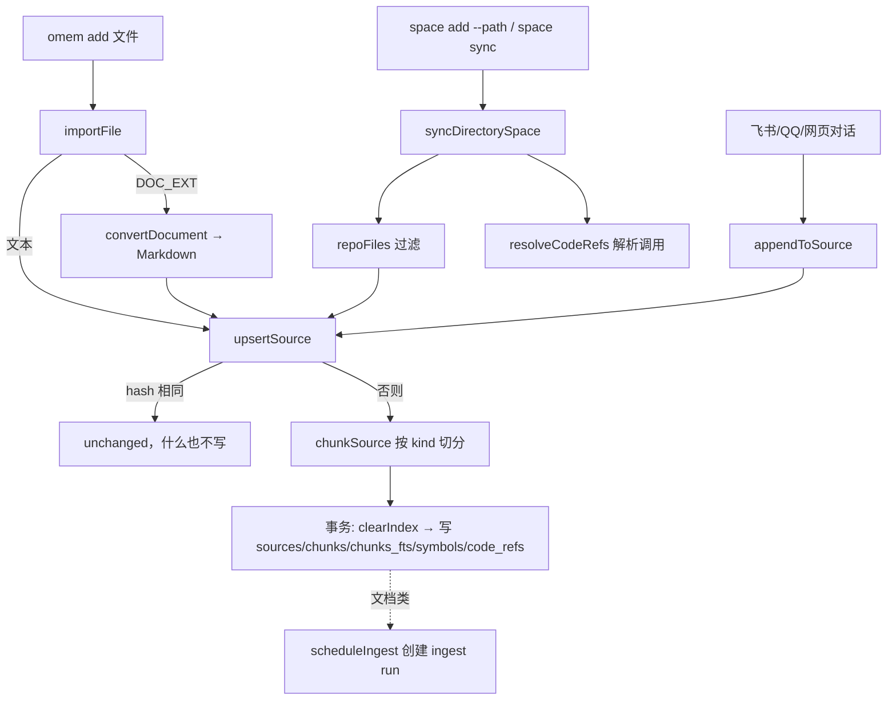
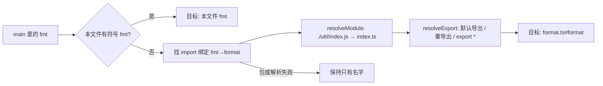

这页回答：把一个文档或一个代码仓库交给 omem 之后，文本怎么切块、怎么进搜索索引、代码的符号和调用关系从哪来、什么时候会叫 Agent 去整理。读完你能判断一个文件为什么搜不到（或搜到的块不对），也知道改切分、解析、调用关系各应该动哪个函数。

## 两条路径走一遍

**例 1：一份 Markdown。** `omem add notes.md -s personal`（[cli-main.ts:166-200](../../../src/cli-main.ts#L166-L200)）走到 `importFile`。它按扩展名分三种：`DOC_EXT`（pdf/docx/pptx/xlsx/html/epub 等）先过 `convertDocument` 转成 Markdown；图片只存原图，正文是一行 ``；其余按文本读，超过 `MAX_TEXT_BYTES`（1MB）或前 8000 字节里有 NUL 就返回 `null`，CLI 提示“不支持的文件类型”（[import.ts:81-106](../../../src/sources/import.ts#L81-L106)）。`notes.md` 的扩展名不在代码或配置表里，`classify` 归为 `doc`，所以 `kind = "doc"`。

**例 2：一个 TS 仓库。** `omem space add myrepo --path ./myrepo` 创建空间后立刻调 `syncDirectorySpace`；之后用 `omem space sync myrepo` 追平改动，两个命令都可以带 `--exclude <路径或 glob>` 把 `docs/archive` 这类目录写进空间设置（[cli-main.ts:138-165](../../../src/cli-main.ts#L138-L165)）。它不走 `importFile`，自己逐文件读，`uri` 是相对仓库根的路径，`.md/.txt/.rst/.adoc` 为 `doc`，其余一律 `code`（[import.ts:155-187](../../../src/sources/import.ts#L155-L187)）。

两条路最后都落到同一个函数 `upsertSource`：

## 进入 upsertSource 之前

**文件筛选（仓库空间）。** `repoFiles` 先问 Git：`git ls-files --cached --others --exclude-standard`，所以 `.gitignore` 自动生效；不是 Git 仓库才退回自己遍历，跳过点开头的目录（`.github` 除外）（[git.ts:70-76](../../../src/core/git.ts#L70-L76)，[import.ts:117-130](../../../src/sources/import.ts#L117-L130)）。无论哪种来源，再过一层：路径里有 `SKIP_DIRS`（node_modules、dist、build、vendor、.omem 等）、锁文件、二进制扩展名、`.min.js/.map` 的都丢掉（[import.ts:132-143](../../../src/sources/import.ts#L132-L143)）。然后是空间设置 `settings.exclude` 的前缀或简单 glob（[import.ts:160-161](../../../src/sources/import.ts#L160-L161)），最后才是 1MB 和 NUL 检查，不合格的进 `report.skipped`。

**文档转换。** `convertDocument` 按顺序尝试一串外部命令，第一个退出码为 0 且输出非空的胜出：配置的 `documents.converter`，然后按 `documents.engines`（默认 docling、pdftotext、pandoc）。Docling 只在 `.docx`，或 `.pdf` 且配了存在的 `doclingArtifacts` 时才加入；pdftotext 只管 PDF；pandoc 管非 PDF。全部失败抛 422，并附每个命令的错误（[import.ts:45-78](../../../src/sources/import.ts#L45-L78)，[config.ts:84-90](../../../src/core/config.ts#L84-L90)）。原文件按内容哈希前 16 位另存到 `files/`，`meta.original` 记文件名（[import.ts:108-115](../../../src/sources/import.ts#L108-L115)）。

有三处容易踩：

- 仓库同步不经过 `importFile`，所以仓库里的 `.html` 当文本读成 `code`，不会转换；而 `BINARY_EXT` 含 pdf/docx，仓库里的 PDF 直接不导入。要进库得用 `omem add 某.pdf`。
- `importDirectory` 同样先过 `repoFiles`，整目录导入时 PDF/DOCX 也被挡掉，只有 html/htm/epub 能走到转换（[import.ts:190-204](../../../src/sources/import.ts#L190-L204)）。这是从两段代码推出来的，没有注释说明是否有意。
- `importFile` 的默认 `uri` 是文件名，同一空间里两个同名文件会互相覆盖。

## upsertSource：去重、版本、重建索引

[store.ts:66-133](../../../src/sources/store.ts#L66-L133) 是整条路径的核心，顺序是：

1. 换行统一成 `\n`，算 SHA-256；按 `(space_id, uri)` 查已有行。哈希相同且未删除，直接返回 `unchanged`，不切块也不写库（[store.ts:67-75](../../../src/sources/store.ts#L67-L75)）。重复同步一个大仓库，没改的文件只花读文件和算哈希的时间。
2. 在事务外先 `chunkSource`，切分出错不会留下半截数据。
3. 事务内：已有行先 `clearIndex`（删该原件的 chunks、对应 `chunks_fts` 行、symbols、code_refs），再 `update` 覆盖 text/hash 并清掉 `deleted_at`；新原件则 `insert`。同一个 uri 永远只有一行，只存最新版本，与 AGENTS.md “原件只保留最新版”一致。然后逐块写 `chunks` 和 `chunks_fts`，有 `outline` 再写 `symbols` 和 `code_refs`（[store.ts:79-130](../../../src/sources/store.ts#L79-L130)）。
4. 事务后发 `changed` 事件，返回 `created` 或 `updated`。

写 `chunks_fts` 时存的不是原文，而是 `indexText` 展开后的词：中日韩连续字符切成重叠二字组，标识符保留整词并拆出 camelCase 和数字部分，所以搜 `parse code` 能命中 `parseCode`，搜“检索”能命中“检索系统”（[tokenize.ts:1-48](../../../src/search/tokenize.ts#L1-L48)）。`title` 列放“原件标题 + 块标题 + 块路径 + uri”，`body` 列放块正文（[store.ts:117-118](../../../src/sources/store.ts#L117-L118)）。FTS 表是无内容表（`content=''`，rowid 对应 `chunks.id`），删除要按 rowid 手动清，这也是 `clearIndex` 先查再删的原因（[db.ts:53](../../../src/core/db.ts#L53)）。查询时 `title` 的 bm25 权重是 `body` 的 4 倍（[search.ts:82-84](../../../src/search/search.ts#L82-L84)）。

## chunkSource：按 kind 分派

[chunk.ts:127-136](../../../src/sources/chunk.ts#L127-L136) 只做分派：

| kind | 切法 | 块的 kind / path |
|---|---|---|
| `code` 且扩展名是代码 | `chunkCode` | `symbol`，`文件#qname` |
| `code` 但是配置（json、yaml、css、html…） | `chunkPlain` | `file`，path 为 uri |
| `chat` | `chunkChat` | `message` |
| 其它，uri 以 `.md` 结尾或正文有 `# ` 标题行 | `chunkMarkdown` | `section`，path 是标题链 |
| 其它 | `chunkPlain` | `window` |

所有切法最终靠 `windows`：目标约 1400 字符，到了且遇到空行就断；超过 2400 字符不管在哪都强断（[chunk.ts:13-32](../../../src/sources/chunk.ts#L13-L32)）。

**Markdown** 按标题切，标题栈生成路径 `Title / A / A.1`，代码围栏里的 `#` 不算标题（[chunk.ts:34-60](../../../src/sources/chunk.ts#L34-L60)）。测试例子：`# Title … ## A … ### A.1 … ## B` 得到路径 `["Title","Title / A","Title / A / A.1","Title / B"]`，并断言块的行号能还原出块文本，长段切出的窗口行号首尾相接（[chunk.test.ts:6-20](../../../test/chunk.test.ts#L6-L20)）。行号精确，是 Wiki 里 `src:<id>#L起-L止` 引用成立的前提。

**聊天** 一行一条消息，每 24 行一个窗口，步长 20，相邻窗口重叠 4 行，让上下文不在窗口边界断掉（[chunk.ts:69-80](../../../src/sources/chunk.ts#L69-L80)）。

**代码** 见下节。

## 代码：符号、调用、解析

`chunkCode` 先 `parseCode`，再按符号切：每个顶层声明（含紧挨在上方的注释，`docStart`）一个或多个块；类超过 120 行时拆成成员；没被符号覆盖的行（import、顶层语句）按连续区段做 `file` 块，最后按行号排序（[chunk.ts:82-113](../../../src/sources/chunk.ts#L82-L113)）。测试：`import a …; export function one()` 得到 `file 1-2` 与 `symbol 3-5` 两块（[chunk.test.ts:38-44](../../../test/chunk.test.ts#L38-L44)）。

`parseCode` 对 `.ts/.tsx/.js/.jsx/.mjs` 等用 TypeScript 编译器 API 建 AST；`.vue/.svelte` 先抠出 `<script>` 再解析并把行号平移回去；其它语言走正则版 `parseGeneric`，Python 另有 `pythonRefs`（[code.ts:38-55](../../../src/sources/code.ts#L38-L55)）。TS 解析遍历文件顶层语句，产出两类东西：

- **符号**：函数、类及其方法（qname 形如 `Store.save`）、interface、type、enum、namespace，以及“有意义的” `const`（箭头函数、跨两行以上、或带 export）。每个带行号范围、签名（截到 `{` 或 `=>` 前）、是否导出（[code.ts:74-91](../../../src/sources/code.ts#L74-L91)，[code.ts:143-163](../../../src/sources/code.ts#L143-L163)）。
- **引用**（`code_refs`）：`import` 带绑定表（本地名 → 导出名，`default` 或 `*`）；`export` 记重导出和默认导出；`call` 记每个符号体内的调用，同一符号里相同的“限定符.名字”只记一次，限定符只收简单的 `ns.fn()` 和 `this.fn()`（[code.ts:92-112](../../../src/sources/code.ts#L92-L112)，[code.ts:113-123](../../../src/sources/code.ts#L113-L123)）。顶层表达式如 `describe("…", …)` 没有所属符号，以“被调函数(首个字符串)”作临时归属（[code.ts:184-201](../../../src/sources/code.ts#L184-L201)）。

此刻 `code_refs` 里的调用只知道名字，`to_source_id/to_qname` 为空。解析是单独一步 `resolveCodeRefs(app, spaceId)`，在 `syncDirectorySpace` 末尾调用，条件是本轮有新增、更新或删除，或这个空间从没同步过（[import.ts:184](../../../src/sources/import.ts#L184)）。它一次读出整个空间的文件、符号和引用（不是增量），再逐条调用往回追：

模块解析支持相对路径、`.js`→`.ts`、目录 `index`、`@/` 与 `~/`（试 `src/` 和根）；Python 处理点号相对导入和按路径后缀匹配的绝对导入（[callgraph.ts:49-79](../../../src/sources/callgraph.ts#L49-L79)）。`resolveExport` 最多追 5 层，防止循环重导出（[callgraph.ts:103-132](../../../src/sources/callgraph.ts#L103-L132)）。`this/self/cls.fn()` 在同一个类里查 `Class.fn`；`ns.fn()` 把 `ns` 解析成模块后再查它的导出（[callgraph.ts:150-162](../../../src/sources/callgraph.ts#L150-L162)）。最后在一个事务里批量回写 `to_source_id/to_qname`（[callgraph.ts:165-168](../../../src/sources/callgraph.ts#L165-L168)）。

测试里有个典型场景：`main.ts` 里 `fmt(' a ')` 经 `util/index.ts` 的 `export *` 追到 `util/format.ts#format`，`renamed()` 经 `export { other as renamed }` 追到 `other`，`new Store().save()` 里的 `Store` 经默认导入解析到类，`other/format.ts` 里同名的 `format` 不会被混淆；`node:fs` 的 `readFileSync` 保持未解析（[callgraph.test.ts:29-63](../../../test/callgraph.test.ts#L29-L63)）。

解析结果有两个读者：`find_symbol` 工具把“已解析”的调用方和被调用者与“只按名字匹配”的分开列，后者标明可能是同名误报（[tools.ts:248-289](../../../src/agents/tools.ts#L248-L289)）；网页原件页右侧“结构”栏点一个符号，请求 `/api/sources/:id/relations`，由 `symbolRelations` 返回调用方和被调用者（[callgraph.ts:178-195](../../../src/sources/callgraph.ts#L178-L195)，[Sources.vue:203-213](../../../web/src/views/Sources.vue#L203-L213)）。

取舍：这是靠 import 绑定的静态解析，不做类型推断，所以变量上的方法调用（`foo.bar()`，`foo` 是实例）、动态分派、包内符号都不会解析。从实现看，选择“解析不了就只留名字”而不是猜，是宁缺毋滥；`find_symbol` 因此把两类分开显示。

## 聊天追加

聊天不是整份重导入，而是 `appendToSource`：取现有文本，拼上新行，记下新内容从第几行开始（`meta.appendedFrom`），再调 `upsertSource`（[store.ts:216-222](../../../src/sources/store.ts#L216-L222)）。飞书群、QQ 群、网页对话（uri 为 `conversation:<id>`，kind 为 `conversation`）都这样写（[lark-bot.ts:85-95](../../../src/channels/lark-bot.ts#L85-L95)，[threads.ts:283-293](../../../src/agents/threads.ts#L283-L293)）。每次追加都会整份重切、重建该原件的全部块，聊天很长时单次开销随长度增长；`appendedFrom` 则交给整理角色，让它只关注新增部分（[jobs.ts:111-134](../../../src/agents/jobs.ts#L111-L134)）。`conversation` 不等于 `chat`，会落到 `chunkSource` 最后两个分支（有标题行按 Markdown，否则按窗口）。

## 什么时候叫 Agent 整理

切块和索引是纯本地、无模型的。整理是另一步：`scheduleIngest` 创建一个 `ingest` run，输入是原件 id 列表，处理时把每个原件的 uri、类型和 `appendedFrom` 写进任务交给 ingest 角色（[jobs.ts:104-134](../../../src/agents/jobs.ts#L104-L134)）。如果开启了注入标记（`guard.provider`），处理函数会先对这些原件跑一遍判官，有疑似“写给 AI 的指令”的行时，在对应那一行任务文字后面加警告，要求角色只当材料记录；判官结果也会写进原件 `meta.guard`，`read_source` 读到被标记的行范围时同样给出警告（[jobs.ts:113-126](../../../src/agents/jobs.ts#L113-L126)，[tools.ts:156-158](../../../src/agents/tools.ts#L156-L158)）。只标记，不拦截、不改变是否入库。

返回 `null`（不整理）的条件：没有新原件，或空间设了 `autoIngest === false`，或空间是 `repo` 且没有显式 `autoIngest: true`（[jobs.ts:107](../../../src/agents/jobs.ts#L107)）。所以：

- 导入文档、笔记、网页，默认触发整理（CLI 可 `--no-ingest` 关掉，网页上传接口也是导入后调用它）。
- 仓库空间的同步本身从不调 `scheduleIngest`；整理要手动，或把 `autoIngest` 设为 true。仓库更新后的后续动作是 `sync` 任务里的 `wiki-lint`：有更新或删除、已有页面、且存在引用了变化原件的页面时才创建（[jobs.ts:224-233](../../../src/agents/jobs.ts#L224-L233)）。
- 定时同步是 `repo-sync` 计划（每小时，默认关闭），对每个有 `rootPath` 的空间创建 `sync` run（[main.ts:16-18](../../../src/main.ts#L16-L18)，[scheduler.ts:15](../../../src/core/scheduler.ts#L15)）。

## 删除与墓碑

`deleteSource` 在事务里 `clearIndex`，再把 `text` 置空、写 `deleted_at`，行本身保留（[store.ts:145-152](../../../src/sources/store.ts#L145-L152)）。搜索带 `deleted_at is null`，所以找不到它；但 Wiki 页面里的 `src:<id>` 引用仍能解析到一条“已删除”的记录，而不是 404。陈旧页面检测也靠这个：`stalePages` 把 `hash` 变了或 `deleted_at` 非空的原件视为引用已变化（[jobs.ts:203-210](../../../src/agents/jobs.ts#L203-L210)）。

仓库同步里，磁盘上不再出现的 `code/doc` 原件被删。`seen` 只在通过大小和二进制检查后才记录，所以一个文件长到超过 1MB 也会被当作消失而打墓碑（[import.ts:167-183](../../../src/sources/import.ts#L167-L183)，这是从代码顺序推出的）。`exclude` 新增匹配项时同理：已导入的匹配文件下次同步会变成墓碑。同一个 uri 之后重新出现时，`upsertSource` 复用旧行 id 并清掉 `deleted_at`；因为“未变”的判断要求 `!deleted_at`，即使内容与删除前一致也会重建索引，返回 `updated`，旧引用重新生效（[store.ts:75-76](../../../src/sources/store.ts#L75-L76)）。

## 要改这里从哪下手

- **文件该不该进来**：`repoFiles`、`SKIP_DIRS`、`BINARY_EXT`（import.ts）；单个空间的排除用 `settings.exclude`（`omem space sync <id> --exclude …`），不要写死项目名，这是 AGENTS.md 的约定。
- **文档转换**：`convertDocument` 和 `documents.engines` 配置（core/config.ts:84-90）。
- **切分粒度**：`TARGET/MAX_CHUNK`、`windows`、各 `chunk*` 函数。改了以后已有原件不会自动重切，因为哈希没变；需要像 db.ts 里那条迁移一样把相关原件 `hash` 清空，下次同步才会重建（[db.ts:231-233](../../../src/core/db.ts#L231-L233)）。同时更新 chunk.test.ts。
- **分词**：`tokenize.ts` 同时用于建索引和查询，两边必须一致，改动后旧索引需要重建。
- **新语言的符号**：TS 系改 `parseTs`；其它语言目前只有 `parseGeneric` 正则和 Python 的 `pythonRefs`，新增模块解析规则要在 `resolveModule` 里补，并在 callgraph.test.ts 加一个小仓库用例。
- **改表结构**：db.ts 的迁移数组追加新条目，不改旧条目。
- **整理触发条件**：`scheduleIngest`（jobs.ts:104）；怎么整理是 `roles/ingest.md` 的事，行为变化优先改角色说明。

相关页面：[一条消息从进来到回复发出](./message-to-reply.md)（对话如何被追加为原件）、[线程与 Agent 会话](../concepts/threads-and-agent-sessions.md)、[跑起来、调试、测试](../howto/run-and-develop.md)、[omem 是什么、怎么组成](../overview.md)。
