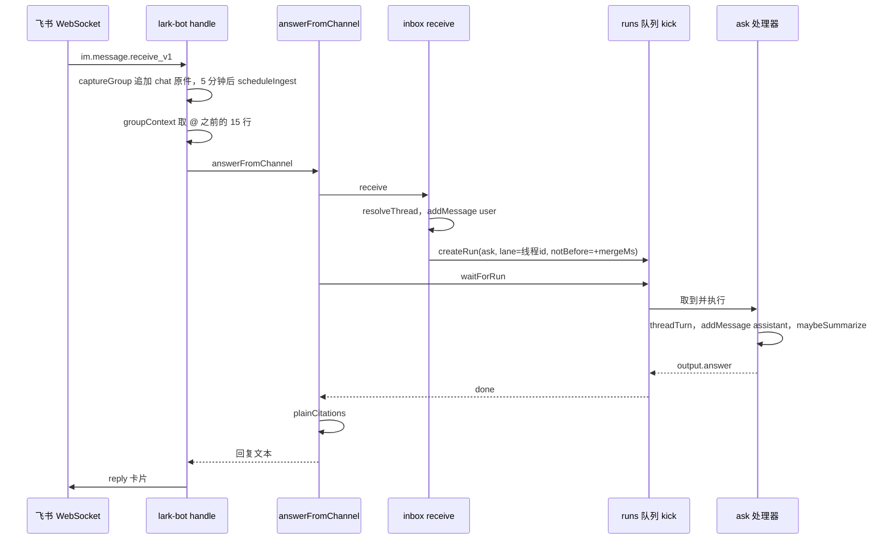

这页回答：本人在飞书里发一句话，到助理的回答出现在同一个聊天里，代码依次经过哪些函数；连发几条、`/` 开头的命令、群里 @ 在路上各走哪个分支。读完你应该能在 `inbox.ts` 和 `runs.ts` 里找到要改的位置。模型实际怎么被调用（`threadTurn`）不在这页展开，只标出它在链路中的位置。全局目录见 [omem 源码 Wiki](../index.md)。

## 一个例子：群里 @机器人

本人在某个飞书群里发「@助理 上周和小王约的接口评审改到什么时候了」，前面几分钟群里还有别人在聊接口。

**1. 事件进入。** `startLarkBot` 里注册的 `im.message.receive_v1` 回调把飞书事件整理成 `Inbound`（chatId、chatType、messageId、senderId、text、是否 @ 了机器人、话题 id），然后图片和文件走 `saveResource`，其余走 `handle`，两者都不 await，回调立即返回 `{}`，失败只打 warn（[lark-bot.ts:172-190](../../../src/channels/lark-bot.ts#L172-L190)）。

**2. 群消息先落库。** `handle` 对群消息第一件事是 `captureGroup`，不管有没有 @ 机器人、也不管是谁发的（[lark-bot.ts:122-126](../../../src/channels/lark-bot.ts#L122-L126)）。它按 `personal` 空间设置里的 `larkGroups` 把群映射到空间（没配就用 `cfg.defaultSpace`），用 `lark:<chatId>` 作 uri，把这一行 `[时间 · 话题 x] 发言人: 内容` 追加到同一份 chat 原件（[lark-bot.ts:81-95](../../../src/channels/lark-bot.ts#L81-L95)）。随后用 `pending` 表做防抖：同一原件每来一条就重置 5 分钟计时，计时到了才 `scheduleIngest`，让 ingest 角色整理这批新内容（[lark-bot.ts:96-107](../../../src/channels/lark-bot.ts#L96-L107)）。所以群里聊天的“记住”和“回答”是两条互不等待的路径。`scheduleIngest` 本身还会看空间的 `autoIngest` 设置，repo 类空间默认不触发（[jobs.ts:102-107](../../../src/agents/jobs.ts#L102-L107)）。

**3. 没 @ 就到此为止。** `if (!m.mentionsBot) return`。@ 之后再检查身份：没配 `ownerOpenId` 时回一句绑定提示，发送者不是本人则直接忽略（[lark-bot.ts:125-131](../../../src/channels/lark-bot.ts#L125-L131)）。通过后去掉文本里的 `@_user_N`，文本为空就不处理。

**4. 取 @ 前的上下文。** `captureGroup` 顺手把「消息 id → 原件」记在 `lastCapture` 里；`groupContext` 读出这份原件全文，丢掉最后一行（就是这条 @ 本身），在有话题时只保留带同一 `话题 <id>]` 的行，取最后 15 行（[lark-bot.ts:110-120](../../../src/channels/lark-bot.ts#L110-L120)）。它作为 `context` 随消息一起交给 inbox，之后写进用户消息的 `meta`，让模型知道“群里刚才在聊什么”。

**5. 进入 `answerFromChannel`。** `handle` 把 channel、chatId、topicId、空间、context、外部消息 id 打包交给 `answerFromChannel`；返回字符串就发出去，返回 `null` 就不发（[lark-bot.ts:136-148](../../../src/channels/lark-bot.ts#L136-L148)）。发出时用 `message.reply` 回复这条原消息，有话题则 `reply_in_thread`，内容是一张只含一段 markdown 的卡片，截到 28000 字符（[lark-bot.ts:62-66](../../../src/channels/lark-bot.ts#L62-L66)）。

## 统一入口 `receive`

所有渠道和 Web/CLI 都汇到 `receive`（[inbox.ts:31-84](../../../src/agents/inbox.ts#L31-L84)），按顺序做这几件事：

1. **找线程。** 有 `conversationId`（Web/CLI）就直接找，找不到按这个 id 新建；有 channel + chatId 就 `resolveThread`；否则新建一个线程（[inbox.ts:34-43](../../../src/agents/inbox.ts#L34-L43)）。
2. **记下回复落点。** 有 `externalMessageId` 就写进线程设置的 `lastMessageId`，后面后台任务回投时要用（[inbox.ts:44](../../../src/agents/inbox.ts#L44)）。
3. **斜杠命令。**
4. **存消息、合并或排队。**

### resolveThread：一个聊天对应哪个线程

键是 `chatId`，或在话题模式下是 `chatId#topicId`。模式取自 `chat_settings`（`/mode` 设置），没设置时有话题 id 就按话题分，否则整群一个线程。找该键下 `active` 的最新线程；没有就新建，并把上一条同键线程记为 `parentId`。整群模式下如果空闲超过 `idleHours`（默认 12 小时），旧线程归档、开新线程并返回 `started: "renewed"`（[threads.ts:146-166](../../../src/agents/threads.ts#L146-L166)）。`answerFromChannel` 看到 `renewed` 会在回答前加一句“已开始新会话并带上之前的摘要”（[common.ts:18-19](../../../src/channels/common.ts#L18-L19)）。

### 斜杠命令：不调模型

文本 trim 后以 `/` 开头就交给 `runCommand`。它用正则取出命令名，在 `commands` 表里查；查不到返回 `null`，**未知命令按普通文字继续往下走**（[commands.ts:301-311](../../../src/agents/commands.ts#L301-L311)）。测试里 `/whatever 这是什么` 就会得到一个 runId（[threads.test.ts:117-120](../../../test/threads.test.ts#L117-L120)）。查到则命令执行完，用户那行和回复都以 `meta.command = true` 存进线程，返回 `reply`、`runId: null`（[inbox.ts:47-54](../../../src/agents/inbox.ts#L47-L54)）。`answerFromChannel` 发现 `reply !== null` 就原样返回，不经过队列（[common.ts:13-14](../../../src/channels/common.ts#L13-L14)）。`meta.command` 的消息不进会话摘要（[jobs.ts:90](../../../src/agents/jobs.ts#L90)）。

命令表分几类：会话控制（`/new /resume /stop /status`）、路由（`/space /agent /as /mode`）、快捷（`/remember /todo /search`）等，完整列表在 `/help`（[commands.ts:39-55](../../../src/agents/commands.ts#L39-L55)）。`/stop` 会取消该线程 lane 里所有排队和运行中的任务（[commands.ts:90-98](../../../src/agents/commands.ts#L90-L98)）。

### 连发合并

非命令消息先 `addMessage(user)`。合并等待时间 `mergeMs`：显式传入的优先；Web、CLI 或带 `conversationId` 的是 0；聊天渠道取 `sessions.mergeMs`，默认 1500 毫秒（[inbox.ts:63](../../../src/agents/inbox.ts#L63)，[config.ts:60-62](../../../src/core/config.ts#L60-L62)）。

接着 `queuedInLane(thread.id, "ask")` 查这个线程是否已有**还在排队**的 ask。有的话，把新消息 id 追加到那个 run 的 `input.messageIds`，把 `notBefore` 顺延到“现在 + mergeMs”，标题拼上新内容，并返回 `merged: true` 和那个 run 的 id（[inbox.ts:66-73](../../../src/agents/inbox.ts#L66-L73)）。这是滑动窗口：只要每条间隔小于 `mergeMs`，就会一直推迟，合成一轮。`threads.test.ts` 里“第一条”“第二条”连发后，第二次 `receive` 返回同一个 runId，模型看到的 `msgs` 是两条（[threads.test.ts:57-63](../../../test/threads.test.ts#L57-L63)）。

没有排队中的 ask，或者 `updateQueuedRun` 因为那个 run 恰好已开始（SQL 里 `status = 'queued'` 才更新）返回 false，就新建一个：`createRun({ kind: "ask", lane: thread.id, notBefore, input: { conversationId, messageIds } })`，并把消息的 `run_id` 指向它（[inbox.ts:74-83](../../../src/agents/inbox.ts#L74-L83)）。

被合并的那一次调用，`answerFromChannel` 返回 `null`，`handle` 不再发消息（[common.ts:15](../../../src/channels/common.ts#L15)）。回答只由第一次调用的 `waitForRun` 发回，且是回复**第一条**消息。

## 运行队列：lane、串行与并行

`createRun` 往 `runs` 表插一行 `queued`，通过 `queueMicrotask` 触发一次 `kick`；有 `notBefore` 还会再设一个定时器到点补踢（[runs.ts:57-90](../../../src/agents/runs.ts#L57-L90)）。`startWorker` 另有每 2 秒一次的兜底 `kick`，并把重启时遗留的 `running` 改回 `queued`（[runs.ts:215-222](../../../src/agents/runs.ts#L215-L222)）。

`nextRunnable` 的规则（[runs.ts:224-246](../../../src/agents/runs.ts#L224-L246)）：

- 到了 `notBefore` 才可选；
- 同 lane 已有 running 的，不选；
- 同 lane 只有最老的 queued 能开始；
- `ask` 和 `agent` 属于 interactive 类，占单独的并发配额，不会被长时间后台任务（ingest、wiki 写作）挤住（[runs.ts:206-207](../../../src/agents/runs.ts#L206-L207)）。

ask 的 lane 就是线程 id，所以**同一线程的轮次按序执行，不同线程并行**。`threads.test.ts` 验证了：同一 lane 的第二个 run 的 `startedAt` 不早于第一个的 `finishedAt`，另一个线程不受影响（[threads.test.ts:65-77](../../../test/threads.test.ts#L65-L77)）。

`kick` 取到后用 `update … where status='queued'` 原子认领（CLI 和服务进程可能共用一个库），执行 handler，结束后写 `done`/`failed`/`cancelled` 并发 `run` 事件（[runs.ts:248-295](../../../src/agents/runs.ts#L248-L295)）。

## ask 处理器

`registerHandler("ask")` 按 `input.messageIds` 从线程最近 400 条消息里取出这几条用户消息，交给 `threadTurn`（[jobs.ts:54-60](../../../src/agents/jobs.ts#L54-L60)）。`threadTurn` 负责选 Agent、续接或冷启动会话、拼 prompt，见后续的线程会话那一页。回来之后：

1. 文本为空时用“（Agent 没有给出文字回答）”顶上；
2. `addMessage(assistant, …, runId, { agent, session, replyTo })` 把回答存进线程；
3. `maybeSummarize` 看自上次摘要以来的新消息是否够 10 条，够就在 `summary:<线程>` lane 里排一个 `thread-summary`，已有则跳过（[sessions.ts:74-83](../../../src/agents/sessions.ts#L74-L83)）；
4. 返回 `{ answer, messageId, session }`，被 `kick` 存进 `runs.output`（[jobs.ts:61-65](../../../src/agents/jobs.ts#L61-L65)）。

## 回复回到聊天

`answerFromChannel` 里的 `waitForRun` 监听 `run` 事件，同时每 1.5 秒轮询库（别的进程可能在跑这个 run）（[runs.ts:307-327](../../../src/agents/runs.ts#L307-L327)）。拿到结果后：`done` 取 `output.answer`，`cancelled` 回“（已停止）”，其余回“处理失败：原因”（[common.ts:16-17](../../../src/channels/common.ts#L16-L17)）。最后 `plainCitations` 把带 `src:`、`mem:`、`msg:`、`wiki:` 前缀的 Markdown 链接换成纯文字，Wiki 双括号链接换成显示文字，因为飞书打不开这些内部链接（[common.ts:22-27](../../../src/channels/common.ts#L22-L27)）。Telegram 和 OneBot 也走这条函数，区别只是各自的发送和分段（`chunkMessage`）。

## Web 和 CLI

`jobs.ask` 只是 `receive` 的薄封装：传 `conversationId`（没传就生成一个 `c…` id）、`channel` 默认 `web`，所以 `mergeMs` 为 0，不会等待合并，但同一会话里正在排队的 ask 仍会被合并，lane 串行同样生效（[jobs.ts:43-52](../../../src/agents/jobs.ts#L43-L52)）。HTTP 接口和 `omem ask` 命令分别在 `src/server/http.ts:224` 和 `src/cli-main.ts:223` 调它。它不等结果，返回 `runId`，由调用方自己订阅事件或 `waitForRun`。

## 后台结果投回原线程

交办给 Agent 档案的任务（`/as 名字 任务`）创建 `kind: "agent"` 的 run，input 里带着 `threadId`（[commands.ts:198-201](../../../src/agents/commands.ts#L198-L201)）。命令当场回复“已交给 …，完成后结果会发回这里”，之后 handler 跑完调 `deliverToThread`（[jobs.ts:69-85](../../../src/agents/jobs.ts#L69-L85)）：

- 找线程，找不到返回 `false`；
- 先 `addMessage(assistant)`，带 `deliveredAt`——所以即使渠道不在线，结果也留在线程历史里；
- 再按 `thread.channel` 在 `senders` 表里找发送函数，没有就返回 `false`；有则调用，抛错只记 warn 并返回 `false`（[inbox.ts:101-114](../../../src/agents/inbox.ts#L101-L114)）。

发送函数由各渠道在启动时用 `registerThreadSender` 注册。飞书的实现把 `thread.key` 按 `#` 拆成 chatId 和话题，并以线程设置里的 `lastMessageId`（`receive` 每次更新）作为回复目标，有话题就在话题内回复（[lark-bot.ts:68-73](../../../src/channels/lark-bot.ts#L68-L73)）。Telegram 和 OneBot 同理。这条路径没有 `waitForRun` 在等，所以发送失败不会通知任何人。测试里注册了一个 `test` 渠道的 sender，验证 `/as reporter 只写标题` 的结果会送达（[threads.test.ts:125-140](../../../test/threads.test.ts#L125-L140)）。

## 为什么这样设计

以下是从实现看到的取舍，源码里没有专门的设计说明：

- **一个入口。** 命令、合并、线程、lane 都在 `receive` 里，渠道只负责收发，新增渠道只需调用 `answerFromChannel` 并注册一个 sender。
- **回答走队列而不是在回调里直接调模型。** 这样串行、重启恢复、取消（`/stop`）、事件流和 Web 的进度展示用同一套 `runs` 机制。
- **合并靠改 queued 的 run，而不是在内存里攒。** 进程重启不丢，CLI 与服务共用库时也一致。代价是只能合并“还没开始”的轮次；轮次开始后的新消息会排到下一轮。
- **群聊记录与回答分离。** 全群消息都进原件供 ingest 整理，只有 @ 才触发回答。

## 要改这里从哪下手

- **换合并策略或等待时间**：`inbox.ts` 的 `receive`（`mergeMs`、`queuedInLane`），默认值在 `src/core/config.ts` 的 `sessions.mergeMs`。测试在 `test/threads.test.ts`。
- **加或改斜杠命令**：`commands.ts` 的 `commands` 表；记得同步 `/help` 的分组列表。命令不要调模型，需要长任务的像 `/as` 一样建 run 并告知回投。
- **线程怎么划分、何时换新会话**：`threads.ts` 的 `resolveThread`，注意 `chat_settings` 与 `/mode`、`idleHours`。
- **新增聊天渠道**：照 `lark-bot.ts` 调 `answerFromChannel`，并 `registerThreadSender`；回复文本已经是去掉内部链接的 Markdown，按渠道限制自行分段。
- **调并发或 lane 规则**：`runs.ts` 的 `nextRunnable`、`INTERACTIVE`。改后跑 `threads.test.ts` 里 lane 的用例。
- **后台结果投递**：`deliverToThread` 的调用方目前只有 `agent` 处理器，新增类型的后台任务想回到聊天，需要在 run input 里带 `threadId` 并调它。
- 改完跑 `pnpm run check`；动了 Agent 运行时相关逻辑还要保持 `test/fake-acp-agent.ts` 的用例通过。

## 没查清的

- `threadTurn` 内部（会话续接、冷启动 prompt）未读，留给线程会话那一页。
- `lastCapture` 只在 `handle` 里被取出删除；群消息若不是 @ 本人或发送者不是本人，条目不会被清理，从实现看会随进程运行缓慢增长。这是推断，未验证。
