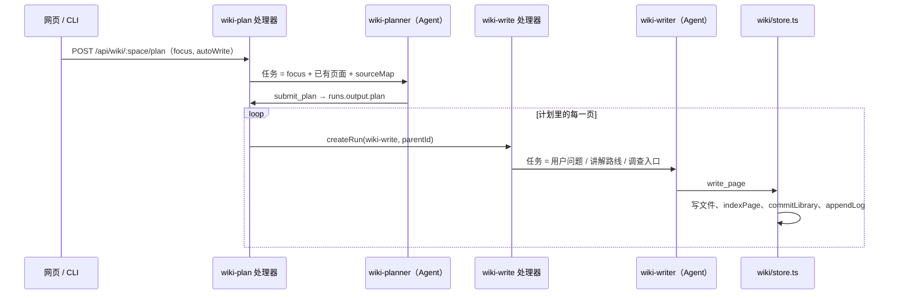

这一页回答：在 Wiki 页点“规划并生成”之后，宿主和 Agent 各做了什么；一篇页面怎样变成磁盘上的 Markdown、数据库里的几张表和一条 Git 提交；原件改了以后，系统怎么知道哪些页面该重看；写好的 Wiki 怎样带出库、放进仓库里读。读完可以定位“页面质量不好”“引用没挂上”“过期提示不对”各应该改哪里。

下面以本页所在的流程为例：这个空间（omem 源码）的 Wiki 就是这样生成的，本页的计划条目就是 `flows/wiki-generation`。

## 一次完整的走法

**1. 入口。** 网页按钮请求 `POST /api/wiki/:space/plan`，只是创建一条 `wiki-plan` 运行，输入是 `focus` 和 `autoWrite`（默认 true）（[http.ts:297-301](../../../src/server/http.ts#L297-L301)）。CLI 的 `wiki plan <space>` 创建同样的运行，`--no-write` 对应 `autoWrite: false`（[cli-main.ts:228-236](../../../src/cli-main.ts#L228-L236)）。运行怎么排队、怎么挑角色对应的 Agent，见 [任务队列、Run 与角色](../concepts/run-queue-and-roles.md)。

**2. 宿主给规划者什么。** `wiki-plan` 处理器只拼三样东西交给 `wiki-planner`：本人的要求（没有就写“为这个空间规划完整的 Wiki”）、已有页面的 slug 和标题、`sourceMap` 生成的目录概况（[jobs.ts:158-178](../../../src/agents/jobs.ts#L158-L178)）。`sourceMap` 不读内容，只按目录统计未删除原件的文件数、行数和前 6 个文件名，最多列 120 个目录（[jobs.ts:138-156](../../../src/agents/jobs.ts#L138-L156)）。宿主不替规划者决定读什么、分几页——这符合 AGENTS.md 里“宿主只做数据、索引、调度和权限”的约定；怎么调查写在角色说明里：读 README、入口、测试，顺着一两条核心流程追代码（[wiki-planner.md:14-15](../../../roles/wiki-planner.md#L14-L15)）。

**3. 计划怎么交回来。** 规划者调用 `submit_plan`，参数是页面数组：`slug`、`title`、`kind`、`question`（用户问题）、`outline`（讲解路线）、`entry_points`（调查入口）、可选的 `section`。工具处理器只做一件事：`setRunOutput(runId, { plan })`，把计划写进这条运行的 `output` 列（[tools.ts:742-766](../../../src/agents/tools.ts#L742-L766)）。处理器等 Agent 结束后再从数据库读 `runs.output` 取回 `plan`，没有就抛错“规划没有提交页面计划”（[jobs.ts:172-174](../../../src/agents/jobs.ts#L172-L174)）。所以“计划”不经过模型的文字输出，也不需要从回答里解析 JSON；结构由工具的 zod schema 保证。

规划者还要自己用 `write_page` 写 `index` 页，列出分组和页面链接（[wiki-planner.md:34-35](../../../roles/wiki-planner.md#L34-L35)）。这页后面会被 `wikiNav` 解析成侧边目录。

**4. 逐页派活。** `autoWrite` 为真时，处理器给计划中的每一页 `createRun({ kind: "wiki-write", input: { brief }, parentId: 本次规划的 id })`（[jobs.ts:175-176](../../../src/agents/jobs.ts#L175-L176)）。`parentId` 让网页和 CLI 能把这些子运行挂在规划运行下面（CLI 的 `children: true` 会等它们）。子运行是否并行取决于运行队列，我没有在这条路径上核实。

**5. 写作任务怎么构造。** `wiki-write` 把 `brief` 渲染成任务文本：页面 slug 与标题、类型、用户问题、讲解路线、调查入口；页面已存在时加一句“先 read_page，保留仍然正确且有用的内容”；再附上全部已有/计划中页面的链接列表，让写作者能互相链接而不重复讲（[jobs.ts:182-200](../../../src/agents/jobs.ts#L182-L200)）。你正在读的这页，收到的任务就是这样一段文字，包括“调查入口”和页面清单。写作结束后处理器检查页面文件是否存在，不存在就让运行失败（[jobs.ts:198](../../../src/agents/jobs.ts#L198)）。

**6. `write_page` 落盘。** 写作者唯一的写入手段是 `write_page`。工具层做三件事：先 `space()` 检查空间范围；把正文开头的一级标题去掉（标题在元数据里）；然后调用 `writePage`，提交信息带上执行者、创建还是更新、原因和运行 id；最后 `appendLog` 往空间的 `log.md` 追一行（[tools.ts:523-546](../../../src/agents/tools.ts#L523-L546)）。返回给 Agent 的文字会带上“引用原件 N 个”和“这些链接目标还不存在”，让它当场发现漏链（[tools.ts:544-545](../../../src/agents/tools.ts#L544-L545)）。

`writePage` 的顺序是：校验 slug → 写 `wiki/<slug>.md`（YAML 头 + 正文，`updated` 取当天）→ `indexPage` → `commitLibrary`（[store.ts:129-144](../../../src/wiki/store.ts#L129-L144)）。Markdown 文件是事实来源，数据库只是索引。`commitLibrary` 在知识库目录这个独立 Git 仓库里 `add -A` 后提交；没有变化就不提交（[git.ts:38-45](../../../src/core/git.ts#L38-L45)）。注意 `appendLog` 在提交之后，所以 `log.md` 的这一行会随下一次提交进入历史，不在同一次。

## 页面进了哪些表

`indexPage` 在一个事务里更新五处（[store.ts:82-116](../../../src/wiki/store.ts#L82-L116)）：

- `pages`：标题、摘要、类型、正文、整份序列化内容的 `hash`。新旧 hash 相同就直接返回 false，不动任何表。
- `page_rowids` + `pages_fts`：全文索引。`pages_fts` 是 contentless 的 FTS5 表，所以要靠 `page_rowids` 找到旧行删掉再插（[db.ts:89-90](../../../src/core/db.ts#L89-L90)）。检索如何用到它见 [检索](../concepts/retrieval.md)。
- `page_links`：先删后插，来自 `extractLinks`。
- `page_cites`：先删后插，来自 `extractCites` 加 `resolveSourceRef`，每行记录 `source_id`、行号范围，以及**此刻**原件的 `hash`（[db.ts:91-92](../../../src/core/db.ts#L91-L92)）。

## 引用语法怎么被解析

两个正则就是全部语法（[store.ts:56-70](../../../src/wiki/store.ts#L56-L70)）：

- 页面链接：双方括号包住 slug，可带 `|显示文字`；也认以 `wiki:` 开头的普通 Markdown 链接目标。带空间前缀的写法（空间 id、冒号、slug）在入库时把冒号换成斜杠，得到跨空间的页面 id；没有冒号就补上本空间前缀（[store.ts:107](../../../src/wiki/store.ts#L107)）。
- 原件引用：链接目标写成 `src:<ref>#L10-L20`。行号可省略；只有起始行时，结束行等于起始行。

`ref` 可以是原件 id，也可以是 uri。`resolveSourceRef` 依次按：id → 本空间 uri → 任意空间最新的同 uri 原件（[store.ts:72-80](../../../src/wiki/store.ts#L72-L80)）。测试里就用 uri 写引用：`src:a.ts#L1-L1`（[library.test.ts:92-98](../../../test/library.test.ts#L92-L98)）。解析不到的引用**不报错也不入表**（[store.ts:110-111](../../../src/wiki/store.ts#L110-L111)）。从实现看，这意味着编造的原件 id 不会被拦住，页面里会留着一条点不开的引用，而且它永远不会被标成过期，因为 `page_cites` 里根本没有这行。

## 过期检查

判断很直接：`page_cites.hash`（写页面时原件的 hash）与 `sources.hash`（现在的 hash）不等，或原件已被标删除。网页列表用 `listPages` 里的子查询数出 `staleSources`（[store.ts:200-210](../../../src/wiki/store.ts#L200-L210)），读页面时 `pageContext` 给每个引用的原件标 `stale` / `deleted`（[store.ts:167-191](../../../src/wiki/store.ts#L167-L191)），`read_page` 工具会在开头提醒 Agent“N 个引用原件在写作后已变化”（[tools.ts:431-434](../../../src/agents/tools.ts#L431-L434)），Wiki 页面上显示徽标和“N 页的原件已变化 · 检查”按钮（[Wiki.vue:220](../../../web/src/views/Wiki.vue#L220)）。

原件 hash 在 `upsertSource` 里用规范化换行后的文本算，内容一样就返回 `unchanged`，不改 hash（[sources/store.ts:66-75](../../../src/sources/store.ts#L66-L75)），所以只有真的改了内容才会触发过期。

测试把这条链走了一遍：写两页互链的页面，检查反向链接和引用；再用新文本 `upsertSource` 同一个 uri，断言 `stale` 变 true、`staleSources` 为 1（[library.test.ts:88-107](../../../test/library.test.ts#L88-L107)）。

### 谁来处理过期页面

`wiki-lint` 运行先 `syncWiki`，再用 `stalePages` 查出“页面 → 变化的原件 uri”，没有就返回 quiet，有就把清单交给 `wiki-linter`（[jobs.ts:202-220](../../../src/agents/jobs.ts#L202-L220)）。linter 的规则在角色说明里：只改受影响的段落；说法仍成立只更新行号；说法不对就改写；没有要改的回复 `QUIET`（[wiki-linter.md:10-18](../../../roles/wiki-linter.md#L10-L18)）。

触发有三条：网页按钮（`POST /api/wiki/:space/lint`，[http.ts:311](../../../src/server/http.ts#L311)）、CLI `wiki lint`，以及目录空间同步之后自动触发。自动触发要同时满足：同步报告里有更新或移除、该空间已有页面、空间设置 `autoLint` 不是 false、`stalePages` 非空，才创建 `wiki-lint` 子运行（[jobs.ts:224-232](../../../src/agents/jobs.ts#L224-L232)）。设置页的开关就是这个 `autoLint`（[Settings.vue:328](../../../web/src/views/Settings.vue#L328)）。

linter 改完靠 `write_page` 重新 `indexPage`，`page_cites` 因此刷新成最新 hash，过期状态才会消失。从实现看有一个后果：如果 linter 判断页面仍然正确并回复 `QUIET`，没有写任何东西，`page_cites.hash` 不会更新，页面会继续显示过期，直到有人改动页面或重写；写入内容与原来完全相同时 `indexPage` 也会提前返回，同样不刷新。我没有找到别处会“确认无需修改”并刷新 hash 的代码。

## 手改文件与目录

页面既然是文件，就可能被手改或 `git pull` 带进来。`syncWiki` 遍历 `wiki/` 下所有 `.md`，对每个文件走同一个 `indexPage`（hash 没变就跳过），再把数据库里有、磁盘上没有的页面清掉（[store.ts:212-238](../../../src/wiki/store.ts#L212-L238)）。它在启动时对所有空间执行一次（[main.ts:33](../../../src/main.ts#L33)），网页打开 Wiki 时也会执行（[http.ts:276-280](../../../src/server/http.ts#L276-L280)），`wiki-lint` 开头也会。

侧边目录来自 `wikiNav`：存在 `index` 页时，按里面的 `##`/`###` 标题分组，列表项里第一个页面链接成为节点，缩进决定父子；没被 index 列到的页面归入“其他页面”。没有 index 就按 slug 排（[store.ts:240-277](../../../src/wiki/store.ts#L240-L277)）。所以目录结构是写在 index 页正文里的，改目录就是改那一页，不需要额外的配置表。

## 导出成仓库里能读的 Markdown

页面里的双方括号页面链接和 `src:<id>#L10-L20` 引用只有 omem 自己能解析，放到 GitHub 或编辑器里就是死链。`omem wiki export <space> <dir> [--repo-root <dir>]` 调 `exportWiki`，把空间的 `wiki/` 复制成一个普通目录，同时改写链接（[cli-main.ts:256-263](../../../src/cli-main.ts#L256-L263)，[store.ts:297-345](../../../src/wiki/store.ts#L297-L345)）：

- 双方括号页面链接（带或不带 `|文字`）变成相对路径的普通链接（`toPage`；空间前缀被直接去掉，所以跨空间链接会指向导出目录内同名页面，目标不在目录里就是死链，这是从代码看出的，没有验证）。
- `src:<id>#La-Lb` 如果能查到该原件的 uri，且 `repoRoot`（默认是空间的 `rootPath`）下真有这个文件，就变成指向仓库文件的相对链接，行号锚点是 `#L10-L20`；查不到或文件不存在，只保留显示文字，不留死链。
- `mem:`、`msg:`、`conv:`、`wiki:` 开头的内部链接去掉链接，只留文字。

命令输出“已导出 N 页，M 处原件引用改成了相对链接”。本仓库的 `.repo-review/wiki` 就是这样导出的，所以导出目录里的引用只指到文件和行，没有 omem 的原件 id。导出是单向的：改导出目录里的文件不会回到库里，要改页面仍走 `write_page`。

## 为什么这样设计

- 计划走工具而不是文字：`submit_plan` 的 schema 要求每页必须有用户问题、讲解路线和调查入口，宿主拿到的是结构化数据，不必解析模型回答。这是从实现看到的好处，代码里没有专门的设计说明。
- 引用记录 hash 而不是时间戳：只要原件内容变了就算过期，与改动大小无关；代价是行号移动、注释改动这类无关变化也会触发检查，交给 linter 判断。
- 页面质量靠角色说明：`wiki-write` 的任务文本只有事实性的字段；写什么、怎么引用、不写什么都在 [wiki-writer.md](../../../roles/wiki-writer.md#L10-L26)。AGENTS.md 也明确要求“改写作质量优先改角色说明，其次才改代码”。

## 要改这里从哪下手

- 页面写得不对、不够深：先改 `roles/wiki-writer.md`，规划粒度问题改 `roles/wiki-planner.md`；改完用真实 Agent 跑一两页验证，不要批量生成。
- 计划字段（比如加“用户”字段）：同时改 `submit_plan` 的 schema（`src/agents/tools.ts`）、`PageBrief` 类型和 `wiki-write` 的任务文本（`src/agents/jobs.ts`），以及 `POST /api/wiki/:space/write` 与 CLI `wiki write` 里手工构造 brief 的地方（`src/server/http.ts`、`src/cli-main.ts`）。
- 引用语法或过期判定：`extractCites`、`extractLinks`、`resolveSourceRef`、`indexPage`、`listPages`、`pageContext` 在 `src/wiki/store.ts`，`stalePages` 在 `src/agents/jobs.ts`。过期的 SQL 条件在 `listPages` 和 `stalePages` 两处各写了一份，改一处要同步另一处；网页端的 Markdown 渲染也认这些语法（`web/src/lib/markdown.ts`，本页没有展开，未核实细节）。**引用语法一变，`exportWiki` 里的两条正则也要跟着改**，否则导出的链接会错。
- 表结构：`src/core/db.ts` 里 `pages`、`page_links`、`page_cites`；改动需要考虑已有数据库的迁移。
- 测试：`test/library.test.ts` 的 `wiki` 和 `tools` 两组覆盖索引、过期和 `write_page` 工具；改 `write_page` 的去标题、日志行为要同步这里。`exportWiki` 目前没有专门的测试，改它之前最好补一个。
- 相关页面：工具权限与空间范围见 [Agent 运行时与 MCP 工具权限](../concepts/agent-runtime-and-tools.md)；整体结构见 [omem 是什么、怎么组成](../overview.md)。
