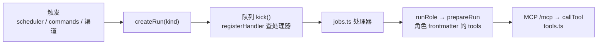

这页是十条改动清单。每条回答三件事：入口在哪、哪些地方必须同步改、怎么验证。机制本身不在这里重讲：工具权限见 [Agent 运行时与 MCP 工具权限](../concepts/agent-runtime-and-tools.md)，队列与角色见 [任务队列、Run 与角色](../concepts/run-queue-and-roles.md)，渠道见 [渠道](../concepts/channels.md)，检索见 [检索](../concepts/retrieval.md)。

先看一次改动是怎么串起来的。一个新能力通常沿这条线落地：触发（定时任务、斜杠命令、渠道消息）创建 Run，队列取出 Run 交给处理器，处理器按角色拉起外部 Agent，Agent 只能通过 MCP 工具读写知识库。



## 所有改动共同的约束

[AGENTS.md](../../../AGENTS.md#L9-L14) 的产品原则决定了很多改法，先记住这几条：

- 宿主只做数据、索引、调度和权限，理解和写作交给 Agent。不要在宿主里拼长 prompt、强制 JSON 输出，缺什么能力就加工具，缺什么说明就改 `roles/*.md`。
- 模型没有直接写库权限，所有写入走工具。工具层校验空间范围和角色的工具清单，并记录在 Run 里。
- 记忆更正用 `supersede` 保留版本链，不覆盖；事项变化写时间线；原件只保留最新版，删除留墓碑。
- 通用代码不得按项目名、目录名或题集问法特判。要区分领域，用空间和持久设置（`spaces.settings`）。

验收见 [AGENTS.md:验证与交付](../../../AGENTS.md#L31-L37)：`pnpm run check` 必须通过，每个完整功能切片通过后提交，不 push。有一处文档和脚本对不上：AGENTS.md 说 check 含“类型、测试、构建”，但 [package.json:23](../../../package.json#L20-L23) 里的 `check` 只跑 `typecheck` 和 `test`；带构建的是 [osdk.toml](../../../osdk.toml#L13-L15) 的 `osdk run check`（typecheck、test、build）。改了 tsconfig.build.json、import 后缀或 web/ 之后，用 osdk 那条，或者另外跑 `pnpm run build`。

## ① 加一个 MCP 工具

在 [tools.ts](../../../src/agents/tools.ts#L41-L43) 里调用 `def({ name, description, schema, write, handler })`。工具靠注册顺序存进模块级数组，没有别的注册表。

1. `schema` 是 zod 对象，`description` 就是模型看到的说明，写清什么时候用、什么时候不该用（参考 `delegate_code`、`apply_code_run` 的写法）。
2. 带 `space` 参数的工具用 `space(ctx, a.space)` 取空间 id，它会同时检查空间存在和调用者的 `ctx.spaces` 范围（[tools.ts:45-50](../../../src/agents/tools.ts#L45-L50)）。按 id 改一个已有对象（记忆、事项、Run、原件）时，先查出对象所在空间再调 `inScope(ctx, spaceId, "记忆")`，如 [supersede](../../../src/agents/tools.ts#L566-L576)。漏掉这一步，一个只能碰 A 空间的 Agent 就能改 B 空间的数据。
3. 会改库的工具标 `write: true`。但要知道它的作用有限：`callTool` 只在写工具成功后向 Run 发一条 `tool-write` 事件（[tools.ts:790-802](../../../src/agents/tools.ts#L790-L802)），并不据此拒绝调用。真正的权限闸门是 `ctx.tools` 白名单：不在白名单的工具直接返回“不可用”。
4. 把工具名加进需要它的角色 frontmatter 的 `tools:`（如 [roles/assistant.md](../../../roles/assistant.md#L1-L8)）。`prepareRun` 用这个列表构造白名单，再自动补上 `list_skills` 和 `read_skill`（[runner.ts:150-153](../../../src/agents/runner.ts#L150-L153)）。工具名拼错不会报错，`toolList` 只是过滤，Agent 那边就是看不到这个工具。Agent 档案（`save_agent`）不写 tools 时用 [DEFAULT_SPEC_TOOLS](../../../src/agents/specs.ts#L55)，这是只读集合，新工具默认不在里面。
5. 空间范围的默认值也在 `prepareRun`：助理是 `null`（全部空间），其余角色只有当前空间（[runner.ts:154-155](../../../src/agents/runner.ts#L154-L155)）。如果新工具要给整理类角色跨空间读，要从调用处传 `spaces`，不要在工具里放宽。
6. 测试：[library.test.ts 的 “tools” 用例](../../../test/library.test.ts#L107-L128)直接用 `callTool(ctx, 名字, 参数)` 构造 `spaces`、`tools` 不同的上下文，断言越权被拒、不在白名单被拒。给新工具照这个写两条：范围外被拒，范围内成功。工具改动影响 Agent 链路时，再跑 [agent.test.ts](../../../test/agent.test.ts#L20-L33)，它经由 [fake-acp-agent.ts](../../../test/fake-acp-agent.ts#L1-L6) 走真实的 ACP 与 stdio MCP 桥接，AGENTS.md 要求改运行时后保持它通过。
7. 改了工具说明或角色用法后，用真实 Agent 跑一两个问题看行为，不要批量生成知识来验证。

## ② 加或改一个角色

角色是 `roles/<name>.md`，frontmatter 有 `description`、`tools`、`writes`、`modes`，正文是给 Agent 的说明，由 [loadRole](../../../src/agents/runner.ts#L28-L46) 读入，和 `_common.md` 一起拼成系统提示。要同步改的有三处：

- [config.ts 的 roleNames](../../../src/core/config.ts#L21-L36)：`RoleName` 类型由它推出，`runRole`、`profileFor` 都按它收窄。漏加会在类型检查阶段暴露。
- [setup.ts](../../../src/setup.ts#L214-L215) 的 `QUICK_ROLES`：日常、速度优先的角色写进去；没写进去的自动归 `DEEP_ROLES`（`roleNames` 减去 QUICK）。`omem setup` 里“按任务分开指定”就是按这两组把后端写进 `config.agents.roles`（[setup.ts:233-236](../../../src/setup.ts#L233-L236)）。
- 后端选择走 [profileFor](../../../src/agents/runner.ts#L60-L71)：先看 `agents.roles[角色]`，再看 `agents.default`，最后取第一个已安装的。新角色一般不用改它，除非需要像 `code.ts` 里评审那样指定独立后端（它直接传 `profileId: app.config.agents.roles.reviewer`，见 [code.ts:89-103](../../../src/agents/code.ts#L89-L103)）。

`writes: true` 只表示允许 Agent 改工作目录里的文件（`coder` 是唯一的例子，见 [roles/coder.md](../../../roles/coder.md#L1-L5)），不影响 omem 工具的写权限。新角色要有处理器去调用它，否则只是文件，见下一条。

## ③ 加一个 Run 类型

1. 在 [RunKind](../../../src/agents/runs.ts#L5) 联合类型里加上新值。
2. 在 [jobs.ts](../../../src/agents/jobs.ts#L54-L66) 里 `registerHandler("kind", async (ctx) => …)`。处理器用本文件的 `agent(ctx, role, spaceId, task, spaces?)` 拉起角色（[jobs.ts:21-33](../../../src/agents/jobs.ts#L21-L33)），任务描述里把需要的材料列清楚，其余让 Agent 用工具去查。返回值会合并进 `runs.output`，网页和 `read_run` 读的就是它。没有“无变化”可说时返回 `{ quiet: true }`，参考 [QUIET 的用法](../../../src/agents/jobs.ts#L19) 和 `heartbeat`。
3. 判断是否进 `INTERACTIVE`：[runs.ts:207](../../../src/agents/runs.ts#L207) 只有 `ask` 和 `agent` 在交互槽里，其余都占后台并发（`concurrency` 默认 2），因为交互槽（`interactiveConcurrency`，默认 4）要保证对话回复不被长任务挡住。除非新类型是用户正在等的回复，别加。
4. 处理器必须能重入。[startWorker](../../../src/agents/runs.ts#L215-L222) 启动时把所有 `running` 的 Run 重新放回队列，所以服务重启后同一个 Run 会从头再跑一遍。`wiki-write` 的做法是先查页面是否已存在，已存在就提示 Agent 在原基础上改（[jobs.ts:170-188](../../../src/agents/jobs.ts#L170-L188)）。写处理器时自问：跑两遍会不会重复建对象、重复通知？
5. 要排队一致（一个会话内的 Run 依次执行）就给 `createRun` 传 `lane`；要合并连发消息就传 `notBefore`。没有这两个需求就都不传。
6. 网页展示：[store.ts 的 runKindLabel](../../../web/src/store.ts#L92-L106) 加中文名（缺了会回退显示原始 kind）；[Runs.vue 的筛选列表](../../../web/src/views/Runs.vue#L75) 是手写数组，想让新类型能被筛选就加进去。这个数组现在没有 `agent`、`curate`、`review`，所以并不是每种类型都能筛。
7. 没注册处理器的 kind 不会卡住：`kick` 会把它标成 failed，错误是“没有处理器”（[runs.ts:254-258](../../../src/agents/runs.ts#L254-L258)）。`review` 就是这样一个只有类型和标签、没有 `registerHandler` 的值；从实现看，评审是在 `code` 的处理器里直接调 `runRole` 完成的，不单独入队。

## ④ 加一个定时任务

两步，缺一不可：

1. [scheduler.ts 的 DEFAULTS](../../../src/core/scheduler.ts#L11-L18) 加一项 `{ id, kind, cron, enabled, label }`。`ensureDefaultSchedules` 用 `insert or ignore`（[scheduler.ts:21-24](../../../src/core/scheduler.ts#L21-L24)），所以老库下次启动会补上新项；但已存在的项不会被覆盖，改默认 cron 只对新库有效。`label` 同时被网页的 `/api/schedules` 和 `omem setup` 的定时任务勾选列表使用（[setup.ts:294-302](../../../src/setup.ts#L294-L302)），不用另外改。新任务除非无副作用，`enabled` 默认写 `false`，现有的也是这样，只有 `heartbeat` 默认开。
2. 在 [main.ts](../../../src/main.ts#L11-L24) 用 `registerScheduleKind(kind, runner)` 注册执行体。runner 通常只是 `createRun`，真正的工作放进 ③ 的处理器。

没有注册 runner 的 kind，[restartScheduler](../../../src/core/scheduler.ts#L55-L73) 会直接跳过，不报错。如果任务可能比间隔跑得久，runner 里先查有没有同类 Run 在跑，`heartbeat` 就是这么做的（[main.ts:11-14](../../../src/main.ts#L11-L14)）。cron 触发的 Cron 带 `protect: true`，只防同一个 job 重叠，防不了你创建出来的 Run 重叠。

## ⑤ 加一个渠道

以 [telegram.ts](../../../src/channels/telegram.ts#L10-L84) 为模板（最短，约 80 行），按下面的顺序对照：

1. 收消息：校验是不是本人（Telegram 比的是 `ownerChatId`，见 [telegram.ts:54-59](../../../src/channels/telegram.ts#L54-L59)；飞书比 `ownerOpenId`，没绑定时回复一句“请设置 xx”，见 [lark-bot.ts:127-131](../../../src/channels/lark-bot.ts#L127-L131)），然后调 [answerFromChannel](../../../src/channels/common.ts#L12-L20)。它走 `receive`：斜杠命令、会话解析、连发合并都在里面，不要绕开；返回 `null` 表示这条消息并入了另一个等待中的回合，此时不要再回复。
2. 回复：`answerFromChannel` 返回的是已经把 `src:`、`mem:` 链接和 Wiki 的双括号页面链接压成纯文字的 Markdown（[plainCitations](../../../src/channels/common.ts#L22-L27)），渠道有长度上限就再用 `chunkMessage` 切段。
3. 异步投递：[registerThreadSender(渠道名, send)](../../../src/agents/inbox.ts#L88-L94) 告诉系统怎么往该渠道的某个会话发消息。交办的 Agent 完成、提醒触发时走 `deliverToThread`，它先写进会话再用这个发送器推出去。渠道名必须和 `receive` 里的 `channel` 一致，Telegram 还把 `thread.key` 约定成 `chatId#话题`（[telegram.ts:23-26](../../../src/channels/telegram.ts#L23-L26)）。
4. 通知：[addNotificationSink](../../../src/core/notify.ts#L7-L12) 注册后，每次 `notify()` 都会推给你的渠道。
5. 配置：[config.ts 的 configSchema](../../../src/core/config.ts#L101-L120) 里加一段 `{ enabled, tokenEnv, owner…, defaultSpace }` 并给 `.default()`。密钥放环境变量，配置里只存变量名。
6. 引导：[setup.ts 的渠道分区](../../../src/setup.ts#L251-L280) 在 checkbox 里加一项，并在后面按渠道提示填写项。
7. 启动：[boot](../../../src/main.ts#L49-L60) 里用 `if (app.config.xxx.enabled)` 动态 import 并调用 `startXxx(app)`，失败只 `console.warn`，不要拖垮服务。
8. 测试：[channels.test.ts](../../../test/channels.test.ts#L19-L53) 用本地 WebSocket 假冒 OneBot 服务端，配上 fake ACP agent，走完“群消息只采集、本人私聊才回答”。新渠道照此伪造对端。会话规则相关的行为（话题、合并、lane）已在 [threads.test.ts](../../../test/threads.test.ts#L36-L88) 覆盖，不必重测。

## ⑥ 加一个斜杠命令

在 [commands.ts 的 commands 表](../../../src/agents/commands.ts#L38) 里加 `{ usage, help, run }`。命令不经过模型，`run` 拿到 `{ app, thread, args, inb }`，返回字符串直接作为回复。三点：

- 命令名只能是字母：[runCommand 的正则](../../../src/agents/commands.ts#L301-L311) 是 `^\/([a-z]+)`，带数字或连字符的名字匹配不上。表里查不到的 `/xxx` 返回 `null`，当作普通文字交给助理。
- 必须手动加进 [/help 的分组](../../../src/agents/commands.ts#L43-L54)（会话、路由、快捷三个数组），否则能用但 `/help` 里看不到。
- 执行结果由 [receive](../../../src/agents/inbox.ts#L47-L54) 记成带 `command: true` 的两条消息，会话摘要会过滤它们。命令要改会话状态时，参考 `/space`、`/agent`：改完调 `resetAgentSession` / `releaseThreadSession`，让下一轮用新设置。

测试沿用 [threads.test.ts](../../../test/threads.test.ts#L87) 那种 `receive(app, { text: "/mode chat" })` 的写法。

## ⑦ 改检索

路和权重都在 [search()](../../../src/search/search.ts#L68-L267)：全文、符号、页面、记忆、向量各出一个排名表，再用 RRF 融合。RRF_K 是 [60](../../../src/search/search.ts#L40)，有向量路时全文表的权重默认降到 0.5（[search.ts:227-242](../../../src/search/search.ts#L227-L242)）。加新的一路，就是再 `lists.push` 一个带 `via` 名字的排名表，`via` 会出现在工具返回里，Agent 靠它判断线索来源。

验证不能用几个自选问题代替。[eval-retrieval.ts](../../../scripts/eval-retrieval.ts#L1-L10) 读 JSONL 语料和问题，输出文档级的 nDCG@10、Recall@10/50、MRR@10：

```bash
node scripts/eval-retrieval.ts t2_corpus.jsonl t2_queries.jsonl --home .scratch/eval-t2            # 全文
node scripts/eval-retrieval.ts … --home .scratch/eval-t2 --vector                                  # 融合
node scripts/eval-retrieval.ts … --vector-only | --fts-weight 0.3
```

几个容易踩的点：

- `--home` 指向的库存在就复用，不会重新建索引（[eval-retrieval.ts:39](../../../scripts/eval-retrieval.ts#L39-L44)）。如果你改的是分块、分词或索引写入，必须换一个新的 `--home` 或删掉旧的，否则比较的是改动前的索引。
- 评测只查 `chunk` 一路且 `perSource: 1`（[eval-retrieval.ts:63](../../../scripts/eval-retrieval.ts#L63)），页面、记忆、符号路线的改动它测不到。
- 对照组要同一批数据同一台机器重跑。[evaluation.md](../../../docs/v2/evaluation.md#L1-L17) 给出了现有基线（T2Retrieval 随机 400 问加 15,000 干扰文档）：全文 nDCG@10 69.01，向量 87.25，全文权重 0.5 的融合 86.76。文档里说明了换模型或改检索后必须重跑，数字不能沿用。
- T2 不考精确名称和代码标识符，改动涉及标识符匹配时，这个基线说明不了问题，要另备数据并在报告里写明。

## ⑧ 改数据库

[db.ts 的 migrations](../../../src/core/db.ts#L9) 是一个字符串数组，下标加一就是 `pragma user_version`。[openDb](../../../src/core/db.ts#L263-L279) 对每个高于当前版本的条目开事务执行，失败回滚并抛错。规则只有一条：只在数组末尾追加，不改已有条目。已发布的库已经执行过旧条目，改了也不会再跑，新旧库的结构就分叉了。

- 加列用 `alter table … add column …`，需要默认值的写 `not null default`。第三条迁移是现成模板：加会话和 Run 的列、建索引（[db.ts:235-258](../../../src/core/db.ts#L235-L258)）。
- 迁移要触发重新处理旧数据时，在同一条里把对应哈希清空，如第二条用 `update sources set hash = ''` 让代码文件下次同步时重新解析（[db.ts:223-234](../../../src/core/db.ts#L223-L234)）。
- 同步改对应 store 里的 `Row` 类型与 `toXxx` 映射（例如 [runs.ts:23-55](../../../src/agents/runs.ts#L23-L55)）、`web/src/api.ts` 里的类型，以及用到该列的 SQL。网页类型要自己搜着改。
- 测试用 `testApp()` 开一个全新临时库（[helpers.ts](../../../test/helpers.ts#L7-L12)），跑到的就是整条迁移链。旧库升级路径没有自动测试，涉及数据转换的迁移，手动拿一个旧库跑一遍。
- 向量不在这里管：换嵌入模型会清空旧向量，是 AGENTS.md 里的既定行为。

## ⑨ 改 Wiki 写作质量

先改 [roles/wiki-writer.md](../../../roles/wiki-writer.md#L1-L31)（和规划用的 `wiki-planner.md`），其次才改代码。原因是写作要求本来就写在角色说明里，[wiki-write 处理器](../../../src/agents/jobs.ts#L170-L188)只是把页面计划（读者问题、讲解路线、调查入口）整理成任务，没有再塞规则。具体到症状：

- 讲得空泛、没有例子：改角色说明里“先调查、再写作”的要求。
- 引用格式错：核对说明里的 `[文字](src:<原件id>#L起-L止)`，同时看 `write_page` 工具返回的“链接目标不存在”提示（[tools.ts:543](../../../src/agents/tools.ts#L521-L545)）。
- 想让已有页面保留好内容：`wiki-write` 已对存在的页面加一句“先 read_page 再改进”，不用再在代码里加。
- 成稿的语气，可以对照 `.agents/skills/lieflat-less-ai-tone/SKILL.md` 检查，不改事实和结构。

验证用真实 Agent 写一两页看效果，不为验证批量生成整个空间。生成流程本身见 [Wiki 生成](../flows/wiki-generation.md)。

## ⑩ 改界面

界面在 `web/src/`（Vue 3 + TypeScript）。样式和主题变量集中在 `styles.css`（浅色、深色两套），组件放 `components/`，页面放 `views/`。几条硬约束：

- 采集来的内容一律经 DOMPurify。[markdown.ts](../../../web/src/lib/markdown.ts#L85) 的 Markdown 渲染出口和 Mermaid 的 SVG 输出（[markdown.ts:102](../../../web/src/lib/markdown.ts#L102)）都先 sanitize；`Markdown.vue` 的 `v-html` 吃的是已经净化的结果（[Markdown.vue:57](../../../web/src/components/Markdown.vue#L57)）。新增需要自定义属性的标记，要加进 `ADD_ATTR` 白名单，不要绕过它直接 `v-html` 原始 HTML。例外是 [CodeView.vue](../../../web/src/components/CodeView.vue#L9)：从实现看，它逐行用 `highlight()` 或手工转义 `& < >` 后再 `v-html`，没有走 DOMPurify。改它时要保证这两条路径仍然转义。
- 引用统一走 CitationDrawer：入口是 `state.trail`，一层层压栈，Esc 退一层，全部关闭后把焦点还给打开前的元素（[CitationDrawer.vue:40-66](../../../web/src/components/CitationDrawer.vue#L40-L66)）。新增可点击的引用类型，扩展 [store.ts 里的 trail 类型](../../../web/src/store.ts#L5-L8)和抽屉的加载逻辑，不要另做弹窗。
- 阅读优先：正文限宽、标题衬线、引用贴近论断。
- 改完用 [screens.ts](../../../scripts/screens.ts#L1-L22) 截图：`node scripts/screens.ts <url> <dir>`，默认 1440 和 390 两个宽度，环境变量 `ROUTES`、`WIDTHS`、`SCHEME=dark` 可以指定路由、宽度和深色。逐张看有没有横向溢出。注意脚本的默认路由包含 `/wiki/zustand` 等示例页面，在你的库里没有的话要用 `ROUTES` 换成自己的。
- 类型检查要过 `vue-tsc`，它在 `pnpm run typecheck` 里，和后端 `tsc` 一起跑。

## 改完之后的统一收尾

1. `pnpm run check`；涉及构建配置、import 后缀或 web/ 再加 `pnpm run build`（见开头关于 check 的说明）。
2. 改角色说明或工具：用真实 Agent（Codex gpt-6.1-sol/luna 低 effort，或 Claude Code）跑一两个问题。
3. 改检索：贴出实际 nDCG@10 和对照组。
4. 一个完整功能切片通过检查后提交，不 push，除非用户要求。

## 哪些是推断，哪些没查

“`review` 没有处理器、评审在 `code` 里直接调用”是从 `RunKind`、`registerHandler` 清单和 [code.ts](../../../src/agents/code.ts#L89-L106) 对照得出的，没有别的文档佐证。`lark-bot.ts` 只看了判断本人的几行，飞书渠道的完整接线（话题、群上下文、文档采集）没有逐行追，需要时看 [concepts/channels](../concepts/channels.md)。数据库迁移的“旧库升级无自动测试”，是我在 test/ 里按 `migrations`、`user_version` 搜索没有命中得出的。
