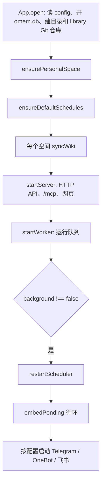
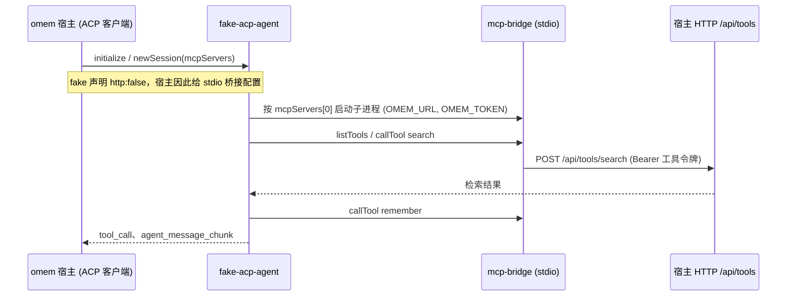

这页回答：怎么把 omem 在本机跑起来，接上一个 Agent，看清一次运行里发生了什么，怎么跑测试，以及没有真实模型时怎么验证。读完你能启动开发环境、用 CLI 和网页追一次 `omem ask`，并知道改 Agent 运行时、检索、角色说明各自该怎么验证。系统整体结构见 [omem 源码 Wiki](../index.md)。

## 先跑起来

两种方式，入口都是 `src/cli.ts serve`。

开发：`osdk run dev`（任务定义在 osdk.toml，转调 `pnpm run dev`），实际执行 `scripts/dev.ts`。它起两个子进程：API 用 `node --watch-path=src --watch-path=roles src/cli.ts serve --port 4317`，网页用 Vite 带热更新。数据目录默认是仓库下的 `./.omem`，除非设了 `OMEM_HOME`（[scripts/dev.ts:9-14](../../../scripts/dev.ts#L9-L14)）。注意 `--watch-path=roles`：改角色说明会重启 API，不用手动重启。

生产式：`pnpm run build && pnpm start`，即 `tsc -p tsconfig.build.json` 加 `vite build`，再运行 `dist/src/cli.js serve`，数据在 `~/.omem`（[README.md](../../../README.md#L43-L49)，脚本见 [package.json](../../../package.json#L16-L25)）。

第一次使用，先运行一次 `omem setup`（源码运行时是 `osdk run cli -- setup`）：它是交互式向导，依次问 Agent 后端与模型、向量模型、PDF/DOCX 解析、渠道、注入标记、会话与并发、定时任务，每一项先显示本机已有什么再让你选，选完立刻写回 `config.json`（[README.md:52](../../../README.md#L52)）。不想走向导，也可以直接编辑 `config.json`，下文“接上一个 Agent”一节给出了要点；各分区具体改了什么见 [配置、setup 与定时任务](../concepts/config-and-setup.md)。

`serve` 只是调用 `boot()`（cli-main.ts:121-128）。`boot()` 按顺序做这些事（[main.ts:29-63](../../../src/main.ts#L29-L63)）：



- `App.open` 读 `config.json`、打开 `omem.db`，构造时建好 `library/`、`files/`、`runs/` 并对 `library/` 做 `git init`（[app.ts:28-49](../../../src/core/app.ts#L28-L49)）。
- `syncWiki` 把磁盘上的页面文件同步进索引，所以手改 `library/` 里的 Markdown 重启后就能被搜到。
- `startServer` 监听后把实际地址写进 `app.baseUrl`（[http.ts:527-531](../../../src/server/http.ts#L527-L531)）。这一步必须先于 `startWorker`：`prepareRun` 在 `baseUrl` 为空时直接报“omem 服务尚未启动，无法为 Agent 提供工具”（[runner.ts:148](../../../src/agents/runner.ts#L148)）。
- `startWorker` 先把上次崩溃遗留的 `running` 改回 `queued`，再每 2 秒 `kick` 一次（[runs.ts:215-222](../../../src/agents/runs.ts#L215-L222)）。
- 只有 `background !== false` 才起调度器、向量化循环和渠道。向量化循环仅在 `embeddings.provider !== "none"` 时启动，3 秒后开始，每轮处理 32 个片段直到清空，之后每 30 秒再查一次。渠道（Telegram、OneBot、飞书）只在配置里 `enabled` 才动态 `import`，启动失败只打警告，不拖垮主进程。

测试和 CLI 的临时服务都传 `background: false`，所以不会触发定时任务、向量化或渠道。这是 `boot` 能被测试直接调用的原因。

## 数据目录

`OMEM_HOME`（默认 `~/.omem`）下的东西（[config.ts:192-195](../../../src/core/config.ts#L192-L195)，[app.ts:33-36](../../../src/core/app.ts#L33-L36)）：

| 路径 | 内容 |
| --- | --- |
| `config.json` | 端口、Agent 配置、渠道、向量模型。`OMEM_PORT` 环境变量覆盖端口 |
| `omem.db` | SQLite：原件、记忆、事项、`runs`、`run_events`、`schedules` 等 |
| `library/` | 独立 Git 仓库。Wiki 页面、`_agents/`、`_skills/` 的文件，每次写入由 `commitLibrary` 提交 |
| `files/` | 网页上传的文件（[http.ts:206](../../../src/server/http.ts#L206)） |
| `runs/` | 按运行 id 分目录。从 `code.ts` 看，目前用于委托编码的工作区和 `changes.patch` |

原件正文在 `omem.db` 里，不在 `library/`。个人配置、数据库、密钥不进仓库（[AGENTS.md](../../../AGENTS.md)）。想隔离实验，换一个 `OMEM_HOME` 或给 CLI 传 `--home <dir>`。

## 接上一个 Agent

omem 自己不带模型，通过 `config.json` 里的 Agent 配置调外部程序。内置五个 profile：`codex`（`codex-acp`）、`traex`、`claude`（`claude-agent-acp`）走 ACP，`claude-cli`、`codex-cli` 直接调命令行（[config.ts:138-190](../../../src/core/config.ts#L138-L190)）。`omem agents` 列出它们并标出本机是否装了（✓/✗）。选择逻辑在 `profileFor`：先看 `agents.roles[角色]`，再看 `agents.default`，都没有就取第一个已安装的；一个都没有则报 503（[runner.ts:60-72](../../../src/agents/runner.ts#L60-L72)）。

换默认 Agent 就在 `config.json` 里写 `agents.default`，或用 `omem setup` 向导。AGENTS.md 要求验证角色说明用 Codex（gpt-6.1-sol 或 luna，低 effort）或 Claude Code 跑一两个真实问题，不要批量生成知识。

## 看一次运行里发生了什么

用一个例子贯穿：`omem ask "和小王什么时候同步"`。

1. `ask` 命令调 `runJob`。`runJob` 先探测本机有没有正在跑的服务：请求 `http://127.0.0.1:<port>/api/settings`，并且返回的 `home` 与当前库一致才算（cli-main.ts:32-41）。
2. 有服务：直接用它，并通过 `/api/events?run=<id>` 的 SSE 订阅事件。没有：在进程内用 `boot(home, { port: 0, quiet: true, background: false })` 起临时服务，监听 `app.events`（cli-main.ts:59-100）。
3. `ask` 建一条 `runs` 记录（状态 `queued`），worker 领走。领取是 `update … where status='queued'` 的原子操作，所以 CLI 和服务同时开着也不会重复执行（[runs.ts:259-260](../../../src/agents/runs.ts#L259-L260)）。
4. 处理器里 `runRole` 起 Agent 进程。ACP 客户端收到的每个 `sessionUpdate` 被翻译成事件：`agent_message_chunk` → `text`，`agent_thought_chunk` → `thought`，`tool_call`/`tool_call_update` → `tool`（完成或失败才再发一次），`plan` → `plan`（[acp.ts:93-120](../../../src/agents/acp.ts#L93-L120)）。`jobs.ts` 里的 `onEvent: (e) => ctx.event(e.type, e)` 把它们交给 `addRunEvent`（[jobs.ts:31](../../../src/agents/jobs.ts#L31)）。
5. `addRunEvent` 写进 `run_events(run_id, seq, at, type, data)`，同时通过 `app.emit` 广播。`text` 和 `thought` 会先缓冲，1.5 秒或遇到别的事件时合并成一行落库；但每个增量仍立刻以 `text-delta` 广播，所以终端和网页是逐字出现的，数据库里却只有几行（[runs.ts:164-182](../../../src/agents/runs.ts#L164-L182)）。
6. 失败时，状态记 `failed`，错误信息写进 `runs.error`，并追加一条 `error` 事件；被取消则记 `cancelled`，不留错误（[runs.ts:281-287](../../../src/agents/runs.ts#L281-L287)）。终端里按 Ctrl-C 会调用 `cancelRun`。

看这些数据有三个入口：

- 终端：`omem ask` 自己的输出——文字走 stdout，工具调用和状态行以暗色走 stderr（cli-main.ts:43-47）。
- `omem run <runId>`：只打印 `getRun` 的 JSON（状态、输入、输出、错误），**不含事件**（cli-main.ts:420-425）。要看事件序列，请求 `GET /api/runs/<id>`，它返回 `{ run, events, children, patch }`，`?after=<seq>` 只取新增（[http.ts:382-387](../../../src/server/http.ts#L382-L387)）；或直接查 `run_events` 表。
- 网页“运行”页（`web/src/views/Runs.vue`）：列表来自 `/api/runs`，详情来自 `/api/runs/:id`，并订阅 SSE，收到 `run` 事件就重新加载。对话页里的 `RunActivity.vue` 用同一接口：先拉历史事件，再用 `seq` 去重接收实时事件，工具调用按 `id` 折叠成一行显示最新状态（[RunActivity.vue:14-60](../../../web/src/components/RunActivity.vue#L14-L60)）。

Agent 调的每个 omem 工具也能在这里看到，因为工具调用本身就是 ACP 的 `tool_call`。工具层的校验和写入记录见 [omem 源码 Wiki](../index.md) 里的 Agent 相关页面。

## 测试

`pnpm run test` 即 `vitest run`，匹配 `test/**/*.test.ts`，`pool: "forks"`，默认超时 20 秒（[vitest.config.ts](../../../vitest.config.ts#L1-L7)）。我在本机跑了一遍：10 个文件、34 个用例全过，约 38 秒。此后又加了 `test/guard.test.ts`（注入标记），没有重跑。

**`pnpm run check` 与 osdk 的 `check` 不完全一样**：`osdk run check` 依次执行 typecheck、test、build（[osdk.toml](../../../package.json) 同目录的 `tasks.check`）；而 package.json 里的 `check` 只有 typecheck 加 test，没有 build（[package.json:25](../../../package.json#L25)）。AGENTS.md 要求类型、测试、构建都通过，所以提交前用 `osdk run check`，或手动补一次 `pnpm run build`。`typecheck` 同时跑后端 `tsc` 和 Vue 的 `vue-tsc`。

### test/helpers.ts

只有 `testApp()`：在系统临时目录建一个新 home，`App.open` 加 `ensurePersonalSpace`（[helpers.ts](../../../test/helpers.ts#L1-L13)）。每个用例得到一个干净的库，不碰 `~/.omem`，适合测检索、存储、Wiki 这类不需要 Agent 的逻辑。

### 没有模型时：fake ACP agent

需要 Agent 的链路用 `test/fake-acp-agent.ts`。它是一个真正的 ACP 服务端进程（`AgentSideConnection` 加 stdio 的 ndJSON 流），所以 omem 的 ACP 客户端、MCP 桥接、工具令牌、运行事件都按生产路径执行，只有“模型”被换成固定脚本（[fake-acp-agent.ts:1-8](../../../test/fake-acp-agent.ts#L1-L8)）。

`agent.test.ts` 的做法：

1. 建临时 home，写 `config.json`，把 `agents.default` 指向一个 `acp` profile，命令是 `process.execPath`，参数是 fake agent 的路径（[agent.test.ts:13-16](../../../test/agent.test.ts#L13-L16)）。
2. `boot(home, { port: 0, quiet: true, background: false })`，端口 0 让系统分配，避免冲突。
3. `importText` 导入一条“每周四下午三点和小王同步项目A进度”，然后 `ask` 并 `waitForRun`。
4. 断言：运行 `done` 且无错误；答案匹配 `/^tools=\d+; search=1\. 原件/`；记忆里出现 `FAKE: 和小王什么时候同步`；事件类型包含 `tool` 和 `text`（[agent.test.ts:20-39](../../../test/agent.test.ts#L20-L39)）。

fake agent 内部的路径：



关键点：fake 在 `initialize` 里声明 `mcpCapabilities: { http: false }`（[fake-acp-agent.ts:20-26](../../../test/fake-acp-agent.ts#L20-L26)），宿主据此选择 stdio 方案：用 `OMEM_URL`、`OMEM_TOKEN` 两个环境变量启动 `src/mcp-bridge.ts`（[acp.ts:155-165](../../../src/agents/acp.ts#L155-L165)）。`newSession` 把宿主给的 `mcpServers` 存起来，`prompt` 时 fake 取出第一个并自己启动该子进程，当 MCP 客户端调 `search` 和 `remember`（[fake-acp-agent.ts:56-66](../../../test/fake-acp-agent.ts#L56-L66)）。桥接只是把调用转成对 `/api/tools` 的 HTTP 请求，带上每次运行签发的令牌，宿主再据令牌决定可用的工具和空间（[mcp-bridge.ts:11-26](../../../package.json)、[tools.ts:806-826](../../../src/agents/tools.ts#L806-L826)）。因此这个测试同时覆盖了工具权限那一层，而不只是 ACP。

另一个模式 `FAKE_MODE=thread`：不连工具，把宿主发来的提示里的角色、新消息、是否冷启动、是否有摘要、是否带了群上下文等回显成 JSON，`FAKE_DELAY` 可以人为拖延。群上下文那一项靠检查 prompt 里有没有“的上下文，”这几个字，所以改 `renderMessages` 的措辞时要同步这里（[fake-acp-agent.ts:50-55](../../../test/fake-acp-agent.ts#L50-L55)）。它用来测会话和线程逻辑，由 `threads.test.ts` 通过 profile 的 `env` 打开（[threads.test.ts:20](../../../test/threads.test.ts#L20)）。`channels.test.ts` 也用默认模式。

局限：fake 不会测模型是否会用对工具、是否遵循角色说明。这部分只能靠真实 Agent 抽查。

## 检索评测

改检索后，AGENTS.md 要求用 `scripts/eval-retrieval.ts` 在公开数据上比 nDCG@10，报告实际数字和对照组，不要用几个自选问题代替。

```bash
node scripts/eval-retrieval.ts <corpus.jsonl> <queries.jsonl> [--vector | --vector-only] [--fts-weight 0.3] [--limit N] [--home DIR]
```

输入：corpus 每行 `{id, text, title?}`，queries 每行 `{id, text, rels:{docId: grade}}`（[eval-retrieval.ts:1-9](../../../scripts/eval-retrieval.ts#L1-L9)）。脚本行为：

- `--home` 默认 `.scratch/eval-home`。库已存在（有 `omem.db`）就复用，不重新导入，所以换了切分或分词逻辑后要换目录或删库重建（[eval-retrieval.ts:23-24, 29-34](../../../scripts/eval-retrieval.ts)）。
- 不加 `--vector` 时强制 `embeddings.provider = "none"`，只测全文；`--vector` 在导入后循环 `embedPending` 补齐向量，测全文加向量融合；`--vector-only` 关掉全文和符号路线。`--fts-weight` 调融合里全文的权重。
- 评测的是文档级：`search` 以 `types:["chunk"]`、`perSource:1` 取前 50，片段合并回原件，再算 nDCG@10、Recall@10/@50、MRR@10 和平均耗时，输出一行 JSON。

已有的对照数据在 `docs/v2/evaluation.md`：T2Retrieval 400 问加 15,000 篇干扰文档，全文 nDCG@10 为 69.01，纯向量 87.25，默认融合（全文权重 0.5）86.76（[evaluation.md](../../../docs/v2/evaluation.md#L5-L25)）。改检索后重跑同一份数据，同时跑 `--vector-only` 和默认融合作对照。数据用 `scripts/prep-t2.py` 生成（固定 `random.seed(7)`）。这些数字只对应当时的数据和模型，换模型要重跑；换向量模型本身会清空旧向量。

## 类型擦除运行 TypeScript

Node 22.18+ 直接执行 `.ts`，只擦除类型，不做转换。所以：

- import 必须写 `.ts` 后缀。tsconfig 开了 `allowImportingTsExtensions` 和 `rewriteRelativeImportExtensions`，构建（`tsconfig.build.json`）时由 `tsc` 把后缀改成 `.js` 输出到 `dist/`（[tsconfig.json](../../../tsconfig.json#L1-L20)）。
- 只能用“可擦除语法”：不写 `enum`、`namespace`、构造函数参数属性。`erasableSyntaxOnly: true` 会让 `tsc` 直接报错，`verbatimModuleSyntax` 要求类型导入写 `import type`。
- `osdk.toml` 钉的 Node 是 24.18.1，`package.json` 的 `engines` 是 `>=22.18.0`。

`src/cli.ts` 开头那几行是为了压掉 `node:sqlite` 的 ExperimentalWarning；`vitest.config.ts` 里把 `node:sqlite` 设成 external，原因是同一个模块。

## 要改这里，从哪下手

- 启动顺序、加新的后台任务或渠道：`src/main.ts` 的 `boot()`。新的定时任务种类用 `registerScheduleKind` 注册在同一个文件顶部。注意顺序约束：`startServer` 要在 `startWorker` 之前。
- CLI 命令：`src/cli-main.ts`；需要 Agent 的命令走 `runJob`，不要自己 `boot`。
- 事件类型：产生在 `src/agents/acp.ts`（以及 `cli.ts` 里 CLI 类 Agent 的对应处理），落库在 `runs.ts` 的 `addRunEvent`，显示在 `Runs.vue`、`RunActivity.vue`。新增事件类型要三处一起看；`run_events.type` 的注释写的是 `text | tool | status | change | error`，实际还有 `thought`、`plan`，注释已落后。
- 改 Agent 运行时（`acp.ts`、`runner.ts`、`mcp-bridge.ts`、工具令牌）后，务必保持 `agent.test.ts` 和 `threads.test.ts` 通过；要测新的 ACP 行为，在 `fake-acp-agent.ts` 加分支（参考 `FAKE_MODE`），不要为此引入真实模型。
- 改角色说明（`roles/*.md`）或工具（`src/agents/tools.ts`）：测试覆盖不到行为，需要用真实 Agent 跑一两个问题看事件流。
- 改界面后按 AGENTS.md 用 `node scripts/screens.ts <url> <dir>` 截 1440 和 390 宽度检查横向溢出。
- 提交前：`osdk run check`（或 `pnpm run check` 加 `pnpm run build`）。

## 未查清

- `cli.ts`（CLI 类 Agent）的事件映射我没有逐行读，上面只写了 ACP 路径。
- 我没有用真实 Agent 跑过 `omem ask`，事件流的描述来自代码和 fake agent 测试。
- “`runs/` 目前只被委托编码使用”是从 grep 结果推断的，没有读完 `code.ts`。
- 源码里 `scripts/screens.ts` 的具体参数没有读。
- 交互式 `omem setup` 我只读了代码，没有在终端里实际走过。
