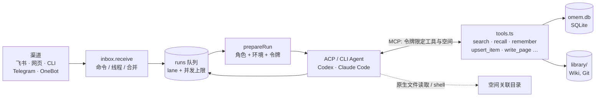

omem 是本人的个人记忆与助理：文档、代码、聊天、笔记进同一个知识库，Agent 带着依据回答问题、记住约定、跟进事项、交办编码。这页回答四件事：它解决什么问题；宿主（omem 进程）和 Agent 各管什么；`src/` 下的目录怎么对应这些职责；先读什么、后读什么。读完你能在脑子里把一条消息从进来到答复发出的路径走一遍，并知道要改某个行为该先打开哪个文件。

## 一个例子：飞书里问一句，顺手记一件事

本人在飞书私聊机器人：“项目A的预算之前是多少？另外我周五前要把方案给老板。”

1. **渠道收消息。** 飞书机器人用 WebSocket 收 `im.message.receive_v1` 事件，转成统一的 `Inbound`；只有 `ownerOpenId` 对得上的发送者才会被处理，私聊时顺带记下这个 chat 作为通知落点 ([lark-bot.ts:122-148](../../src/channels/lark-bot.ts#L122-L148))。
2. **进收件箱。** 所有渠道共用 `answerFromChannel → receive`。`receive` 先找到或创建这条消息所属的 Thread；以 `/` 开头的命令不经过模型直接答；其他消息写入 `messages`，并创建一个 `kind: "ask"` 的 Run，`lane` 设为 Thread id。如果同一个 Thread 里已有一个还没开始的 ask，新消息并进去（突发的几条合成一轮）([inbox.ts:32-88](../../src/agents/inbox.ts#L32-L88))。
3. **队列调度。** `startWorker` 每 2 秒、也在每次 `createRun` 后 `kick`。同一 lane 里同时只跑一个 Run，且只有最老的排队项能启动；不同 Thread 并行。问答类（`ask`、`agent`）和后台类（整理、巡检等）各有并发上限，所以长时间的后台任务不会堵住回复 ([runs.ts:207-246](../../src/agents/runs.ts#L207-L246))。
4. **组装上下文。** `ask` 处理器调用 `threadTurn`，后者调用 `prepareRun`：选 Agent 配置，给这次运行签一个工具令牌，把角色说明、环境（当前时间、空间、`SPACE.md`）、本人的偏好和以往经验、可用技能拼成 system 文本 ([runner.ts:134-180](../../src/agents/runner.ts#L134-L180))。
5. **交给 Agent。** 优先走 ACP：起一个 Codex 或 Claude Code 的 ACP 进程，在 `newSession` 里注入名为 `omem` 的 MCP 服务器；Agent 支持 HTTP MCP 就直连 `/mcp`，否则起 `mcp-bridge.ts` 这个 stdio 桥，两种方式都带上那个令牌 ([acp.ts:152-166](../../src/agents/acp.ts#L152-L166))。没有 ACP 时退回 `claude -p` / `codex exec`（`src/agents/cli.ts`）。
6. **Agent 自己调查。** 它用 `recall` 找项目A的预算记忆（带版本链），必要时 `search` / `read_source` 读聊天原文；同时从“周五前把方案给老板”里看出一个待办。`roles/assistant.md` 的要求就是：回答之外顺手检查有没有值得记的事实和隐含的事项，先 `recall` 去重，已有就更新 ([assistant.md:34-44](../../roles/assistant.md#L34-L44))。于是它调用 `upsert_item` 建一个 todo，并在答复末尾写一行 `已记录：…`。
7. **工具层把关并落库。** 每次工具调用先查这次令牌允许的工具清单，再用 zod 校验参数，处理器里再校验空间范围，然后写 SQLite；写入类工具还会向这次 Run 发 `tool-write` 事件 ([tools.ts:792-807](../../src/agents/tools.ts#L792-L807))。
8. **答复回到渠道。** 处理器把答案存成一条 assistant 消息、写进 Run 的 `output`；`answerFromChannel` 里 `waitForRun` 等到 Run 结束，取出答案，把 `src:`、`mem:` 链接和页面双链这类飞书打不开的内部链接还原成纯文字，再由机器人回复 ([common.ts:12-27](../../src/channels/common.ts#L12-L27))。

这条链上有两件事值得先记住：一是 Agent 没有任何直接写库的路径，唯一的入口是令牌限定的 MCP 工具；二是宿主在 Agent 开口之前只做了“选人、发工具、拼上下文”，没有替它检索。

## 核心术语

数据结构都定义在 `src/core/db.ts` 的迁移里，`openDb` 靠 `pragma user_version` 依次执行迁移，每条迁移在事务里运行 ([db.ts:263-279](../../src/core/db.ts#L263-L279))。

| 术语 | 是什么 | 在哪 |
| --- | --- | --- |
| Space（空间） | 隔离领域的单位：个人、项目、代码仓库、学习主题。检索默认不跨空间；`repo` 类空间带 `root_path` | `spaces` 表，`core/spaces.ts` |
| Source（原件） | 文档、代码、聊天、网页的原文，按 `(space_id, uri)` 只保留最新版，删除记 `deleted_at` | `sources` 表，`sources/store.ts` |
| Chunk（片段） | 检索单位：Markdown 按标题、代码按符号、聊天按窗口；记录行号范围，所以引用能落到行 | `chunks`、`chunks_fts`，`sources/chunk.ts` |
| Page（页面） | Agent 维护的 Wiki，真身是 `library/<space>/wiki/*.md`，整个库目录是 Git 仓库；`pages` 表只是搜索投影 | `wiki/store.ts`，`core/git.ts` |
| Memory（记忆） | 一句话事实、约定或偏好，带 `valid_from/valid_to/superseded_by`。更正用 `supersede`：插入新版本，把旧版标为 `superseded` | `memories`，`memory/store.ts` |
| Item（事项） | todo / waiting / reminder / watch / decision，有状态和时间线 `item_events` | `items`，`items/store.ts` |
| Run（运行） | 一次 Agent 执行：问答、整理新材料、写 Wiki、巡检、做梦、交办编码……状态 `queued → running → done/failed/cancelled`，过程写 `run_events` | `runs`，`agents/runs.ts` |
| Thread（线程） | 助理保持上下文的一条对话线：一个私聊、一个群、群里的一个话题、一次网页对话。存在 `conversations` 表，记着 Agent 会话 id 和滚动摘要 | `agents/threads.ts` |
| Role（角色） | `roles/*.md`：frontmatter 声明描述、允许的工具、是否可写文件，正文是这个角色的目的与质量标准 | `loadRole`，[runner.ts:25-46](../../src/agents/runner.ts#L25-L46) |
| Agent spec | 助理或本人在 `library/_agents/<name>.md` 里建的自定义 Agent：指定后端、模型、工具、可读的空间、额外 MCP，正文是 system prompt | `agents/specs.ts` |

几个容易误会的地方：

- Wiki 的“文件是真身、表是投影”：启动时 `boot` 会对每个空间执行 `syncWiki`，把磁盘上的页面重新索引进数据库 ([main.ts:29-35](../../src/main.ts#L29-L35))。
- 对话本身也是原件。`addMessage` 每写一条消息，就把它追加到 `conversation:<id>` 这个 Source 里，所以“上周我跟你说过什么”能用普通检索找到 ([threads.ts:269-295](../../src/agents/threads.ts#L269-L295))。
- `Actor` 要么是内置 Role，要么是 Agent spec，`prepareRun` 对两者走同一条路径 ([runner.ts:115-135](../../src/agents/runner.ts#L115-L135))。

引用格式有三种：原件用 `src:<原件id>#L起-L止` 链接，页面用双方括号包住 slug，记忆用 `mem:<id>`，规定写在 [AGENTS.md:11-12](../../AGENTS.md#L11-L12)。`docs/v2/architecture.md` 的“核心概念”一节还写着 `[^1]` 脚注指向 `source:<id>` 的旧格式，以实际代码和 AGENTS.md 为准。

## “宿主只做数据、索引、调度和权限”在代码里的样子

设计原则写在 [architecture.md:7-13](../../docs/v2/architecture.md#L7-L13)：v1 的根因是把智能放在宿主里——宿主先检索、拼几十条规则的长 prompt、要求模型输出固定 JSON、再二次检索，模型只能在宿主给的片段里作答；v2 把理解和写作交给有工具的 Agent。[AGENTS.md:9](../../AGENTS.md#L9) 把它写成了开发约束：不要为模型拼长 prompt、强制 JSON 输出或替模型规划多轮检索。

对应到代码，可以逐项核对：

- **数据与索引。** `sources/` 导入、切分、建符号和调用图；`search/` 做全文、可选向量、符号名三路召回，RRF 融合 ([search.ts:40](../../src/search/search.ts#L40))。检索只返回线索，是否继续搜、读全文、看 Wiki 由 Agent 决定 ([architecture.md:71](../../docs/v2/architecture.md#L71))。顺带一提：架构文档说全文用 FTS5 `trigram`，实际代码是 `unicode61` 加上自己的预处理——中文切成重叠二元组，标识符拆 camelCase ([tokenize.ts:1-12](../../src/search/tokenize.ts#L1-L12))，建表也是 `unicode61` ([db.ts:53](../../src/core/db.ts#L53))。
- **调度。** 上面的 Run 队列、lane、并发上限，以及 `core/scheduler.ts` 里的定时任务。`main.ts` 为 `heartbeat`、`dream`、`repo-sync`、`brief` 等注册的回调只做一件事：`createRun`。巡检回调还会先看有没有排队或运行中的巡检，避免堆积 ([main.ts:11-24](../../src/main.ts#L11-L24))。
- **权限。** `issueToolToken` 签发的令牌绑定了 `{runId, spaceId, spaces, tools}`。`prepareRun` 里工具集合取自角色的 `tools` 字段，助理默认可访问所有空间，其他角色只能访问当前空间 ([runner.ts:150-156](../../src/agents/runner.ts#L150-L156))；`callTool` 拒绝清单外的工具，`space()` / `inScope()` 拒绝范围外的空间 ([tools.ts:45-54](../../src/agents/tools.ts#L45-L54))。注意 `assistant.md` 的 `writes: false`：这个标志管的是 Agent 自己能不能改文件系统，不是 omem 工具能不能写库，后者由 `tools` 清单决定。
- **没有长 prompt。** `_common.md` 只有 23 行，是所有角色共享的工作方式、引用格式和表达要求；各角色正文也是几十行的目的与标准。`prepareRun` 拼接的内容是：共享说明、角色说明、环境、本人偏好，以及技能和 Agent 档案的名称索引（正文让 Agent 按需 `read_skill`）([runner.ts:164-168](../../src/agents/runner.ts#L164-L168))。宿主没有任何“根据问题类型决定搜几轮”的代码。
- **没有宿主多轮检索。** 搜索、`scan`（穷举命中行）、`read_source`、`find_symbol` 都是 Agent 可调用的工具。汇总类问题该怎么穷举、怎么计数，写在 `assistant.md` 里，而不是宿主代码里。
- **模型不直接写库。** 写入只能走 `remember` / `supersede` / `forget` / `upsert_item` / `write_page` 等工具。`write_page` 先写 Markdown，再更新索引，再向 Git 提交，提交信息里带 Run id，所以“这份理解什么时候被谁改的”可追溯 ([wiki/store.ts:129-143](../../src/wiki/store.ts#L129-L143))。
- **别人写的内容只标记、不过滤。** 群聊、网页、文档里可能夹着“写给 AI 的指令”。可选的注入标记（`config.guard`，需要本机跑一个小判官模型）在原件入库整理时和群上下文进线程时打分，超过阈值就在 `read_source`、ingest 任务和线程提示里附一句警告，要求 Agent 只当材料；宿主不拦截、不删除，也不替模型判断该不该执行 ([architecture.md:145](../../docs/v2/architecture.md#L145))。

## 分支与边界

- **渠道不同，入口相同。** 群里的消息先作为 `kind: "chat"` 的 Source 追加保存，等 5 分钟安静期后再触发 `ingest` 运行；只有 @ 机器人且发送者是本人才进入问答 ([lark-bot.ts:80-108](../../src/channels/lark-bot.ts#L80-L108))。
- **Agent 会话分三层延续。** ACP 进程保活（live）、用保存的 session id 恢复（resumed）、冷启动时带摘要和最近消息（fresh）；超过 `sessions.maxTurns` 轮就换新会话 ([sessions.ts:12-28](../../src/agents/sessions.ts#L12-L28))。
- **进程重启。** `startWorker` 启动时把 `running` 的 Run 改回 `queued`，要求处理器可重入 ([runs.ts:218-219](../../src/agents/runs.ts#L218-L219))。多个进程（服务、CLI）共用一个库，所以领取任务时用带 `status='queued'` 条件的 update 做原子认领 ([runs.ts:259-260](../../src/agents/runs.ts#L259-L260))。
- **没有可用 Agent。** `profileFor` 在没配置也没装任何 Agent 时直接抛 503，提示安装 `codex-acp`、`claude-agent-acp` 或 CLI ([runner.ts:60-71](../../src/agents/runner.ts#L60-L71))。omem 不自带模型。第一次用可以跑 `omem setup`，向导会列出本机已装的 Agent 并写入配置。

## 为什么这样设计

- 动机在文档里有明确记录：规则越加越多、彼此冲突，模型读不到全貌 ([architecture.md:9](../../docs/v2/architecture.md#L9))。
- 从实现看，让工具令牌承担权限、而不是在 prompt 里写禁令，是同一个思路的延伸：约束放在代码能确定性执行的地方，行为指导放在可以随模型进步而改写的 Markdown 里。AGENTS.md 也说改写作质量优先改角色说明，其次才改代码 ([AGENTS.md:15-16](../../AGENTS.md#L15-L16))。
- 代价是行为依赖外部 Agent 的质量，所以验证用真实 Agent 抽查，而不是靠宿主侧的复核链；同时保留了 `test/fake-acp-agent.ts`，它走真实的 ACP + stdio MCP 桥 + 令牌路径，但不用模型 ([fake-acp-agent.ts:1-6](../../test/fake-acp-agent.ts#L1-L6))。

## 目录与阅读路线

| 目录 | 管什么 |
| --- | --- |
| `src/core` | `App`（共享上下文：配置、数据库、事件、目录）、`db.ts` 迁移、`spaces`、`git`、`scheduler`、`notify` |
| `src/sources` | 导入（文件、目录、URL、飞书文档）、转文本、切片、符号与调用图；`guard.ts` 是可选的注入标记 |
| `src/search` | 分词、FTS 与向量召回、RRF 融合 |
| `src/memory`、`src/items`、`src/wiki`、`src/learn` | 记忆（含版本链）、事项（含时间线）、Wiki 页面（文件 + Git + 索引，含 `exportWiki`）、学习卡片 |
| `src/agents` | 本系统的核心：`inbox` / `threads` / `sessions`（会话）、`commands`（斜杠命令）、`runs`（队列）、`jobs`（各类 Run 的处理器）、`runner`（`prepareRun`）、`acp` / `cli`（Agent 传输）、`tools`（MCP 工具与令牌）、`specs`（Agent 档案与技能）、`code`（交办编码） |
| `src/channels` | 飞书机器人、飞书个人消息、Telegram、OneBot，都只负责收发，把消息交给 `receive` |
| `src/server` | Fastify：REST API、`/api/tools`、`/mcp`、事件流、静态网页 |
| `src/setup.ts`、`src/cli-main.ts` | `omem setup` 交互向导；命令行入口（`ask`、`space`、`wiki`、`delegate`、`mcp` 等） |
| `roles/`、`web/`、`test/`、`scripts/` | 角色说明；Vue 3 网页；测试；评测与截图脚本 |

建议顺序：

1. `README.md`、`docs/v2/architecture.md`、`AGENTS.md`，建立术语和原则；architecture.md 末尾的状态表标出了每项能力的入口。
2. `src/main.ts` 和 `src/core/app.ts`：看启动时接了什么；再扫一遍 `src/core/db.ts` 的表。
3. `src/agents/inbox.ts` → `runs.ts` → `jobs.ts` 中的 `ask` → `runner.ts` 的 `prepareRun`：就是上面的例子。
4. `src/agents/tools.ts` 和 `roles/assistant.md`：对照着读，工具的描述和角色说明是 Agent 看到的全部“接口文档”。
5. 按兴趣选：检索（`src/search`）、Wiki（`src/wiki` 与 `roles/wiki-*.md`）、记忆与事项、交办编码（`src/agents/code.ts`）。

更细的主题见 [omem 源码 Wiki](./index.md) 里列出的其他页面。

## 要改这里从哪下手

- **改助理的行为（怎么答、记什么、何时追问）：** 先改 `roles/assistant.md`，不要在宿主里加规则；改后用真实 Agent 跑一两个问题。
- **新增或修改一个 Agent 能力：** 在 `src/agents/tools.ts` 里用 `def({...})` 定义工具，再把工具名加进需要它的角色 frontmatter 的 `tools`。要同时检查空间范围（`space()` / `inScope()`）和是否标 `write: true`。
- **新增一种后台任务：** 在 `runs.ts` 的 `RunKind` 加类型，在 `jobs.ts` 里 `registerHandler`；需要定时就在 `main.ts` 里 `registerScheduleKind`。处理器要能被重入。
- **接一个新渠道：** 参照 `src/channels/telegram.ts`，把消息交给 `answerFromChannel`，并用 `registerThreadSender` 注册“稍后往这个线程发消息”的方式；在 `main.ts` 的 `boot` 里按配置启动。
- **改表结构：** 只能在 `db.ts` 的 `migrations` 数组末尾追加一条，不要改已有条目；需要重新解析旧数据时参考第二条迁移里把 `sources.hash` 清空的做法。
- **改 Agent 运行时（ACP、MCP 注入、会话延续）后：** 跑 `pnpm run check`，并确认用到 `test/fake-acp-agent.ts` 的测试仍通过 ([AGENTS.md:33](../../AGENTS.md#L33))。改检索则要用 `scripts/eval-retrieval.ts` 在公开数据上报告 nDCG@10 和对照组。
