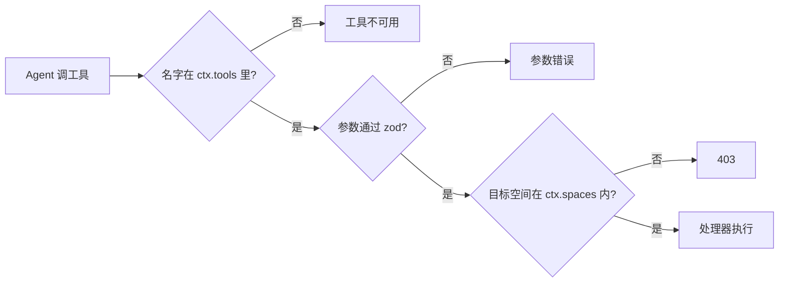

这页是查表用的：想知道“某个角色能不能调 `remember`”“`/as` 和 `run_agent` 有什么区别”“`omem wiki plan` 会排出哪些 Run”“`runs` 表里的 `lane` 是什么”，直接翻对应的表。机制本身不在这里重复，权限怎么落地见 [Agent 运行时与 MCP 工具权限](../concepts/agent-runtime-and-tools.md)，队列和角色见 [任务队列、Run 与角色](../concepts/run-queue-and-roles.md)。

先说三条贯穿全页的规则，后面的表都建立在它们之上。

1. **能不能调用只由“工具白名单”和“空间范围”决定。** `callTool` 在工具不在 `ctx.tools` 里时直接返回“不可用”，随后校验参数，调用处理器 [tools.ts:792-805](../../../src/agents/tools.ts#L792-L805)。空间范围由各处理器里的 `space()` / `inScope()` 检查，越界返回 403 [tools.ts:45-54](../../../src/agents/tools.ts#L45-L54)。
2. **工具定义里的 `write: true` 只是标记，不是闸门。** 它唯一的用途是在 Run 里发一个 `tool-write` 事件，方便界面显示“这次改了什么” [tools.ts:799](../../../src/agents/tools.ts#L799)。因此下面“写库”的判断是我根据处理器内容标的，不能只看这个标记：`save_agent`、`save_skill`、`run_agent` 会落盘或建 Run，却没有 `write: true`（[tools.ts:328](../../../src/agents/tools.ts#L328)、[tools.ts:356](../../../src/agents/tools.ts#L356)、[tools.ts:394](../../../src/agents/tools.ts#L394)）。
3. **角色文件 frontmatter 里的 `writes` 说的是后端 Agent 能不能改工作目录里的文件，和 omem 工具无关。** 13 个角色里只有 `coder` 是 `writes: true`，其余都是 false；`dreamer`、`ingest` 能写记忆和页面，是因为白名单里有那些工具，不是因为 `writes`。`runner.ts` 把 `role.writes` 传给 `allowWrites` [runner.ts:176-177](../../../src/agents/runner.ts#L176-L177)。

## 一、MCP 工具（共 36 个，定义在 tools.ts）

### 读：检索与阅读

| 工具 | 做什么 |
|---|---|
| `list_spaces` | 列出可见空间（按 `ctx.spaces` 过滤）[tools.ts:94-102](../../../src/agents/tools.ts#L94-L102) |
| `search` | 混合检索原件片段、页面、记忆；`scope` 选范围，`space:"*"` 表示所有可访问空间 [tools.ts:104-135](../../../src/agents/tools.ts#L104-L135)。检索实现见 [concepts/retrieval](../concepts/retrieval.md) |
| `scan` | 穷举：在空间所有原件全文和有效记忆里找出含任一关键词的每一行，用于“一共几次”类汇总问题 [tools.ts:177-236](../../../src/agents/tools.ts#L177-L236) |
| `read_source` | 按行读原件，每次最多 400 行；输出顶部给出现成的引用格式。开启注入标记后，读到被标记的行范围时在顶部多一行“⚠ 注入检测”，提醒只当材料看 [tools.ts:137-160](../../../src/agents/tools.ts#L137-L160) |
| `source_outline` | 原件的章节或代码符号及行号 [tools.ts:162-175](../../../src/agents/tools.ts#L162-L175) |
| `list_sources` | 按标题/路径浏览原件列表，不是全文检索 [tools.ts:238-246](../../../src/agents/tools.ts#L238-L246) |
| `find_symbol` | 按名称找定义、调用方、被调用方和导入者；已解析与仅按名称匹配的分开列 [tools.ts:248-289](../../../src/agents/tools.ts#L248-L289) |
| `list_pages` / `read_page` | Wiki 页面列表（含“引用原件已变化”）和全文（含反向链接、引用原件）[tools.ts:411-442](../../../src/agents/tools.ts#L411-L442) |
| `recall` | 查记忆；默认只返回有效的，`include_history=true` 带回被替代/撤回的旧版本 [tools.ts:444-470](../../../src/agents/tools.ts#L444-L470) |
| `list_items` | 事项及最近进展 [tools.ts:472-493](../../../src/agents/tools.ts#L472-L493) |
| `list_conversations` / `read_conversation` | 找并读会话原话；按 `ctx.spaces` 过滤，读越界会话返回 403 [tools.ts:291-313](../../../src/agents/tools.ts#L291-L313) |
| `list_runs` / `read_run` | 后台 Run 的状态和结果 [tools.ts:495-522](../../../src/agents/tools.ts#L495-L522) |
| `list_agents` / `list_skills` / `read_skill` | Agent 档案和技能的列表、技能全文 [tools.ts:315-325](../../../src/agents/tools.ts#L315-L325)、[tools.ts:369-391](../../../src/agents/tools.ts#L369-L391)。档案和技能见 [concepts/agent-specs-and-skills](../concepts/agent-specs-and-skills.md) |
| `list_lark_chats` | 飞书最近活跃会话及是否已订阅（只读）[tools.ts:718](../../../src/agents/tools.ts#L718)。渠道见 [concepts/channels](../concepts/channels.md) |

### 写：知识与事项

| 工具 | 写什么 | 备注 |
|---|---|---|
| `write_page` | Wiki 页面（整体替换，进 Git 历史），同时往空间日志追加一条 | 去掉正文开头的一级标题；返回里提示不存在的页面链接目标 [tools.ts:524-548](../../../src/agents/tools.ts#L524-L548) |
| `remember` | 新记忆 | [tools.ts:550](../../../src/agents/tools.ts#L550) |
| `supersede` | 用新内容更正旧记忆，旧的保留并标为已被替代 | [tools.ts:569](../../../src/agents/tools.ts#L569) |
| `forget` | 撤回记忆，保留撤回记录 | [tools.ts:581](../../../src/agents/tools.ts#L581)。三者的版本链见 [concepts/memory-and-items](../concepts/memory-and-items.md) |
| `upsert_item` | 新建或更新事项（含时间线事件） | [tools.ts:593](../../../src/agents/tools.ts#L593) |
| `create_card` | 一张复习卡片 | [tools.ts:639](../../../src/agents/tools.ts#L639) |
| `notify` | 站内通知，并发给已绑定的机器人 | 描述要求只在需要本人知道或决定时用 [tools.ts:650](../../../src/agents/tools.ts#L650) |
| `describe_source` | 给图片/扫描件原件补充文字，使其可检索 | [tools.ts:661](../../../src/agents/tools.ts#L661) |
| `save_note` / `import_url` | 把用户明确要保存的内容存成笔记原件；抓取网页或飞书文档存成原件 | [tools.ts:677-697](../../../src/agents/tools.ts#L677-L697)。导入后的流程见 [flows/import-to-searchable](../flows/import-to-searchable.md) |

### 写：配置、调度与交办

| 工具 | 效果 |
|---|---|
| `save_agent` / `save_skill` | 写 Agent 档案 / 技能。`draft=true` 存为草稿，需本人 `/approve`；`save_agent` 对已存在的档案保留原状态 [tools.ts:348-352](../../../src/agents/tools.ts#L348-L352)、[tools.ts:404-408](../../../src/agents/tools.ts#L404-L408) |
| `run_agent` | 建一个 `agent` Run；档案是草稿则拒绝；从当前 Run 的输入里取出会话 id，使结果发回原会话 [tools.ts:355-367](../../../src/agents/tools.ts#L355-L367) |
| `delegate_code` | 建一个 `code` Run；空间必须有关联目录 [tools.ts:699-715](../../../src/agents/tools.ts#L699-L715)。过程见 [flows/delegated-coding](../flows/delegated-coding.md) |
| `apply_code_run` | 把已完成的交办改动应用到仓库工作区（不提交）；先 `inScope` 检查 [tools.ts:769-781](../../../src/agents/tools.ts#L769-L781) |
| `set_lark_subscription` | 订阅/取消订阅一个飞书会话的只读采集 [tools.ts:730](../../../src/agents/tools.ts#L730) |
| `submit_plan` | 把 Wiki 目录计划写进当前 Run 的 `output.plan`；没有 `runId` 时拒绝 [tools.ts:743-766](../../../src/agents/tools.ts#L743-L766) |

### 谁能用：按角色

角色白名单来自各 `roles/*.md` 的 frontmatter `tools:`。`runner.ts` 在此基础上给所有角色再加 `list_skills`、`read_skill` [runner.ts:150-153](../../../src/agents/runner.ts#L150-L153)，所以下表不再列这两个。表里“读”一栏只列有区别的读工具；除 `coder`、`reviewer`、`summarizer` 外，其余角色都有 `search`、`scan`、`read_source`（`reviewer` 和 `coder` 也有，`summarizer` 没有任何检索）。

| 角色 | 读（除通用检索外） | 写/副作用工具 |
|---|---|---|
| `assistant` | `list_spaces`、`source_outline`、`list_sources`、`find_symbol`、`list_pages`、`read_page`、`recall`、`list_items`、`list_runs`、`read_run`、`list_conversations`、`read_conversation`、`list_agents`、`list_lark_chats` | `remember`、`supersede`、`forget`、`upsert_item`、`create_card`、`save_note`、`import_url`、`delegate_code`、`apply_code_run`、`set_lark_subscription`、`save_agent`、`run_agent`、`save_skill` [assistant.md:3](../../../roles/assistant.md#L3) |
| `ingest` | `source_outline`、`list_sources`、`list_pages`、`read_page`、`recall`、`list_items`（无 `find_symbol`、无会话类） | `describe_source`、`remember`、`supersede`、`forget`、`upsert_item`、`write_page`、`notify` [ingest.md:3](../../../roles/ingest.md#L3) |
| `dreamer` | `list_pages`、`read_page`、`recall`、`list_items`、`list_conversations`、`read_conversation` | `remember`、`supersede`、`forget`、`upsert_item`、`write_page`、`notify`、`save_skill`、`save_agent` [dreamer.md:3](../../../roles/dreamer.md#L3) |
| `heartbeat` | `list_sources`、`read_page`、`recall`、`list_items` | `upsert_item`、`notify` [heartbeat.md:3](../../../roles/heartbeat.md#L3) |
| `brief` | 同 heartbeat，另有 `list_runs`、`read_run` | `upsert_item`、`notify` [brief.md:3](../../../roles/brief.md#L3) |
| `curator` | `list_spaces`、`list_lark_chats`、`recall`、`list_items` | `set_lark_subscription`、`notify` [curator.md:3](../../../roles/curator.md#L3) |
| `tutor` | `source_outline`、`list_sources`、`read_page`、`recall` | `create_card` [tutor.md:3](../../../roles/tutor.md#L3) |
| `wiki-planner` | `source_outline`、`list_sources`、`find_symbol`、`list_pages`、`read_page` | `submit_plan`、`write_page` [wiki-planner.md:3](../../../roles/wiki-planner.md#L3) |
| `wiki-writer` | 同上 | `write_page` [wiki-writer.md:3](../../../roles/wiki-writer.md#L3) |
| `wiki-linter` | `source_outline`、`find_symbol`、`list_pages`、`read_page` | `write_page` [wiki-linter.md:3](../../../roles/wiki-linter.md#L3) |
| `coder` | `find_symbol`、`list_pages`、`read_page`、`recall` | 无（但可改 worktree 里的文件）[coder.md:3-4](../../../roles/coder.md#L3-L4) |
| `reviewer` | `find_symbol`、`read_page` | 无 [reviewer.md:3](../../../roles/reviewer.md#L3) |
| `summarizer` | 无（`tools: []`，只剩技能两个）| 无 [summarizer.md:3](../../../roles/summarizer.md#L3) |

几个容易误会的点：

- `notify` 助理自己没有，只有整理类和定时类角色有；`delegate_code`、`apply_code_run` 只有助理有。
- Agent 档案（`save_agent` 建的）不走这张表。没填 `tools` 时用 `DEFAULT_SPEC_TOOLS`，是 15 个只读工具 [specs.ts:55](../../../src/agents/specs.ts#L55)。
- 空间范围：助理是 `null`（所有空间），档案按自己的 `spaces` 配置，其他角色默认只有当前 Run 的空间 [runner.ts:154-156](../../../src/agents/runner.ts#L154-L156)。`heartbeat`、`dream`、`brief`、`curate` 调用时显式传了 `null`，所以能跨空间（[jobs.ts:264](../../../src/agents/jobs.ts#L264)、[jobs.ts:303](../../../src/agents/jobs.ts#L303)、[jobs.ts:332](../../../src/agents/jobs.ts#L332)、[jobs.ts:348](../../../src/agents/jobs.ts#L348)）。

### 外部入口的权限

- 网页/内部令牌：`app.internalToken` 得到全部工具、所有空间、`actor: "user"`，空间默认 `personal` [tools.ts:822-827](../../../src/agents/tools.ts#L822-L827)。
- Agent 会话：`issueToolToken` 发一个令牌，绑定该次的白名单和空间 [tools.ts:809](../../../src/agents/tools.ts#L809)。
- `omem mcp`（给 Claude Code、Codex 直接用个人库）：空间 `personal`、所有空间可访问；始终去掉 `submit_plan` 和 `delegate_code`；`--read-only` 只开放 13 个读工具 [cli-main.ts:323-336](../../../src/cli-main.ts#L323-L336)。注意非只读模式下 `apply_code_run`、`save_*`、`remember` 等都是开着的。

## 二、斜杠命令（commands.ts）

斜杠命令不经过模型，由 `inbox.ts` 在收到以 `/` 开头的文字时先尝试 `runCommand`，成功则把命令和回复都存为带 `meta.command` 的消息，不建 `ask` Run [inbox.ts:47-54](../../../src/agents/inbox.ts#L47-L54)。未知的 `/词` 返回 `null`，当普通文字交给助理 [commands.ts:301-310](../../../src/agents/commands.ts#L301-L310)。带 `meta.command` 的消息不进摘要 [jobs.ts:92](../../../src/agents/jobs.ts#L92)。

命令里没有按人区分的权限判断：谁能给这个会话发消息，谁就能用。

| 命令 | 做什么 | 写什么 |
|---|---|---|
| `/help` | 按“会话/路由/快捷”分组列出命令 [commands.ts:39-55](../../../src/agents/commands.ts#L39-L55) | 无 |
| `/new [标题]` | 归档当前会话，在同一渠道、同一 key 上建新会话，沿用档案和后端设置；对旧会话排一次摘要 [commands.ts:56-66](../../../src/agents/commands.ts#L56-L66) | `conversations`；可能建 `thread-summary` Run |
| `/status` | 空间、回答者、Agent 会话在线/可恢复、本会话队列、群设置 [commands.ts:67-89](../../../src/agents/commands.ts#L67-L89) | 无 |
| `/stop` | 取消本会话 lane 里排队和运行中的 Run [commands.ts:90-98](../../../src/agents/commands.ts#L90-L98) | `runs.status` |
| `/sessions [关键词]` | 最近会话；带关键词时包含已归档 [commands.ts:99-106](../../../src/agents/commands.ts#L99-L106) | 无 |
| `/resume <id>` | 把这个聊天重新指向旧会话 [commands.ts:107-118](../../../src/agents/commands.ts#L107-L118) | 会话与渠道 key 的绑定 |
| `/link <id>` / `/link -<id>` | 把另一个会话的摘要作为本会话背景 / 取消；下一条起生效 [commands.ts:119-134](../../../src/agents/commands.ts#L119-L134) | `conversations.settings`，重置 Agent 会话 |
| `/summary [refresh]` | 看摘要；`refresh` 排一次摘要 [commands.ts:135-145](../../../src/agents/commands.ts#L135-L145) | 可能建 `thread-summary` Run |
| `/compact` | 换用新的 Agent 会话并排摘要 [commands.ts:146-155](../../../src/agents/commands.ts#L146-L155) | 重置 Agent 会话 |
| `/space [id]` | 查看/切换空间；群里同时设为群默认 [commands.ts:156-169](../../../src/agents/commands.ts#L156-L169) | `conversations`、`chat_settings` |
| `/agent [后端id\|default]` | 本会话用哪个后端（codex、claude…）[commands.ts:170-182](../../../src/agents/commands.ts#L170-L182) | `conversations.settings` |
| `/as <档案\|off> [任务]` | 不带任务：让档案接管本会话；带任务：建一个 `agent` Run 只做这一件事；草稿档案拒绝 [commands.ts:183-207](../../../src/agents/commands.ts#L183-L207) | `conversations.settings` / `runs` |
| `/agents`、`/skills` | 列出档案/技能（含草稿）[commands.ts:208-223](../../../src/agents/commands.ts#L208-L223) | 无 |
| `/approve agent\|skill <名称>` | 把草稿启用 [commands.ts:224-233](../../../src/agents/commands.ts#L224-L233) | 档案/技能的 `status` |
| `/mode chat\|topic` | 群里整个群一个会话，还是每个话题一个 [commands.ts:234-244](../../../src/agents/commands.ts#L234-L244) | `chat_settings` |
| `/idle <小时>` | 聊天空闲多久后自动开新会话，0 为不自动 [commands.ts:245-255](../../../src/agents/commands.ts#L245-L255) | `chat_settings` |
| `/remember <内容>` | 直接记一条 `fact` 记忆，`createdBy: "user"`，来源 `conv:<会话id>` [commands.ts:256-264](../../../src/agents/commands.ts#L256-L264) | `memories` |
| `/todo <事项>` | 直接记一条 `todo` 事项 [commands.ts:265-273](../../../src/agents/commands.ts#L265-L273) | `items` |
| `/search <关键词>` | 在当前空间和 `personal` 里检索，最多 8 条 [commands.ts:274-284](../../../src/agents/commands.ts#L274-L284) | 无 |
| `/runs` | 最近 10 个 Run，不按空间过滤 [commands.ts:285-292](../../../src/agents/commands.ts#L285-L292) | 无 |

`/as` 带任务和 `run_agent` 工具效果相近，都建 `agent` Run。区别在发起者：前者是本人直接下命令，后者是助理在对话中自己决定交办。

## 三、CLI 子命令（cli-main.ts）

数据目录用全局 `--home`（默认 `~/.omem` 或 `OMEM_HOME`）[cli-main.ts:21-29](../../../src/cli-main.ts#L21-L29)。凡是要让 Agent 干活的子命令都走 `runJob`：如果这个库上已有服务在跑（探测 `/api/settings` 并核对 `home`），就把 Run 交给它执行并订阅事件流；否则在进程内临时起一个服务 [cli-main.ts:31-62](../../../src/cli-main.ts#L31-L62)。

| 命令 | 做什么 | 是否调 Agent | 写什么 |
|---|---|---|---|
| `serve [-p] [--host]` | 启动网页、API 和后台任务 [cli-main.ts:121-128](../../../src/cli-main.ts#L121-L128) | — | — |
| `space list` / `add <name>` / `sync <id>` | 列空间；建空间（`--path` 关联目录并立即导入，`--exclude <路径或 glob…>` 把不导入的路径写进空间设置）；同步关联目录（`--exclude` 会替换原有设置，已导入的匹配文件变墓碑）[cli-main.ts:130-165](../../../src/cli-main.ts#L130-L165) | 否 | `spaces`、`sources` |
| `add <input>` | 文件、目录、网址或 `-`（标准输入）存为原件；默认再排一次 `ingest`，`--no-ingest` 跳过 [cli-main.ts:166-203](../../../src/cli-main.ts#L166-L203) | 默认是 | `sources`，及整理产生的记忆等 |
| `search <query...>` | 检索，`-s` 限空间 [cli-main.ts:204-216](../../../src/cli-main.ts#L204-L216) | 否 | 无 |
| `ask <question...>` | 向助理提问，`-c` 延续会话；渠道记为 `cli` [cli-main.ts:217-225](../../../src/cli-main.ts#L217-L225) | 是（`ask` Run） | `conversations`、`messages` |
| `wiki plan <space>` | 建 `wiki-plan` Run，`--no-write` 只规划；等待子 Run 完成 [cli-main.ts:227-235](../../../src/cli-main.ts#L227-L235) | 是 | `pages` |
| `wiki write <space> <slug>` | 写一页，必须给 `--title` 和 `-q`；`kind` 固定为 `guide` [cli-main.ts:236-247](../../../src/cli-main.ts#L236-L247) | 是 | `pages` |
| `wiki lint <space>` | 检查并修正引用原件已变化的页面 [cli-main.ts:248-254](../../../src/cli-main.ts#L248-L254) | 是 | `pages` |
| `wiki export <space> <dir>` | 把 Wiki 导出成普通 Markdown 目录：页面互链和指向仓库文件的原件引用改成相对链接，`--repo-root` 指定引用原件所在目录，默认是空间关联目录 [cli-main.ts:255-263](../../../src/cli-main.ts#L255-L263) | 否 | 只写目标目录，不改库 |
| `wiki show <space> [slug]` | 同步页面文件后列出或打印 [cli-main.ts:264-276](../../../src/cli-main.ts#L264-L276) | 否 | 同步磁盘页面到库 |
| `items [-a]` | 查看事项，`-a` 含已完成 [cli-main.ts:277-284](../../../src/cli-main.ts#L277-L284) | 否 | 无 |
| `todo <title...>` | 新建事项，`--kind`、`--remind`、`--due` [cli-main.ts:285-295](../../../src/cli-main.ts#L285-L295) | 否 | `items` |
| `memory [-s]` | 列有效记忆 [cli-main.ts:296-303](../../../src/cli-main.ts#L296-L303) | 否 | 无 |
| `delegate <space> <task...>` | 建 `code` Run，`--check` 指定检查命令；打印 diff 统计、评审和结论 [cli-main.ts:304-313](../../../src/cli-main.ts#L304-L313) | 是 | worktree、`runs.output` |
| `agents` | 列出可用后端配置及是否已安装 [cli-main.ts:314-322](../../../src/cli-main.ts#L314-L322) | 否 | 无 |
| `mcp [--read-only]` | 以 stdio 暴露 omem 工具，见上文 [cli-main.ts:323-336](../../../src/cli-main.ts#L323-L336) | — | 取决于调用的工具 |
| `sync` | 同步所有关联了目录的空间（直接调用，不建 Run）[cli-main.ts:337-348](../../../src/cli-main.ts#L337-L348) | 否 | `sources` |
| `hook <claude\|codex> [payload]` | 把编码 Agent 的会话记成聊天原件；出错只打印，不让调用它的 Agent 失败 [cli-main.ts:349-364](../../../src/cli-main.ts#L349-L364)、[hooks.ts:57-90](../../../src/hooks.ts#L57-L90) | 否 | `sources`（`kind: "chat"`）|
| `setup [component]` | 交互向导（Agent、向量、文档解析、渠道、注入标记、会话、定时任务七个分区）；`embeddings`、`documents` 可直接指定，`embeddings` 带 `--model`、`--no-osdk` [cli-main.ts:365-408](../../../src/cli-main.ts#L365-L408) | 否 | 配置文件、`schedules` 开关、向量 |
| `import-v1 <db>` | 从 v1 库导入原件、有效记忆和未完成事项，`--dry-run` 只统计 [cli-main.ts:409-418](../../../src/cli-main.ts#L409-L418) | 否 | `sources`、`memories`、`items` |
| `run <runId>` | 把一次运行的完整记录打印成 JSON [cli-main.ts:419-426](../../../src/cli-main.ts#L419-L426) | 否 | 无 |

注意 `wiki plan` 的输出只是规划摘要；逐页写作是它建出来的子 Run，所以 CLI 里用 `children: true` 逐个等待并打印 ✓/✗ [cli-main.ts:106-113](../../../src/cli-main.ts#L106-L113)。流程见 [flows/wiki-generation](../flows/wiki-generation.md)。

## 四、Run 类型

`RunKind` 有 17 个值 [runs.ts:5](../../../src/agents/runs.ts#L5)。`registerHandler(kind, fn)` 把类型和处理器挂上；队列取到没有处理器的 Run 会直接置为 `failed`，错误是“没有处理器：<kind>” [runs.ts:254-258](../../../src/agents/runs.ts#L254-L258)。

| kind | 处理器 | 角色 | 队列类别 | 谁创建 |
|---|---|---|---|---|
| `ask` | [jobs.ts:56](../../../src/agents/jobs.ts#L56)，经 `threadTurn` | 助理（或会话指定的档案，见 `actorFor`）[sessions.ts:85-91](../../../src/agents/sessions.ts#L85-L91) | 交互 | `inbox.ts` 每条（合并后的）消息；`lane` 为会话 id，可带 `notBefore` 合并连发消息 [inbox.ts:78-87](../../../src/agents/inbox.ts#L78-L87) |
| `agent` | [jobs.ts:71](../../../src/agents/jobs.ts#L71) | 档案（`runRole` 传 `role: "assistant"` 加 `spec`；工具以档案为准）| 交互 | `/as 档案 任务`、`run_agent` |
| `thread-summary` | [jobs.ts:89](../../../src/agents/jobs.ts#L89) | `summarizer` | 后台 | `maybeSummarize`，`lane` 为 `summary:<会话id>` [sessions.ts:74-83](../../../src/agents/sessions.ts#L74-L83) |
| `ingest` | [jobs.ts:111](../../../src/agents/jobs.ts#L111)（开启注入标记时先对原件打分并在任务里附警告）| `ingest` | 后台 | `scheduleIngest`：`omem add`、网页导入、飞书/OneBot 采集 |
| `wiki-plan` | [jobs.ts:158](../../../src/agents/jobs.ts#L158) | `wiki-planner` | 后台 | `omem wiki plan`、网页接口 |
| `wiki-write` | [jobs.ts:182](../../../src/agents/jobs.ts#L182) | `wiki-writer` | 后台 | `wiki-plan` 对计划中每页各建一个（`parentId` 指向它）；`omem wiki write` |
| `wiki-lint` | [jobs.ts:212](../../../src/agents/jobs.ts#L212) | `wiki-linter` | 后台 | `omem wiki lint`；`sync` 发现页面过期时 |
| `sync` | [jobs.ts:224](../../../src/agents/jobs.ts#L224) | 无（纯代码，不调 Agent）| 后台 | `scheduleSpaceSync`；定时 `repo-sync` |
| `heartbeat` | [jobs.ts:236](../../../src/agents/jobs.ts#L236) | `heartbeat` | 后台 | 定时，每 15 分钟；已有排队或运行中的就不重复建 [main.ts:11-16](../../../src/main.ts#L11-L16) |
| `dream` | [jobs.ts:270](../../../src/agents/jobs.ts#L270) | `dreamer` | 后台 | 定时 |
| `brief` | [jobs.ts:309](../../../src/agents/jobs.ts#L309) | `brief` | 后台 | 定时 |
| `curate` | [jobs.ts:338](../../../src/agents/jobs.ts#L338) | `curator` | 后台 | 定时 `lark-curate`，输入带筛选方向 |
| `tutor` | [jobs.ts:354](../../../src/agents/jobs.ts#L354) | `tutor` | 后台 | 网页接口生成复习卡片 |
| `code` | `runCodeTask`，[jobs.ts:364](../../../src/agents/jobs.ts#L364) | 先 `coder`，再 `reviewer`（[code.ts:57-103](../../../src/agents/code.ts#L57-L103)）| 后台 | `delegate_code`、`omem delegate`、网页接口 |
| `ingest-shadow` | `jobs.ts` 的 `ingest-shadow` 处理器 | `ingest`（工具令牌带 `shadow`，写入只记录到 `shadow_writes`）| 后台 | `ingest` 按 `memory.compare` 每项建一个子运行（`parentId` 指向正式运行），结果默认静默 |
| `memory-review` | `jobs.ts` 的 `memory-review` 处理器 | `memory-reviewer`（后端/模型可由 `memory.review` 单独指定）| 后台 | 定时 `memory-review`（每小时，默认开），每个有未复核记忆或对比提案的空间一个 |
| `review` | **无** | — | — | 无 |

两点需要说明：

- **`review` 是占位值。** 类型里有，但没有处理器，代码里也没有哪处创建它；评审是 `code` 处理器内部再调一次 `reviewer` 角色完成的（从实现看，是为了让评审和编码共用同一个 worktree 与 Run）。
- **队列类别只有两种。** `ask`、`agent` 算交互，其余都是后台；两类各有一个并发上限：`interactiveConcurrency`（默认 4）和 `concurrency`（默认 2）[runs.ts:206-208](../../../src/agents/runs.ts#L206-L208)、[config.ts:46-48](../../../src/core/config.ts#L46-L48)。设计意图写在注释里：长后台任务不该拖慢回复。同一个 `lane` 内严格按创建顺序一次只跑一个 [runs.ts:224-246](../../../src/agents/runs.ts#L224-L246)。

定时类 Run 来自 `schedules` 表。2026-10-17 起另有 `memory-review`（每小时第 20 分，默认开）。原有六项：`heartbeat`（每 15 分钟，默认启用）、`brief`（工作日 08:45）、`dream`（每晚 03:30）、`repo-sync`（每小时）、`lark-curate`（每周一 09:15）、`lark-poll`（每 10 分钟，直接采集，不建 Run），除 `heartbeat` 外默认都关着 [scheduler.ts:13-20](../../../src/core/scheduler.ts#L13-L20)。

Run 的状态是 `queued → running → done | failed | cancelled`。服务启动时把残留的 `running` 全部放回 `queued`，所以所有处理器都要能重复执行 [runs.ts:215-222](../../../src/agents/runs.ts#L215-L222)。网页上的“重试”是按原 `kind`、`input` 另建一个新 Run，而不是复活旧的 [http.ts:389-392](../../../src/server/http.ts#L389-L392)。

## 五、主要数据库表

全部在 `db.ts` 的 `migrations` 数组里，按 `pragma user_version` 依次执行，每条迁移一个事务 [db.ts:8-12](../../../src/core/db.ts#L8-L12)。

| 表 | 存什么 |
|---|---|
| `spaces` | 空间；`root_path` 非空即关联了目录；`settings` 里有 `exclude` 排除规则、`autoIngest`、`autoLint`、`checkCommand` 等 |
| `sources` | 原件，`unique(space_id, uri)`；`kind` 为 doc/code/chat/note/web/image/conversation；`hash` 用于判断变化；`deleted_at` 是墓碑；`meta.guard` 记注入标记的检查进度和被标记的行范围 |
| `chunks`（+ `chunks_fts`）| 检索用的切片，带行号和可选向量 |
| `symbols`、`code_refs` | 代码符号和引用关系，`find_symbol` 的数据来源 |
| `pages`（+ `pages_fts`、`page_rowids`）| Wiki 页面 |
| `page_links`、`page_cites` | 页面间的链接；页面对原件的引用及写作时的 `hash`（过期检查靠它和 `sources.hash` 比较）|
| `memories`（+ `memories_fts`）| 记忆；`status` 为 active/superseded/retracted，`supersedes`/`superseded_by` 构成版本链；`agent_profile`/`model`/`effort`/`run_id` 记写入来源，`reviewed_at`/`review_verdict`/`review_note`/`reviewed_by` 记复核，`agent` 是档案专属，`tags` 标签 |
| `memory_rejections` | 被写入检查拒绝的记忆（内容、原因 code、后端/模型、是否对比运行）|
| `shadow_writes` | 对比运行提出但没执行的写入（工具名、参数、复核结论）|
| `items`、`item_events` | 事项和时间线 |
| `conversations`、`messages` | 会话（线程）与消息；`messages.run_id` 指向回答它的 Run；`messages.meta` 里有 `context`（群上下文）、`contextSuspect`（注入分）、`command` 等。线程细节见 [concepts/threads-and-agent-sessions](../concepts/threads-and-agent-sessions.md) |
| `chat_settings` | 按 (渠道, 聊天) 保存的 `/mode`、`/idle`、`/space` 设置；渠道 `lark-capture` 存飞书会话的采集方式 `policy` |
| `lark_cursors` | 飞书采集游标（会话和 `thread:` 话题），另记 `kind`、`muted`、`involved` |
| `runs`、`run_events` | Run 本身和它的事件流（text/tool/status/change/error）；`runs` 另有 `profile_id`、`parent_id`、`lane`、`not_before` |
| `schedules` | 定时任务 |
| `cards`、`card_reviews` | 复习卡片与复习记录 |
| `notifications` | 站内通知 |
| `kv` | 零散键值 |

以上表定义见 [db.ts:11-250](../../../src/core/db.ts#L11-L250)。

## 要改这里从哪下手

- **加/改一个 MCP 工具**：在 `tools.ts` 用 `def({...})` 定义，写入类别忘了 `write: true`（它决定界面上有没有 `tool-write` 事件，参考上面 `save_*` 的反例）；然后决定哪些角色该有它，改对应 `roles/*.md` 的 `tools:`，并在角色正文里讲清什么时候用。要不要出现在 `omem mcp --read-only` 里，改 [cli-main.ts:330](../../../src/cli-main.ts#L330) 的集合。写入类处理器必须自己调 `space()`/`inScope()`，因为空间校验不是框架统一做的。
- **加斜杠命令**：在 `commands.ts` 的 `commands` 对象里加一项，再把名字加进 `/help` 的分组数组，否则帮助里看不到 [commands.ts:39-55](../../../src/agents/commands.ts#L39-L55)。
- **加 CLI 子命令**：`cli-main.ts`；要调 Agent 就用 `runJob` 包一层，别自己 `createRun` 后不等待。
- **加 Run 类型**：改 `RunKind`，在 `jobs.ts` 里 `registerHandler`，需要的话新增 `roles/<名>.md` 并扩 `RoleName`（`core/config.ts`）。要决定它算交互还是后台（`INTERACTIVE` 集合）。别忘了处理器必须可重复执行。
- **加表或字段**：只能在 `migrations` 数组末尾追加，不要改已发布的条目。
- 改动后跑 `pnpm run check`；改了工具或角色，按 AGENTS.md 要求用真实 Agent 跑一两个问题验证，不要批量生成知识。
