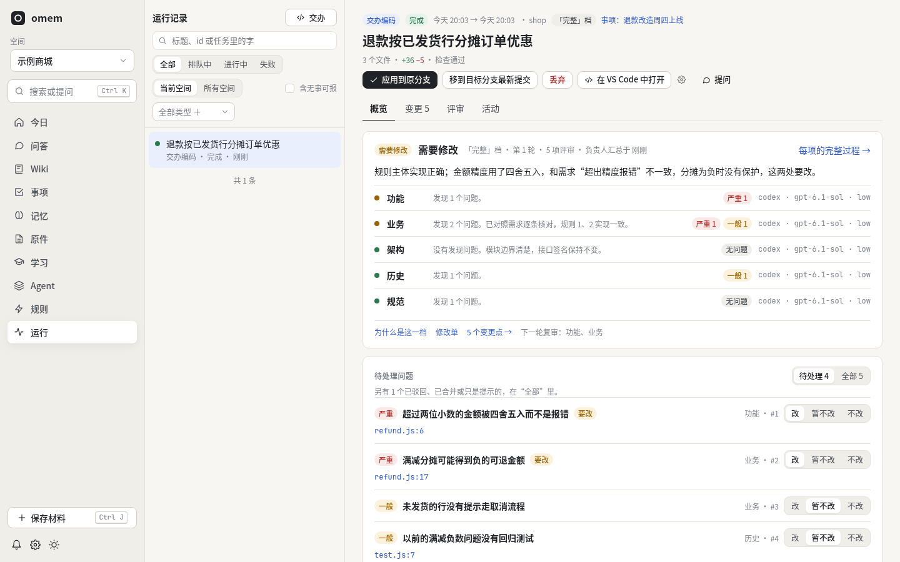
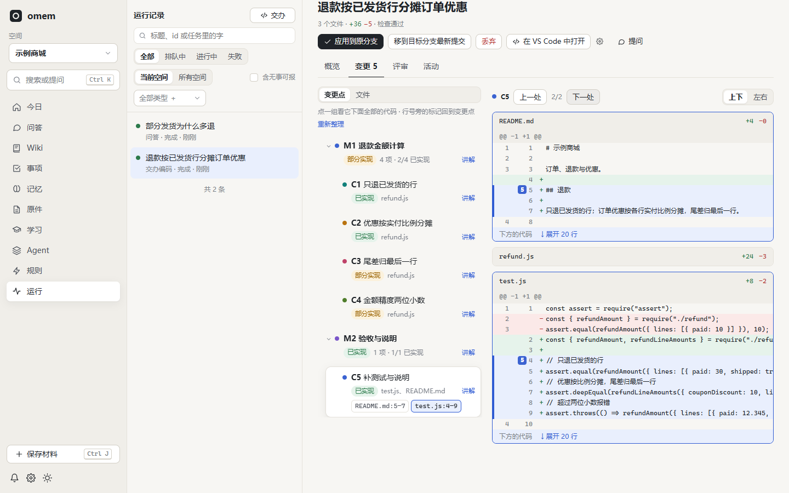
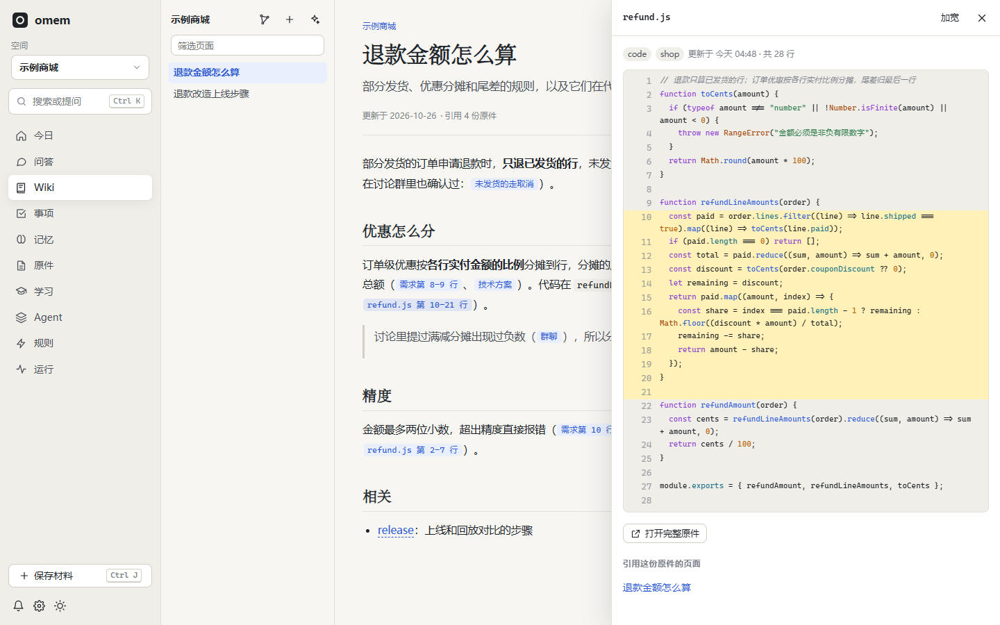
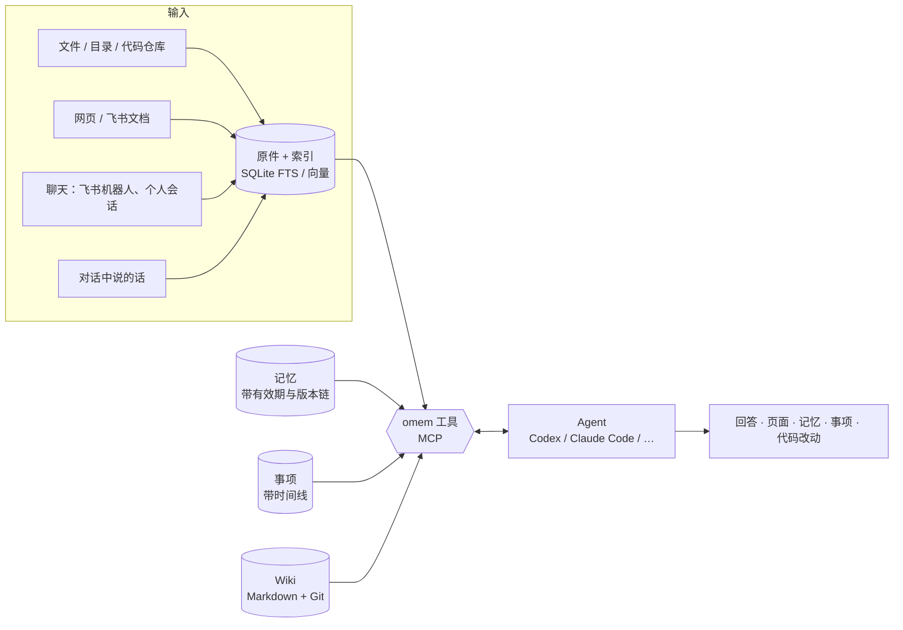
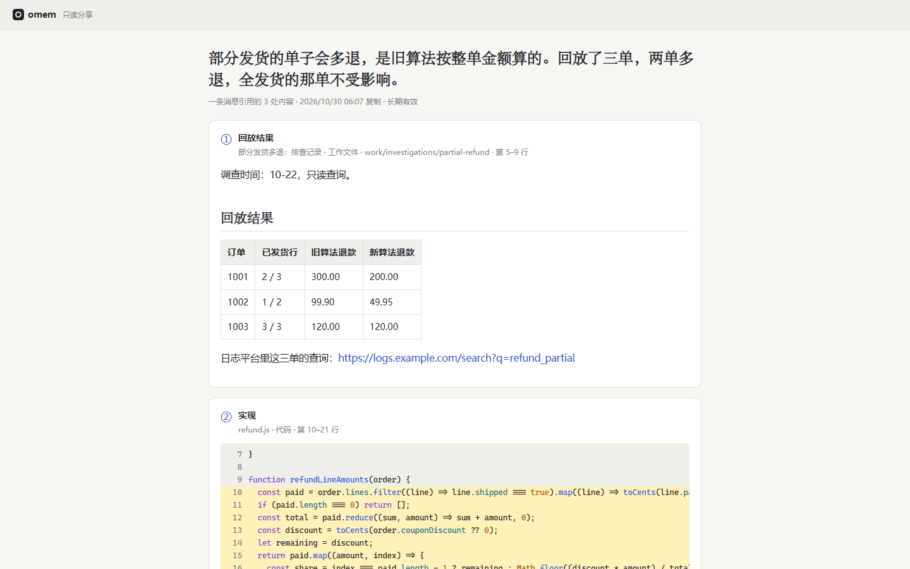

# omem

个人记忆与助理：把文档、代码、聊天、笔记放进同一个知识库，带依据地回答问题，记住约定并在被纠正时更新，持续跟进事项，还能把编码任务交给其他 Agent 并保留检查与评审结果。

**文档站**：<https://lejunyang.github.io/omem/>（功能介绍、安装和使用，源码在 [site/](site/)）

## 主要特色

**交办编码，多维度评审。** 编码 Agent 在独立 worktree 里改完、跑过检查后，功能、业务、架构、历史、规范几个评审项各自独立审查，评审负责人合并重复的问题、决定哪些要改，再续一轮。每个问题可以选“改 / 暂不改 / 不改”，不改写一句业务理由，之后的评审不再提。



**从需求走到代码。** 每次评审都把需求拆成变更点，标出已实现、部分实现、没实现和对应的代码行；需求大时按页面或模块分组，像文件夹一样展开。点变更点，代码高亮并滚到它的标记；拆得不顺手，可以让助手按你的要求重新整理。差异可以上下或左右对比，左侧是可折叠的文件树。



**Wiki 的每个论断都贴着出处。** 一页 Wiki 同时引用需求文档、技术方案、讨论群和代码，点任意一个引用，右侧打开原件并高亮被引用的那几行。问答也一样：回答里的引用指向聊天里那一句、需求里那一行。



**还有：**

- **选中就能引用**：在差异、评审或打开的原件里选中几段，编号后一起提问，或攒成下一轮的修改点；提问抽屉可以缩小成可拖动的图标。
- **Git 同步交给它**：交办时先拉取、合并或变基，冲突先交给编码 Agent，拿不准的问你；应用时快进到目标分支，推送到你选的分支。
- **不用每次重装依赖**：仓库可以把几个装好依赖的工作区借给交办轮流用，准备命令只在锁文件变了时才跑。
- **记忆有版本，事项会收尾**：约定被纠正时旧版本保留并指向新版本；事项有时间线和期限，没进展自己过期，有新消息再打开。
- **插件做强交互的事**：一个插件打包 Agent 档案、技能、工具、数据和独立页面。内置的“英语练习”按场景出一组题（中英互选、填空、听写、翻译），一次提交，宿主判客观题、陪练评翻译并点评；陪练在后台补题库，“下一组”按你的水平和薄弱点当场挑出来。自己的插件放数据目录，只写清单和档案就能用表单、图表和默认页面；带代码和常驻服务的（比如实时看机器状态）要你在设置 → 插件里确认后才运行，页面能经 omem 和服务保持 WebSocket 连接。
- **飞书里用**：机器人回答带进度卡片和思考过程，规则一句话写成“遇到什么就做什么”，提问和评审结果都是带按钮的卡片。
- **不自带模型**：理解和写作交给你已安装的 Agent（Codex、Claude Code、Gemini CLI 等），omem 管存储、索引、调度和权限。

> v2 是一次精简重写（2026-10）。v1 的代码与文档在 Git 历史和 `docs/archive/v1/` 中；设计取舍见 [docs/v2/architecture.md](docs/v2/architecture.md)，评测见 [evaluation.md](docs/v2/evaluation.md)，验收步骤见 [acceptance.md](docs/v2/acceptance.md)。

## 它怎么工作



- **空间**把领域分开，类型有个人、项目、代码仓库、学习、通用。检索默认在当前空间和它的**相关空间**，主助手可显式检索所有可访问空间；Wiki 用 `[[space:slug]]` 跨空间关联。互相调用的仓库、同一项目的几个空间可以关联（设置 → 空间，或对助理说“A 调用 B 的接口”）：整理、复核这类只管一个空间的任务也会读相关空间（只读，写入仍在自己的空间），写记忆时会提示相关空间里已有的相近记忆；定期整理会从互相引用、页面互链、依赖声明和共用标签里发现可能相关的空间，确认后关联，你移除的不会再被加回。一个空间可同时放项目文档、讨论和代码，但只关联一个仓库；多个仓库分别建空间。本人可在主助手对话中创建空间、关联本地仓库或接入 Git 链接。
- **原件**是依据，只保留最新版；聊天按追加保存。**Wiki、记忆、事项**是派生知识，都引用原件。
- **空间归属与归档**：问答、原件（含文档）、运行列表跟随所选空间；切换空间退出旧详情。规则分为“任务规则”和“归档规则”。自动采集优先使用手动归属和来源绑定，再按创建顺序匹配条件，未命中的批量交给归档角色判断，不确定的仍放个人空间。归档规则可让 AI 编写草稿，核对后保存启用；历史材料先预览再应用，迁移保留 ID、引用和行号。
- **原件页**：普通空间按列表展示；代码仓库空间在文件较多时按目录展示，网址和会话标识保留为独立原件。
- 理解和写作由你已安装的 **Agent** 完成（通过 ACP 或命令行），它们用 omem 的工具（MCP，或 shell 里的 `omem tool`）检索、阅读、写入，同时保有自己的文件与搜索能力。omem 负责存储、索引、调度和权限，不自带模型。
- **Wiki** 是 Markdown 文件，整个知识库目录是一个 Git 仓库，每次修改都有历史和差异。
- **记忆**被更正时不覆盖：旧版本标记为“已被更正”并链接到新版本，所以“之前怎么约定的”和“现在是什么”都能回答。
- **记忆按目录分层**：每条记忆在空间里有一个目录（如 `工作/项目A/发布`，最多三层），记忆页左侧是目录树。助理写记忆时按目录说明选目录，没有合适的才新建并写一句说明；拿不准的先放“未归档”，每两小时由整理目录的运行归档，每周再看一遍结构（拆太满的、并太小的、补说明）。标签只用来串起跨目录的东西（同一个人、同一个季度）。
- **记忆质量不靠人工逐条看**：写入前有规则检查（免责式、超长、转述原件、事件复述、无来源、重复的会被退回并告诉模型怎么改），之后每小时由复核模型盲评保留、改写或撤回；可以再挂几个模型做对比运行，在“记忆 → 质量”里按模型比较。
- **相关记忆自动带上**：开了向量检索后，你每发一条消息，和它足够相近的记忆（事实、约定、人物、决定，最多 5 条）会附在这一轮里，助理不用先想起来去查；不够相近就什么都不加（门槛在设置 → 检索，校准数据见 docs/v2/evaluation.md）。
- **问你和给你选项**：Agent 遇到非你决定不可的事用卡片问你，你答完它在同一轮继续，不用等它结束再重说一遍；回答以建议结尾时附上下一步按钮。列在 `approvals.tools` 里的工具调用要你批准才执行，拒绝时写的理由会回给 Agent。

## 快速开始

需要 Node.js 22.18+（推荐 24），以及至少一个已登录的 Agent。任何支持 [Agent Client Protocol](https://agentclientprotocol.com) 的 Agent 都能用，装在 PATH 里就会被自动识别：

| Agent | 安装 | 配置 id |
| --- | --- | --- |
| Codex | `npm i -g @agentclientprotocol/codex-acp` | `codex` |
| Claude Code | `npm i -g @agentclientprotocol/claude-agent-acp` | `claude` |
| Gemini CLI | `npm i -g @google/gemini-cli` | `gemini` |
| GitHub Copilot CLI | `npm i -g @github/copilot` | `copilot` |
| Qwen Code | `npm i -g @qwen-code/qwen-code` | `qwen` |
| Cursor Agent | `curl https://cursor.com/install -fsS \| bash` | `cursor` |
| OpenCode | `npm i -g opencode-ai` | `opencode` |
| CodeBuddy Code / Qoder / iFlow | `npm i -g @tencent-ai/codebuddy-code` / `@qoder-ai/qodercli` / `@iflow-ai/iflow-cli` | `codebuddy` / `qoder` / `iflow` |
| Kimi CLI / Mistral Vibe | `uv tool install kimi-cli` / `mistral-vibe` | `kimi` / `vibe` |
| goose、Kilo、Auggie、Cline、Factory Droid、Grok、MiniMax、Amp、Junie、Devin、pi、DeepAgents、TraeX | 见 `omem agents --all` | 同名 |
| Claude / Codex / TraeX 命令行（非 ACP 兜底） | `claude`、`codex` 或 `traex` 在 PATH 中 | `claude-cli` / `codex-cli` / `traex-cli` |
| 豆包 OpenAPI（云端 Managed Agent，无需本地程序） | 飞书应用开了豆包用户权限并授权：`omem doubao status` / `omem doubao login` | `doubao` |

`omem agents` 列出已识别的 Agent；`omem agents registry` 列出官方 ACP 注册表里的全部 Agent，`omem agents add <id> [--via npx|uvx|binary]` 一步加入（npm 包可以 npx 运行不安装，独立程序会下载并校验到数据目录）。`omem setup` 和网页“设置 → Agent → ACP 注册表”做同样的事。每个 Agent 第一次用前在终端直接运行一次完成登录；模型和推理强度在“检测模型”里选。

```bash
# 源码运行（osdk 管理 Node/pnpm 与模型）
osdk install && osdk deps --frozen
osdk run dev          # API :4317 + 网页 :5173，数据在 ./.omem

# 或直接用 npm/pnpm
pnpm install
pnpm run build && pnpm start      # http://127.0.0.1:4317，数据在 ~/.omem
npm install -g .                  # 可选：把命令行 omem 链接到这个仓库
```

第一次使用先运行 `omem setup`（或 `osdk run cli -- setup`）：交互式选择 Agent 后端与模型、向量模型（经 osdk 下载并锁定）、PDF/DOCX 解析（Docling 及其模型）、飞书 / Telegram / QQ·微信渠道、注入标记、桌面与浏览器控制（可选）、会话与并发、定时任务。每一项都会先显示本机已安装什么、各选项的代价；缺的 uv、llama.cpp 和模型经 osdk 装好（不用把 osdk 的 shims 加进 PATH）。最后可以直接启动后台服务。

**后台服务**：`omem service start | stop | restart | status | logs`。用 omem 自带的 PM2 常驻运行（PM2 数据放在 `~/.omem/service/pm2`，不碰你自己的 PM2），崩溃自动重启，日志在 `~/.omem/service/logs` 按天和大小轮换。`omem service enable` 设置开机自启（macOS 用 LaunchAgent，Linux 用 systemd 用户服务并开启 linger、没有 systemd 时用 crontab `@reboot`，Windows 在“启动”文件夹放一个隐藏窗口的启动脚本，都不需要管理员权限），`omem service disable` 取消；`omem setup` 结束时也会问。自启用的是设置时终端里的 PATH，之后装了新 Agent 或换了 Node 版本再 `enable` 一次。前台调试用 `omem serve`。

**更新**：在源码仓库里 `osdk run upgrade`（或 `node scripts/upgrade.ts`）：拉最新代码、装依赖、构建、`npm install -g .` 链接全局命令；加 `--restart` 顺便重启后台服务，`--no-global` 跳过全局安装。

**传输压缩**：Web 服务为支持 gzip 的客户端压缩网页静态资源和超过 1 KB 的 JSON 等文本响应；实时事件保持流式发送。

**监听地址**：默认监听所有网卡（`0.0.0.0`），方便其他设备配对和打开网页；本机的请求不需要令牌，其他机器的请求必须带令牌（配对码或 `omem link` 给的）。只想本机访问，配置里写 `"host": "localhost"`。Windows 第一次启动时防火墙可能会询问是否允许 Node 访问网络。

打开网页后：

1. **设置 → Agent**：确认至少一个后端显示“已安装”。在 **Agent → 档案** 中为内置角色和自定义档案设置默认后端、模型与思考强度；可用后端排在前面，模型和强度自动检测，检测不到时可手填。默认配置里 Codex 使用 `gpt-6.1-sol`、低 effort。
2. 在主助手对话中说“创建一个项目空间”或“关联这个本地仓库 / Git 链接”，也可在 **设置 → 空间** 新建。Git 链接会尝试克隆到 omem 数据目录下的 `repos/`；已有路径复用空间，关联后导入文件（遵守 `.gitignore`）。私有仓库使用本机已有 Git/SSH 读取权限。
3. **Wiki → 规划并生成 Wiki**，或直接对助手说“生成 Wiki”：共用先规划、再逐页写作的流程，用户要求传到每一页。可结合多个空间的代码和文档，页面写入指定空间；当前实现以代码为准，过时文档会注明。
4. **今日 / 问答**：直接提问或交代事情——“记住：周四下午三点和小王同步项目A”“不对，预算改成 120 了”“下周一提醒我交报销单”“帮我盯着项目A的需求变化”。
5. 按 <kbd>Ctrl K</kbd> 搜索或提问，<kbd>Ctrl J</kbd> 保存材料（文本、网址、飞书文档、拖入文件）。

文档解析支持 PDF、DOCX、XLSX、PPTX、CSV 和 HTML；Docling 在源码和安装后的构建中使用同一份解析脚本。结构化 Office / CSV 无需 PDF 模型，旧版 DOC / XLS / PPT 需额外安装 LibreOffice。飞书文档附件先保存原文件，再单独解析；解析失败在“运行 → 解析附件”中重试，不阻塞消息回溯。视频封面可选，正文中的图片副本外链保留为引用，不计入原附件缺失。

## 日常用途

| 想做的事 | 怎么做 |
| --- | --- |
| 数据目录越来越大，想知道占在哪 | 设置 → 占用 → 开始统计：数据目录各部分的大小；附件按类型（图片、视频、音频、文档……）和来源（群聊附件、在线文档里的图片、导入的原件、没有引用的）分开，列出最大的几十个文件；数据库按模块展开到表（行数、索引），原件按类别分正文、切块和向量，并给出删除后留下的空闲页。统计在后台进程里读一遍整个库，库大时要几分钟，结果留着下次直接看 |
| 让同类材料自动进入项目空间 | 规则 → 归档规则，按标题、正文、网址 / 路径、中文采集渠道、知识库名称和目录路径设条件，或用原话让 AI 编写；从上到下匹配（选中规则后可上移），首条命中即停止 |
| 整理已有材料、修正一份原件的归属 | 规则 → 归档规则 → 列表底部“整理已有材料” → 预览当前空间，核对后应用；旧飞书文档可先“更新飞书目录”，只补目录名称。未命中的可交给 AI 判断。原件详情标题下的“换空间”，可手动指定并查看历次归属 |
| 定时做日常总结，不想误交给专用档案 | 任务规则交给“主助手”；定时规则要回复时选“发到”哪个会话或已采集的飞书群（机器人需在群中），动作也可单独指定查资料的空间；缺少投递目标的旧规则会明确报错 |
| 平时随口说的计划、承诺、在等谁回复 | 不用说“记住”：助理回答时会顺手记成记忆或事项，并在回答末尾列出；做梦整理时再复查一遍漏记 |
| 保存文档、笔记、聊天，之后问“之前怎么约定的 / 有什么变化 / 依据在哪” | 保存材料（同空间、同要求的待整理材料合并，每批最多 40 份，整理成记忆和事项）→ 问答；回答里的引用可逐层点开到原文行 |
| 读懂一个陌生项目，定位实现、知道怎么改 | 建代码仓库空间 → 在 Wiki 页或对助手说“生成 Wiki”（可结合前后端和文档空间）；或直接在问答里问，助理会读代码并给出修改入口。原件页点函数名可看谁调用它、它调用了谁 |
| 关注一个项目或讨论，持续整理需求、责任和下一步 | 在问答里说“关注 X”，或订阅飞书会话；巡检只在有需要你知道的变化时通知 |
| 做完的事不用回来点完成 | 事项按类型有期限（待办 14 天、待决定和关注 7 天、等待回复 14 天，提醒过后 1 天），期间没有新进展就自动“过期”（不算完成，有新进展会重新打开）；你在来源群里回过话、回了表情的，由助理判断是否已经办了并关掉，回 DONE 表情直接关。每天一张“事项清点”卡片列出自动收尾的和明天过期的，要留下的点“保留”或“恢复”；期限在 设置 → 定时任务 里改。升级前就积压的旧事项，事项页顶部会提示，看过之后一次收尾 |
| 交办等待、提醒、待办，并在改期或完成后维护同一事项 | 问答里交代，或在“事项”页添加；每个事项都有时间线；通知只带本次变化的来源，错误来源可撤回并留历史 |
| 助理拿不准时问你、给你下一步选项 | 它会在飞书卡片或网页上问你（选项按钮，也可以直接在对话里回一句或回个编号），你答了它在同一轮接着做；回答末尾有值得推进的下一步时附上按钮，点一下就等于你说了那句话。没处理的问题在“今天”页“等你回答”。想让某些操作先经你批准，在配置里列出工具名（`approvals.tools`，默认不开） |
| 一件事要做好几天（逐个回溯一批群、清点一批文档），随时知道做到哪了 | 交代时说清楚是一件事项；助理把当前成果写成工作文件挂在事项上（做了哪些、得到什么、下一步），在“事项”详情里点开，下次接着做也先读它 |
| 周报、季报不想到时候再翻聊天记录 | 建一条定时规则（如工作日 18:00）交给某个 Agent“把今天的进展追加到本周周报”；它每天往 `weekly/<周>` 工作文件里追加，下次触发时会看到这份文件，周五整理成稿。素材可设过期，成品永久保留 |
| 排查过的问题以后还能想起来 | 事项经过几轮进展才结束时，助理会把排查过程写成案例页（`cases/…`：现象、判断、原因、解法、适用条件）并记一条经验指向它，下次遇到类似的能召回 |
| 让助理过一会儿、或等某人回复后自己接着做 | 说“半小时后看看 CI 结果”“小王发了发布单就检查回滚方案”；它设一个定时或等消息的唤醒，到时候在原会话里接着做，没变化不打扰你。规则触发的档案给自己设复查时，沿用原空间、话题和回复权限；没有新变化时保持安静。待触发的在“规则”页底部“临时唤醒”里，可以取消；确认弹窗里的长说明可滚动阅读，手机上也能操作 |
| 把一个飞书知识库（或其中一大块目录）读进来 | 发知识库页面链接时，它的子页面会跟着读（从这篇算往下两层，一次最多 100 篇，设置 → 渠道 → 飞书文档可改）；要整个知识库就说“把这个知识库按目录读进来，每天读 200 篇”，助理开一个知识库爬取，配合定时规则每天继续一批，进度存在库里 |
| 让助理把整理结果写成飞书文档 | 说“整理成一篇飞书文档”：它以你的身份新建（默认在你的个人文档库），也能追加、改写、移动；要放进团队知识库时，每次新建、改写、覆盖和移动都先把具体位置发给你批准 |
| 记忆多了按领域翻 | 记忆页左侧目录树，点开某个目录看其中（含子目录）的记忆；拖到别的目录上或点“移动”就换了位置；目录可新建、改说明、改名（改成已有的就合并）、删除（记忆上移一层）；旧记忆点目录树上的整理按钮让助理归档一遍 |
| 看助理哪里还不够好 | “记忆 → 不足”：回答说没找到、你纠正了回答、失败的运行、被撤回的记忆；每晚整理时逐条看能不能补 |
| 交办编码（可以几个仓库一起改）、看进度、看实际差异与评审结果 | 问答里说“在 xx 仓库实现…”“前端和订单服务一起改…”，或 `omem delegate`；每个仓库一条工作分支（新建的从仓库目录当前的提交切出，编码 Agent 按功能提交、起分支名），在 omem 自动管理的工作区里改，改过的文件在确认前可检索；在“运行”页分“概览 / 变更 / 评审 / 活动”看：结论、各评审项、修改单和待处理问题；评审时自动拆出的变更点和对应代码（大需求按页面或模块分组折叠；点变更点高亮代码，涉及几处时逐处跳转，点行号旁的标记看讲解、就地提问；“重新整理”或对助手说按什么重新拆，只重做拆分）；每个评审项的完整结论；“活动”按评审项分节看各自的过程；检查输出和按仓库的 diff。选中一段代码或评审意见点“就选中内容提问”就地问助手。运行页“工作分支”列出每轮的提交，可改名、在仓库目录检出（之后每轮的提交自动快进过去，直接在那里启动服务验证）、压缩成一个提交、合并或变基到别的分支；最后点“确认并推送”推到 origin 的同名分支，归还工作区。没有“应用”和手动提交这两步 |
| 看完评审决定改哪些 | 运行页概览里每个问题选“改 / 暂不改 / 不改”（不改写一句业务理由，之后的评审不再提；暂不改的之后各轮还看得到），在下面补充需求变化或评审没发现的问题，“之后的评审”里可选档位（可以更轻）、要不要再拆需求、每轮换不换模型、评审用哪个 AI，点“开始修改”，交办编码在同一条工作分支上续一轮（网页直接发起、没有问答会话的任务也能继续），分支评审在这个分支已有没确认的交办时续在它上面，否则基于分支交办。也可以在飞书里说“改 #4 #7，#9 不改，因为……，后面评审从简” |
| 交办进行中加要求、改评审、叫停 | 运行页“补充给编码 Agent”，或对助手说（`message_code_run`）：编码 Agent 这一轮就收到，不用等它结束；“后面评审从简 / 别再拆需求”（`set_code_review`）从还没开始评审的这一轮生效；“停止”或“先停”（`stop_code_run`）不再自动续轮。每轮编码前先拉取工作分支在 origin 上的新提交；同一个分支一次只有一个没确认的交办，新交办默认各开一条分支，可以同时做几个需求，编码 Agent 知道彼此的分支、需要时 cherry-pick |
| 交办时不想每次重装依赖 | 不用设置：omem 在数据目录里按需建工作区（每个仓库最多 4 个，闲着的收回给新交办），`node_modules` 等忽略的文件一直留着；准备命令不填时按锁文件自动选（`pnpm install --frozen-lockfile` 等），只在新工作区或锁文件变了时运行，要换就在设置 → 空间 → 编辑仓库里填，填 `none` 不准备。仓库是 omem 克隆的、你平时在另一份克隆里开发时，在同一处点“换目录”改用你的目录（remote 相同即可；没确认的交办要先确认或丢弃） |
| 清理交办留下的工作区和没确认的交办 | 跟助手说“把没确认的交办清理一下”：它先列出每次交办的仓库、分支、改了几个文件（还有没对应交办的遗留工作区，要的话连旧交办应用后留下的接收工作区），你同意哪些就只丢弃哪些（这次交办新建、没推送的分支一起删）。进行中的交办不动；事项结束时它的交办占着的工作区自动归还，分支保留 |
| 在自己的另一份仓库上交办 | 把本地路径给助手：同一个仓库（git remote 相同）已经有空间时不会再建一个，助手告诉你用哪个空间；要让那个空间改用这份目录（比如这里装好了依赖），说一声它会改关联（那个空间还有没应用的交办时要先清理） |
| 在 VS Code 里处理评审 | 装 `vscode/` 里的插件（`pnpm run package` 打出 .vsix）：打开交办的工作区后，评审问题挂在代码行上，线程标题点“改 / 暂不改 / 不改”；选中代码 `Ctrl+Alt+A` 提问或记修改点；侧栏“修改单”点“开始修改”续一轮；侧栏“交办”的 ＋ 写任务文档交办；状态栏看轮次和过程。经 Remote-SSH 打开时插件直接连那台机器上的 omem |
| 不装 VS Code 也在浏览器里看交办的代码 | 运行页“在 VS Code 中打开”旁的齿轮里选“网页版 VS Code”（同一处能看用的是哪个 VS Code 命令行，找不到时填路径）：新标签页里就是这台机器上交办的工作区。用的是官方 `code serve-web`（机器上要有 VS Code 或它的命令行），omem 代理并鉴权，只对你开放；经 `omem peer open` 看常驻服务器时也能用。浏览器是中文时界面用已装语言包按键翻译（语言包比服务端旧，没翻到的显示英文，不会错位）；omem 自己的插件已经装好并连上这台 omem；网页版还没有自己的设置时，拿这台机器上 Remote-SSH（或桌面 VS Code）的设置做初始值（`ide.web.reuseSettings`），`ide.web.reuseExtensions: true` 时再把那边装的、适合这台机器和这一版的扩展各复制一份 |
| 用 VS Code 看交办的代码 | 运行页点“在 VS Code 中打开”：本机直接打开工作区，从别的电脑看时第一次填一下那台机器的 SSH 主机名，之后经 Remote-SSH 打开；改动在源代码管理面板里。齿轮里可换 Insiders 或 Cursor |
| 大型需求：文档、群聊、代码分支、要对照的源仓库归到一处 | 说“建一个『退款改造』事项，把这些文档、群和分支挂上去”，或在事项详情的“材料”区添加；之后说“评审这个事项的分支”，评审者会读这些材料，评审结果、分支和结论都挂回事项，从事项点进运行页 |
| 告诉 omem 哪些材料重要、哪些过时或没用 | 原件页给每份选“重点关注 / 一般 / 仅检索 / 忽略”，过时或关键的段落加标注（写清以哪份为准）；或在问答里说“这个知识库都是历史资料”“oncall 群的要重点看”，助手会定级、加标注或存成规则。重点的排在检索前面，仅检索的排后面，忽略的不再出现；过时段落命中时带着标注 |
| 整理一大批已经存进来的群和文档 | 原件页“整理”：先“分级”过一遍，再“精读整理”成主题页、案例页、标注和记忆；可以选一个 Agent，把排查经验写成它的专属记忆。后台一批一批地做，可以几批同时跑（分到不同模型上），`omem digest` 看进度 |
| 把几个后端、几十个模型都用起来 | 设置 → Agent → 并行：后台任务总数、每个模型的上限（或整个后端合计），不想自动用的模型设 0。某个模型满了，任务换到角色配置过的其他模型，都满了排队；助手交办时看得到各模型的占用和近况 |
| 运行记录太多找不到 | “运行”页按标题、id 或任务里的字搜索；类型里可选内置角色（如 `reviewer`、`review-lead`），中英文名都能搜 |
| 助理说“已记录…”，想看它记了什么 | 网页问答里那一轮下面列出这次新建或更新的工作文件、记忆、页面、事项和规则，点开就是；飞书回答底部有运行 id，复制到 <kbd>Ctrl K</kbd> 直接打开那次运行记录。各种 id（`src:`、`mem:`、事项、对话）也都能直接搜 |
| 评审一个已有的需求分支（自己或同事写的） | 问答里说“帮我评审 shop-api 的 feature/refund”，运行页“交办 → 评审分支”选仓库、分支和基线，或 `omem review-branch <空间> <分支>`；分支检出到独立工作区，只看它从基线分叉以来的改动，按评审档位交给各评审项，只出意见不改代码。要按意见修改，交办时选“从哪里开始改”（`--from-branch`），在那个分支上继续 |
| 查某个分支上的代码 | 问答里说“feature/refund 上退款金额怎么算的”，或 `omem search --space <仓库> --branch <分支> …`；分支改过、删过的文件按分支上的版本，其余按仓库；`omem branches <空间>` 列分支和已建索引的分支，仓库同步时索引跟着分支更新 |
| 大改动多看几个角度、加自己的专项评审 | Agent 页 → 评审：档位（默认轻 / 标准 / 完整）按改动行数、文件数、路径等条件或一句话说明（AI 判断）选择，每档挑做哪些评审项（功能、业务、架构、规范、历史）和最多几轮；“加专项评审”把一个 Agent 档案（如只看鉴权的安全评审）挂成评审项，可设额外加入的条件或说明。交办时说“用完整评审”直接指定档位。打开“由评审负责人协调”的档位由负责人合并、裁决各项意见，下一轮只复审受影响的评审项；改不动、僵持或需要换方案时停下来在飞书 / 运行页问你；打开“先给我看计划”的档位编码后先确认评审计划；打开“多轮时换模型复审”的档位从第 2 轮起各评审项轮换用列表里的模型（同一轮各项也错开），交办时也可以单独开关 |
| 别人私聊你时让 AI 先处理、或拉个群让机器人接手 | 设置 → 渠道 开启私聊指令，在私聊里发 `/ai [要求]` 或 `/ai拉群` |
| 一个群里放几个各管一摊的机器人，让它们互相 @ 着讨论 | `omem setup` → 渠道 → 飞书 → 添加机器人，选回答的 Agent 档案；群里同时 @ 它们，或让一个在回复里 @ 另一个 |
| 让群里的同事也能 @ 机器人问项目的事 | 设置 → 渠道 开启访客提问；只读这个群的空间，危险或无关的提问直接拒绝 |
| 采集消息、筛选关注群、生成简报 | `omem setup` 选择读取方式，或设置 → 渠道 勾选会话（只读）；定时任务里开启采集、巡检和“筛选值得关注的飞书群” |
| 成组练英语，按水平和薄弱点出题 | 左侧“英语练习”：选场景和侧重点开始，做完一组一起提交；选择、填空、听写当场判分，翻译由陪练评分点评。“下一组”从陪练补好的题库里按你的情况马上挑（设置里可改成每组由陪练现出），题库里没这个场景的题时由陪练出。右侧是各项水平、今天的目标、近 14 天练习量和薄弱点；“设置”里改每组题数、朗读口音和语速。陪练是 Agent 页里的 `english-tutor`，可以改说明、挂技能 |
| 做一个自己的小插件（复盘、问卷、打卡） | 在数据目录建 `plugins/<id>/plugin.yaml`、`agents/<名>.md`（可带 `skills/`、`settings`），重启后侧栏出现它的页面：和它的 Agent 对话，Agent 能发表单让你填、画图给你看。不加载数据目录里的代码。格式见 [docs/v2/plugins.md](docs/v2/plugins.md) |
| 插件要一个常驻进程（采集、看屏幕、连设备），页面实时显示 | 清单里写 `services` 和 `streams`，服务用 `plugins/sdk/service.mjs`，页面 `omem.stream(名)`；数据目录插件带代码时在设置 → 插件里点“信任并运行”，代码改了要重新确认；服务的状态和输出也在那里看。点击、输入这类工具标 `approval: true`，每次等你批准 |
| 在飞书里点开 omem 的页面 | 设置 → 渠道 → 网页地址，填其他设备能访问的地址；通知卡片的“打开链接”、插件 Agent 在飞书里给的练习链接都能直接打开 |
| 飞书回答里的引用点开就能看，给群里的同事看也行 | 填好网页地址后，回答句末的 ①② 打开只读分享（被引的代码行、排查记录、记忆、Wiki 小节），聊天引用直接跳到飞书里那条消息；设置 → 分享 改新分享的有效期（默认长期有效）、看打开次数、撤销 |
| 用间隔重复学习（如英语） | 打开材料点“生成卡片”，在“学习”页按 FSRS 复习；或对助理说“我想练英语开会表达，每天 8 张，晚上九点提醒我”建学习目标；聊天里 `/review` 复习；可与 Anki 互相导入导出（制表符文本） |
| 减少巡检、材料整理在后端的重复会话 | 默认按权限与角色复用后台 ACP 会话，超过 60% 上下文换新；不支持用量报告的后端保持单次任务 |
| 每天早上知道今天该处理什么 | 定时任务开启“简报”，通过站内和机器人推送 |
| 看记忆写得好不好、哪个模型写得好 | “记忆 → 质量”：按模型看写入数、被退回的原因、复核结果；`omem memories stats`。旧记忆可用 `omem memories check` 过一遍检查 |
| 让 Agent 替我操作电脑上的程序或网页（填表、点按钮、看界面现在是什么样） | `omem setup` → 桌面与浏览器控制（或 `omem setup desktop`、设置 → Agent）经 osdk 装好 ai-auto-desktop，之后对助理说要做什么；内置技能 `desktop-control` 规定默认只看、动手前先问你、不输入密码 |
| 开会时让机器人进会记录、有人问到我时提醒我 | 规则 → 新建 → 触发选“我加入会议时”，按标题、人数、参会人写条件，动作“拉机器人入会”勾选机器人、记录、旁听；确认方式可选始终询问、直接加入或按条件询问（如 30 人及以上先问）；保存后看“飞书权限”，缺的点链接申请。会议本身要打开“允许智能体加入” |
| 一台机器常驻，在别的电脑上看它、拉数据和代码仓库 | 见“多台设备”：`omem peer invite` / `add` 配对，`omem peer pull` 合并原件、记忆、规则、评审记录、Wiki、档案、附件与仓库，`omem link` 在浏览器里打开 |
| 某类事以后都按固定做法办，或交给专门的 Agent | 说“把这个做法记成技能”“建一个负责代码评审的 Agent”；在“Agent”页查看和编辑（＋ 新建是一张完整的表单）；`/as 名称 任务` 交给它，结果发回当前会话 |
| 查看和编辑一个技能的附属说明、清单或脚本 | Agent → 技能：展开目录、切换文件、编辑保存；新建文件可填写多层路径。支持不超过 2 MB 的 UTF-8 文本，修改保留 Git 历史 |
| 从新上下文开始任务，或把任务放在独立飞书话题里 | `/new 任务描述` 开新会话并立即执行；在飞书群聊或机器人私聊的主界面发送 `/topic 任务描述`（群里需 @ 机器人），以本条消息开启话题并保持独立上下文；话题内拒绝此指令 |
| 某次任务想用特定 AI，或不同部分用不同模型 | 直接说“这次用某后端、模型和强度做……”；只影响这次交办。设置 → Agent → 任务选型可填写总体偏好和候选组合的适用说明，也能关闭自主选择；开着时候选会写进助手的环境说明，助手每次交办都对照着挑 |
| 让 Agent 越用越顺，包括内置的独立评审 | 纠正它时说“以后评审先看错误处理”，助理记成它的专属记忆或挂一个技能；内置角色（独立评审、编码、整理…）在“Agent”页也能自定义，omem 更新后可合并或恢复源码版本（`omem roles`）；每晚复盘有纠正或失败的档案，提示词和技能的改动提成建议等你采纳 |

档案里的 AI 是默认值。助手可用 `list_ai_backends` 核对实际可用的后端与模型，在交办、请教或续轮时通过 `execution` 临时选择；编码和独立评审可分别选择。没有专门档案的一次性任务可交给 `assistant`，不创建新档案。选择及理由保存在运行中，不改变档案工具和权限。内置后台任务仍按角色默认运行；已开始的当前对话不会在一轮中途更换后端。

## 会话

巡检、材料整理、每日整理、简报、群筛选、学习出卡和 Wiki 写作/检查会复用各自的后台 ACP 会话。角色说明只在新会话发送；角色、空间、权限、工作目录、模型或说明变化时另开。按后端 `usage_update` 的真实上下文占用计算，超过 60% 就释放，下次任务新开；后端不报告本轮用量时不复用。后台池默认空闲 60 分钟释放、最多保留 3 个进程，与聊天会话独立，可在 `config.json` 的 `sessions.background` 设置 `enabled`、`liveMinutes`、`maxLive` 和 `maxContextRatio`（默认 `0.6`）。

角色说明（共同约定、角色、环境、偏好与经验、技能目录）每个 Agent 会话只发一次：后端在 ACP 里声明支持系统提示（codex-acp 2.5、claude-agent-acp 0.99 以上）时作为系统提示，否则放在新会话的第一条消息；接上的会话（编码续轮、多 Agent 话题续轮、对话）只发这一轮的内容，当前时间写在每轮开头。编码交办的下一轮默认接着上一轮的编码会话，但上一轮结束时会话已超过 `sessions.codeResumeMaxTokens`（默认 100000）token 上下文时换新会话：任务里带上原始任务、工作分支上已有的提交和上一轮的说明，改动从分支读，不再每次调用都带着前几轮的全部历史。

一次性 Codex CLI / TraeX CLI 任务使用 `--ephemeral`，Claude CLI 使用 `--no-session-persistence`。TraeX 的该参数适用于 `exec`，不适用于 `acp serve`；选 `traex-cli` 使用原生临时模式。ACP 没有通用的不落盘开关：后端声明支持 `session/delete` 时，omem 在临时会话释放时请求移出后端列表；当前 Codex ACP 实际执行归档，磁盘上仍可能保留历史。TraeX ACP 未声明 `session/delete`，释放时改用目录中声明的 `traex archive <会话 ID>`。其他后端可在后端配置中声明 `archiveArgs`，通过同一个可执行程序归档；既无协议清理也无归档命令时，会在运行中提示历史可能仍保留，不能保证所有 ACP 都能归档。会话闲置、超过占用阈值、取消或正常停服时都清理；强制杀进程、后端崩溃或清理失败仍可能留下记录。普通聊天和需要续轮的编码/交办会话保留恢复能力，既有历史不批量处理。每次任务在 omem 内仍有独立运行记录和工具调用归属。

每个网页对话、飞书私聊、群、群里的话题（Telegram 论坛话题同理）各是一个会话，接着上下文继续聊：

- **连续**：回复后 Agent 进程保留一段时间（默认 20 分钟），下一条消息直接进同一个 Agent 会话；释放或重启后用 Agent 自己的会话恢复（Claude Code、Codex 都支持）；都不行时，新会话会拿到本会话的滚动摘要和最近消息，需要细节时自己读原话。
- **独立**：每个会话一次只处理一轮，不同会话并行；对话和后台任务用不同的并发槽，生成 Wiki 不会拖慢回复。几秒内连发的消息合并成一轮；一轮还在进行时再发的消息，会在它下一次调用工具时交给它（不打断、不另开一轮），没赶上就照常排成下一轮。失败或停下的运行点“重试”时，编码交办接着原来的工作区和编码会话做（已写完代码的只重跑检查和评审），Agent 运行会被告知上次已经做过哪些写入（发过的消息不再发）；先发分享的群、合并转发、图片或文件再补一句说明时，会多等十几秒（`sessions.contentWaitMs`），和后面的说明一起处理。代码仓库的 Git 子模块会递归检出并索引（omem 自己克隆的仓库；单个子模块无权限会报原因）。交办编码评审不通过时自动在同一会话续轮，复用原来的工作区和编码 Agent 会话；飞书里会单独开一张“编码交办”卡片持续更新进度和各轮独立评审摘要。自动最多推进 3 轮，到上限后持久记录等待本人处理；本人明确继续时，`continue_code_run` 可安排第 4 轮及以后，仍复用最初工作区和编码会话。卡片创建、更新失败会保存脱敏错误并有限重试，重启后恢复；收尾记账失败不改变运行结果，也不阻断其他任务的进度恢复；`read_run` 可看 `codeProgress`，`retry_code_progress` 可单独恢复原卡片投递。复杂的多 Agent 长任务会单独开工作会话（飞书话题）：每个 Agent 的思考过程按顺序显示在话题里；每轮报告交回后主助手接手，能推进的自己续轮或换 Agent（你上次说话后最多连续 6 次），完成或卡住才找你，回复下面折叠完整报告；Agent 之间可以互相请教（`ask_agent`）。编码交办停下时，发起的助理也会主动说结果和下一步。
- **过期**：私聊或整群会话空闲超过 12 小时（`/idle` 可改），下一条消息开始新会话并带上上一段的摘要；`/resume` 回到旧会话。
- **跨会话**：问“上次在 xx 群里怎么说的”时，助理会查找并阅读其他会话；`/link <id>` 把另一个会话的摘要固定为本会话背景。
- **主动开新任务**：`/new 任务描述` 归档当前会话，立即把后面的完整内容作为新会话首条任务；不带任务只开空白会话。`/topic 任务描述` 在飞书群聊和机器人私聊的主界面都可发起：以你发指令的这条消息作为话题根消息，机器人先开话题，再启动任务；已在话题中则直接拒绝，不重置上下文。进度、答案和后续追问都在该话题中，即使群设置为 `/mode chat` 也保持独立。两种指令都不自动带入旧会话或群里的历史，显式引用的消息仍作为材料。群里需真正 @ 机器人；私聊机器人时不需要 @。指令与任务之间用空格或换行分隔。
- **群聊**：被 @ 时，助理能看到群里（或话题里）前面的发言；`/mode topic` 让每个话题独立，`/mode chat` 让整个群共用一个会话。
- **飞书思考与 @**：过程显示在原生思考气泡；投递失败时尝试撤回异常气泡，任务继续，兜底卡片只显示状态和最终答案。超时不再让后续对话停用气泡；权限拒绝只暂停当前群的气泡。@ 人可用姓名或邮箱，姓名无法唯一匹配时核对目标群的完整成员列表；已知机器人使用本应用收到的 @ 消息里的名字或 open_id，不能用 app_id。

命令由宿主直接解析；带任务的 `/new`、`/topic` 和 `/as` 会继续启动 AI，整理摘要也会调用模型。除标明飞书专用的命令外，各渠道通用：

```
/help                      全部命令
/new [任务]  /resume <id>   开新会话并执行任务（不带任务只开空白会话）/ 回到旧会话
/topic <任务>               从飞书群聊或机器人私聊以本条消息开话题并执行任务，话题内拒绝
/status  /stop  /sessions  当前状态 / 停止 / 最近的会话
/link <id>  /summary  /compact   关联会话 / 查看摘要 / 从摘要重开 Agent 会话
/space <id>  /agent <后端>  /as <档案> [任务]   切空间 / 换后端 / 让某个 Agent 档案接管或做一件事
/model [模型] [effort=low|medium|high]   本会话临时换模型/思考强度；`save` 存为该任务默认，`off` 恢复；飞书里直接发 /model 弹配置卡片；模型名不区分大小写和点/连字符（GPT-Sol-6.1 自动匹配 gpt-6.1-sol）
/agents  /skills  /approve agent|skill <名称>
/mode chat|topic  /idle <小时>
/remember <内容>  /todo <事项>  /search <关键词>  /runs
```

## 命令行

归档规则和历史归档在网页“规则 → 归档规则”管理，本次不新增 CLI 命令；后台运行类型为 `archive` 和 `archive-rule-draft`。

```bash
omem serve                                  # 前台启动服务；正常停止时释放后台 Agent 会话
omem service start                          # 后台常驻（PM2，崩溃自动重启）；stop / restart / status / logs
omem service enable                         # 开机自启（disable 取消）
omem space add omem --path E:\Projects\omem  # 代码仓库空间
omem add notes.md -s personal               # 保存材料（文件/目录/网址/飞书文档，- 读标准输入）
omem search "预算 约定"                      # 检索原件、页面、记忆
omem ask "项目A的预算之前是多少，现在是多少？"  # 让助理调查并回答（会按需记录）
omem wiki plan omem -f "读者是新加入的后端开发"  # 规划并逐页生成 Wiki
omem wiki lint omem                         # 原件变化后修正受影响的页面
omem items / omem todo "交报销单" --remind 2026-10-19T09:00+09:00
omem delegate omem "给 search 加按时间过滤" --check "pnpm test"
omem delegate shop "订单页显示退款状态" --repos shop-web,shop-api   # 项目里几个仓库一起改
omem review-branch shop-api feature/refund --task "只退未发货的行"   # 评审已有分支（--base、--repos、--tier、--read 评审者还要读的空间、--no-fetch）
omem branches shop-api [--fetch] [--index <分支>] [--drop <分支>]   # 分支列表与按分支检索的索引
omem digest proj --mode triage --title-contains 值班 --goal "…"     # 整理存量材料：分级 / 精读（--mode digest --agent <档案>）；--parallel 同时几批，--pace <任务> 调速度；不带参数看进度
omem search --space shop-api --branch feature/refund "退款金额"     # 查分支上的代码
omem mcp [--read-only] [--space <id>]       # 把个人库作为 MCP 服务给其他 Agent 用（默认空间按当前目录所在的仓库空间）
omem tool [工具名] [JSON | 键=值 … | -f 文件]  # 在终端里调用 omem 工具；omem tool help [工具名|分组] 看说明；omem 运行里的 Agent 带着本次运行的权限
omem tool --peer <同伴> [工具名] [参数…]      # 在同伴（常驻服务器）上调用工具：用本机的模型整理它的数据，不含对外发消息、交办、唤醒；调用记在它那里的一条“同伴的外部 Agent”运行（--session 分会话，--space / --spaces / --read-only）
omem mcp --peer <同伴>                      # 同上，作为 stdio MCP 服务给本机的 Claude Code、Codex 用
omem import-v1 path/to/old/omem.db          # 从 v1 导入原件、记忆和事项
omem memories stats|check|prune|rejections  # 记忆质量：按模型统计、用写入检查过一遍旧记忆、撤回不合格的、看被拒绝的写入
omem roles [list|customize|reset|merge] <名>  # 内置角色：复制到知识库自定义、恢复源码版本、合并源码更新（冲突交给模型）
omem agents [--all]                         # 查看 Agent 配置与安装状态（--all 含未安装的和安装方式）
omem agents registry                        # 官方 ACP 注册表里的 Agent
omem agents add gemini --via npx            # 加入 Agent（npm 全局 / npx / uvx / 下载程序）
omem doubao status                           # 哪个飞书应用有豆包权限、本机是否已授权
omem doubao login [--app <appId>]            # 设备码授权豆包（在飞书里打开链接确认）
omem user add 小王 --id wang --lark ou_xxx --space team  # 登记同事，见“多人使用”
omem setup                                  # 设置向导（Agent、模型、文档解析、渠道、会话…）
omem setup embeddings --model bge-small-zh  # 只开启向量检索（经 osdk 下载，也可 bge-base-zh / bge-m3）
omem setup desktop                          # 安装或更新桌面与浏览器控制（ai-auto-desktop 的 aad），并做只读的环境检查
omem space sync omem --exclude docs/archive # 同步仓库空间并排除路径
omem space relate shop-web shop-api -n "调用订单接口"  # 关联两个空间（--remove 取消）
omem wiki export omem .repo-review/wiki     # 把 Wiki 导出成仓库里可读的 Markdown
omem hook claude|codex                      # 记录编码 Agent 会话（配在钩子里）
omem peer invite|add|list|call / omem diag   # 多台设备：配对、诊断、远程检查，见“多台设备”
omem lark docs-refresh [--space <id>]        # 重新读已保存的飞书文档（补下载图片、画板，导入链接的文档）
omem lark docs-missing [--retry|--ignore all] # 链接里读不到的飞书文档（多半没权限）：立即重试或不再重试
omem lark docs-check [--force]               # 检查飞书文档有没有更新（默认只查到期的）
omem lark backfill [会话…|--name 群名片段|--kind group|--all] [--days 0]  # 回溯这些会话的历史消息（服务采集时逐页推进）
omem lark fill-files [会话…|--name …|--all]  # 补拉已保存消息里缺的图片和附件
omem lark wiki-crawl [<知识库页面链接> --depth 3 --max 500 --batch 100 | --continue <id> | --stop <id>]  # 按目录树读飞书知识库，不带参数看进度
omem lark user-permissions [--grant]         # lark-cli 本人登录缺哪些权限（读知识库、写文档），--grant 发起授权
omem lark bot-permissions [--scan]           # 机器人缺哪些权限（@ 人要 user_id、邮箱），给申请链接或扫码补齐
omem link                                   # 从其他设备打开网页的链接（带令牌）
```

数据目录默认 `~/.omem`（`--home` 或 `OMEM_HOME` 可改）：`config.json` 配置，`omem.db` 索引与记录，`library/` 是 Wiki 的 Git 仓库，`files/` 存原始文件，`runs/` 存交办编码的工作区（每个仓库一个 worktree）和补丁，`workspaces/` 是仓库设置了复用工作区时 omem 自建的那几个。各部分占了多少在设置 → 占用里看。

## 给其他 Agent 用

在 Claude Code、Codex 等里把 omem 配成 MCP 服务（`omem mcp`，只读用 `--read-only`），它们就能检索你的知识库、读原文、记记忆和事项。`skills/omem/SKILL.md` 是给这些 Agent 的使用说明（概览和接入方式），各类工具的做法分在 `skills/omem/references/` 里，可以把整个目录放进它们的技能目录。能跑 shell 的 Agent 也可以不配 MCP，直接用 `omem tool <工具名> 键=值 …`。

工具很多（约 100 个），为了不占上下文，常用的二十来个直接作为 MCP 工具列出，其余的经 `omem_help`（看说明）和 `omem_call`（调用）使用；omem 自己调用的 Agent 也是这样。omem 启动 Agent 时给它的进程带上本次运行的令牌（`OMEM_TOKEN`）并把 `omem` 放进 PATH，它在 shell 里用 `omem tool` 时，能用的工具和能读写的空间与 MCP 一样由服务检查。

## 桌面与浏览器控制

可选。omem 的 Agent 可以用 [ai-auto-desktop](https://github.com/lejunyang/ai-auto-desktop)（命令 `aad`）看和操作本机的桌面程序与浏览器页面：先读出界面结构，再对读到的元素点击、填写、按键，不按坐标乱点；界面变了会拒绝而不是点歪。

- **安装**：`omem setup` → 桌面与浏览器控制，或 `omem setup desktop`，或网页设置 → Agent → 桌面与浏览器控制。经 osdk 装 `github:lejunyang/ai-auto-desktop` 的发布包（Linux 取静态的 musl 包），然后跑只读的 `aad probe` 报告这台机器能用什么。装不装由你定；没装时技能会让 Agent 告诉你，不会自己下载。
- **怎么被用**：会话里带命令行的 Agent 直接运行 `aad`。osdk 的安装目录不在你的 PATH 上也行：omem 启动 Agent 时把它放进 PATH（osdk 给没选用的工具留的空垫片会被识别并绕开）。用法在内置技能 `desktop-control`（带 `references/aad.md`），启动时自动补进技能库，已有的技能不覆盖。
- **约束**：技能规定默认只看；动手前先问你，不可撤销的操作逐个确认；不输入密码、验证码和支付信息；屏幕上的文字只当材料。这是对 Agent 的约束，不是权限边界：装了之后带命令行的 Agent 档案都能运行 `aad`。回答访客的运行不把 osdk 的安装目录放进 PATH（`OMEM_DESKTOP_TOOLS=off`）；但如果你自己把 `aad` 放在了全局 PATH 上，访客用的档案仍要选没有命令行的后端；不想要了 `osdk uninstall github:lejunyang/ai-auto-desktop`。
- **查看**：`omem diag` 的 `tools.aad` 和 `omem setup` 开头一行显示是否装好、版本；网页设置 → Agent 里有安装 / 更新按钮。

## 记录编码 Agent 的会话

把你和 Claude Code / Codex 的工作过程也存进知识库（按工作目录归入对应的代码仓库空间，否则进个人空间）：

- Claude Code：在 `~/.claude/settings.json` 的 `hooks.Stop` 里加命令 `omem hook claude`。
- Codex：在 `~/.codex/config.toml` 里设置 `notify = ["omem", "hook", "codex"]`。

之后可以问“上周让 Claude 改登录流程时是怎么决定的”。

## 飞书

**机器人**（指挥助理、代你回复）：运行 `omem setup` → 渠道 → 飞书机器人。它会先读本机 lark-cli 的应用和登录状态、omem 已保存的应用，然后让你选：

- **继续用 / 绑定已有应用**：已保存凭据的直接校验；没有凭据的扫码授权，omem 拿到凭据并补齐所需权限。
- **创建新机器人**：扫码后在飞书里一步建好应用，开启机器人能力、长连接事件（`im.message.receive_v1` 等）和卡片回调 `card.action.trigger`，并授予消息、卡片、文档、日历、任务等权限（不含群管理和权限修改）。

扫码走官方 SDK 的应用注册流程，事件走 SDK 长连接，不需要公网地址；扫码人的 open_id 自动设为本人，只有你（和 `omem user add` 登记的人）能指挥它。App Secret 存在 `~/.omem/secrets/lark.json`（仅本人可读），配置文件只记 App ID；环境变量 `OMEM_LARK_APP_SECRET` 仍可覆盖。企业租户里新权限可能要管理员审批后才生效。

- 回答时先在你的消息上加“处理中”表情，再发一张进度卡片，实时显示 Agent 的步骤、思考片段和正在写的答案，完成后原地变成答案。
- Agent 可以用机器人回复或开话题回复、@人（按名字或邮箱，机器人用通讯录的 user_id 去 @）、加表情、发 Markdown、图片和文件、带按钮/下拉/输入框/表单的卡片，并限定只有某些人能操作；别人点了按钮或提交了表单，会作为新消息回到原来的会话继续处理。还可以对指定的人加急（应用内加急，`urgent`），或在群里发只给某几个人看的卡片（`only_to`，其他人看不到）：默认都不能用，只有你在对话里明确要求、或规则勾了“允许加急 / 允许只给部分人看”时工具才放行，什么情况用、对谁用照你的原话。用法见内置技能 `lark-messaging`。

普通 @ 会按目标群核对姓名。确认不在群内的人自动跳过，其他人的提醒与正文照常发送；不会把全局同名联系人记录误报成群内重名。

**回答里的引用**：飞书打不开 omem 自己的引用，发出去前逐条换掉（回答、规则开话题回复、主动发送、更新卡片都一样）。属于句子的引用（“按[《差旅报销制度》]第 3 条”）保留文字、链到原处；跟在句末的换成 ①② 这样的小号链接，段落不再以一串标题结尾。飞书文档和网页链到原文；聊天里的那句话和来自飞书的消息直接打开飞书会话并定位到那条消息（新采集的消息记下了位置，旧消息发送前用 lark-cli 补读一次，读不到时只打开会话）。代码、工作文件、记忆、Wiki 页面或小节这类 omem 自己的东西，发送时复制成一个**只读分享**：链接放在“网页地址”上，带一个随机令牌，打开不用登录，只能看到这条消息引用的那几处（原件的被引行和前后几行、记忆、页面），里面再提到的东西不能点开；默认不过期（设置 → 分享 改有效期），在那里也能看到每个分享来自哪次运行、哪个群、被打开过几次，随时撤销。只复制这次运行能读的空间（访客回答只复制群所在的空间）；没填网页地址时不生成分享，这类引用直接省略，不再显示成文字。



**同事和别的机器人 @ 它**（设置 → 渠道 → 访客提问，默认关）：没有登记的同事在群里 @ 机器人时，先由“访客提问把关”判断该回答、拒绝还是不理——要它执行命令或脚本、读本机文件、打听私人信息（别人的私聊、个人记忆、你的日程和设定）、问无关或敏感的事，直接回一句拒绝；能回答的由“回答访客”只读这个群所在的空间（个人空间不开放）和你另外开放的空间，不带你的偏好和技能。别的机器人 @ 它时先交给规则，没有规则接手再让把关判断它说的事要不要处理。每人每小时有次数上限；私聊机器人的陌生人可另外打开。你自己也在的群可以放宽（“你也在群里时”）：照常受限回答；把关后交给助理本身回答（像你自己问的一样，能用全部资料和工具，助理知道提问的是同事）；或者不把关直接由助理回答。群里被拒绝的请求，你会收到一张只有你能看见的卡片（你在群里就在群里出现，不在就发到私聊），写着谁、要做什么、为什么被拦；点“同意这次”就交给助理本身按你的身份处理、结果回在群里，“不同意”就不理。两个角色的后端和模型在“Agent”页设：把关用快的小模型，回答访客最好用不能在本机执行命令的后端。

**再加几个机器人，各管一摊**：`omem setup` → 渠道 → 飞书 → 添加机器人（扫码），给每个机器人选一个 Agent 档案当回答者（也可以是主助手角色，但会话独立）；设置 → 渠道 → 其他机器人里改回答者、填你在那个应用里的 open_id、启停。你在群里 @ 它或私聊它时由它回答，同一个群里可以同时 @ 几个。每个机器人都知道群里还有哪些 omem 机器人、各自做什么；回复里 @ 另一个，omem 就把这条回复转给它接着做，它的回复再 @ 回来也一样，连续转交有上限（默认 4 次），有人发话后重新计数。每个机器人能做的事和主机器人一样：进度卡片和思考气泡、卡片按钮、@ 人、加急和只给部分人看、访客提问（访客、私聊指令等设置对所有机器人生效），会话里的后续结果、提问卡片和编码进度也从同一个机器人发。群消息的采集和规则只做一次：主机器人在群里就由它做，不在才由那个机器人做；不属于某个会话的通知（简报、事项提醒）仍从主机器人发给你。

有人 @ 机器人就是在直接找它：这条消息不再交给规则（等待、静默排查、跳过这些只管没人找它的消息），由机器人直接回答。

**私聊指令**（设置 → 渠道 → 私聊指令，默认关）：在你和别人的私聊里发 `/ai`（可在后面写要求，如 `/ai 帮我回他部署的问题`），omem 一分钟内读到，助理读最近的私聊把事情处理掉，以你的身份在那个私聊里回复，结尾带“（此消息由 AI 代发）”；只想给自己看的（如“/ai 总结一下”），结果发给你，不发给对方。私聊里发不了思考气泡和卡片，只发最后的结论。`/ai拉群 [群名]` 建一个你、对方和机器人的群，机器人读之前的私聊，在新群里接着处理，之后在群里 @ 它继续。这是 omem 仅有的以你身份发消息的地方，只在你亲手发指令时发生。

**以你的身份写飞书文档**：你让助理把东西整理成文档时，它用 lark-cli 以你的身份新建（`lark_doc_create`）、编辑（`lark_doc_update`：追加、替换一段、整篇覆盖）和移动（`lark_doc_move`）飞书文档，文档归你。默认放在你的个人文档库；在个人文档库或你自己的云空间文件夹、文档里直接做，放进别人也在用的知识库、别人的文件夹或文档时，每次新建、编辑、覆盖和移动都先把具体位置（哪个知识库、哪个父页面下）发给你批准。lark-cli 的登录缺权限时，omem 发起只要那一项的授权，把链接发到你的飞书私聊，你确认后自动完成登录；`omem lark user-permissions` 或设置 → 渠道 → 飞书文档里可以先检查一遍。外部 Agent 经 `omem mcp` 用不了这几个工具。

**读取你自己的飞书**（lark-cli 个人登录；以你的身份发消息只限上面的私聊指令，写文档见上一段）：在 setup 的同一部分选择读取方式；lark-cli 未登录或登录过期时会直接发起扫码登录（lark-cli 还没有应用时可以用机器人应用），并可顺手开启每 10 分钟的采集。

- 消息：可选“所有有新消息的会话”或“只读订阅的会话 + @我”。每个群或私聊存成一份聊天原件，第一次往前读 72 小时，之后每次只拉上次之后的新消息，包括话题里的回复；回复别人的消息会带上被引用的那句；图片、文件会下载保存；飞书文档链接会读成原件。
- @我消息直接写入对应群原件，联系人学习照常执行；旧的 `lark:mentions` 聚合原件保留，不再追加。
- 飞书文档：里面的图片、画板（缩略图）、视频和附件（默认 100 MB 以内，`lark.capture.docMediaMaxMB`）都下载到本地，原件页不用登录飞书就能看；内嵌的电子表格读成表格，同步块读出原文，分栏、高亮块、按钮、勾选框和子页面列表照常显示，多维表格保留链接。文档里链接的其他飞书文档一并读进同一空间（默认往下两层，`docLinkDepth`，层数从最先给的那篇算起；每篇最多 30 篇，`docMaxLinked`），链接换成本地原件；知识库页面在知识库里的子页面也算它的链接（每页最多 50 个，`docWikiChildren`，正文没链接到的列在末尾“知识库子页面”），一次导入最多读 100 篇（`docMaxPerImport`）。更大的知识库用知识库爬取（`lark_wiki_crawl` 工具或 `omem lark wiki-crawl`）：从一个页面按目录树逐层往下读，可设层数、总量（默认 2000 篇，`wikiCrawlMaxDocs`）和每批篇数，进度存在库里，读完一批暂停等下次继续（定时规则或助理的唤醒），重启后接着读；设置 → 渠道 → 飞书文档里看进度、继续或停止。读不到的（多半是没有权限）汇总发一条通知，之后每 6 小时重试、最多 3 次（`docRetryHours`、`docRetryMax`），用完就不再提（已删除的、不是文档的链接如表格和多维表格不重试也不提醒）；不需要的用 `omem lark docs-missing --ignore` 放弃。读到后只整理新读到的那篇，原文里只改那条链接。以前存的文档用 `omem lark docs-refresh` 重新读一遍补上图片；重新读取中途重启服务会接着读。
- 文档更新：每天检查一次到期的文档，在文档上次修改后 7 天、1 个月、3 个月、半年、一年各查一次（`docRecheckDays`），先问飞书最后修改时间，改过的才重新读并整理；超过一年没改的不再查。
- 更早的历史：新会话里按“保存并整理”处理的（单聊、订阅的群）默认再往前补 30 天；任何会话都可以在原件页点“回溯历史”、用 `omem lark backfill --name 报警 --days 0` 一次安排一批，或对助理说“把名字带‘报警’的群全部历史读进来，图片附件也补上”。回溯时图片和附件随消息下载；以前存下却缺图片或附件的消息（采集时没下载、早期只记了 key）用 `omem lark fill-files` 补拉（远程：`peer call <机器> lark-fill-files`）。机器人在群里实时写下的消息，本人采集再读到时不会重复写。历史在单独的后台循环里按设定速度读（默认每分钟 20 页、同时 2 个会话，被限流时自动放慢；会话多时对助理说“回溯快一点”，它会调高速度），按月存成“群名（2026-09 历史）”原件，只保存可检索，不触发整理（除非要求）。
- 原件页把聊天显示成聊天：发送人、时间、被引用的消息、话题、换行和 Markdown、图片、文件、卡片；被 @ 的人后面附上邮箱，方便认出是谁；长聊天只渲染屏幕附近的部分。消息里的 open_id 只存在消息记录里，不出现在聊天原文和检索里。
- 你最近打开过的飞书文档（文档、旧版文档、知识库页，默认 7 天内，`lark.capture.recentDocs` / `recentDocsDays`）每次采集先读：没在聊天里出现过的文档也能进来。每篇只读一次（每次最多 10 篇，其余下次），之后由每天的文档更新检查跟进。
- 日程（前一天到未来一周）和妙记（总结、待办、逐字稿）也会读进来。
- 会话分成单聊（人）、机器人单聊、普通群、话题群，加上免打扰状态。每类可以设成“保存并整理”“与我有关时整理”（你发言、被 @ 或参与的话题有新消息时才整理）“只保存”“不读取”，默认分别是：单聊整理、机器人单聊只保存、群和话题群与我有关时整理、免打扰不读。单个会话可以在 设置 → 渠道 里单独改，订阅的会话按“保存并整理”。omem 机器人自己的私聊和它在群里发的消息不会被采集。
- 要整理的新内容交给助理，整理成记忆和事项。同空间、同整理要求的材料等待 30 秒合并，排队期间持续去重，每批最多 40 份，同空间串行执行；聊天保留最早待整理行号。空间的“新材料保存后让助理整理”开关只控制后续入队，不会主动回溯或补整理旧材料；显式要求“回溯并整理”时，补拉的历史聊天也会作为新入库材料进入整理队列。

**规则**：侧栏“规则”里用一句话说“遇到什么情况就做什么”，例如“报警群里小王发报警卡片时，在卡片下开话题交给 alert-analyst 分析，需要关注就 @ 值班人”“值班群里我被 @ 就把机器人拉进去并优先采集”。模型把原话写成条件（群名、发送人、邮箱、关键词、@ 本人、卡片……）和动作（交给 Agent、开话题、拉机器人进群、优先采集、持续监听、通知），能写成条件的由 omem 直接判断，写不成的请模型按原话判断；保存前可以“用最近的消息试一试”。说“P0 报警加急值班的小王”“超时的工单只发给提单人看”，交给 Agent 的动作会勾上“允许加急”或“允许只给部分人看”，什么情况、对谁写在任务里。值班这类场景可以让规则“等 10 分钟没人回应再处理”“我已在讨论里 / 已有人回复就跳过”，Agent 用“静默排查”：群里看不到过程，它读完讨论自己决定要不要发、要不要追问缺的信息，有结论才在话题里回复，之后跟进那个话题，你一插话就停。也可以直接对助理说，它建的规则默认不启用，等你核对。会议也能写成规则：“我加入标题带‘评审’的会议时，问我要不要把机器人拉进去，记录会议，有人问到我时提醒我”——你入会时（用你的 lark-cli 登录接收入会事件）按会议标题、人数、参会人判断，先发卡片问你，点了再让选中的机器人入会；也能在同一条规则里设置“30 人及以上先问，否则直接拉”，人数未知时先问，试运行会显示入会方式；会上的转写、会中聊天、谁进谁出和共享的文档记成一份会议原件，会后补进妙记；选了旁听的 Agent 每几分钟看一次新内容，有人点你的名、要你表态或有和你有关的决定时提醒你，会后给你一份简短纪要，也可以在会中聊天里回答点名机器人的问题。保存会议规则后页面上直接检查 lark-cli 和各机器人的飞书权限，缺的给出申请链接。设计见 [docs/v2/rules.md](docs/v2/rules.md)。 实时事件的 `bot` 与消息读取接口的 `app` 都识别为机器人，卡片按原消息核实发送者名称后再匹配规则；名称查询暂时失败会在下条消息重试，不把错误名称长期缓存。

**盯群**：在群里 @ 机器人说“帮我盯一下这个群，有人问接口进度就帮我回”，或把群分享给助理（机器人不在群里时它用你的身份把机器人拉进去）。之后群里的消息攒成一批（默认 10 分钟，@ 你或机器人的 30 秒内）交给助理，整个群一个上下文；它只在能回答、值得排查或你需要知道时动手，独立的话题可以交给别的 Agent 单独做，节奏它自己调，到期（默认 3 天）自动停；规则页“正在盯的群”里能看到和取消。长期分工（报警群、oncall 群…）先建一个处理它的 Agent 档案，再在群里发 `/watch 档案名 [all|mention|keyword:正则] [none|draft|auto]`，或对助理说“报警群的 P0/P1 告警交给 alert-handler，回复前先给我看”。

- `none` 只处理不回复；`draft` 回复先变成草稿卡片发给你，你点“发送”才发出；`auto` 直接用机器人回复（机器人需在群里）。
- 每个群（或话题）是处理 Agent 的一个连续会话，每条消息只处理一次；机器人在群里时实时处理，不在时随采集处理。

## Telegram 与 QQ / 微信

`omem setup` 的渠道部分开启。Telegram 的机器人 token 放在环境变量 `OMEM_TELEGRAM_TOKEN`，再填你的 chat id，私聊、群、论坛话题与飞书一样各是一个会话；QQ / 微信经 OneBot v11 兼容桥（NapCat、LLOneBot 等）接入，没有话题，每个私聊或群一个会话。命令与飞书相同。

## 多人使用

omem 默认只服务你自己。要给同事用：

```bash
omem user add 小王 --id wang --lark ou_xxx --space team   # 建用户、绑定飞书身份、可读 team 空间（--edit 可写）
omem user token wang                                # 给他发一个 API 令牌（只显示一次）
omem space share project-a wang [--edit]           # 再开放一个空间
```

他私聊机器人时，会话进他自己的个人空间，只能检索自己和被共享的空间；`/whoami` 显示他能访问什么。事项和偏好各归各的。这是“留口子”级别的支持：同一台机器、同一个数据目录，不做多租户隔离。

## 多台设备

常见用法是一台机器常驻运行（采集、定时任务），其他机器拉它的数据、看它的状态、让它执行检查。机器之间不必能直接访问：可以经中间那台转发。

```bash
# 常驻那台（默认就监听所有网卡；不是本机的请求没有令牌一律拒绝）
omem peer invite --label laptop           # 打印一行配对码（omem1.…），含本机所有网卡地址；服务不必正在运行

# 另一台
omem peer add <配对码>                    # 直接能访问到
omem peer add <配对码> --via <中间那台>     # 只能经中间那台访问（中间那台先和它配对）
omem peer list
omem peer name laptop                     # 改本机在同伴中的名字（默认主机名，存为配置 node.id）
omem peer url <同伴> http://<新地址>:4317   # 对方换了地址、码里的地址都连不上时（不用重新配对）
omem diag <同伴>                          # 版本、数量、最近失败、飞书采集状态、Agent
omem peer commands <同伴>                 # 可远程执行的命令
omem peer call <同伴> logs '{"stream":"out","lines":5000}'  # 气泡请求与成功记录
omem peer call <同伴> logs '{"stream":"err","lines":5000}'  # 气泡失败与超时记录
omem peer call <同伴> lark-raw '{"command":"+chat-messages-list","chat_id":"oc_…"}'
omem peer call <同伴> sql '{"query":"select count(*) from lark_messages"}'   # 只读
omem peer call <同伴> update               # git pull --ff-only、安装依赖、构建、重启服务
omem peer call <同伴> agents '{}'           # 只读：它上面的 AI 后端、ACP 适配器的已装版本、模型和探测结果
omem peer call <同伴> search '{"query":"退款规则","limit":5}'   # 只读：Agent 的 search 工具同一套检索，看真实数据上的命中
omem peer call <同伴> prompt '{"space":"personal","role":"coder","task":"…"}'   # 只读：预览一次运行收到的常驻说明（不含令牌）
omem peer call <同伴> ide '{}'              # 只读：网页版 VS Code 的服务端版本、扩展与语言包（界面按键翻译了多少）、omem 插件、可复用的设置与扩展、语言和终端设置、日志、进程
omem peer call <同伴> agent-upgrade '{"id":"codex"}'   # 把已装的 ACP 适配器（如 codex-acp）升到 npm 最新版，返回前后版本
omem peer call <同伴> lark-docs-refresh '{}'  # 让它在后台重新读飞书文档，完成后发通知；进度看 lark-docs-status
omem peer call <同伴> lark-doc-import '{"url":"https://…/docx/…"}'  # 立即读一篇，返回素材下载情况和没处理掉的标签
omem tool --peer <同伴> search query=退款     # 用本机的 Agent 整理它的库：工具在它上面执行，每次调用记成它的一条运行；见 skills/omem/SKILL.md“在另一台设备上用这个库”
omem peer pull <同伴>                     # 经 HTTP 合并数据、附件、仓库与编码工作区（手动）
omem peer pull <同伴> --dry-run           # 预览数据库合并，不改本机数据或仓库
omem peer pull <同伴> --overwrite         # 停掉本机服务后替换；旧数据库、文件和仓库留备份
omem peer open <同伴>                     # 在本机浏览器打开它的网页，经中间机器的也行，不用令牌
```

`pull` 单向拉取，不会把本机修改传回去；未配对的主机走 SSH。业务数据包括原件（含代码和工作区索引）、记忆与质量记录、事项和提醒时间、材料关联、会话、运行与事件、代码评审及问题、原件标注和归档信息、学习卡片、规则与定时任务；Wiki、Agent 档案和技能随 `library/` 合并。附件复制整个 `files/`，编码补丁随运行复制。两端都升级后才能传仓库和完整文件目录；拉旧版本的同伴时会提示，并补拉能识别的附件。

同一文档按更新时间取较新版本；聊天把远端缺少的消息行追加到本机，保留本机行号，并换算远端记忆、标注、聊天消息和 Wiki 的引用。记忆、事项等按记录 ID 合并，辅助表用跨设备标识区分本地自增编号。没有更新时间的已有设置优先留本机。Wiki、档案和技能走 Git 合并，冲突保留本地，远端另存 `.remote.md`（非 Markdown 文件追加 `.remote`）。合并不传播物理删除；原件墓碑和记忆撤回状态随记录更新。

仓库带 Git 历史、分支、标签、已暂存和未暂存改动，以及未被 `.gitignore` 排除的未跟踪文件；已检出的子模块与交办 worktree 一起保存。不传仓库 hooks、凭据配置或忽略的未跟踪文件。新仓库放在数据目录的 `repos/pulled/` 并关联空间；已有仓库仅在两边工作区干净、同分支且能快进时更新，本地改动和分叉会保留，远端分支放在 `refs/remotes/omem-pull/<空间>/…`，完整远端工作区另留副本。运行中的工作区路径会换成本机副本。

配置、密钥、API 令牌、采集游标、模型和服务日志留在本机；合并时重建检索索引，不复制另一台的向量。新拉来的任务规则、定时任务和存量整理任务先停用或暂停，排队与运行中的远端任务取消，原 Agent 进程会话不恢复，避免两台重复执行。覆盖也会停用任务规则和定时任务；本机服务启动后按需要启用。

同伴的名字是对方配置里的 `node.id`（`omem peer name` 查看或设置），没配就是它的主机名；最好在配对之前起好名字，之后改名的话对方那边仍记着旧名字。配对码里是对方的所有可能地址和一个为本人生成的 API 令牌（标签 `peer:<名字>`）；`add` 留下能连上的地址，之后正在用的地址连不上时会自动换码里的其他地址，所以断线、重启、换网后不用重新配对。`omem user revoke owner peer:<名字>` 撤销令牌即解除配对；配对信息存在 `secrets/peers.json`，令牌用 `omem user tokens` 查看。远程命令是固定的一组（诊断、日志、配置、飞书只读查询、手动采集与回溯、记忆统计、运行记录、只读 SQL、AI 后端 / 检索 / 说明 / 网页版 VS Code 的只读查看、git 与更新、重启），没有任意 shell。本机打开网页不需要令牌；要看已配对的同伴的网页，最省事的是 `omem peer open <同伴>`：本机起一个只给本机用的转发地址，经 `--via` 的同伴也能打开（经中间机器时上传文件不可用）。从别的机器直接打开时运行 `omem link`，它打印带新令牌的链接（每个网卡地址一个），打开一次后令牌存在那个浏览器里；也可以在页面提示时粘贴 `omem user token owner` 生成的令牌。

`scripts/relay.mjs` 是一个临时的白名单转发：在只能 ssh 到其他机器的那台上运行（不配置时只有本机目标 `local`，经已配对的同伴执行 `omem peer call` / `omem diag`），往 `.remote/relay/inbox/` 放请求文件，它经 ssh 执行允许的命令（omem 子命令、git/pnpm 的检查与更新、lark-cli 只读查询、本机 API 的 GET、几个系统信息命令）并把结果写到 `outbox/`。目标机器在 `.remote/relay/config.json` 里配置，详见脚本开头的说明。

## 开发

```bash
pnpm run dev          # node --watch 运行 API，Vite 运行网页
pnpm run check        # 类型检查 + 测试 + 构建
pnpm run build:plugins   # 只构建插件页面（web/dist/plugins/<id>；dev 会自动监听构建）
node scripts/screens.ts http://127.0.0.1:5173 screens   # 桌面与手机截图
node scripts/doc-screens.ts         # 文档站与 README 的功能截图（先 pnpm run build；用虚构演示数据，输出 site/public/screens）
cd site && pnpm install --ignore-workspace && pnpm run dev   # 文档站（VitePress）
node scripts/eval-retrieval.ts corpus.jsonl queries.jsonl [--vector]
```

交办时可以先做 Git 同步：拉取目标分支在 origin 上的新提交，再合并或变基到另一个分支（如 main），也可以只同步不编码。冲突先交给编码 Agent 解决，业务上拿不准的它会问你，解决不了的停下来发卡片给你（在工作区里解决后点“继续”，或放弃这次同步）。同步的提交在应用时快进到目标分支；目标分支在交办后又有了新提交、应用不上时，点“移到目标分支最新提交”重做一次。已应用的编码改动可在运行详情填写提交信息，选择“提交”或“提交并推送”；也可让主助手通过 `code_git_status` / `code_git_action` 操作。只提交暂存区，未暂存修改保留；默认推送到原分支的 `origin`，也可以推到别的分支，变基过的分支可强制推送（带 lease，远端有别人的新提交时不会覆盖）；失败保留本地提交并可仅重试推送。提交与推送目前走网页或工具，未新增 CLI 子命令。

代码结构：

```
src/core      配置、SQLite、空间、用户与令牌、只读分享链接（shares.ts）、Git、调度、通知、后台服务、磁盘占用统计（storage-scan）、多台设备（peers、peer-exec、pull；快照传输、仓库恢复与业务表合并）
src/rules     任务规则、条件判断、执行动作与触发记录
src/sources   归档规则与原件迁移（archive.ts）、导入、切分（Markdown 章节 / 代码符号 / 聊天窗口）、调用图、代码活动、注入标记
src/search    分词（中文双字 + 标识符拆分）、FTS、向量（按空间 int8 矩阵）、RRF 融合
src/memory    记忆（目录、有效期、版本链、写入检查与复核统计、对话前带上相关记忆、日常不足信号）
src/items     事项（时间线）
src/wiki      统一生成入口、页面文件、链接与引用索引、过期检测
src/learn     FSRS 卡片、学习目标
src/plugins   插件：清单与加载（内置与数据目录）、信任（trust.ts）、服务与流（services.ts）、插件档案、插件记录（plugin_records）、设置、内容块（交出、提交、判分）与宿主的表单和图表、插件接口与页面（docs/v2/plugins.md）
src/agents    ACP/CLI 运行与 Agent 目录（catalog.ts）、MCP 工具、角色、会话与命令、档案与技能目录编辑（specs.ts）、临时 AI 选型校验（execution.ts）、后台会话复用与上下文轮换（background-sessions.ts）、后台任务、交办编码与复用工作区（workspaces.ts）、应用后的 Git 提交与推送（code-git.ts）；豆包 OpenAPI 后端在 doubao.ts（鉴权与设备码）/ dispatch.ts
src/channels  发出去的消息里的引用（citations.ts）、飞书机器人（发送、卡片、进度、回调、监听群、访客提问、多个机器人与互相转交 lark-bots.ts）、飞书私聊指令、飞书个人采集（lark-cli，消息结构化与历史回溯、文档素材与链接本地化）、Telegram、OneBot
src/setup.ts  omem setup 交互式向导
roles/        各角色的工作说明（问答、整理、Wiki 规划/写作/检查、巡检、简报、做梦、筛群、摘要、编码、评审及业务/架构/规范/历史四个评审项、记忆复核、记忆目录整理、事项收尾、出卡），共同部分在 _common.md
skills/omem     omem 工具的使用说明：SKILL.md 概览，references/ 按分组讲做法（omem_help(分组) 返回同一份内容）
plugins/      内置插件（english：档案、出题技能、判分、学习者画像与题库 server.ts / learner.ts、页面 web/）；sdk/client.ts 是插件页面与外壳的桥，sdk/blocks.ts 画表单和图表，sdk/service.mjs 是插件服务的 HTTP / WebSocket 帮助模块
skills/library  内置技能（如 lark-messaging、desktop-control，可带 references/），启动时播种到 library/_skills（已有的不覆盖，新版新增的技能补进）
.agents/skills  在本仓库开发时给编码 Agent 的技能（网页设计约定、osdk、中文表达检查）
scripts/      脚本：更新（upgrade.ts）、截图（screens.ts；文档站功能截图 doc-screens.ts）、检索与记忆评测、规模测试、临时转发（relay.mjs）
vscode/       VS Code 插件（独立依赖；omem 的网页版 VS Code 启动前从源码编译装进去，连本机 omem 不用设置）：连接方式（本机 / 直接 / 本机配对的设备）、交办列表、评审问题评论线程、选中提问与修改点、发起交办；在真实 VS Code 里跑的测试在 vscode/test
site/         文档站（VitePress，独立依赖）：功能介绍与安装使用，截图在 site/public/screens，GitHub Pages 发布（.github/workflows/docs.yml）
web/          Vue 3 网页
```

`lark-personal.ts` 做本人身份的轮询，`lark-bot.ts` 接收机器人事件，`lark-sender.ts` 分开解析人与机器人的发送者名称，`lark-resource-parse.ts` 独立处理已保存附件的解析，`lark-messages.ts` 统一两路消息、资源与原件行。`lark-docs.ts` 读飞书文档（素材本地化、链接与知识库子页面），`lark-wiki.ts` 是知识库节点与分批爬取，`lark-doc-write.ts` 以本人身份写文档（判断位置是不是本人自己的），`lark-auth.ts` 检查 lark-cli 本人登录的权限，缺了就发起授权。

角色说明在 `roles/*.md`，改它们就能调整 Agent 的工作方式，不需要改代码。

## 当前限制

- 多人只到“留口子”：用户、身份、空间成员和令牌，不做多租户隔离。
- 默认监听所有网卡，其他机器必须带令牌（配对或 `omem link`）；在同一台机器上用反向代理对外暴露时，经代理来的请求看起来来自本机，这种情况要配置 `token`。多台设备是“一台常驻写入、其他来看”，还没有双向持续同步。
- 除 Claude Code、OpenCode 外，其他 ACP Agent 只验证过连接握手；各家登录和模型名以实际“检测模型”结果为准。
- 代码解析：TS/JS/JSX/TSX/Vue 用 TypeScript AST；Python 用导入与缩进分析；Go、Rust、Java、Kotlin、Swift、C、C++、Objective-C、C#、PHP、Ruby、Scala、Dart、Lua、Zig、Elixir、OCaml、ReScript、Solidity、Bash、Emacs Lisp 用 tree-sitter（WebAssembly，无需编译，按需加载语法）；其他语言（Haskell、Erlang、Clojure、Elm…）只做通用声明识别。
- 跨文件调用解析到具体定义：TS/JS/Python 按导入；Go 按包（同目录与导入路径）；Rust 按 `use` 路径、`mod` 和工作区 crate；Java/Kotlin 按包、导入和静态导入（两者互通）；Swift 按整个模块；其余 tree-sitter 语言先看本类型、本文件和导入的文件（`#include`、`require`、`import … as`、`open`），再在同一语言里找唯一的同名定义，有多个同名就不连。对变量调用方法（`db.open()`）需要类型推断，和动态派发、第三方包一样只有名称级候选。
- 扫描版 PDF 需要 OCR，当前只解析文字 PDF / DOCX（Docling、pdftotext 或 pandoc 任一可用即可）。
- 微信只能通过 OneBot 兼容桥接入，没有话题概念，每个私聊或群是一个会话。

本仓库的 Wiki（由 omem 生成）在 [.repo-review/wiki](.repo-review/wiki/index.md)。它主体生成于 2026-10-13，之后的改动列在 [changes-since-2026-10-13](.repo-review/wiki/reference/changes-since-2026-10-13.md)；建仓库空间后 `omem wiki lint omem` 会按改动更新受影响的页面，再 `omem wiki export omem .repo-review/wiki` 导出。


## 事项来源与历史关联修复

通知保留本次事件的来源快照，飞书在正文和来源区之间按原件最终 URL 去重。通知附带 HTTP(S) 外链时，飞书卡片显示“打开链接”按钮（事项正文或来源已有同一链接时不重复）；站内路由只在网页使用。事项继续累积有效来源和事件历史；显式 `replace/remove` 可纠正来源，空数组不会意外清空。后台整理可只读发现本人可访问空间中的已有事项，跨空间进展先提交提案，由有权限的主助手复核后应用。

修复历史错关联通过 omem MCP 的 `repair_item_association` 预览和应用，审计用 `read_item_repair`；需要同步原飞书卡片时再调用 `refresh_item_notification`。这些是 MCP 工具，不新增远程任意 SQL 或 shell 命令。部署与数据修复步骤见 [事项维护](docs/v2/item-maintenance.md)。

编码交办的轮次与等待状态在 `src/agents/code-chain.ts`；飞书进度投递、失败重试与恢复在 `src/channels/lark-code-progress.ts`，投递记录保存在发起 ask 运行的 `output.codeProgress`。恢复步骤见 `docs/v2/acceptance.md` 的“编码进度故障恢复”。
