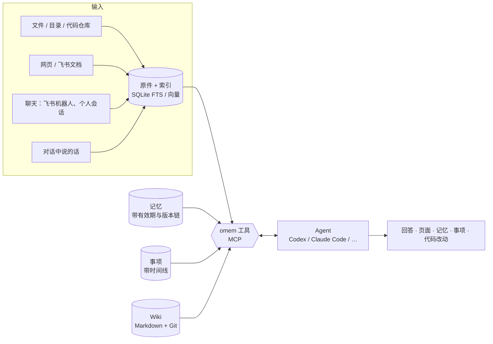

# omem

个人记忆与助理：把文档、代码、聊天、笔记放进同一个知识库，带依据地回答问题，记住约定并在被纠正时更新，持续跟进事项，还能把编码任务交给其他 Agent 并保留检查与评审结果。

> v2 是一次精简重写（2026-10）。v1 的代码与文档在 Git 历史和 `docs/archive/v1/` 中；设计取舍见 [docs/v2/architecture.md](docs/v2/architecture.md)，评测见 [evaluation.md](docs/v2/evaluation.md)，验收步骤见 [acceptance.md](docs/v2/acceptance.md)。

## 它怎么工作



- **空间**把领域分开，检索默认在当前空间，主助手可显式检索所有可访问空间；Wiki 用 `[[space:slug]]` 跨空间关联。一个空间可同时放项目文档、讨论和代码，但只关联一个仓库；多个仓库分别建空间。本人可在主助手对话中创建空间、关联本地仓库或接入 Git 链接。
- **原件**是依据，只保留最新版；聊天按追加保存。**Wiki、记忆、事项**是派生知识，都引用原件。
- **原件页**：普通空间按列表展示；代码仓库空间在文件较多时按目录展示，网址和会话标识保留为独立原件。
- 理解和写作由你已安装的 **Agent** 完成（通过 ACP 或命令行），它们用 omem 的 MCP 工具检索、阅读、写入，同时保有自己的文件与搜索能力。omem 负责存储、索引、调度和权限，不自带模型。
- **Wiki** 是 Markdown 文件，整个知识库目录是一个 Git 仓库，每次修改都有历史和差异。
- **记忆**被更正时不覆盖：旧版本标记为“已被更正”并链接到新版本，所以“之前怎么约定的”和“现在是什么”都能回答。
- **记忆质量不靠人工逐条看**：写入前有规则检查（免责式、超长、转述原件、事件复述、无来源、重复的会被退回并告诉模型怎么改），之后每小时由复核模型盲评保留、改写或撤回；可以再挂几个模型做对比运行，在“记忆 → 质量”里按模型比较。

## 快速开始

需要 Node.js 22.18+（推荐 24），以及至少一个已登录的 Agent。任何支持 [Agent Client Protocol](https://agentclientprotocol.com) 的 Agent 都能用，装在 PATH 里就会被自动识别：

| Agent | 安装 | 配置 id |
| --- | --- | --- |
| Codex | `npm i -g @agentclientprotocol/codex-acp` | `codex` |
| Claude Code | `npm i -g @agentclientprotocol/claude-agent-acp` | `claude` |
| Gemini CLI | `npm i -g @google/gemini-cli` | `gemini` |
| GitHub Copilot CLI | `npm i -g @github/copilot` | `copilot` |
| Qwen Code | `npm i -g @qwen-code/qwen-code` | `qwen` |
| Cursor Agent | `curl https://cursor.com/install -fsS \| bash` | `cursor` |
| OpenCode | `npm i -g opencode-ai` | `opencode` |
| CodeBuddy Code / Qoder / iFlow | `npm i -g @tencent-ai/codebuddy-code` / `@qoder-ai/qodercli` / `@iflow-ai/iflow-cli` | `codebuddy` / `qoder` / `iflow` |
| Kimi CLI / Mistral Vibe | `uv tool install kimi-cli` / `mistral-vibe` | `kimi` / `vibe` |
| goose、Kilo、Auggie、Cline、Factory Droid、Grok、MiniMax、Amp、Junie、Devin、pi、DeepAgents、TraeX | 见 `omem agents --all` | 同名 |
| Claude / Codex 命令行（非 ACP 兜底） | `claude` 或 `codex` 在 PATH 中 | `claude-cli` / `codex-cli` |

`omem agents` 列出已识别的 Agent；`omem agents registry` 列出官方 ACP 注册表里的全部 Agent，`omem agents add <id> [--via npx|uvx|binary]` 一步加入（npm 包可以 npx 运行不安装，独立程序会下载并校验到数据目录）。`omem setup` 和网页“设置 → Agent → ACP 注册表”做同样的事。每个 Agent 第一次用前在终端直接运行一次完成登录；模型和推理强度在“检测模型”里选。

```bash
# 源码运行（osdk 管理 Node/pnpm 与模型）
osdk install && osdk deps --frozen
osdk run dev          # API :4317 + 网页 :5173，数据在 ./.omem

# 或直接用 npm/pnpm
pnpm install
pnpm run build && pnpm start      # http://127.0.0.1:4317，数据在 ~/.omem
npm install -g .                  # 可选：把命令行 omem 链接到这个仓库
```

第一次使用先运行 `omem setup`（或 `osdk run cli -- setup`）：交互式选择 Agent 后端与模型、向量模型（经 osdk 下载并锁定）、PDF/DOCX 解析（Docling 及其模型）、飞书 / Telegram / QQ·微信渠道、注入标记、会话与并发、定时任务。每一项都会先显示本机已安装什么、各选项的代价；缺的 uv、llama.cpp 和模型经 osdk 装好（不用把 osdk 的 shims 加进 PATH）。最后可以直接启动后台服务。

**后台服务**：`omem service start | stop | restart | status | logs`。用 omem 自带的 PM2 常驻运行（PM2 数据放在 `~/.omem/service/pm2`，不碰你自己的 PM2），崩溃自动重启，日志在 `~/.omem/service/logs` 按天和大小轮换。`omem service enable` 设置开机自启（macOS 用 LaunchAgent，Linux 用 systemd 用户服务并开启 linger、没有 systemd 时用 crontab `@reboot`，Windows 在“启动”文件夹放一个隐藏窗口的启动脚本，都不需要管理员权限），`omem service disable` 取消；`omem setup` 结束时也会问。自启用的是设置时终端里的 PATH，之后装了新 Agent 或换了 Node 版本再 `enable` 一次。前台调试用 `omem serve`。

**更新**：在源码仓库里 `osdk run upgrade`（或 `node scripts/upgrade.ts`）：拉最新代码、装依赖、构建、`npm install -g .` 链接全局命令；加 `--restart` 顺便重启后台服务，`--no-global` 跳过全局安装。

**监听地址**：默认监听所有网卡（`0.0.0.0`），方便其他设备配对和打开网页；本机的请求不需要令牌，其他机器的请求必须带令牌（配对码或 `omem link` 给的）。只想本机访问，配置里写 `"host": "localhost"`。Windows 第一次启动时防火墙可能会询问是否允许 Node 访问网络。

打开网页后：

1. **设置 → Agent**：确认至少一个 Agent 显示“已安装”，可以按角色指定（问答用快模型，Wiki 与评审用强模型）。默认配置里 Codex 使用 `gpt-6.1-sol`、低 effort。
2. 在主助手对话中说“创建一个项目空间”或“关联这个本地仓库 / Git 链接”，也可在 **设置 → 空间** 新建。Git 链接会尝试克隆到 omem 数据目录下的 `repos/`；已有路径复用空间，关联后导入文件（遵守 `.gitignore`）。私有仓库使用本机已有 Git/SSH 读取权限。
3. **Wiki → 规划并生成 Wiki**：Agent 先调查仓库、规划目录，再逐页写作。
4. **今日 / 问答**：直接提问或交代事情——“记住：周四下午三点和小王同步项目A”“不对，预算改成 120 了”“下周一提醒我交报销单”“帮我盯着项目A的需求变化”。
5. 按 <kbd>Ctrl K</kbd> 搜索或提问，<kbd>Ctrl J</kbd> 保存材料（文本、网址、飞书文档、拖入文件）。

## 日常用途

| 想做的事 | 怎么做 |
| --- | --- |
| 平时随口说的计划、承诺、在等谁回复 | 不用说“记住”：助理回答时会顺手记成记忆或事项，并在回答末尾列出；做梦整理时再复查一遍漏记 |
| 保存文档、笔记、聊天，之后问“之前怎么约定的 / 有什么变化 / 依据在哪” | 保存材料（自动交给助理整理成记忆和事项）→ 问答；回答里的引用可逐层点开到原文行 |
| 读懂一个陌生项目，定位实现、知道怎么改 | 建代码仓库空间 → 生成 Wiki；或直接在问答里问，助理会读代码并给出修改入口。原件页点函数名可看谁调用它、它调用了谁 |
| 关注一个项目或讨论，持续整理需求、责任和下一步 | 在问答里说“关注 X”，或订阅飞书会话；巡检只在有需要你知道的变化时通知 |
| 交办等待、提醒、待办，并在改期或完成后维护同一事项 | 问答里交代，或在“事项”页添加；每个事项都有时间线 |
| 交办编码、看进度、看实际差异与评审结果 | 问答里说“在 xx 仓库实现…”，或 `omem delegate`；在“运行”页看检查输出、diff、评审，确认后应用 |
| 采集消息、筛选关注群、生成简报 | `omem setup` 选择读取方式，或设置 → 渠道 勾选会话（只读）；定时任务里开启采集、巡检和“筛选值得关注的飞书群” |
| 用间隔重复学习（如英语） | 打开材料点“生成卡片”，在“学习”页按 FSRS 复习；或对助理说“我想练英语开会表达，每天 8 张，晚上九点提醒我”建学习目标；聊天里 `/review` 复习；可与 Anki 互相导入导出（制表符文本） |
| 每天早上知道今天该处理什么 | 定时任务开启“简报”，通过站内和机器人推送 |
| 看记忆写得好不好、哪个模型写得好 | “记忆 → 质量”：按模型看写入数、被退回的原因、复核结果；`omem memories stats`。旧记忆可用 `omem memories check` 过一遍检查 |
| 一台机器常驻，在别的电脑上看它、拉它的数据 | 见“多台设备”：`omem peer invite` / `add` 配对，`omem diag`、`omem pull`，`omem link` 在浏览器里打开 |
| 某类事以后都按固定做法办，或交给专门的 Agent | 说“把这个做法记成技能”“建一个负责代码评审的 Agent”；在“Agent”页查看和编辑；`/as 名称 任务` 交给它，结果发回当前会话 |

## 会话

每个网页对话、飞书私聊、群、群里的话题（Telegram 论坛话题同理）各是一个会话，接着上下文继续聊：

- **连续**：回复后 Agent 进程保留一段时间（默认 20 分钟），下一条消息直接进同一个 Agent 会话；释放或重启后用 Agent 自己的会话恢复（Claude Code、Codex 都支持）；都不行时，新会话会拿到本会话的滚动摘要和最近消息，需要细节时自己读原话。
- **独立**：每个会话一次只处理一轮，不同会话并行；对话和后台任务用不同的并发槽，生成 Wiki 不会拖慢回复。几秒内连发的消息合并成一轮。
- **过期**：私聊或整群会话空闲超过 12 小时（`/idle` 可改），下一条消息开始新会话并带上上一段的摘要；`/resume` 回到旧会话。
- **跨会话**：问“上次在 xx 群里怎么说的”时，助理会查找并阅读其他会话；`/link <id>` 把另一个会话的摘要固定为本会话背景。
- **群聊**：被 @ 时，助理能看到群里（或话题里）前面的发言；`/mode topic` 让每个话题独立，`/mode chat` 让整个群共用一个会话。

在任何渠道都可以直接输入命令（不经过模型）：

```
/help                      全部命令
/new [标题]  /resume <id>   开新会话 / 回到旧会话
/status  /stop  /sessions  当前状态 / 停止 / 最近的会话
/link <id>  /summary  /compact   关联会话 / 查看摘要 / 从摘要重开 Agent 会话
/space <id>  /agent <后端>  /as <档案> [任务]   切空间 / 换后端 / 让某个 Agent 档案接管或做一件事
/model [模型] [effort=low|medium|high]   本会话临时换模型/思考强度；`save` 存为该任务默认，`off` 恢复；飞书里直接发 /model 弹配置卡片；模型名不区分大小写和点/连字符（GPT-Sol-6.1 自动匹配 gpt-6.1-sol）
/agents  /skills  /approve agent|skill <名称>
/mode chat|topic  /idle <小时>
/remember <内容>  /todo <事项>  /search <关键词>  /runs
```

## 命令行

```bash
omem serve                                  # 前台启动服务
omem service start                          # 后台常驻（PM2，崩溃自动重启）；stop / restart / status / logs
omem service enable                         # 开机自启（disable 取消）
omem space add omem --path E:\Projects\omem  # 代码仓库空间
omem add notes.md -s personal               # 保存材料（文件/目录/网址/飞书文档，- 读标准输入）
omem search "预算 约定"                      # 检索原件、页面、记忆
omem ask "项目A的预算之前是多少，现在是多少？"  # 让助理调查并回答（会按需记录）
omem wiki plan omem -f "读者是新加入的后端开发"  # 规划并逐页生成 Wiki
omem wiki lint omem                         # 原件变化后修正受影响的页面
omem items / omem todo "交报销单" --remind 2026-10-19T09:00+09:00
omem delegate omem "给 search 加按时间过滤" --check "pnpm test"
omem mcp [--read-only]                      # 把个人库作为 MCP 服务给其他 Agent 用
omem import-v1 path/to/old/omem.db          # 从 v1 导入原件、记忆和事项
omem memories stats|check|prune|rejections  # 记忆质量：按模型统计、用写入检查过一遍旧记忆、撤回不合格的、看被拒绝的写入
omem agents [--all]                         # 查看 Agent 配置与安装状态（--all 含未安装的和安装方式）
omem agents registry                        # 官方 ACP 注册表里的 Agent
omem agents add gemini --via npx            # 加入 Agent（npm 全局 / npx / uvx / 下载程序）
omem user add 小王 --id wang --lark ou_xxx --space team  # 登记同事，见“多人使用”
omem setup                                  # 设置向导（Agent、模型、文档解析、渠道、会话…）
omem setup embeddings --model bge-small-zh  # 只开启向量检索（经 osdk 下载，也可 bge-base-zh / bge-m3）
omem space sync omem --exclude docs/archive # 同步仓库空间并排除路径
omem wiki export omem .repo-review/wiki     # 把 Wiki 导出成仓库里可读的 Markdown
omem hook claude|codex                      # 记录编码 Agent 会话（配在钩子里）
omem peer invite|add|list|call / omem diag   # 多台设备：配对、诊断、远程检查，见“多台设备”
omem link                                   # 从其他设备打开网页的链接（带令牌）
```

数据目录默认 `~/.omem`（`--home` 或 `OMEM_HOME` 可改）：`config.json` 配置，`omem.db` 索引与记录，`library/` 是 Wiki 的 Git 仓库，`files/` 存原始文件，`runs/` 存交办编码的工作区和补丁。

## 给其他 Agent 用

在 Claude Code、Codex 等里把 omem 配成 MCP 服务（`omem mcp`，只读用 `--read-only`），它们就能检索你的知识库、读原文、记记忆和事项。`skills/omem/SKILL.md` 是给这些 Agent 的使用说明（工具清单、写记忆的要求、命令行），可以直接放进它们的技能目录。

## 记录编码 Agent 的会话

把你和 Claude Code / Codex 的工作过程也存进知识库（按工作目录归入对应的代码仓库空间，否则进个人空间）：

- Claude Code：在 `~/.claude/settings.json` 的 `hooks.Stop` 里加命令 `omem hook claude`。
- Codex：在 `~/.codex/config.toml` 里设置 `notify = ["omem", "hook", "codex"]`。

之后可以问“上周让 Claude 改登录流程时是怎么决定的”。

## 飞书

**机器人**（指挥助理、代你回复）：运行 `omem setup` → 渠道 → 飞书机器人。它会先读本机 lark-cli 的应用和登录状态、omem 已保存的应用，然后让你选：

- **继续用 / 绑定已有应用**：已保存凭据的直接校验；没有凭据的扫码授权，omem 拿到凭据并补齐所需权限。
- **创建新机器人**：扫码后在飞书里一步建好应用，开启机器人能力、长连接事件（`im.message.receive_v1` 等）和卡片回调 `card.action.trigger`，并授予消息、卡片、文档、日历、任务等权限（不含群管理和权限修改）。

扫码走官方 SDK 的应用注册流程，事件走 SDK 长连接，不需要公网地址；扫码人的 open_id 自动设为本人，只有你（和 `omem user add` 登记的人）能指挥它。App Secret 存在 `~/.omem/secrets/lark.json`（仅本人可读），配置文件只记 App ID；环境变量 `OMEM_LARK_APP_SECRET` 仍可覆盖。企业租户里新权限可能要管理员审批后才生效。

- 回答时先在你的消息上加“处理中”表情，再发一张进度卡片，实时显示 Agent 的步骤、思考片段和正在写的答案，完成后原地变成答案。
- Agent 可以用机器人回复或开话题回复、加表情、发 Markdown、图片和文件、带按钮/下拉/输入框/表单的卡片，并限定只有某些人能操作；别人点了按钮或提交了表单，会作为新消息回到原来的会话继续处理。用法见内置技能 `lark-messaging`。

**读取你自己的飞书**（lark-cli 个人登录，只读，从不以你的身份发消息）：在 setup 的同一部分选择读取方式；lark-cli 未登录或登录过期时会直接发起扫码登录（lark-cli 还没有应用时可以用机器人应用），并可顺手开启每 10 分钟的采集。

- 消息：可选“所有有新消息的会话”或“只读订阅的会话 + @我”。每个群或私聊存成一份聊天原件，第一次往前读 72 小时，之后每次只拉上次之后的新消息，包括话题里的回复；回复别人的消息会带上被引用的那句；图片、文件会下载保存；飞书文档链接会读成原件。
- 更早的历史：新会话里按“保存并整理”处理的（单聊、订阅的群）默认再往前补 30 天；任何会话都可以在原件页点“回溯历史”或对助理说“把这个群最近三个月的记录也读进来”。历史每次采集读几页，按月存成“群名（2026-09 历史）”原件，只保存可检索，不触发整理（除非要求）。
- 原件页把聊天显示成聊天：发送人、时间、被引用的消息、话题、换行和 Markdown、图片、文件、卡片；长聊天只渲染屏幕附近的部分。
- 日程（前一天到未来一周）和妙记（总结、待办、逐字稿）也会读进来。
- 会话分成单聊（人）、机器人单聊、普通群、话题群，加上免打扰状态。每类可以设成“保存并整理”“与我有关时整理”（你发言、被 @ 或参与的话题有新消息时才整理）“只保存”“不读取”，默认分别是：单聊整理、机器人单聊只保存、群和话题群与我有关时整理、免打扰不读。单个会话可以在 设置 → 渠道 里单独改，订阅的会话按“保存并整理”。omem 机器人自己的私聊和它在群里发的消息不会被采集。
- 要整理的新内容交给助理，整理成记忆和事项。

**监听群**（报警群、oncall 群…）：先建一个处理它的 Agent 档案（怎么处理、用哪些技能和工具），再在群里发 `/watch 档案名 [all|mention|keyword:正则] [none|draft|auto]`，或对助理说“报警群的 P0/P1 告警交给 alert-handler，回复前先给我看”。

- `none` 只处理不回复；`draft` 回复先变成草稿卡片发给你，你点“发送”才发出；`auto` 直接用机器人回复（机器人需在群里）。
- 每个群（或话题）是处理 Agent 的一个连续会话，每条消息只处理一次；机器人在群里时实时处理，不在时随采集处理。

## Telegram 与 QQ / 微信

`omem setup` 的渠道部分开启。Telegram 的机器人 token 放在环境变量 `OMEM_TELEGRAM_TOKEN`，再填你的 chat id，私聊、群、论坛话题与飞书一样各是一个会话；QQ / 微信经 OneBot v11 兼容桥（NapCat、LLOneBot 等）接入，没有话题，每个私聊或群一个会话。命令与飞书相同。

## 多人使用

omem 默认只服务你自己。要给同事用：

```bash
omem user add 小王 --id wang --lark ou_xxx --space team   # 建用户、绑定飞书身份、可读 team 空间（--edit 可写）
omem user token wang                                # 给他发一个 API 令牌（只显示一次）
omem space share project-a wang [--edit]           # 再开放一个空间
```

他私聊机器人时，会话进他自己的个人空间，只能检索自己和被共享的空间；`/whoami` 显示他能访问什么。事项和偏好各归各的。这是“留口子”级别的支持：同一台机器、同一个数据目录，不做多租户隔离。

## 多台设备

常见用法是一台机器常驻运行（采集、定时任务），其他机器拉它的数据、看它的状态、让它执行检查。机器之间不必能直接访问：可以经中间那台转发。

```bash
# 常驻那台（默认就监听所有网卡；不是本机的请求没有令牌一律拒绝）
omem peer invite --label laptop           # 打印一行配对码（omem1.…），含本机所有网卡地址；服务不必正在运行

# 另一台
omem peer add <配对码>                    # 直接能访问到
omem peer add <配对码> --via <中间那台>     # 只能经中间那台访问（中间那台先和它配对）
omem peer list
omem peer name laptop                     # 改本机在同伴中的名字（默认主机名，存为配置 node.id）
omem peer url <同伴> http://<新地址>:4317   # 对方换了地址、码里的地址都连不上时（不用重新配对）
omem diag <同伴>                          # 版本、数量、最近失败、飞书采集状态、Agent
omem peer commands <同伴>                 # 可远程执行的命令
omem peer call <同伴> lark-raw '{"command":"+chat-messages-list","chat_id":"oc_…"}'
omem peer call <同伴> sql '{"query":"select count(*) from lark_messages"}'   # 只读
omem peer call <同伴> update               # git pull --ff-only、安装依赖、构建、重启服务
omem pull <同伴>                          # 经 HTTP 拉一份快照合并进本机
```

同伴的名字是对方配置里的 `node.id`（`omem peer name` 查看或设置），没配就是它的主机名；最好在配对之前起好名字，之后改名的话对方那边仍记着旧名字。配对码里是对方的所有可能地址和一个为本人生成的 API 令牌（标签 `peer:<名字>`）；`add` 留下能连上的地址，之后正在用的地址连不上时会自动换码里的其他地址，所以断线、重启、换网后不用重新配对。`omem user revoke owner peer:<名字>` 撤销令牌即解除配对；配对信息存在 `secrets/peers.json`，令牌用 `omem user tokens` 查看。远程命令是固定的一组（诊断、日志、配置、飞书只读查询、手动采集与回溯、记忆统计、运行记录、只读 SQL、git 与更新、重启），没有任意 shell。本机打开网页不需要令牌；从别的机器打开时运行 `omem link`，它打印带新令牌的链接（每个网卡地址一个），打开一次后令牌存在那个浏览器里；也可以在页面提示时粘贴 `omem user token owner` 生成的令牌。

`scripts/relay.mjs` 是一个临时的白名单转发：在只能 ssh 到其他机器的那台上运行（不配置时只有本机目标 `local`，经已配对的同伴执行 `omem peer call` / `omem diag`），往 `.remote/relay/inbox/` 放请求文件，它经 ssh 执行允许的命令（omem 子命令、git/pnpm 的检查与更新、lark-cli 只读查询、本机 API 的 GET、几个系统信息命令）并把结果写到 `outbox/`。目标机器在 `.remote/relay/config.json` 里配置，详见脚本开头的说明。

## 开发

```bash
pnpm run dev          # node --watch 运行 API，Vite 运行网页
pnpm run check        # 类型检查 + 测试 + 构建
node scripts/screens.ts http://127.0.0.1:5173 screens   # 桌面与手机截图
node scripts/eval-retrieval.ts corpus.jsonl queries.jsonl [--vector]
```

代码结构：

```
src/core      配置、SQLite、空间、用户与令牌、Git、调度、通知、后台服务、多台设备（peers、peer-exec、pull）
src/sources   导入、切分（Markdown 章节 / 代码符号 / 聊天窗口）、调用图、代码活动、注入标记
src/search    分词（中文双字 + 标识符拆分）、FTS、向量（按空间 int8 矩阵）、RRF 融合
src/memory    记忆（有效期、版本链、写入检查与复核统计）
src/items     事项（时间线）
src/wiki      页面文件、链接与引用索引、过期检测
src/learn     FSRS 卡片、学习目标
src/agents    ACP/CLI 运行与 Agent 目录（catalog.ts）、MCP 工具、角色、会话与命令、档案与技能、后台任务、交办编码
src/channels  飞书机器人（发送、卡片、进度、回调、监听群）、飞书个人采集（lark-cli，消息结构化与历史回溯）、Telegram、OneBot
src/setup.ts  omem setup 交互式向导
roles/        各角色的工作说明（问答、整理、Wiki 规划/写作/检查、巡检、简报、做梦、筛群、摘要、编码、评审、记忆复核、出卡），共同部分在 _common.md
skills/omem     给外部 Agent 的 omem 使用说明（配合 omem mcp）
skills/library  内置技能（如 lark-messaging），首次启动播种到 library/_skills
.agents/skills  在本仓库开发时给编码 Agent 的技能（网页设计约定、osdk、中文表达检查）
scripts/      脚本：更新（upgrade.ts）、截图、检索与记忆评测、规模测试、临时转发（relay.mjs）
web/          Vue 3 网页
```

角色说明在 `roles/*.md`，改它们就能调整 Agent 的工作方式，不需要改代码。

## 当前限制

- 多人只到“留口子”：用户、身份、空间成员和令牌，不做多租户隔离。
- 默认监听所有网卡，其他机器必须带令牌（配对或 `omem link`）；在同一台机器上用反向代理对外暴露时，经代理来的请求看起来来自本机，这种情况要配置 `token`。多台设备是“一台常驻写入、其他来看”，还没有双向持续同步。
- 除 Claude Code、OpenCode 外，其他 ACP Agent 只验证过连接握手；各家登录和模型名以实际“检测模型”结果为准。
- 代码解析：TS/JS/JSX/TSX/Vue 用 TypeScript AST；Python 用导入与缩进分析；Go、Rust、Java、Kotlin、Swift、C、C++、Objective-C、C#、PHP、Ruby、Scala、Dart、Lua、Zig、Elixir、OCaml、ReScript、Solidity、Bash、Emacs Lisp 用 tree-sitter（WebAssembly，无需编译，按需加载语法）；其他语言（Haskell、Erlang、Clojure、Elm…）只做通用声明识别。
- 跨文件调用解析到具体定义：TS/JS/Python 按导入；Go 按包（同目录与导入路径）；Rust 按 `use` 路径、`mod` 和工作区 crate；Java/Kotlin 按包、导入和静态导入（两者互通）；Swift 按整个模块；其余 tree-sitter 语言先看本类型、本文件和导入的文件（`#include`、`require`、`import … as`、`open`），再在同一语言里找唯一的同名定义，有多个同名就不连。对变量调用方法（`db.open()`）需要类型推断，和动态派发、第三方包一样只有名称级候选。
- 扫描版 PDF 需要 OCR，当前只解析文字 PDF / DOCX（Docling、pdftotext 或 pandoc 任一可用即可）。
- 微信只能通过 OneBot 兼容桥接入，没有话题概念，每个私聊或群是一个会话。

本仓库的 Wiki（由 omem 生成）在 [.repo-review/wiki](.repo-review/wiki/index.md)。它主体生成于 2026-10-13，之后的改动列在 [changes-since-2026-10-13](.repo-review/wiki/reference/changes-since-2026-10-13.md)；建仓库空间后 `omem wiki lint omem` 会按改动更新受影响的页面，再 `omem wiki export omem .repo-review/wiki` 导出。
