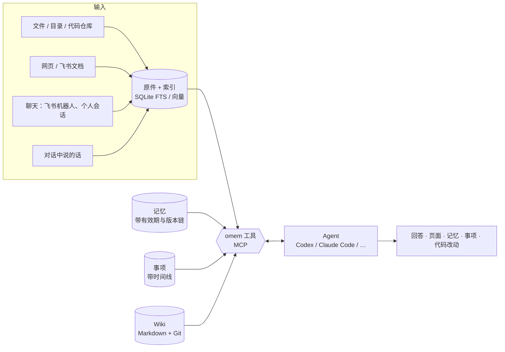

# omem

个人记忆与助理：把文档、代码、聊天、笔记放进同一个知识库，带依据地回答问题，记住约定并在被纠正时更新，持续跟进事项，还能把编码任务交给其他 Agent 并保留检查与评审结果。

> v2 是一次精简重写（2026-10）。v1 的代码与文档在 Git 历史和 `docs/archive/v1/` 中；设计取舍见 [docs/v2/architecture.md](docs/v2/architecture.md)，评测见 [evaluation.md](docs/v2/evaluation.md)，验收步骤见 [acceptance.md](docs/v2/acceptance.md)。

## 它怎么工作



- **空间**把领域分开：个人、项目、代码仓库、学习主题各自一个空间，检索默认不跨空间。
- **原件**是依据，只保留最新版；聊天按追加保存。**Wiki、记忆、事项**是派生知识，都引用原件。
- 理解和写作由你已安装的 **Agent** 完成（通过 ACP 或命令行），它们用 omem 的 MCP 工具检索、阅读、写入，同时保有自己的文件与搜索能力。omem 负责存储、索引、调度和权限，不自带模型。
- **Wiki** 是 Markdown 文件，整个知识库目录是一个 Git 仓库，每次修改都有历史和差异。
- **记忆**被更正时不覆盖：旧版本标记为“已被更正”并链接到新版本，所以“之前怎么约定的”和“现在是什么”都能回答。

## 快速开始

需要 Node.js 22.18+（推荐 24），以及至少一个已登录的 Agent：

| Agent | 安装 | omem 配置 id |
| --- | --- | --- |
| Codex（ACP） | `npm i -g @agentclientprotocol/codex-acp`，并登录 codex | `codex` |
| Claude Code（ACP） | `npm i -g @agentclientprotocol/claude-agent-acp`，并登录 claude | `claude` |
| TraeX（ACP） | 已安装 `traex` | `traex` |
| Claude / Codex 命令行 | `claude` 或 `codex` 在 PATH 中 | `claude-cli` / `codex-cli` |

```bash
# 源码运行（osdk 管理 Node/pnpm 与模型）
osdk install && osdk deps --frozen
osdk run dev          # API :4317 + 网页 :5173，数据在 ./.omem

# 或直接用 npm/pnpm
pnpm install
pnpm run build && pnpm start      # http://127.0.0.1:4317，数据在 ~/.omem
```

打开网页后：

1. **设置 → Agent**：确认至少一个 Agent 显示“已安装”，可以按角色指定（问答用快模型，Wiki 与评审用强模型）。默认配置里 Codex 使用 `gpt-6.1-sol`、低 effort。
2. **设置 → 空间**：新建一个代码仓库空间并填写本地路径，omem 会导入文本文件（遵守 `.gitignore`）。
3. **Wiki → 规划并生成 Wiki**：Agent 先调查仓库、规划目录，再逐页写作。
4. **今日 / 问答**：直接提问或交代事情——“记住：周四下午三点和小王同步项目A”“不对，预算改成 120 了”“下周一提醒我交报销单”“帮我盯着项目A的需求变化”。
5. 按 <kbd>Ctrl K</kbd> 搜索或提问，<kbd>Ctrl J</kbd> 保存材料（文本、网址、飞书文档、拖入文件）。

## 日常用途

| 想做的事 | 怎么做 |
| --- | --- |
| 保存文档、笔记、聊天，之后问“之前怎么约定的 / 有什么变化 / 依据在哪” | 保存材料（自动交给助理整理成记忆和事项）→ 问答；回答里的引用可逐层点开到原文行 |
| 读懂一个陌生项目，定位实现、知道怎么改 | 建代码仓库空间 → 生成 Wiki；或直接在问答里问，助理会读代码并给出修改入口 |
| 关注一个项目或讨论，持续整理需求、责任和下一步 | 在问答里说“关注 X”，或订阅飞书会话；巡检只在有需要你知道的变化时通知 |
| 交办等待、提醒、待办，并在改期或完成后维护同一事项 | 问答里交代，或在“事项”页添加；每个事项都有时间线 |
| 交办编码、看进度、看实际差异与评审结果 | 问答里说“在 xx 仓库实现…”，或 `omem delegate`；在“运行”页看检查输出、diff、评审，确认后应用 |
| 采集消息、筛选关注群、生成简报 | 设置 → 飞书：订阅会话（只读）；定时任务里开启采集与巡检 |
| 用间隔重复学习（如英语） | 打开材料点“生成卡片”，在“学习”页按 FSRS 复习；可与 Anki 互相导入导出（制表符文本） |
| 每天早上知道今天该处理什么 | 定时任务开启“简报”，通过站内和机器人推送 |

## 命令行

```bash
omem serve                                  # 启动服务
omem space add omem --path E:\Projects\omem  # 代码仓库空间
omem add notes.md -s personal               # 保存材料（文件/目录/网址/飞书文档，- 读标准输入）
omem search "预算 约定"                      # 检索原件、页面、记忆
omem ask "项目A的预算之前是多少，现在是多少？"  # 让助理调查并回答（会按需记录）
omem wiki plan omem -f "读者是新加入的后端开发"  # 规划并逐页生成 Wiki
omem wiki lint omem                         # 原件变化后修正受影响的页面
omem items / omem todo "交报销单" --remind 2026-10-19T09:00+09:00
omem delegate omem "给 search 加按时间过滤" --check "pnpm test"
omem mcp [--read-only]                      # 把个人库作为 MCP 服务给其他 Agent 用
omem import-v1 path/to/old/omem.db          # 从 v1 导入原件、记忆和事项
omem agents                                 # 查看 Agent 配置与安装状态
omem setup embeddings                       # 开启本地中文向量检索（推荐）
omem hook claude|codex                      # 记录编码 Agent 会话（配在钩子里）
```

数据目录默认 `~/.omem`（`--home` 或 `OMEM_HOME` 可改）：`config.json` 配置，`omem.db` 索引与记录，`library/` 是 Wiki 的 Git 仓库，`files/` 存原始文件，`runs/` 存交办编码的工作区和补丁。

## 记录编码 Agent 的会话

把你和 Claude Code / Codex 的工作过程也存进知识库（按工作目录归入对应的代码仓库空间，否则进个人空间）：

- Claude Code：在 `~/.claude/settings.json` 的 `hooks.Stop` 里加命令 `omem hook claude`。
- Codex：在 `~/.codex/config.toml` 里设置 `notify = ["omem", "hook", "codex"]`。

之后可以问“上周让 Claude 改登录流程时是怎么决定的”。

## 飞书

- **机器人**（日常指挥）：设置 → 飞书，填写 App ID，App Secret 放在环境变量 `OMEM_LARK_APP_SECRET`。首次私聊机器人会告诉你自己的 open_id，填入后只有你能指挥它。群里的消息会作为聊天原件保存并交给助理整理。
- **个人消息**（只读）：用本机 `lark-cli` 的个人登录，订阅选中的会话，另外收集任意群里 @你 的消息。飞书文档链接可直接保存为原件。

## 开发

```bash
pnpm run dev          # node --watch 运行 API，Vite 运行网页
pnpm run check        # 类型检查 + 测试 + 构建
node scripts/screens.ts http://127.0.0.1:5173 screens   # 桌面与手机截图
node scripts/eval-retrieval.ts corpus.jsonl queries.jsonl [--vector]
```

代码结构：

```
src/core      配置、SQLite、空间、Git、调度、通知
src/sources   导入、切分（Markdown 章节 / 代码符号 / 聊天窗口）、原件存储
src/search    分词（中文双字 + 标识符拆分）、FTS、向量、RRF 融合
src/memory    记忆（有效期、版本链）
src/items     事项（时间线）
src/wiki      页面文件、链接与引用索引、过期检测
src/learn     FSRS 卡片
src/agents    ACP/CLI 运行、MCP 工具、角色、后台任务、交办编码
src/channels  飞书机器人、个人消息、飞书文档
roles/        各角色的工作说明（问答、整理、规划、写作、巡检、做梦、编码、评审、出卡）
web/          Vue 3 网页
```

角色说明在 `roles/*.md`，改它们就能调整 Agent 的工作方式，不需要改代码。

## 当前限制

- 单用户；HTTP 只监听本机，远程访问需配置 `token`。
- 代码解析：TS/JS/Vue 用 TypeScript AST，其他语言用通用声明识别；调用关系是名称级匹配。
- 扫描版 PDF 需要 OCR，当前只解析文字 PDF / DOCX（Docling、pdftotext 或 pandoc 任一可用即可）。
- 微信、QQ、Telegram 渠道还没有接入（通知与消息入口已抽象，可按飞书的方式扩展）。
