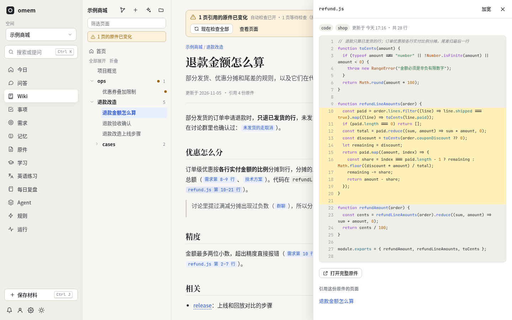
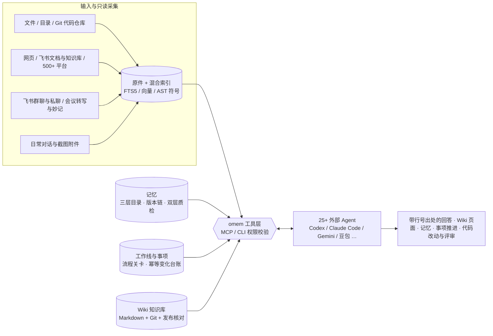

# omem

**住在飞书里、凡事有出处的个人与团队助理**：把散落在各处的聊天消息、云文档、会议妙记和代码仓库收进同一个本地知识库。它不自带也不绑定大模型，直接调度你已安装的 Claude Code、Codex、Gemini CLI、豆包等 25+ 种 Agent——每句回答都能点回原文行，记住约定并在被纠正时保留版本链，围绕工作线持续把事项推进到收尾，交办编码则由六个维度的独立评审交叉把关。

**文档站**：<https://lejunyang.github.io/omem/>（完整功能介绍、安装与日常指南，源码位于 [site/](site/)）


## 重点功能与差异化特色

| 特色能力 | 它解决什么问题、怎么做到 | 详细文档 |
| --- | --- | --- |
| **1. 文档、群聊、代码同一上下文，行级精确溯源** | 真实工作里的口径往往分散在最初的需求文档、群里后来的改口和实际代码分支里。omem 把它们统一存为只读**原件**，按**空间**隔离项目；代码按 AST 符号切分并建调用图。每次回答、每页 Wiki、每条记忆都贴着 `src:<id>#L起-L止` 行号引用，点击直接在侧栏高亮原话或代码行；发到飞书的内部引用自动生成免登录、只暴露被引用几行的**只读分享快照**。 | [原件与空间](site/features/sources.md) · [问答](site/features/ask.md) |
| **2. 工作线与事项流程闭环推进** | 不只是被动问答。几周推进的大事建成**工作线**，一屏看清“截至今天”的现状、最近关键变化点线（改期、决定、风险、结果，各带出处）和建议的下一步；**“需求到交付”**四栏把需求点、研究发现、技术方案与编码交办/PR 联动对齐。事项可按**流程阶段**推进——你在群里拍了板或推了代码，助手核实依据后自动过关；每天早上一张**“今天”**卡片集中处理待办与提议，上线观察期满自动写小结收尾。 | [工作线](site/features/work-lines.md) · [事项与流程](site/features/items.md) |
| **3. 飞书双身份原生协同** | 用**你本人的身份**（`lark-cli`）默认只读采集群聊、私聊、云文档（含内嵌图片、画板、表格本地化）、知识库目录树、日程与妙记；用**机器人的身份**展示原生思考气泡，发提问、表单、图表、方案确认与评审卡片。内置**“有人找你”**（先免费过滤、小模型分诊、主助手查清背景并附回复草稿）、**按问题盯群（关注）**、**会议旁听与实时查库**，以及未登记同事 `@` 时的**访客把关模式**。 | [飞书概览](site/features/lark.md) · [群里的协作](site/features/lark-groups.md) · [会议](site/features/lark-meetings.md) |
| **4. 云端交办编码，六维独立评审** | 把编码交给常驻机器上的独立 Git worktree 工作区池（保留 `node_modules` 免重复装依赖）：先查影响面与可复用实现、大改动先确认结构化**技术方案**，再拆成**修改项（`T1`、`T2`…）**逐项提交并收集截图/报告产物。写完由**功能、精简、业务、架构、历史、规范**六个角色（默认尽量换别家模型）独立审查，谁提的问题谁验收，改坏自动回退。评审自动把需求拆成**变更点**高亮跳转代码；浏览器一键打开**网页版 VS Code** 或按原端口号转发本地预览。 | [云端编码](site/features/coding.md) · [交办与评审](site/features/review.md) · [VS Code 与预览](site/features/ide.md) |
| **5. 活的 Git Wiki 与版本化自检记忆** | **Wiki** 按读者问题先规划目录再跨代码与文档写作，整个知识库是 Git 仓库；写完必须过 `wiki-checker` 逐条核对才发布，原件变了自动巡检更新，你指出一处错误会顺手排查近 90 天同类页面。**记忆**按三层目录归档，被纠正时用 `supersede` 保留版本演变链（过去和现在都能答）；写入前过确定性规则拦截、写入后每小时由独立模型盲评复核，夜里通过**“做梦”**和 **A/B 回放盲评（`replay-judge`）**自动淘洗记忆并试用新技能草稿。 | [Wiki](site/features/wiki.md) · [记忆](site/features/memory.md) · [学习与进步](site/features/learning.md) |
| **6. 开放 Agent 调度、一句话规则与插件生态** | 宿主不绑模型，内置约 **30 个专职角色**，支持按任务类别设 AI 规则、实时监控多账号套餐额度自动避让、绑定 TUN/代理网络出口、配置命令/HTTP 操作审批与 Linux `bubblewrap` 沙箱。用一句话写**规则**（配合只读预查脚本与 90 秒快模型快速通道）；用浏览器扩展或远程桌面**做一遍操作就能录成技能**；支持零代码**插件**、一键分享**场景包**（内置[英语练习](site/features/english.md)与 500+ 平台连接器），以及多设备配对组网与团队多人隔离协作。 | [Agent 与技能](site/features/agents.md) · [规则](site/features/rules.md) · [插件](site/features/plugins.md) · [多设备与多人](site/features/devices.md) |




## 基本原理

omem 的核心设计原则是：**宿主只做数据、索引、调度和权限边界；理解、调查和写作交给你已安装的强 Agent。**



1. **统一原件与空间隔离**：文档、代码、聊天、网页、日程、妙记全部作为只读**原件（Sources）**入库，文档与代码只保留最新版（代码默认按远端基线分支建索引，分支与交办工作区按需建叠加索引），聊天按追加保存。不同领域通过**空间（Spaces）**隔离，业务空间可挂载多个代码仓库，关联的**相关空间**在检索时自动联查。
2. **三路混合检索 + 交叉编码器重排**：检索同时融合 **SQLite FTS5 全文**（中文双字分词 + 代码驼峰/下划线标识符拆分）、**向量语义**（本地 `bge` `int8` 量化矩阵或云端/插件向量接口）与**代码符号精确匹配**，经 RRF 融合后可选由本地 `bge-reranker-v2-m3`（或云端重排）对前 20 条候选对读打分（在 T2Retrieval 中文集上将 `nDCG@10` 从 `86.6` 提升至 `91.6`）。原件支持四档**关注程度**与**行级段落标注**（过时/有误/关键），标注经独立模型复核后按重叠比例动态调整检索权重。
3. **派生知识全部指回原件，幂等台账防重复**：
   - **Wiki** 存在 `library/` Git 仓库中，所有事实均以 `[文字](src:<原件id>#L起-L止)` 锚定原件行；原件变更稳定 30 分钟后自动触发 `wiki-linter` 巡检更新。
   - **记忆** 存储在 SQLite 中，带有 `valid_from / valid_to / superseded_by` 版本链；开启向量与重排后，每轮对话和任务启动前自动挂载最相关的最多 5 条记忆及角色专属经验。
   - **工作线与事项** 通过底层的**幂等变化台账（`item_changes`）**汇总来自采集、规则、有人找你、群关注和会议的多路信号——同一变化只记一次，回复责任按“当场 `@` → 规则 → 关注 → 有人找你”有序礼让，后台多路运行通过**态势感知（Awareness）**互知进展，你一旦亲自插手发言，后台运行在发出前会自动复核或静默让开。
4. **工具层硬权限隔离**：omem 通过 ACP（Agent Client Protocol）或命令行启动 Agent，将约 100 个工具按分组封装为 MCP 服务（常驻仅暴露约 20 个核心工具，其余经 `omem_help` / `omem_call` 按需展开，不挤占上下文）。**模型没有直接写数据库的权限**——每次读写都由工具层严格校验当前用户、可访问空间与角色权限，并完整记录在运行（`Run`）与安全审计日志中。

> 架构演进与设计细节见 [docs/v2/architecture.md](docs/v2/architecture.md)，检索与记忆评测见 [docs/v2/evaluation.md](docs/v2/evaluation.md)，实现状态与验收见 [docs/v2/status.md](docs/v2/status.md) 与 [docs/v2/acceptance.md](docs/v2/acceptance.md)。

## 快速开始

需要 **Node.js 22.18+**（推荐 24），以及至少一个已安装并登录的 ACP / CLI Agent（如 Codex、Claude Code、Gemini CLI、Antigravity、Copilot、Qwen、OpenCode、Cursor、豆包 CLI 等，详见 [安装指南](site/guide/getting-started.md)），或者在网页中配置 OpenAI / Anthropic / 火山方舟等 API Key。

```bash
# 方式 1：从 npm 安装发布版（推荐）
npm install -g @omem-ai/app

# 方式 2：从源码运行（pnpm workspace 或 osdk）
pnpm install && pnpm run build
npm install -g .                  # 可选：链接全局 omem 命令
# 若使用 osdk 管理工具链与本地模型：osdk install && osdk deps --frozen && osdk run dev

# 方式 3：仅连接远程 omem 服务的轻量客户端（单文件、零依赖）
npm install -g @omem-ai/cli
```

首次使用运行交互式设置向导，随后启动后台常驻服务：

```bash
omem setup                        # 交互式配置 Agent、可选向量/重排模型、文档解析、飞书渠道与定时任务
omem service start                # 后台常驻运行（自带独立 PM2，崩溃自动重启）；前台调试用 omem serve
omem service enable               # 设置开机自启
```

浏览器打开 `http://127.0.0.1:4317` 后：
1. 在 **设置 → 后端与模型** 确认 Agent 已就绪（也可添加 API Key 或配置 AI 组与选型规则）。
2. 在问答里说“创建一个项目空间”或“关联这个本地仓库 / Git 链接”（或在 **设置 → 空间** 新建）。
3. 在 **Wiki** 页点“规划并生成 Wiki”，或在 **工作 / 问答** 页直接提问、交代待办、交办编码任务。
4. 按 <kbd>Ctrl K</kbd> 全局搜索或提问，按 <kbd>Ctrl J</kbd> 保存材料；运行 `omem mcp` 可将个人知识库作为 MCP 服务接入你终端里的 Claude Code 或 Codex。

完整的命令行清单请参考 [命令行文档](site/guide/cli.md)。

## 代码结构与开发

```bash
pnpm run dev                      # 开发模式：node --watch 运行 API (:4317)，Vite 运行网页 (:5173)
pnpm run check                    # 类型检查 + 测试 + 构建
pnpm --filter omem-docs run dev   # 启动 VitePress 文档站
```

```text
src/core        配置、SQLite 数据库、空间、用户与令牌、只读分享、Git、调度、通知、多设备组网与快照合并 (peers/pull/mesh)、端口转发
src/sources     原件导入与解析、目录树 (catalog)、关注程度与标注复核 (attention)、归档规则与个人空间归位 (archive/homing)、AST 切分、调用图、代码基线索引
src/search      中文双字与标识符分词、FTS5、按空间 int8 向量矩阵、RRF 融合、交叉编码器重排 (rerank)
src/memory      记忆存储、三层目录树、版本链 (supersede)、写入前确定性检查与独立模型盲评 (quality)、被动召回
src/items       事项、工作线 (现状、关键变化幂等台账 changes、观察期与自动收尾 lifecycle、今日卡片 today、需求到交付链路 chain)、需求树与测试点
src/flows       事项流程引擎：YAML 定义、阶段推进、外部对象轮询与动作、耗时回顾与定义优化建议
src/studies     持续探索研究流程：功能清单、探索方向、独立副本与跨设备试验 (trials/remote)、复现发现与交办修复
src/designs     技术方案：结构化决定 (新增/修改/删除/重构)、评估他人方案、按决定归集分支代码改动
src/wiki        统一规划与逐页生成、链接与引用索引、原件变更巡检 (upkeep)、写入检查与发布前核对 (checks/verify)、未决问题与本人指正排查
src/quality     每晚自动抽检 AI 写入的 Wiki 页面与原件定级，按运行类型统计与动态加严
src/agents      ACP/CLI 运行时、25+ Agent 目录、30+ 内置角色调度、MCP 工具集、会话与后台池、重启保持 (restartHold)、工作区池与编码交办循环 (code-loop)、夜间回放盲评 (replay)、工作近况与人物卡 (work-state)、态势感知 (awareness)、网络出口策略与 Linux 沙箱 (sandbox/egress)
src/rules       一句话规则编译、条件匹配、动作执行、只读预查脚本库 (probes) 与 90 秒快速通道 (first-look)
src/mentions    有人找你：免费预筛、小模型分诊、主助手协查、回复草稿与自动升降档 (reply-ladder)、学习本人回复风格
src/channels    飞书机器人 (进度卡、思考气泡、交互卡片、群关注 listen、多机器人转交、访客把关)、飞书个人只读采集 (lark-cli 消息、文档本地化、知识库发现 kb-scout、会议旁听)、Telegram、OneBot
src/remote      桌面与浏览器远程控制 (aad 进程管理、画面流转发、操作录制与跨端演示提炼技能、接口审批规则提取、成员会话临时授权)
src/plugins     插件加载与信任、零代码内容块 (表单/图表)、场景包导出导入、平台连接器、外部事件 Webhook、检索/流程/UI 插槽扩展
src/auth        多用户登录 (飞书/连接器/鉴权插件)、全局与空间角色、20+ 细粒度能力矩阵、凭据保险箱 (vault) 与出借
src/insights    数据页：业务观测指标与多图报表、omem 自身运行统计与明细下钻抽屉、回答效果回扫
src/learn       FSRS 间隔重复记忆卡与学习目标
roles/          30+ 内置角色的工作说明 Markdown（共同约定在 _common.md）
skills/         omem 工具分组说明 (skills/omem/) 与首次启动播种的内置技能库 (skills/library/)
plugins/        内置插件（english 英语练习与口语陪练、connect 500+ 平台连接器及 8 大深度平台包）
packages/       @omem-ai/cli 轻量远程命令行客户端、@omem-ai/plugin-sdk 插件开发 SDK
vscode/         VS Code 插件（omem-vscode，代码行内处理评审、按修改项与方案决定看 diff）
chrome/         Chrome 扩展（omem-chrome，UI 拾取走查、网页操作录制与演示、免 CDP 提示条的网络调试与 Mock）
web/            Vue 3 + TypeScript 前端网页
site/           VitePress 文档站
```
