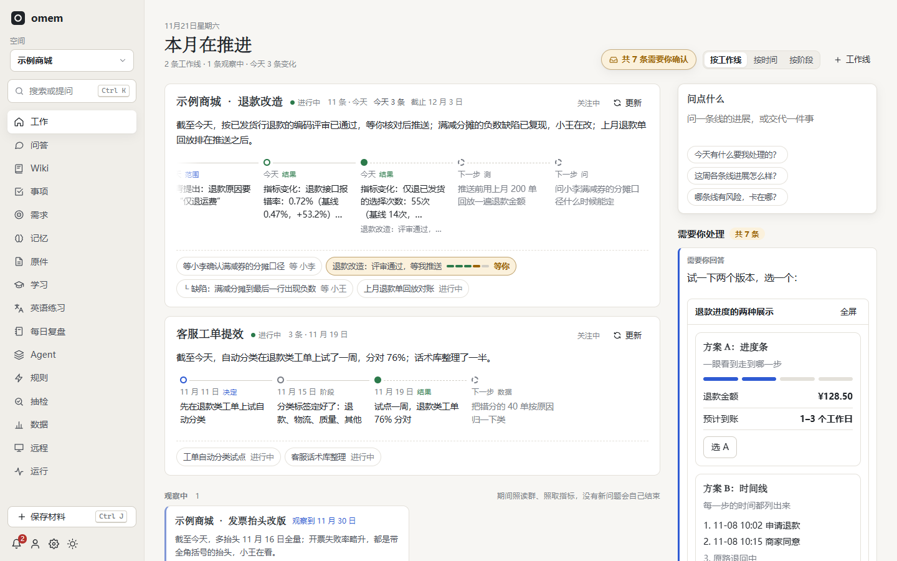
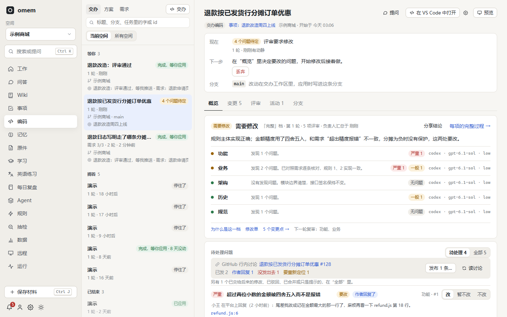
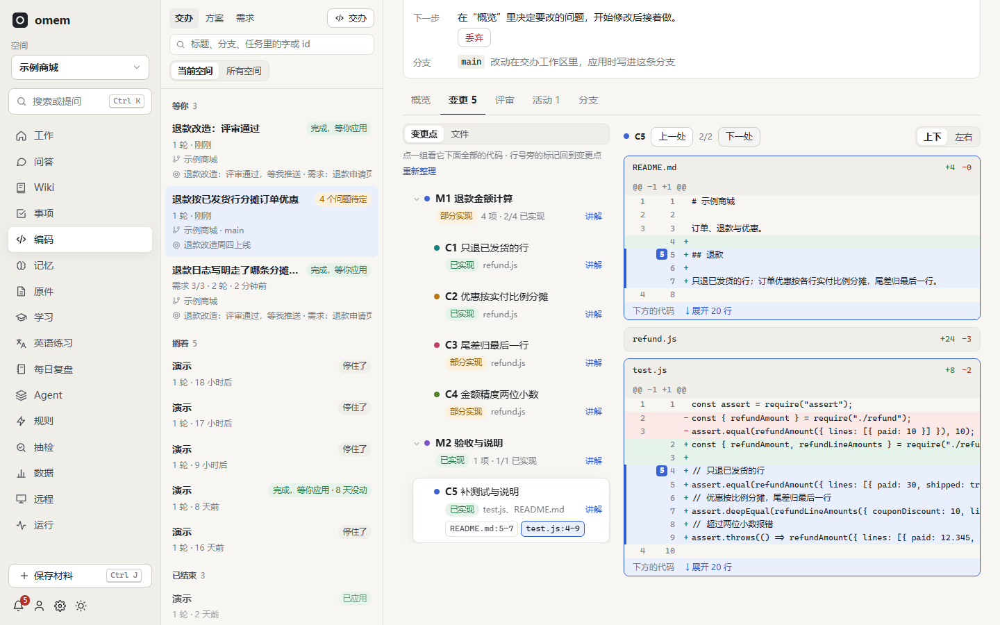
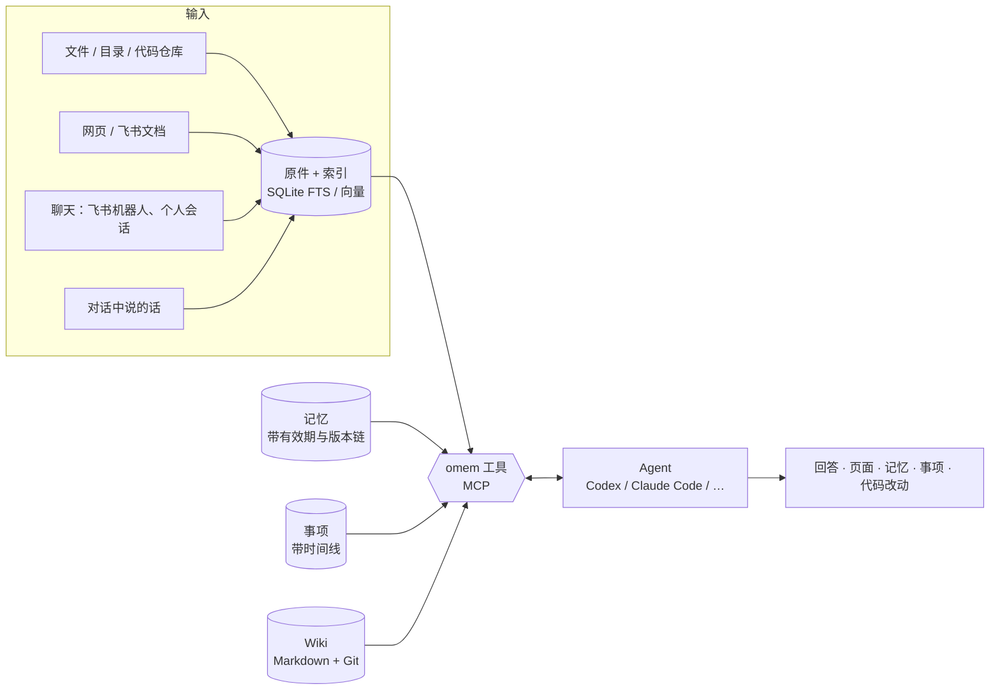
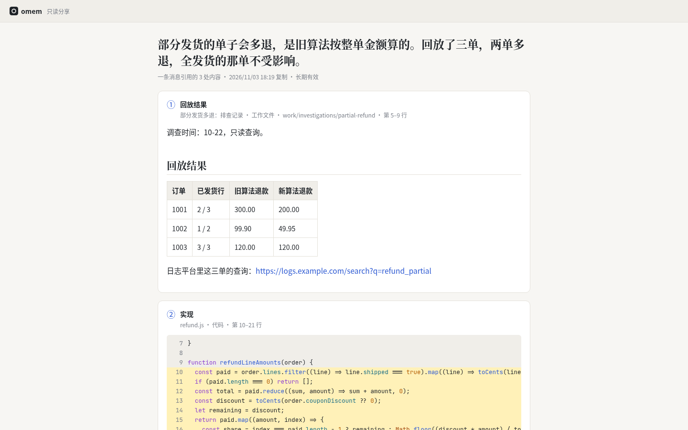

# omem

个人记忆与助理：把文档、代码、聊天、笔记放进同一个知识库，带依据地回答问题，记住约定并在被纠正时更新，持续跟进事项，还能把编码任务交给其他 Agent 并保留检查与评审结果。

**文档站**：<https://lejunyang.github.io/omem/>（功能介绍、安装和使用，源码在 [site/](site/)）

## 主要特色

**接收外部事件。** 外部系统可以把事件直接推到插件的回调。回调可先落库再应答，由插件按发送方协议返回受理结果；同一标识、同一正文不重复处理，正文不同则报冲突。支持普通 webhook 和 Chat Completions 回执。回调地址和密钥在 设置 → 插件 里配置。[怎么接入](site/features/plugins.md#接收外部事件)

**工作线：本月在推进。** 从已经关联事项的会话里追问，助手会看到这条线的现状和待定变化，新建的相关待办也会归到线上。 这几周在推进的一件事建成一条工作线，需求、缺陷、评审挂在它下面。打开 omem 先看到的“工作”页，每条线一张卡：一句“截至今天”的现状，最近几条关键变化排成一条点线（改期、决定、风险、结果，各带来源），末尾是虚线的下一步，下面是各工作项走到哪。等你处理的问题、流程关卡、没定的变化合在右栏。点开一条线，看最近几周各忙了什么、下一步（点“就这么做”助手就去做）、时间线、相关的人和群，还能在旁边直接问这条线。每晚整理近况时，助手会提议该建哪几条线。线不用你自己关：上线了先观察两周，群里和指标没有新问题就自己结束，写一段收尾小结；以前的线在工作页下面的“已结束”里按月翻、能搜。见 [工作线](site/features/work-lines.md)。



**事项按流程推进。** 在事项上开始一份流程，按前提走过澄清、方案、编码和推送；阶段条显示进度和用时，需要你确认或动手时直接给出操作卡片。推送那一段可以设成“改动推到远端就算做完”：你推送以后，后面的阶段自己开始，也可以手动点做完。点阶段能看承担者、方案、交办和原件依据。在“流程 → 流程定义”讲讲做法，让助手起草，确认后启用。[怎么用流程](site/features/items.md)。

阶段卡在网页和飞书用同一套内容和动作。平台暂时不可用时，助手可以等一段时间再重试；能自己补的文档、字段或证据交回原助手，不请你代做。确实要你处理时，卡片写清卡点和依据，也可以直接写一句指示让助手接着做。

你自己做的普通阶段只在事项进展里提醒一声，不用回来点“做完了”。助手根据你说的话、关联群的消息和挂在事项上的对象核实，查实就带依据推进；有计划时间时，到点也会核对。网页仍可手动完成或跳过。跳过一段不会让下游越过它尚未完成的上游。

对账查到流程目标已达成或不再成立，助手会带依据收口，不再请你到网页停止。要同事补材料时，在卡片上可以直接把草稿发到机器人所在的关联群。

启用 GitHub 插件并连接账号后，把合并请求链接发给助手，就能挂到事项上跟进状态，流程也能等它合并或关闭后接着走。事项页的合并请求卡上可以直接点“合并”；助手也能合并，默认每次先问你。状态一变还能触发规则（比如“合并请求没合就被关掉时告诉我”）；状态没变但有新提交、新评论时算“有更新”，流程可以等它、规则也能选它，插件带回调的，平台一通知 omem 就去读，不用等定时检查。omem 自己的事（运行结束、评审结束、事项和流程阶段变化……）也能当规则的触发。插件停用后保留最后状态并停止跟进。仓库里的 `examples/plugins/ghdelivery` 是一个现成的场景包：GitHub 需求交付的流程、建合并请求 / 等检查 / 合并三个技能和一条规则。

流程进行中，关联的群、会话和文档有了新内容，助手会攒一批看看这件事变了什么。新要求影响已经在做或做完的部分时，先问你要并进、另开还是不用管，不替你答应；你自己拍板或直接让助手去改的，直接并进。这些变化列在事项页上，等你定的排在最上面，可以逐条处理；文档更新只看新增或改过的行。

你直接在仓库里提交的代码，助手也会帮你核对属于哪件事，在卡片上由你选择挂到已有事项、新建一件事或不用管。确认挂上以后，还没开始的编码阶段可一并补记完成；首次接入不会翻以前的提交。

流程也支持把已经做过的阶段补记完成、对验证结果逐条签字；同一开始关卡连着直接同意后，会先问你是否以后直接开始，重开或暂停时改回每次问。新内容每天默认最多看 12 批，多的留到明天；事项页的阶段上有“这一段已经做过了”，验证结果每条可以点“看过，对”或“不对”；工作页的“按阶段”把在走流程的事项按阶段分列（侧栏不再单列“流程”，流程定义从“按阶段”右上角进），工作页右栏列出流程里等你的；这几个数和开关在 设置 → 推进工作 里。每件走流程的事项在工作页下有自己的页面（事项列表、看板、工作页和飞书进度卡都直接打开它），头部是阶段条和等你的那一段，“流程”标签按文章的写法排：背景、每一段做了什么（截图插在对应的文字后面）、接下来要做的和这件事的来源；等你的卡片下可以写一句话（开始时照这句做、做完了不满意就按这句重做、卡住了就按这句重开），也可以点“在对话里讨论”把这一段带进对话。

事项跟进会从已采集的群聊和私聊里找正在谈这件事的会话，挂上时把依据记在时间线。助手随手挂的会话连续五批没有变化和相关线索就会放下，材料仍可查。预筛跳过的批次不占额度，距阶段计划或事项截止不到 48 小时时，当天的额度放宽一倍。

轮到你做的一段，只收到一张“轮到你了”的卡片，写着要做的事，做完点“做完了”，不再先问“开始吗”。定义里的开始关卡和需要你判断的条件仍会询问。交办完成卡上已有“确认并推送”时，到卡上点一次，推送成功后流程会核对并完成该段。卡片上可直接打开改动、所属事项或流程依据。

重开上游会收回下游还挂着的开始确认；等推送信号的阶段不问开始，远端已有这次交付就直接完成。返工已经交给正在编码的一轮就跟着它，不用再起一轮。有新交付时，助手会核对久等的阶段，能根据记录确认已做完的就补记并收回旧卡；当天你已经在这件事上有动作，停留提醒顺延。

配置了决策模型时，流程等确认、等你做或卡住后，有新材料、交付、事项变化或你的关联会话发言，就会合批复核。摘要显示某个卡点可能有变化才启动对账，判断与结果留在事项时间线。门槛可在 设置 → AI → 决策 调整。

流程结束时（走完、你停下或事项关闭），事项页上多一块“这一次走得怎样”：各段用了多久、其中等你多久、卡在哪、返工几次、哪些关卡你每次都直接同意。同一份流程又结束满三件，助手会对照这几份回顾看定义要不要改，有站得住的修改就起草一份新定义等你点“启用”，不会直接改。重开前面的阶段时，后面正在做的阶段不会被悄悄停掉，会问你要停下还是继续做。

流程还可按需一轮一轮转：默认等你说“再来一轮”，也可设完成后、每天或每周几开始。运行阶段可指定 AI 档位、允许开始的时间段、分钟预算和有限的升档次数；`agents.tiers` 在配置中把 `strong / standard / cheap` 各映射到 `{ profile, model?, effort? }`，默认不配。事项页上能看到现在第几轮、点“再来一轮”、改这一轮的预算；在 设置 → 后端与模型 → 默认 AI 与档位 配置模型档位。[字段与接口](docs/v2/studies.md#第一期的实现)。

持续探索项目可用内置“研究”流程：先写功能清单，再提方向交给你选，按预算逐个试验，最后把有复现依据的问题归并成发现。没有值得做的方向、没有新发现都可以照实结束；默认由你开始下一轮。事项页的“研究记录”里看发现、每个试验的结果、各个方向和各功能试过几次；选方向、判定一条发现算不算，也在那里。发现按条件、现象、为什么是问题、建议分节写，可以带试验的截图；每条可以“就这条问”或“看不懂，重写”带进对话，助手能替你改写、改状态，改好的标“已改好”排到最后。定方向时能看到以前各轮的方向和发现标题，避开做过的；“再来一轮”时可以写这一轮看什么。[研究的用法与边界](docs/v2/studies.md#第二期的实现)，[发现的写法与避开做过的方向](docs/v2/studies.md#发现的写法改好与避开做过的方向)。

研究可限定能碰哪些仓库、选用登记的执行环境；试验在自己的副本里跑，同一方向固定在确认时的版本，不改你的检出目录。你允许改代码后，可以挑几条发现一起“交给改”（不限轮次和类型，也可以在对话里让助手交），omem 按顺序一次交办一条，用研究范围里指定的 AI 改代码和评审；评审通过的自动标为已改好，没过的留给你看，改动都留在各自的交办分支上等你确认。范围在事项页“研究记录”顶上改，发现上有“去改”，执行环境在 设置 → 推进工作 → 研究的试验在哪跑 登记。[范围与执行环境](docs/v2/studies.md#第三期的第一步)。

新交办的研究发现默认由你选的评审 AI 做编码前检查、专项评审和主审。续轮评审仍按最初的复现步骤验收，不把本轮的修改项当成新需求。

含“改”阶段的研究流程可在你允许的方向上逐条改缺陷，经评审后重跑失败试验，留在交办分支上等你应用；没改成的留给你看。你通过范围接口登记远端和分支前缀后，试验与改后重跑可在这个范围内推送，每次有记录；已有流程需自行补上“改”阶段。[自动改与推送](docs/v2/studies.md#第三期的第二步)。

登记执行环境时可以选“派给设备”：这个环境的试验交给你配对过的另一台设备，它按远端地址找到自己的那份仓库，在自己的工作区里切到方向确认时的提交，用自己的模型跑完，把结果和证据文件送回这里的记录。只对你自己的设备开放；那台离线或出错时再派一次，之后记“跑不了”。[派给另一台设备](docs/v2/studies.md#第四期把试验派给另一台设备)。

**做了什么，有数可查。** “数据”页分两栏：“工作数据”是你工作上的指标，按工作线分组，连着数据源目录、观测计划和助手写的报表；每个指标写着它回答什么问题、从哪份计划来，助手在后台提的放在最上面一张“等你确认”的清单里，一行一个，可以一个个、一组或全部保留或不要；“omem 自己”先是几个关键的数和一排节导航，再按时间段列出 omem 做了多少件事、用在哪、替你挡了多少找你的消息、别人直接问机器人多少次、做得怎么样、编码交付、知识用上了没有、花了多少时间和长期走势。点任何一个数，右侧抽屉里是它按天的记录、按场景 / 空间 / 模型 / 谁触发等拆开的样子和记录本身，也能导出给周报用。系统自己的整理另外算；没有基线就不推算省了多少时间。[怎么读这一页](site/features/insights.md)。

**交办编码，多维度评审。** 编码 Agent 把需求拆成修改项，一项一组提交；评审负责人按改动决定这次让功能、业务、架构、历史、规范、精简哪几个评审项看、各看什么；评审问题变成修改项自动改，由提出它的评审项验证，改坏了自动回退重做；和需求、实际用法无关的边界问题记成“以后再做”，不让交办在细枝末节里打转。只有业务和功能上的取舍才问你，问的时候别的项照做。需求做完就可以先推送验证，推送后接着改，下次在同一分支交办时接上没做完的项。每一项都能单独看改动、单独回退。 仓库还能从反复采纳的评审问题里学到约定：同类问题在两次交办出现后默认启用，能写成模式的由宿主检查新增行，其余交给编码和评审遵守；你在空间设置里维护。



评审概览上的“分享结论”生成一个只读链接，发给写分支的同事或别的评审人：里面是结论、每个问题（级别、文件和行、说明、建议）和你定的改 / 暂不改 / 不改，左边有问题目录，正文里引用的代码行、原件和记忆一并复制，点开在右边看；不含评审过程，不用登录就能打开，可在 设置 → 分享 里撤销；也可以让助手发（`share_review`）。交办或评审归在某个事项上、事项的流程有一段在等你时，运行页概览顶部显示这一段的卡片，和流程页上的一样，定完问题直接在这里点“做完了”。

**从需求走到代码。** 每次评审都把需求拆成变更点，标出已实现、部分实现、没实现和对应的代码行；需求大时按页面或模块分组，像文件夹一样展开。点变更点，代码高亮并滚到它的标记；拆得不顺手，可以让助手按你的要求重新整理。差异可以上下或左右对比，左侧是可折叠的文件树。



**Wiki 的每个论断都贴着出处。** 一页 Wiki 同时引用需求文档、技术方案、讨论群和代码，点任意一个引用，右侧打开原件并高亮被引用的那几行。问答也一样：回答里的引用指向聊天里那一句、需求里那一行。工作文件和确认表里的代码锚点也引用库内代码原件，先核对版本和行号，不根据 Git 地址猜网页链接。


**每晚抽检助手自己写的页面。** 每晚 05:10 从整理材料、修正页面等运行写的 Wiki 里抽几页，核对角色对照原件和代码检查，有事实问题的交回修改；按运行类型统计，低于门槛的一类加严。运行旁的“抽检”可看问题与修改进展，设置 → 自检与复盘 → 每晚抽检 可改开关、页数、门槛和交回方式。设计见 [docs/v2/quality.md](docs/v2/quality.md)。

每晚也会抽查 Agent 给原件和目录定的关注程度，优先看“忽略”“仅检索”和大目录；不对的在“原件 → 待复核”给出建议，由你采纳或保持。

**还有：**

- **选中就能引用**：在差异、评审或打开的原件里选中几段，编号后一起提问，或攒成下一轮的修改点；提问抽屉可以缩小成可拖动的图标。
- **Git 同步交给它**：交办时先拉取、合并或变基，冲突先交给编码 Agent，拿不准的问你；中断的合并、变基、拣选提交或撤销在原现场继续，完成后再同步和编码；应用时快进到目标分支，推送到你选的分支。
- **不用每次重装依赖**：仓库可以把几个装好依赖的工作区借给交办轮流用，准备命令只在锁文件变了时才跑。
- **在自己电脑上看交办的页面**：交办视图点“预览”，omem 在那次交办的工作区里起服务，认出它开的端口，按同样的端口号转到你的电脑上；主子应用、写死 localhost 端口的项目也不用另配。
- **截图、录屏和测试报告留在交办上**：编码 Agent 和检查命令把它们放进 `$OMEM_ARTIFACTS`（或用工具交），omem 收下、按修改项挂好，交办视图“产物”里直接看图、拖视频、打开报告；评审和逐项验证也拿得到。
- **方案与变更说明**（`docs/v2/coding-plan.md`）：值得的交办在编码前先写方案——几个决定，分新增 / 修改 / 删除 / 重构，各写要点：行为对照表、对外的约定、删什么、不选什么——你在卡片或方案页上通过、提意见或换个思路，通过后照它编码，每个修改项挂到决定上，偏差和“有没有更简单的做法”写回决定；不走方案的交办结束时交一份变更说明。别人的技术方案也能交给助理跟进：提取作者的决定、回到代码核对，写出问题、风险、改进和要问作者的，文档更新后重新评估；别人的分支出来后对照同一份方案评审，改动归到决定上，逐个决定看做了没有、偏差在哪。
- **编码前先查影响面**：新交办开始编码前，另一个 Agent 查改动会碰到什么、这些文件以前出过什么问题（需求点、交办、评审问题、提交）、改完要回归什么；编码 Agent 拆修改项时照着补，评审拿它核对。
- **记忆有版本，事项会收尾**：约定被纠正时旧版本保留并指向新版本；事项有时间线和期限，没进展自己过期，有新消息再打开。
- **改了以后怎么做，你看得到**：助手改技能、规则或关注，通知里会列改动前后，可以撤回。规则页和周报能看到哪些规则经常安静结束；确认问题未恢复、又没有后续安排时，会提醒你。
- **有期限的事会主动找上门**：在规则页启用“清点指派给我的事”，主助手在工作日早上按内置技能 `assigned-sweep` 和你提供的查询技能找有时限的外部指派。新发现且三天内到期的合成一条通知，其余在早上的“今天”里看。事项不到 48 小时截止、一天没进展且没在走流程时，巡检会先做只读预查；点“按这个开始”才在事项会话继续。[事项用法](site/features/items.md#指派清点与临期预查)。
- **插件做强交互的事**：一个插件打包 Agent 档案、技能、工具、数据和独立页面。内置的“英语练习”按场景出一组题（中英互选、填空、听写、翻译），一次提交，宿主判客观题、陪练评翻译并点评；陪练在后台补题库，“下一组”按你的水平和薄弱点当场挑出来；也可以和语音模型按场景说英语，陪练评价口语，记进同一份学习画像。自己的插件放数据目录，只写清单和档案就能用表单、图表和默认页面；带代码和常驻服务的（比如实时看机器状态）要你在设置 → 插件里确认后才运行，页面能经 omem 和服务保持 WebSocket 连接，声明了语音的页面能和语音模型对话（麦克风在 omem 的页面里，插件只拿到文字）。不带代码的插件叫“场景包”：可把空间结构、已有档案、完整技能、停用规则和不含密钥值的 MCP 定义一起打包，交给别人安装；命令 MCP 仍须先确认信任。插件可以按成员投递通知、接收表单回答；通知出口默认关闭。插件也能接入自己的聊天渠道，身份、会话、回复和通知由宿主管理。
- **飞书里用**：机器人回答带进度卡片和思考过程，规则一句话写成“遇到什么就做什么”，提问和评审结果都是带按钮的卡片。成员需要用自己的 AI 账号时，可在飞书授权后继续原运行。
- **给 Agent 接 MCP 服务**：Agent 页 → MCP 服务 配置命令或网址，再到档案或内置角色里勾选；环境变量和请求头的值按密钥保存，保存后只显示是否已设置。可检测连接并查看工具，删除前列出使用它的档案和角色。仅你自己的运行带这些服务，其他成员、访客和评审不带；夜间复盘只用标为只读的服务。
- **按网络条件使用后端**：给后端设 TUN 网卡或代理和出口要求（地区 / IP）；用之前查一次出口，一小时内有效，网卡断了或出口不对时停下，按兜底顺序换后端。也可以查 IPv6 出口和 DNS 设置。设置 → 后端与模型 → 通用，点开后端 → 网络条件。[使用方法](site/features/agents.md#限定后端的网络环境)。
- **向量和重排可走云端**：不装本地模型也能用向量检索和重排，在 设置 → 检索与记忆 的两张卡里选来源、先“试一下”再保存；密钥复用 AI 服务商的密钥库，或从环境变量读取。原件分块、记忆和查询会发给选中的提供者。更换向量模型、维度或服务地址要先确认清空与重算数量。插件也能算向量。[配置与检测接口](docs/v2/architecture.md#向量和重排用云端接口)。
- **不自带模型**：理解和写作交给你已安装的 Agent（Codex、Claude Code、Gemini CLI 等），omem 管存储、索引、调度和权限。

> v2 是一次精简重写（2026-10）。v1 的代码与文档在 Git 历史和 `docs/archive/v1/` 中；设计取舍见 [docs/v2/architecture.md](docs/v2/architecture.md)，评测见 [evaluation.md](docs/v2/evaluation.md)，验收步骤见 [acceptance.md](docs/v2/acceptance.md)。

## 它怎么工作



- **空间**把领域分开，类型有个人、项目、代码仓库、学习、通用。代码仓库挂在它所属的业务空间下（业务空间设置里的“仓库”），在业务空间里检索、交办、评审都包括它。检索默认在当前空间和它的**相关空间**，主助手可显式检索所有可访问空间；代码仓库默认按基线分支的提交建索引、每小时拉取更新，分支和交办的代码作为叠加索引按需查、用完自动清理（`docs/v2/code-index.md`）；Wiki 用 `[[space:slug]]` 跨空间关联。互相调用的仓库、同一项目的几个空间可以关联（设置 → 空间，或对助理说“A 调用 B 的接口”）：整理、复核这类只管一个空间的任务也会读相关空间（只读，写入仍在自己的空间），写记忆时会提示相关空间里已有的相近记忆；定期整理会从互相引用、页面互链、依赖声明和共用标签里发现可能相关的空间，确认后关联，你移除的不会再被加回。一个空间可同时放项目文档、讨论和代码，但只关联一个仓库；多个仓库分别建空间。本人可在主助手对话中创建空间、关联本地仓库或接入 Git 链接。
- **原件**是依据，只保留最新版；聊天按追加保存。**Wiki、记忆、事项**是派生知识，都引用原件。
- **空间归属与归档**：问答、原件（含文档）、需求树、运行列表跟随所选空间；需求切换时先显示新标题和加载骨架，编码列表批量读取状态摘要；切换空间退出旧详情（“编码”里打开的需求和交办也退回列表）。规则分为“任务规则”和“归档规则”。自动采集优先使用手动归属和来源绑定，再按创建顺序匹配条件，未命中的批量交给归档角色判断：宿主附上旁证（知识库位置、同目录文档的去向、引用它的业务页面和事项、贴过它的群），几条指向同一业务空间就移过去，确实个人或判断不了的留在个人空间；之后出现新旁证、空间或归档规则变了，每晚再判断一批。为业务事项写的工作文件放进那个业务空间。“从个人空间归位”列出自动移走的（可移回）、等你定的和读者打不开的页面引用。归档规则可让 AI 编写草稿，核对后保存启用；历史材料先预览再应用，迁移保留 ID、引用和行号。
- **原件页**：普通空间按目录树展示，一层一层展开：飞书知识库按知识库和节点层级（文档本身也是节点，下面还能有子页面），知识库外的云文档按“由哪篇文档链接进来”或“直接导入”，聊天按群聊 / 话题群 / 单聊 / 机器人、再按会话和月份（会话里的图片收在“图片”下），网页按站点，会议和日程按年月，笔记和工作文件按月。每个目录带份数和关注程度色点，筛选（关键词、类型、关注程度）同时作用于计数。在任一目录上设关注程度，整个子树连同以后进来的都按这一档。知识库里看到过、但还没采集的节点显示为灰色，点“采集”读进来。业务空间名下的仓库也是树里的目录，展开是仓库的路径树。代码仓库空间在文件较多时按路径目录展示，网址和会话标识保留为独立原件。
- **主动读飞书知识库**：omem 每周列出你在飞书里能看到的知识库，由 kb-scout 角色按你写的方向提议每个知识库放进哪个空间（已有的或新建的）、先读哪些、读进来按什么关注程度；默认归入已有空间和“不读”的建议直接生效，新建空间仍等你确认；也可选择全部等确认或全部直接生效。每次通知列出已处理和待确认的数量，生效后可改回。每晚按优先级读一些，目录级的关注程度让整个知识库的页面都按这一档。只读飞书，不改知识库。
- 理解和写作由你已安装的 **Agent** 完成（通过 ACP 或命令行），它们用 omem 的工具（MCP，或 shell 里的 `omem tool`）检索、阅读、写入，同时保有自己的文件与搜索能力。omem 负责存储、索引、调度和权限，不自带模型。
- **Wiki** 是 Markdown 文件，整个知识库目录是一个 Git 仓库，每次修改都有历史和差异。页面按路径分目录（`a/b/c` 是目录 `a/b` 里的页面 `c`），网页里是可折叠的目录树；页面移动后旧路径仍能打开。
- **记忆**被更正时不覆盖：旧版本标记为“已被更正”并链接到新版本，所以“之前怎么约定的”和“现在是什么”都能回答。
- **记忆按目录分层**：每条记忆在空间里有一个目录（如 `工作/项目A/发布`，最多三层），记忆页左侧是目录树。助理写记忆时按目录说明选目录，没有合适的才新建并写一句说明；拿不准的先放“未归档”，每两小时由整理目录的运行归档，每周再看一遍结构（拆太满的、并太小的、补说明）。标签只用来串起跨目录的东西（同一个人、同一个季度）。
- **记忆质量不靠人工逐条看**：写入前有规则检查（免责式、超长、转述原件、事件复述、无来源、重复的会被退回并告诉模型怎么改），之后每小时由复核模型盲评保留、改写或撤回；可以再挂几个模型做对比运行，在“记忆 → 质量”里按模型比较。
- **相关记忆自动带上**：开了向量检索后，对话新消息或回答、办事的任务开始前，和它足够相近的各类记忆（含偏好、经验，最多 5 条）会自动带上，提示里已有的不重复，助理不用先想起来去查；不够相近就什么都不加（门槛在设置 → 检索与记忆，校准数据见 docs/v2/evaluation.md）。
- **偏好与经验按用途带上**：对话常驻最多 60 条偏好；档案自己的经验不超过 12 条时全带，更多时带最新 6 条和目录提示。任务带自己的偏好（最多 16 条）、最多 12 条自身经验和最接近任务的 8 条共享偏好与经验；有向量时按相关性挑选，其余可按目录查询。“记忆 → 召回”分自动带上、任务挑选、主动查询统计带上和引用次数，整理时查看单列，不计入；从未召回不含偏好。
- **重排（可选）**：检索先按全文和向量取候选，再由本地的 bge-reranker-v2-m3 把问题和前 20 条逐条对读、重新排序；开着时对话前带上的记忆也由它判断相关不相关。公开中文检索集上排序指标 nDCG@10 从 86.6 提到 91.6，代价是每次检索多几秒 CPU，超时就保持原来的顺序。`omem setup rerank` 经 osdk 下载模型，设置 → 检索与记忆 里开关和调参数。
- **问你和给你选项**：Agent 遇到非你决定不可的事用卡片问你：选项都短时排成按钮，按手机宽度均匀分行；有一个长选项时，所有选项按编号逐行显示完整文字，旁边点“选择”；输入框后有“用文字回答”，问题里列了几条要逐条答时输入框可以写多行。卡片发在群里时开头 @ 要回答的人。你答完它在同一轮继续；原来那轮已结束也会接着回答并发回原会话。编码的技术返工先交给助手调查，已有授权能在后台接着执行，完整技术记录在卡片里默认折叠；回答以建议结尾时附上下一步按钮。要问好几件事时，它给你一张表一次问完（单选多选、日期、开关、几个方案卡片挑一个、一批条目逐条通过或不通过），网页上直接填，飞书里点链接去填，也可以直接回一句话；数据和对比放在回答下面：先是一句结论（图标标出达成、需要关注还是故障），再是带涨跌箭头和走势的指标、柱状 / 横向条形 / 折线 / 面积 / 饼图、可排序的表格、方案对比；飞书里用卡片自己的组件画成同样的版式。设计方案、界面改动这类要你试过才好判断的，它写一个可以点的小页面（在沙箱里运行，不能联网），你在页面里试完选一个，选择直接交回给它。设置 → 安全 → 工具审批可逐个选“每次问我 / 做完告诉我 / 不用问”。连续批准默认 10 次后会问一次要不要改成做完告知，只有你同意才改；拒绝理由会回给 Agent，机器点击、输入类插件工具始终要批准。

## 快速开始

需要 Node.js 22.18+（推荐 24），以及至少一个已登录的 Agent。任何支持 [Agent Client Protocol](https://agentclientprotocol.com) 的 Agent 都能用，装在 PATH 里就会被自动识别：

| Agent | 安装 | 配置 id |
| --- | --- | --- |
| Codex | `npm i -g @agentclientprotocol/codex-acp` | `codex` |
| Claude Code | `npm i -g @agentclientprotocol/claude-agent-acp` | `claude` |
| Gemini CLI | `npm i -g @google/gemini-cli` | `gemini` |
| Antigravity CLI | 按[官方说明](https://antigravity.google/docs/getting-started?tab=cli)安装 `agy`，再 `agy acp --login` | `antigravity` |
| GitHub Copilot CLI | `npm i -g @github/copilot` | `copilot` |
| Qwen Code | `npm i -g @qwen-code/qwen-code` | `qwen` |
| Cursor Agent | `curl https://cursor.com/install -fsS \| bash` | `cursor` |
| OpenCode | `npm i -g opencode-ai` | `opencode` |
| CodeBuddy Code / Qoder / iFlow | `npm i -g @tencent-ai/codebuddy-code` / `@qoder-ai/qodercli` / `@iflow-ai/iflow-cli` | `codebuddy` / `qoder` / `iflow` |
| Kimi CLI / Mistral Vibe | `uv tool install kimi-cli` / `mistral-vibe` | `kimi` / `vibe` |
| goose、Kilo、Auggie、Cline、Factory Droid、Grok、MiniMax、Amp、Junie、Devin、pi、DeepAgents、TraeX | 见 `omem agents --all` | 同名 |
| Claude / Codex / TraeX 命令行（非 ACP 兜底） | `claude`、`codex` 或 `traex` 在 PATH 中 | `claude-cli` / `codex-cli` / `traex-cli` |
| 豆包 CLI（本机运行；2.38 起经 ACP 用 MCP 工具，更早的版本经 `omem tool`） | `npm i -g @bytedance/doubao-cli`，再 `doubao login` | `doubao-cli` |
| 豆包 OpenAPI（云端 Managed Agent，无需本地程序） | 飞书应用开了豆包用户权限并授权：`omem doubao status` / `omem doubao login` | `doubao` |

豆包 CLI 按 PATH 中的 `doubao` 命令识别；已有其他发行包提供同名命令时可以直接用，无需重装。omem 按 `doubao --help` 判断版本能做什么：有 `doubao acp serve` 的走 ACP（omem 工具经 MCP、过程逐步显示、模型按名字选），有 `doubao delete` 的单次任务会话用它删除（成员自己的账号也能删），旧版仍用 `-p` 和 OpenAPI 清理。

Antigravity CLI 按 PATH 中的 `agy` 识别，以 `agy acp` 启动并复用 CLI 登录。额度通过 CLI 自己的 `/usage` 读取，不消耗模型额度；后端页显示各模型组的已用比例和重置时间，快用完时按模型组避让。ACP 注册表下载的 `antigravity-acp` 是另一份独立运行包，认证配置与 CLI 分开；已经装好并登录 `agy` 时直接选 `antigravity`；原先手动添加、同样以 `agy acp` 启动的后端会顶替它，保留原名和设置并共用额度。成员可以在“我的 AI 账号”里用网页登录自己的 agy；本人可以在后端卡片上“再加一个账号”，同一个后端登录多个号，各有登录目录和额度（Codex、Claude Code、TraeX、Copilot 也可以）。

自动选型的对话每轮开始前也看已缓存的额度；原后端接近上限且有可用替代时，在原对话换后端接着答。手动指定的后端不因额度接近上限而换。

云端会话可以按运行授权检索、读原文，研究的阶段也能交给云端后端跑并用工具交结果。默认关闭。本人探测并确认后端后，可指定它能使用的工具；云端和这台机器在同一个内网时，可以允许用内网的 http 地址。每次调用沿用成员和运行的空间权限。[配置云端工具](docs/v2/external-access.md#云端后端调工具)。

`omem agents` 列出已识别的 Agent；`omem agents registry` 列出官方 ACP 注册表里的全部 Agent，`omem agents add <id> [--via npx|uvx|binary]` 一步加入（npm 包可以 npx 运行不安装，独立程序会下载并校验到数据目录）。`omem setup` 和网页“设置 → 后端与模型 → 添加 Agent”做同样的事；内置目录里有 npm 包的，在“其他支持的 Agent”里点“安装”就在后台装好（有 osdk 和 Node 时用 osdk 装）。每个 Agent 第一次用前在终端直接运行一次完成登录；模型和推理强度在“检测模型”里选。也可以不登录、改用 API key：设置 → 后端与模型 → API key 添加 OpenAI、Anthropic、火山方舟或其他第三方（OpenAI 兼容）的 key，勾选要生成的后端，就多出 `codex@<编号>`、`claude@<编号>`、`opencode@<编号>` 这样按 API 计费的后端，和本机登录的那个并存，额度分开算；第三方的 key 生成的后端用这个 key 列出的模型（也可以只挑几个，第一个是默认），Claude Code 要的 Anthropic 格式地址检查时自动找；这些后端经 omem 转发，限流、每日用量、额度用完和欠费按提供方的错误码认出来，限流换后端，额度类暂停这个 key 并通知你；key 存在数据目录的 `secrets/ai-keys.json`，网页只显示后 4 位。同一页的 OpenAI key 也给语音、决策、图片三类模型用（设置 → 后端与模型 的对应子页，设计见 [docs/v2/ai-models.md](docs/v2/ai-models.md)）。

设置 → 后端与模型 → 决策 可配置多个模型，按顺序或每次随机先问一个；不可用、拒答或出错会换下一个，刚出错的 5 分钟内排到最后，判断记录显示由谁回答及换用情况。 巡检、盯群、有人找你和直接答复分别设最低把握，按后续结果记录漏看、多看；同页可看报告，也可用命令离线比较其他决策模型。

```bash
# 源码运行（osdk 管理 Node/pnpm 与模型）
osdk install && osdk deps --frozen
osdk run dev          # API :4317 + 网页 :5173，数据在 ./.omem

# 或直接用 npm/pnpm（pnpm workspace：应用、插件 SDK、VS Code 插件、Chrome 扩展、文档站共用一份锁文件）
pnpm install                      # 只要应用：pnpm install --filter @omem-ai/app
pnpm run build && pnpm start      # http://127.0.0.1:4317，数据在 ~/.omem
npm install -g .                  # 可选：把命令行 omem 链接到这个仓库

# 或从 npm 装发布版（包名 @omem-ai/app，命令是 omem）
npm install -g @omem-ai/app

# 只用别人（或常驻服务器）的 omem：轻量命令行，单文件、无依赖，命令也是 omem
npm install -g @omem-ai/cli
```

`@omem-ai/cli`（`packages/cli`）只有连远程 omem 的命令：`omem login`、`omem tool`、`omem mcp`、`omem open`、`omem remote`，不含服务端、本机的库和 `--peer`。两个包装一个就行，完整版也有这些命令。

向量模型可选：使用云端接口或插件提供者时不用下载本地向量模型，重排也可以独立走云端。密钥和外发内容的设置见 [检索配置](docs/v2/architecture.md#向量和重排用云端接口)。

第一次使用先运行 `omem setup`（或 `osdk run cli -- setup`）：交互式选择 Agent 后端与模型、向量模型与重排模型（经 osdk 下载并锁定）、PDF/DOCX 解析（Docling 及其模型）、飞书 / Telegram / QQ·微信渠道、注入标记、桌面与浏览器控制（可选）、会话与并发、定时任务。每一项都会先显示本机已安装什么、各选项的代价；缺的 uv、llama.cpp 和模型经 osdk 装好（不用把 osdk 的 shims 加进 PATH）。最后可以直接启动后台服务。

**后台服务**：`omem service start | stop | restart | status | logs`。用 omem 自带的 PM2 常驻运行（PM2 数据放在 `~/.omem/service/pm2`，不碰你自己的 PM2），崩溃自动重启，日志在 `~/.omem/service/logs` 按天和大小轮换。`omem service enable` 设置开机自启（macOS 用 LaunchAgent，Linux 用 systemd 用户服务并开启 linger、没有 systemd 时用 crontab `@reboot`，Windows 在“启动”文件夹放一个隐藏窗口的启动脚本，都不需要管理员权限），`omem service disable` 取消；`omem setup` 结束时也会问。自启用的是设置时终端里的 PATH，之后装了新 Agent 或换了 Node 版本再 `enable` 一次。前台调试用 `omem serve`。

**更新**：在源码仓库里 `osdk run upgrade`（或 `node scripts/upgrade.ts`）：拉最新代码、装依赖、构建、`npm install -g .` 链接全局命令；加 `--restart` 顺便重启后台服务，`--no-global` 跳过全局安装。装了 osdk 时依赖由 osdk 安装，npm 包从 `osdk.toml` 里 `[registries.npm]` 指定的公开源下载，不管这台机器的 `.npmrc` 指向哪个镜像（公司镜像缺版本或缺发布时间时 pnpm 会装不上）；要换源改那一项。

**传输压缩**：Web 服务为支持 gzip 的客户端压缩网页静态资源和超过 1 KB 的 JSON 等文本响应；实时事件保持流式发送。

**监听地址**：默认监听所有网卡（`0.0.0.0`），方便其他设备配对和打开网页；本机的请求不需要令牌，其他机器的请求必须带令牌（配对码或 `omem link` 给的）。“本机”只认用 `localhost` / `127.0.0.1` 访问、且不是别的网站发来的请求（检查 `Host` 和 `Origin`），所以浏览器里打开的其他网页借不到这份信任。只想本机访问，配置里写 `"host": "localhost"`。Windows 第一次启动时防火墙可能会询问是否允许 Node 访问网络。

打开网页后：

1. **设置 → 后端与模型**：确认至少一个后端显示“已安装”。在 **Agent → 档案** 中为内置角色和自定义档案设置默认后端、模型与思考强度；可用后端排在前面，模型和强度自动检测，检测不到时可手填。默认配置里 Codex 使用 `gpt-6.1-sol`、低 effort。
2. 在主助手对话中说“创建一个项目空间”或“关联这个本地仓库 / Git 链接”，也可在 **设置 → 空间** 新建。网页选择“代码仓库”后，同一输入框自动识别目录和 HTTP(S)/SSH Git 地址；本地目录填运行 omem 的机器上的绝对路径，Git 地址会尝试克隆到 omem 数据目录下的 `repos/`。主助手接入已有路径时复用空间，关联后导入文件（遵守 `.gitignore`）。私有仓库使用服务器已有 Git/SSH 读取权限，链接不含密码或令牌。
3. **Wiki → 规划并生成 Wiki**，或直接对助手说“生成 Wiki”：共用先规划、再逐页写作的流程，用户要求传到每一页。可结合多个空间的代码和文档，页面写入指定空间；当前实现以代码为准，过时文档会注明。
4. **工作 / 问答**：直接提问或交代事情——“记住：周四下午三点和小王同步项目A”“不对，预算改成 120 了”“下周一提醒我交报销单”“帮我盯着项目A的需求变化”。
5. 按 <kbd>Ctrl K</kbd> 搜索或提问，<kbd>Ctrl J</kbd> 保存材料（文本、网址、飞书文档、拖入文件）。

文档解析支持 PDF、DOCX、XLSX、PPTX、CSV 和 HTML；Docling 在源码和安装后的构建中使用同一份解析脚本。结构化 Office / CSV 无需 PDF 模型，旧版 DOC / XLS / PPT 需额外安装 LibreOffice。飞书文档附件先保存原文件，再单独解析；解析失败在“运行 → 解析附件”中重试，不阻塞消息回溯。视频封面可选，正文中的图片副本外链保留为引用，不计入原附件缺失。

**不急的进展一起发。** 后台做完、查清的结论等不需要你现在处理的通知，先出现在网页，到 09:30、13:30、18:30（按设置的时区）一起推送；超过两条合成一份清单。你离开飞书会议或会议结束时，攒着的通知立即放出，不占下个时点。设置 → 通知与打扰 → 通知时间 可以增删时点，清空后新通知照常立即发。数据页“omem 自己”一栏的“提醒”一节按运行类型和会话列出近 30 天处理、先已知道、只看、没看与反感的数量；至少 8 条、一次也没处理的会话可确认后设为免提醒，点名或限时的事除外。你对普通通知回负面表情，助手会学出限定场景的忽略规则，稍后告诉你；通知页能删规则，设置 → 通知与打扰 能关闭学习，紧急提醒不受影响。对工具“做完告诉我”的汇报回负面表情，工具立即改回每次先问你，连续批准次数重新计算。

后台主动汇报的结果，如果决策模型根据你近期发出的相关消息确认你已经知道、也没有新事需要你处理，飞书会略过推送，网页仍保留通知。规则或关注排查出仍在影响人的问题，只有从触发到复查都没人收到消息、也没人接着办时，才会补一条提醒。

内置技能包括 `wiki-writing`、`lark-messaging`、`desktop-control`、`meeting-assist`（旁听会议时按会议性质主动查），以及 `research`（先查库、再查外部并交叉核对，给出有依据的结论）和 `improve-loop`（按可检查的目标逐轮改进，保留有效改动，停滞时换方向或交回）。启动时补进技能库，已有内容不覆盖。 编码改进目标由宿主固定度量命令、测基线，逐轮检查并决定留下或新增提交回退；达到目标、预算用完、连续四轮无效或到点就停止并发报告。运行页能看前后数字和每轮结果，循环不合并或推送分支。

成员还可以使用“网页只读观察者”预设，在获准空间查看工作线、事项、运行和评审。成员打开“工作”看到他能读的线（线下有他读不到的事项时不给整条线的现状）和他自己的线，右栏是等他处理的；他的线每天整理只用他自己登录的 AI 账号，默认不开。助手可以替你问成员某条线的进展（“去问小林退款接口到哪了”），回答记成那条线的一条变化，见[成员的工作页](site/features/work-lines.md#成员的工作页)。每个人能做什么在 设置 → 成员 → 能做什么 里按项给或不给，可以只在某个空间另设；网页只显示他能用的入口和按钮，见[成员能力](docs/v2/multi-user.md#成员能力)。

## 日常用途

**跟一类反复发生的事**：告诉助手“每次演练开始前先查这次的范围，异常就私下告诉我”，再说怎么认出开始。它记成一条持续跟进的规则，每次演练单独开一次跟进；别的运行也能看到这一次并把发现记回对应事项。也可以直接说这次开始了。网页上它和别的规则一起在规则页：可以新建，用一句话生成条件或直接设条件，在“各次”里看、手动开始或结束一次；工作页右栏列着正在跟进的。见 [持续跟进的规则](docs/v2/situations.md)。

每次有不同的协作群时，在规则设置的「这一次的群里」选「先给我看」或「直接发」，再在说明里写清怎么认出群、哪些进展发过去。默认不发群消息。

| 想做的事 | 怎么做 |
| --- | --- |
| 同时推进几件事，想一眼看清每件到哪了 | 打开“工作”：每条线一句现状、最近的关键变化和下一步，右栏是等你处理的；“按时间”看所有变化按天排，“按阶段”看流程看板。点开一条线看最近几周、时间线、工作项、人和群，右边“问这条线”能问“现在卡在哪”“按这条线写一份周报”。没有线就点“＋ 工作线”，或等每晚整理近况时助手提议 |
| 群里有进展，不想每次都 @ 助手让它查下一步 | 打开事项的“关注”。默认能只读查清的马上查、把结论和依据写回时间线；要改外部系统或发消息先给你看具体操作，点“执行”才动；没有现成工具时，助手也能在事项会话里按技能做，原有审批照常。只有你能办的列在“需要你处理”和早上的“今天” |
| 想知道一件事从需求到交付做到哪了 | 工作项页上的“需求到交付”：挂的需求点、研究的发现、方案、编码交办和合并请求排成四栏，指着一条看它连着哪些，点进各自的页面 |
| 不想每天收好几张各说各的卡片 | 每天早上一张“今天”（默认 09:30）：等你处理的、各条线的现状和新的下一步、夜里提议的线、要不要跟的候选、自动收尾和明天过期的、复盘提的改动、AI 提议的指标，逐条选了一起提交，没选的照旧在工作页；开着简报时它是卡片开头的几句，周五带上这周的周报。设置 → 通知与打扰 里改时间或关掉，关掉后各张卡照原来的时间单独发 |
| 让卡住的流程接着走、临时交代一件多步工作 | 助手会对照群消息和平台状态，能确认的按依据推进，需要你点头的把证据补进卡片，只有你能做的写成“需要你处理”的一步。没有合适模板时，直接说要做什么，助手会给这件事起一次性清单；写平台或对外发消息前仍先请你确认。 |
| 一件事上线了，不想再管它什么时候算完 | 不用管：流程走完、下面的事都结了，或助手看到“已全量”，这条线就进“观察中”，期间照读群、照取指标；两周没有新问题自己结束，第二天早上的“今天”里告诉你，点“恢复”就回来。拿不准的才问你一次。以前的线在工作页下面的“已结束”，有收尾小结 |
| 看 omem 和机器人做了什么，给周报一份有据可查的数字 | 打开“数据”，切到“omem 自己”，选时间段，需要时再按空间、谁触发的、场景、Agent、模型筛选；点任何一个数看是哪些记录，导出 Markdown / CSV。主人看全部，成员只看自己的部分；系统自己的整理默认不计在内，换算成“省了多少时间”要你自己填假设 |
| 重点文档还没写进 Wiki，没时间逐份挑 | 每晚 04:10 按贴链接、引用和事项等信号选最多 3 份，每空间最多 2 份，沿用规划、写作和核对；空间 Wiki 顶部展开“重点文档 X / Y 份已写进页面”查看候选与数字，点“现在写这几份”立即安排；最近 30 天试过的不重复选。在 设置 → 定时任务 点开“重点文档补写”那一行可调低额度或关闭 |
| 偶然发现一页 Wiki 写错了 | 点页面“这页有错”，一次填哪里不对、应该是什么，或在对话里指出。助理修改这页，再查同空间里同类运行近 90 天写的页面和搜索命中（默认最多 15 页），有同样问题的也改；之后的核对会带上本空间最近的指正。进度在“未决问题 · 本人指正”，结束后合并到不急的进展通知 |
| 有人在别的群 @ 你或私聊你，想让助理先查清楚再提醒 | 设置 → 代你回复 → 有人找你（规则页列表最后一条也通向这里）：排在所有规则之后，你几分钟内没看时，先免费筛掉已看过、已回过、有规则接手（触发过或在等）的；剩下的用决策模型分诊，值得查的交给主助手读上下文、查事项和资料，提醒里给结论、依据和建议的回复。可选让它回复对方：草稿由你点发送，或在你允许时自动回（草稿连着照发够次数后会问你一次要不要改成自动，自动回复让你不满意时点个负面表情就退回草稿）；企业不让 lark-cli 以你的身份发私聊时，私聊回复可选“经豆包发送”（发完读私聊核对） |
| 有人找你时想更快拿到能直接发的回复 | 设置 → 代你回复 → 有人找你 打开“先帮你回复”：值得查的先交给快模型在 90 秒内看，答得了就马上提醒你，拟好的回复附在下面由你点发送；要你定的提醒你定，不用回的不打扰；答不了才交给主助手接着查。见 [快速通道](docs/v2/first-look.md#有人找你) |
| 让已经在做的事项接住验收反馈和改期 | 把相关会话挂到事项上并开始流程。原定范围内的反馈会并进流程，重开受影响的阶段后给你一条通知。需要你决定的范围变化会问你。截止时间变更，包括已关联会议里的改期，会直接更新并带原话告知 |
| 替你回复的草稿总是太长或没结论 | 草稿卡片上不发时点原因（不用回 / 太啰嗦 / 没有结论 / 我自己回）；omem 记下每次的去向和你之后自己回的话，下一次分诊和拟稿会带上“你以往怎么回”的例子。统计在 设置 → 代你回复 → 有人找你 |
| 一个飞书知识库的文档散在几个空间 | 原件 → 知识库：已归入空间的知识库会列出“另有几篇在别的空间”，点“收回”；之后从链接、群聊、最近打开进来的这个知识库的文档都直接放进它的空间。个别目录属于别的业务，在原件目录树里给这个目录选“放在”哪个空间 |
| 让规则用每位成员的飞书连接查数据或填周报 | 规则页 → 交给 Agent → 以谁的身份运行。成员同意后，规则可用他的飞书连接读写。写他自己的文件可直接执行，其他文件和任务由机器人私聊请他批准。详情见[规则以成员的身份运行](docs/v2/rules.md#以成员的身份运行) |
| 成员想为不同任务指定 AI | 在会话发 `/agent 后端id` 或 `/model 模型名`，加 `save` 存为个人默认。账号页的“个人 AI 设置”可填写选型偏好，例如整理长会议纪要优先用哪个候选 |
| 给成员各配一个助手，或自己再建几个分工不同的助手 | 账号 → 我的助手 → 新建助手：“用飞书创建机器人”会给一个飞书链接，确认后机器人应用就建好并绑定；写一句它做什么、选回答的 Agent 档案。成员建的助手以成员的身份运行；你在 设置 → 渠道 → 助手 里能看到全部，可以给每个设每天的次数 |
| 让自己的助手去问另一台 omem 上的 Agent | 两台先配对（设置 → 设备）。对方在给你的共享下面选“可以请教的 Agent”；你这边的助手每十分钟拿一次对方的名片，知道那边有谁、各做什么，问题属于对方领域时会用 `ask_agent` 写「档案@节点」去问——在对方那台上只读地查、用对方的 AI 回答，引用落到你这台。也可以直接说“问问 某台 的 某个 Agent” |
| 把常驻那台的数据在自己电脑上留一份完整的备份 | `omem peer backup <设备> --to <目录> --at 00:00`（或 设置 → 设备 → 自动备份；不写 `--at` 按 `--every` 的间隔）：本机服务每 20 分钟看一眼，那台设备连得上（直连或经别的设备）就把它的数据拉进这个目录，白天连不上、晚上连上了会自己补。要看这份数据：`omem --home <目录> serve --no-background --port 4400` |
| 数据库太大 | `omem db` 看大小、空闲页和向量改存紧凑格式的进度（向量占大头，新版按 int8 存，是原来的四分之一，旧的在后台自动改）；改完后停服务运行 `omem db vacuum` 把空间还给磁盘 |
| 看某个人让机器人做了什么 | 运行 → 全部运行 → 筛选 → “触发人”下拉选他（同一个人只有一项，提示里写着他找助手、有人找你各多少次），旁边“触发方式”再分开看找助手、有人找你……；每条运行的第二行写着谁、怎么触发的 |
| 看某个后端或模型跑了哪些运行 | 运行 → 全部运行 → 筛选 → “后端或模型”下拉：先列近 30 天用过的后端，缩进的是它用过的模型 |
| 把同事加成 omem 的用户 | 在飞书里 @ 助手：“把 @小王 @小李 加成用户，项目 A 可写”。助手登记他们（飞书身份和邮箱），按你说的给空间权限，之后他们用飞书登录直接进来，不用再批准；只认你自己的话 |
| 让一次授权同时供给命令行和 AI 后端 | 信任声明了 `permissions.credential` 的进程内插件。成员在「账号 → 凭据」登录、重新授权、退出或设置谁能借，也可通过 `/api/credentials` 管理。成员的短令牌在后台提前续签，临时失败自动重试，确认不能续签时才提醒授权，「我的 AI 账号」标明各后端的供给来源。对话里的命令需要持有人重新授权时，omem 替他发起登录、把官方授权页私聊给他，授权完成后这段对话自动接着做；插件提供 `ownerLogin` 时你自己那份也能在这里登录。本人在「设置 → 安全」选择出借方式，在「设置 → 成员」查看持有或替成员退出。助手用 `who_can` 查谁有读取权及申请链接。开启直接出借后，成员缺少登录时，插件实时核实他对该资源有读取权，才可借用向他开放的登录执行只读命令；也可以打开“查不到时用你的登录兜底”，成员自己的登录查不到时提醒他授权，同时用你的登录接着查。选择先问持有人时，持有人可以在“等我的”或机器人私聊里同意这一次或这次任务。见[离线示例](examples/plugins/acmeauth/README.md)。 |
| 同事的运行别再用我的 AI 账号 | Linux 上装好 bubblewrap 后，同事在账号 → 我的 AI 账号 里登录 Codex、TraeX、豆包命令行，或给 Claude Code 粘贴令牌，他发起的运行就在沙箱里用他自己的账号，额度也按他自己的算。你在设置 → 成员 → 成员的 AI 账号 按后端选“借用本人的”“换别的后端”或“只能用自己的”。公司要求用统一身份登录某个后端时，写一个插件用 `api.agentLogin` 提供登录方式 |
| 把几个同事或别的机器人拉进一批群 | 对助理说“把小王、小李和日报机器人拉进项目 A 的三个群”：它查出每个人（重名时先让你挑），发一张审批卡片到你和机器人的私聊，列出每个群和每个人，批准后一次拉完并逐群告诉你谁进了、谁在等群主审批。只拉机器人默认不用批准（设置 → 代你回复 → 拉人进群 可改成也要批准） |
| 群里报的问题很多跑一两条固定查询就能答，不想每次都等 Agent 从头查 | 把那几条只读查询存成预查（规则页的“预查”页签里写和试跑，只有你能存；助手发现反复在查同样几条时会把代码发给你问要不要存），在规则的“交给 Agent”或关注里打开“帮你回复”（有人找你里的“先帮你回复”是同一层）：先跑预查，再由快模型在 90 秒内看一眼，答得了就答，要你定就只告诉你，不用处理的（进退群、例行提醒、别人已经答了的确认）不发，答不了才交给 Agent 深查（带着预查结果和快模型的结论）。第一条默认私聊你，也可发到群里或群里只有你看得到的卡片（点“发给大家”才发出）；要深查时可点“不用查了”。见 [快速通道](docs/v2/first-look.md) |
| 「帮你回复」给了结论，但还想再核对 | 在规则或关注发给你个人的第一张卡片上点“接着查”。原来的处理者带着结论和依据接手，结果回到同一处。卡片先显示一句结论，依据展开再看。 |
| 同一类事经常发生，每次都要先查一下，再持续跟 | 用[持续跟进的规则](docs/v2/situations.md)写清什么时候开始、发生时关心什么，并打开“帮你回复”。新开一次时先跑所选预查、发第一条结论，再带着结果继续跟；后续事件只附预查结果，不再重复这一步。不是群消息触发的，第一条只私聊你。 |
| 盯一张飞书表格，有人新增一行就查一下并回到群里 | 规则 → 文档变化：电子表格按行比对，每个新增或改动的行单独触发；条件里可以排除本人的改动；“发到”选一个群，Agent 回复在对应消息下并 @ 修改人；规则自己回写表格不会再次触发。在群里对助手说“这个群……”就能给当前群建规则 |
| 想知道规则拦下了什么、谁批准的、以你的身份发出过什么 | 设置 → 安全 → 记录：按时间列出规则的判定和批准、代你发出的回复和拉群、成员和登录的变动，可按类筛，点一行看当时记下的内容 |
| 同一个工具既有读又有写，想只审批写操作 | 设置 → 安全 → 操作规则：按命令名、子命令（如 `mr create`）、参数正则写一条“要批准”，可限定成员、角色、空间和后端；文件读写和 omem 工具也能这样管。插件或技能带的规则包在同一页选范围启用。见 [操作规则与审批](docs/v2/command-gate.md)。 |
| 浏览器开了很多 omem 标签页后页面打不开 | 后台的标签页 45 秒后自动断开实时连接，回到前台再连；想彻底不受 http 每个地址 6 条连接的限制，配置 `https` 开一个 HTTPS（HTTP/2）端口 |
| 数据目录越来越大，想知道占在哪 | 设置 → 占用 → 开始统计：数据目录各部分的大小；附件按类型（图片、视频、音频、文档……）和来源（群聊附件、在线文档里的图片、导入的原件、没有引用的）分开，列出最大的几十个文件；数据库按模块展开到表（行数、索引），原件按类别分正文、切块和向量，并给出删除后留下的空闲页。统计在后台进程里读一遍整个库，库大时要几分钟，结果留着下次直接看 |
| 图片和视频把磁盘占满了 | 设置 → 占用 → 压缩附件（没有 ffmpeg 时先点“安装 ffmpeg”，或 `omem setup ffmpeg`）：选图片 / 视频 / 音频、有损或无损、质量、长边上限，可以先试 20 个。有损把图片转 WebP、视频转 AV1、音频转 Opus；无损只做内容不变的转换（PNG 等转无损 WebP，WAV 转 FLAC）。聊天和文档里原来的引用不变，打开时自动换成压缩后的文件；可以先两份都留着，确认没问题再删原件。可设同时压几个；在服务里后台跑，重启或意外关机后接着做，停止后能“继续”。打开“新下载的附件自动压缩”后，Agent 交的截图也按这个设置压；之后存下的图片、视频、音频按同样的设置自己压 |
| 让同类材料自动进入项目空间 | 规则 → 归档规则，按标题、正文、网址 / 路径、中文采集渠道、知识库名称和目录路径设条件，或用原话让 AI 编写；从上到下匹配（选中规则后可上移），首条命中即停止 |
| 整理已有材料、修正一份原件的归属 | 规则 → 归档规则 → 列表底部“整理已有材料” → 预览当前空间，核对后应用；旧飞书文档可先“更新飞书目录”，只补目录名称。未命中的可交给 AI 判断。原件详情标题下的“换空间”，可手动指定并查看历次归属 |
| 个人空间里堆了业务文档，协作者打不开业务页面的引用 | 什么都不用做：每晚检查一次，被业务页面、事项或记忆引用的，同目录文档已归档的，交给 AI 带着这些线索重新判断，挂在业务事项上的工作文件直接移过去（每晚份数可设，默认 60）。规则 → 归档规则 → “从个人空间归位”看自动移走了哪些和依据（可一键移回，移回后不再动）、AI 判断不了的（批量指定空间）、某个空间的页面引用了哪些读者打不开的原件（送去重新判断）；“现在检查”立即跑一遍 |
| 定时做日常总结，不想误交给专用档案 | 任务规则交给“主助手”；定时规则要回复时选“发到”哪个会话或已采集的飞书群（机器人需在群中），动作也可单独指定查资料的空间；缺少投递目标的旧规则会明确报错 |
| 平时随口说的计划、承诺、在等谁回复 | 不用说“记住”：助理回答时会顺手记成记忆或事项，并在回答末尾列出；做梦整理时再复查一遍漏记 |
| 助手自己建了一堆没要过的事项和提醒 | 不是你开口要的，助手得先说清你为什么会要它（你说过的话、你的「关注」、你近况里的哪条线），拿不准的放进“可能要跟的”：不提醒，每天早上的“今天”和事项页顶上点“留下”或“不要”，三天不答就放下；你的选择会教它以后少建这类。门槛在 设置 → 后端与模型 → 决策 的“自动建事项” |
| 记忆越记越多、越来越乱 | 每晚整理（新装默认开，记忆 → 不足 能看开关和上次时间，也能立即跑一次）：合并重复、处理冲突和过期，把存量整理写下的大批经验记忆按原件分组逐晚合并 |
| 保存文档、笔记、聊天，之后问“之前怎么约定的 / 有什么变化 / 依据在哪” | 保存材料（同空间、同要求的待整理材料合并，每批最多 40 份，整理成记忆和事项）→ 问答；回答里的引用可逐层点开到原文行 |
| Wiki 页面多了、顶层散着一堆页面 | Wiki 左侧是可折叠的目录树（有页数，展开状态按空间记住，手机上也能用）；点目录旁的“整理目录”或 `omem wiki organize`，助理按主题把顶层页面和挤在一起的目录分进子目录（页面也可手动“移动”）；旧路径、`[[链接]]` 会自动跟过去。新页面生成时放进现有目录，顶层页面多了或某个目录超过 40 页会自动整理（设置 → 空间可关） |
| 想知道哪些 Wiki 页面该更新了 | 页面顶部有提示条：几页引用的原件变了、是哪几页、自动检查在做什么；目录里对应页面和上层目录带标记。原件稳定半小时后自动检查，一次最多 10 页，同一页一天最多一次，聊天只是新增消息的不检查；也可“现在检查全部”或只检查一页 |
| 自动生成的 Wiki 没时间逐页核对 | 生成时每页先当草稿，由核对角色（Agent 页的 wiki-checker，可以选和写作不同的模型）对照原件和代码查论断、步骤、“没有”这类说法和相关空间里的重复页面，问题交回写作者改，最多三轮再发布；丢首页入口、引用个人空间或临时分支的原件、代码写成纯文本、超长这些写入时就被拦下。“本次整理”“经核对”和“可能”“以实际为准”这类话、写成待确认的内容、某天谁说了什么的流水记录，核对时逐句指出让写作者改；超过 6000 字的页面一定拆开；mermaid 图写入时检查语法。结束后只发一条通知：写了几页、自动修了几处、还剩哪几条（每条带页面链接），拿不准的点不写进页面，存成未决问题：助手先查，查不清的才问你（一次最多 5 个），其余在 Wiki 左侧的“未决问题”清单里，答了补进页面；问题清单显示页面近 30 天被回答、办事运行读到的次数，已过期的可筛选并重新打开；升级时旧页面的“还没查清”一节自动移进清单；页面右栏“核对”看每轮结论 |
| 从零开始一个新项目，让 Agent 在里面写 | 对助手说“新建一个仓库叫 xxx”，或 设置 → 新建空间 选代码仓库、勾“新建一个空仓库”：omem 建好带一次空提交的仓库和空间，之后直接交办编码 |
| 读懂一个陌生项目，定位实现、知道怎么改 | 建代码仓库空间 → 在 Wiki 页或对助手说“生成 Wiki”（可结合前后端和文档空间）；或直接在问答里问，助理会读代码并给出修改入口。原件页点函数名可看谁调用它、它调用了谁 |
| 关注一个项目或讨论，持续整理需求、责任和下一步 | 在问答里说“关注 X”，或订阅飞书会话；巡检只在有需要你知道的变化时通知 |
| 服务器和自己不在一个时区 | 设置 → 定时任务 → 时区 选一个（默认是服务器所在的时区）。定时任务的时间、免打扰和攒着一起发的时点、每天的计数和额度、网页和飞书消息里显示的时间、交给助手的材料里的时间都按它算，改了马上生效 |
| 清点指派给我的事 | 在规则页启用同名规则；把要追踪的平台和对应查询技能写进工作近况的“本人补充”。即使没有新群消息，规则也在工作日 09:00 查看 |
| 减少无关新材料触发的巡检 | 在 设置 → 定时任务 点开“巡检”那一行，预筛默认开启。决策模型先看新材料是否关联关注、等待中的事项，无关就不启动助手；跳过的材料默认每 12 小时补看一次，可设 1–72 小时。决策模型在 设置 → 后端与模型 → 决策 配置；未配、调用失败或新材料超过 30 份时直接交给助手，到期提醒照常发送 |
| 做完的事不用回来点完成 | 事项按类型有期限（待办 14 天、待决定和关注 7 天、等待回复 14 天，提醒过后 1 天），期间没有新进展就自动“过期”（不算完成，有新进展会重新打开）；你在来源群里回过话、回了表情的，由助理判断是否已经办了并关掉，回 DONE 表情直接关。每天早上的“今天”里列出自动收尾的和明天过期的（关掉“今天”时是单独一张“事项清点”卡片），要留下的选“保留”或“恢复”；期限在 设置 → 推进工作 → 事项自动收尾 里改。升级前就积压的旧事项，事项页顶部会提示，看过之后一次收尾 |
| 把需求拆成需求点和测试点，编码和评审都对着它 | 在事项上挂好需求文档，点材料里的“拆需求点”：AI 把系统、模块、页面、功能和测试点写进这个业务空间的“需求”树，你确认或修改。之后交办这个事项，编码 Agent 按需求点开发，评审按需求点逐个核对并标出“已实现 / 部分实现 / 没实现”。规则变了在“编码”的“需求”标签里选“业务变更”写原因，历史都留着；为这个事项做的交办和分支评审直接列在需求点下，点开转到“交办”标签里的这次交办，能看评审、定要改的问题、确认推送；跨业务的需求互相关联，不复制。编码 Agent 跑完测试按测试点交结果，需求树上每个点显示最近的结果和截图、录屏；每个仓库怎么跑测试写成技能挂在它的空间上，不用放进代码仓库。拆需求的角色可以在 Agent 页改说明、挂技能（比如在内部测试平台同步生成用例） |
| 交办等待、提醒、待办，并在改期或完成后维护同一事项 | 问答里交代，或在“事项”页添加；每个事项都有时间线；通知只带本次变化的来源，错误来源可撤回并留历史 |
| 助理拿不准时问你、给你下一步选项 | 它会在飞书卡片或网页上问你（选项按钮，也可以直接在对话里回一句或回个编号），你答了它在同一轮接着做；回答末尾有值得推进的下一步时附上按钮，点一下就等于你说了那句话。没处理的问题在工作页右栏“需要你处理”；你接着说了别的、它所属的交办或事项结束、或放了 7 天（`asks.staleDays`）没人回答的会自己失效，飞书卡片也变成“已失效”。网页的通知以飞书为准，推到飞书的不算未读。在 设置 → 安全 → 工具审批 选择每次问你、做完告诉你或不用问，连续批准次数也在这里设；你对工具汇报回负面表情后，这个工具改回每次先问你 |
| 一件事要做好几天（逐个回溯一批群、清点一批文档），随时知道做到哪了 | 交代时说清楚是一件事项；助理把当前成果写成工作文件挂在事项上（做了哪些、得到什么、下一步），在“事项”详情里点开，下次接着做也先读它 |
| 周报、季报不想到时候再翻聊天记录 | 建一条定时规则（如工作日 18:00）交给某个 Agent“把今天的进展追加到本周周报”；它每天往 `weekly/<周>` 工作文件里追加，下次触发时会看到这份文件，周五整理成稿。素材可设过期，成品永久保留 |
| 排查过的问题以后还能想起来 | 事项经过几轮进展才结束时，助理会把排查过程写成案例页（`cases/…`：现象、判断、原因、解法、适用条件）并记一条经验指向它，下次遇到类似的能召回 |
| 让助理过一会儿、或等某人回复后自己接着做 | 说“半小时后看看 CI 结果”“小王发了发布单就检查回滚方案”；它设一个定时或等消息的唤醒，到时候在原会话里接着做，没变化不打扰你。规则触发的档案给自己设复查时，沿用原空间、话题和回复权限；没有新变化时保持安静。待触发的在“规则”页底部“临时唤醒”里，可以取消；确认弹窗里的长说明可滚动阅读，手机上也能操作 |
| 把一个飞书知识库（或其中一大块目录）读进来 | 发知识库页面链接时，它的子页面会跟着读（从这篇算往下两层，一次最多 100 篇，设置 → 采集 → 飞书文档可改）；要整个知识库就说“把这个知识库按目录读进来，每天读 200 篇”，助理开一个知识库爬取，配合定时规则每天继续一批，进度存在库里 |
| 让 omem 自己去读我能看到、但没读过的飞书知识库 | 原件 → 知识库：每周日列出你能看到的全部知识库（含个人文档库），新出现的浅读一层目录；在页面上写一句方向（“我负责项目 A 的退款，行政类不用读”），助理按方向逐个提议归入哪个空间、要不要新建空间、优先级和初始关注程度，默认归入已有空间和“不读”直接生效，新建空间等你确认；也可全部等确认或全部直接生效，随时能改回。之后每晚 2:30 按优先级从已归入的知识库共读 30 篇（可改），空间里已有的不重复读，读到的照常交给整理；简报里说一句读了多少 |
| 让助理把整理结果写成飞书文档 | 说“整理成一篇飞书文档”：它以你的身份新建（默认在你的个人文档库），也能追加、改写、移动和完整复制；可指定一个知识库节点及子页面，一次批准新建、复制、局部编辑和范围内移动，定时规则也能沿用，审批卡发到你的机器人私聊；要改共享文档时，先列出本次文档和改动摘要，按文档复用批准，后续对话中的分段编辑与失败重试不再逐次问；范围外操作和整篇覆盖另行批准 |
| 记忆多了按领域翻 | 记忆页左侧目录树，点开某个目录看其中（含子目录）的记忆；拖到别的目录上或点“移动”就换了位置；目录可新建、改说明、改名（改成已有的就合并）、删除（记忆上移一层）；旧记忆点目录树上的整理按钮让助理归档一遍 |
| 看助理哪里还不够好 | “记忆 → 不足”：回答说没找到、你纠正了回答、失败的运行、被撤回的记忆；每晚整理时逐条看能不能补 |
| 交办编码（可以几个仓库一起改）、看进度、看实际差异与评审结果 | 问答里说“在 xx 仓库实现…”“前端和订单服务一起改…”，或 `omem delegate`；每个仓库一条工作分支（新建的从仓库目录当前的提交切出，编码 Agent 按功能提交、起分支名），在 omem 自动管理的工作区里改，改过的文件在确认前可检索；在“运行”页切到“编码”：每次交办一行，按等谁分组（等你、进行中、助手在处理、搁着、已结束）；点开先看现在在做什么、下一步、每个仓库的分支从哪切出推到哪，下面分“概览 / 需求点 / 变更 / 评审 / 活动 / 分支”（编码中也能看，各轮在“活动”里）：结论、各评审项、修改项和待处理问题；评审时自动拆出的变更点和对应代码（大需求按页面或模块分组折叠；点变更点高亮代码，涉及几处时逐处跳转，点行号旁的标记看讲解、就地提问；“重新整理”或对助手说按什么重新拆，只重做拆分）；“评审”按轮列，进行中的阶段评审逐项写排队、进行中、通过或需要修改，问题带 T 编号回到修改项，编码时的逐项验证单列；“活动”把一轮分成编码、宿主检查、阶段评审几段，当前段展开、之前的收成一行，段里各评审项分节看各自的过程；检查输出和按仓库的 diff。选中一段代码或评审意见点“就选中内容提问”就地问助手。运行页“工作分支”列出每轮的提交，可改名、在仓库目录检出（之后每轮的提交自动快进过去，直接在那里启动服务验证）、压缩成一个提交、合并或变基到别的分支；最后点“确认并推送”推到 origin 的同名分支，归还工作区（几个仓库时可以只勾其中几个推，其余原样不动）。没有“应用”和手动提交这两步 |
| 交办、方案和需求在一处找 | 左侧菜单的“编码”有三个标签：“交办”是每次交办和分支评审一行（按等谁分组，上方“交办”按钮新开一次），“方案”是全部方案和变更说明，“需求”是这个空间的需求树；三个都是左边列表、右边详情。“运行”页只列问答、整理这些别的运行，旧的运行页、需求页、方案页链接会自动转过来 |
| 编码中要合并另一条分支 | 直接对助手说“先把 `integration` 合进这次交办，再改接口”。主编码 Agent 这一轮就能让宿主同步和继续处理冲突；已经开始评审时，宿主在下次编码前同步。同步不推送。 |
| 先验已经改好的部分 | 对助手说“先把 T2 推上去我验”。编码 Agent 可以交付已提交、已验证的连续一批；你确认后只推这批，剩下的继续做。待做清空后再评审整份改动，仓库检查按改动决定范围。 |
| 看完评审决定改哪些 | 交办页概览里每个问题选“改 / 暂不改 / 不改”（不改写一句业务理由，之后的评审不再提；暂不改的之后各轮还看得到），在下面补充需求变化或评审没发现的问题，“之后的评审”里可选档位（可以更轻）、要不要再拆需求、每轮换不换模型、评审用哪个 AI，点“开始修改”，交办编码在同一条工作分支上续一轮（网页直接发起、没有问答会话的任务也能继续），分支评审在这个分支已有没确认的交办时续在它上面，否则基于分支交办。也可以在飞书里说“改 #4 #7，#9 不改，因为……，后面评审从简” |
| 交办怎么推进、什么时候问我 | 新交办按修改项推进（`docs/v2/coding-loop.md`）：交办页“修改项”里看每项从哪来、谁验证的、试了几次、它自己的改动，“等你决定”里直接选或写做法（不挡别的项），“加修改项”“暂停 / 继续”，每项可以重做、不做、回退或回退并重做；“看改动”选某一项、全部，或“我上次看过之后”；“检查点”里回到某一步，看改动时把文件恢复成改动前或只回退其中一段；自己在工作区里改的代码在下一轮前记成你的检查点、编码 Agent 保留它。VS Code 侧栏有同样的“修改项”视图（多文件对比看每一项），飞书进度卡片显示修改项进度。项多时编码 Agent 把互不相干的几组分给编码助手同时做（设置里 `agents.autoAdvance.parallelCoders`），评审和编码有分歧时由评审负责人裁决。做完的项边编码边验证，没改好的在同一轮交回；配了轮换模型时评审负责人可以请另一个模型在修改的同时复看。交办时说“最多推进 3 轮”给预算，不说由编码 Agent 按任务估（设置里有上限）；交办时说“完整评审”“加上安全评审”，评审负责人照做。改到 40 行源代码时精简必须参加；计划同时参考本次和同仓库近 30 天的采纳 / 驳回，第三次修补的位置单列链条先考虑换结构；编码前检查会列出可以直接用的已有实现，供编码、方案与评审核对 |
| 交办进行中加要求、改评审、叫停 | 交办页“补充给编码 Agent”，或对助手说（`continue_code_run`）：编码 Agent 这一轮就收到，不用等它结束；“后面评审从简 / 别再拆需求 / 业务评审换个模型”从还没开始评审的这一轮生效；“停止”或“先停”（`stop_code_run`）不再自动续轮。每轮编码前先拉取工作分支在 origin 上的新提交；同一个分支一次只有一个没确认的交办，新交办默认各开一条分支，可以同时做几个需求，编码 Agent 知道彼此的分支、需要时 cherry-pick |
| 交办时不想每次重装依赖 | 不用设置：omem 在数据目录里按需建工作区（每个仓库最多 4 个，闲着的收回给新交办），`node_modules` 等忽略的文件一直留着；准备命令不填时按锁文件自动选（`pnpm install --frozen-lockfile` 等），只在新工作区或锁文件变了时运行，要换就在设置 → 空间 → 编辑仓库里填，填 `none` 不准备。仓库是 omem 克隆的、你平时在另一份克隆里开发时，在同一处点“换目录”改用你的目录（remote 相同即可；没确认的交办要先确认或丢弃） |
| 清理交办留下的工作区和没确认的交办 | 跟助手说“把没确认的交办清理一下”：它先列出每次交办的仓库、分支、改了几个文件（还有没对应交办的遗留工作区，要的话连旧交办应用后留下的接收工作区），你同意哪些就只丢弃哪些（这次交办新建、没推送的分支一起删）。进行中的交办不动；事项结束时它的交办占着的工作区自动归还，分支保留 |
| 在自己的另一份仓库上交办 | 把本地路径给助手：同一个仓库（git remote 相同）已经有空间时不会再建一个，助手告诉你用哪个空间；要让那个空间改用这份目录（比如这里装好了依赖），说一声它会改关联（那个空间还有没应用的交办时要先清理） |
| 在 VS Code 里处理评审 | 装 `vscode/` 里的插件（`pnpm run package` 打出 .vsix）：打开交办的工作区后，评审问题挂在代码行上，线程标题点“改 / 暂不改 / 不改”；选中代码 `Ctrl+Alt+A` 提问或记修改点；侧栏“修改单”点“开始修改”续一轮；侧栏“交办”的 ＋ 写任务文档交办；状态栏看轮次和过程；“看全部改动”“和分支比较…”对任何交办可用（另一台设备的 Agent 还没交结果时也能看它改了什么）；有方案的交办多一个“方案”视图，点一个决定只看它的改动。经 Remote-SSH 打开时插件直接连那台机器上的 omem |
| 走查页面、收集截图素材，再把问题写清楚 | 装 `chrome/` 里的浏览器扩展（`pnpm --filter omem-chrome run build`，在 `chrome://extensions` 加载 `chrome/dist`）。点扩展图标的「拾取」或按 `Alt+Shift+X`：单击元素看字体、颜色、内外边距、边框、圆角，`Shift` + 单击别的元素量间距，也可以框选区域、截可视区或整页，`Enter` 记下。`Alt+Shift+S` 打开侧边栏的拾取篮：点「引用」或输入 `#` 把记录插进输入框，接着写描述，然后「问 omem」（发到问答，侧栏里显示回答）或「存为原件」（存成笔记，截图存成图片原件），带上页面和元素的信息（CSS 路径、id / class / `data-*` 属性、文字、精简的 HTML，大元素只取头尾）。拾取篮顶部可以存多条 omem 连接切换：本机、远程地址、经已登录连接转到的配对设备；连接时打开 omem 的确认页点「允许」，和 `omem login` 同一套扩展默认不连 Chrome 调试接口（连了 Chrome 会一直显示调试提示条），Mock、调用栈、资源搜索用不需要它的做法；要禁用缓存、限速、原页面设备模拟时在扩展里打开「CDP 增强」 |
| 不装 VS Code 也在浏览器里看交办的代码 | 交办页“在 VS Code 中打开”旁的齿轮里选“网页版 VS Code”（同一处能看用的是哪个 VS Code 命令行，找不到时填路径）：新标签页里就是这台机器上交办的工作区。用的是官方 `code serve-web`（机器上要有 VS Code 或它的命令行），所有项目共用服务端，已有完整缓存就直接进入（新版本在后台下载，下次启动时换上），首次下载时显示下载进度，准备好自动进入；omem 代理并鉴权，只对你开放；用内网 IP 的 http 地址也能打开（Markdown 预览、扩展面板这类 webview 要 HTTPS 或经 `omem peer open` 的 localhost 地址）。浏览器是中文时界面用已装语言包按键翻译（语言包比服务端旧，没翻到的显示英文，不会错位）；omem 自己的插件已经装好并连上这台 omem；交办的工作区直接按已信任打开，不用每次点信任（`ide.web.trustCodeFolders`）；网页版还没有自己的设置时，拿这台机器上 Remote-SSH（或桌面 VS Code）的设置做初始值（`ide.web.reuseSettings`），`ide.web.reuseExtensions: true` 时再把那边装的、适合这台机器和这一版的扩展各复制一份 |
| 看交办改出来的页面效果 | 在设置 → 空间 → 编辑仓库里填“预览命令”（一行一个 `名字: 命令`，比如 `主站: pnpm --dir apps/main dev & pnpm --dir apps/sub dev & wait`，端口不用填）。交办视图点“预览”选一条启动：工作区没装过依赖时先跑仓库的准备命令（和编码前同一个规则），然后在这次交办的工作区里运行它，显示输出，认出它和它启动的进程在监听的端口；点 `localhost:<端口>` 打开。网页和 omem 在同一台机器时端口直接能开；在别的电脑上用 `omem peer open <设备>` 打开 omem，它会在你电脑上按同样的端口号监听并转过去（HTTP 和热更新的 WebSocket 都行），所以把 localhost 端口写死在开发配置里的多应用项目也能用。同一仓库同时只开一个，端口上 30 分钟没有连接就停（`preview.idleMinutes`），交办的工作区收回、应用或丢弃后也停；只对你开放 |
| 看交办留下的截图、录屏和测试报告 | 交办视图的“产物”标签（有产物时才出现）按修改项列出；每组默认只显示截图、录屏和报告，日志和中间文件收在“其他 N 个”里；修改项展开后“看截图和报告”就在那一项下面显示。仓库里的测试脚本或技能把文件写到 `$OMEM_ARTIFACTS`（`T<编号>/` 子目录归到那一项，带 index.html 的目录是一份报告），omem 在编码 Agent 说一项做完、这一轮结束和每条命令跑完时收走；图片、视频、网页和报告都在页面上打开，从别的电脑经 `omem peer open` 也能看 |
| 编码前看这次改动会碰到什么 | 新交办第一轮在编码前先做“编码前检查”（设置 → 推进工作 → 自动推进可关；小改动助手可以跳过）：交办视图“概览”里的卡片写要顾及的现有功能、以前出过的问题（带依据）、回归清单和没查清的。编码 Agent 拆修改项、评审核对时都用它 |
| 大改动先看方案再让它写 | 交办时说“先出方案”（或 设置 → 推进工作 → 方案先行 选“总是”，或在仓库空间设置里勾“总是先写方案”；默认由编码前检查判断要不要）：方案写好后交办停在“等你确认方案”，在飞书卡片或交办视图的“方案”标签里通过、提意见（改出下一版）或换个思路；说“直接改”就不等方案 |
| 别人写的技术方案，让助理先过一遍 | 把方案文档发给助理说“跟进一下这个方案”（或事项页 → 跟进一份技术方案）：它读文档和代码，在方案页列出作者的每个决定和意见（问题 / 风险 / 改进 / 要问作者的）；文档更新后点“重新评估”，上一版的每条意见都会给出现在的状态。要不要把意见发给作者由你定 |
| 别人的分支出来了，对照方案评审 | 对助理说“评审一下 <分支>，对照小王的方案”（`review_branch` 带事项或方案）：方案页每个决定下面是改到的文件和增删行数、“看 diff”、和方案的偏差、当初的意见是否还成立、评审问题；归不到任何决定的进“方案之外的改动” |
| 用 VS Code 看交办的代码 | 交办页点“在 VS Code 中打开”：本机直接打开工作区，从别的电脑看时第一次填一下那台机器的 SSH 主机名，之后经 Remote-SSH 打开；改动在源代码管理面板里。齿轮里可换 Insiders 或 Cursor |
| 大型需求：文档、群聊、代码分支、要对照的源仓库归到一处 | 说“建一个『退款改造』事项，把这些文档、群和分支挂上去”，或在事项详情的“材料”区添加；之后说“评审这个事项的分支”，评审者会读这些材料，评审结果、分支和结论都挂回事项，从事项点进运行页 |
| 告诉 omem 哪些材料重要、哪些过时或没用 | 原件页目录树上给整个知识库、目录或群选档（以后进来的也按这一档），或给单份选“重点关注 / 一般 / 仅检索 / 忽略”，过时或关键的段落加标注（写清以哪份为准）；或在问答里说“这个知识库都是历史资料”“oncall 群的要重点看”，助手会定级、加标注或存成规则。重点的排在检索前面，仅检索的排后面，忽略的不再出现；过时段落命中时带着标注和更正原文。Agent 写的标注先按一半分量生效，每小时由 note-reviewer 对照原文和依据复核：保留的按八成分量生效，撤回的不再起作用；原件页“待复核”只列拿不准的、原文已改动的标注和目录定级，并显示待复核、保留、撤回数量。近 14 天撤回的可恢复；只有本人确认的“有误”“不检索”才会移出检索结果 |
| 持续探索一个项目 | 给持续关注的事项开始 study 流程：梳理功能清单、本人选方向、按预算逐个试验（可以交给你的另一台设备跑），再归并有复现依据的发现；默认手动开下一轮。在事项页的“研究记录”里选方向、看试验结果、判定发现；数据页数记录事实，简报说新结束的轮次，coach 可读记录建议改进技能；发现多少不代表做得好坏 |
| 整理一大批已经存进来的群和文档 | 原件页“整理”：先“分级”过一遍，再“精读整理”成主题页、案例页、标注和记忆；可以选一个 Agent，把排查经验写成它的专属记忆。后台一批一批地做，可以几批同时跑（分到不同模型上），`omem digest` 看进度 |
| 限定某个后端只能在指定网络下运行 | 设置 → 后端与模型 → 通用，点开后端 → 网络条件：选 TUN 网卡或代理，填出口检测地址和要求的地区或 IP；结果一小时内有效；可以也查 IPv6 出口和 DNS 设置。网卡断了或出口不对时停下相关运行、换兜底后端，没有能用的时写明原因；手动指定也绕不过 |
| 把几个后端、几十个模型都用起来 | 设置 → 后端与模型 → 并行 设后台任务总数和每个模型默认的上限；点开某个后端，在“用量”里设整个账号或单个模型的上限，不想自动用的模型设 0。某个模型满了，任务换到角色配置过的其他模型，都满了排队；助手交办时看得到各模型的占用和近况。本机登录的 Codex、Claude Code 账号的套餐额度（5 小时、每周、按模型）几分钟读一次，不耗额度；快用完的账号（任一窗口用到 90% 以上，或“周额度剩余 ÷ 距重置天数”低于你设的每天百分比，单个账号可以另设）排到最后，后台任务先用别的。后端崩溃、断开或长时间没反应时，这次运行或对话换到下一个后端接着做（告诉它上一个已经做过的写入），出故障的后端 15 分钟内排到最后 |
| 搜索命中的文档看不出匹配在哪 | <kbd>Ctrl K</kbd> 的结果先写标题（文档标题、飞书知识库路径、所属空间和类型），链接放在次要位置；摘录是匹配处周围的纯文字（Markdown、HTML 表格的标记已去掉），查询词高亮 |
| 运行记录太多找不到 | “运行”页按标题、id 或任务里的字搜索；输入 id 先显示精确命中，再追加文本匹配，期间保留加载状态；类型里可选内置角色（如 `reviewer`、`review-lead`），中英文名都能搜 |
| 助理说“已记录…”，想看它记了什么 | 网页问答里那一轮下面列出这次新建或更新的工作文件、记忆、页面、事项和规则，点开就是；飞书回答底部显示 `id r… · codex · gpt-6.1-sol · low`，复制到 <kbd>Ctrl K</kbd> 直接打开那次运行记录。各种 id（`src:`、`mem:`、事项、对话）也都能直接搜；全局搜索先显示 id 命中，再追加其他结果 |
| 评审一个已有的需求分支（自己或同事写的） | 问答里说“帮我评审 shop-api 的 feature/refund”，“编码”里的“交办 → 评审分支”选仓库、分支和基线，或 `omem review-branch <空间> <分支>`；分支检出到独立工作区，只看它从基线分叉以来的改动，按评审档位交给各评审项，只出意见不改代码。要按意见修改，交办时选“从哪里开始改”（`--from-branch`），在那个分支上继续 |
| 同事改完了，复审 | 评审概览上点“复审”（或对助理说“复审一下”），可补充要求、贴上作者的回复：评审项看上次以后的增量，把上次的问题逐条判成已修 / 仍在 / 不再适用，再提新问题；还在的严重问题让复审不通过。问题发到合并请求上时助理登记是哪条评论，复审判为已修的列出来去 resolve |
| 查某个分支上的代码 | 问答里说“feature/refund 上退款金额怎么算的”，或 `omem search --space <仓库> --branch <分支> …`；分支改过、删过的文件按分支上的版本，其余按仓库；`omem branches <空间>` 列分支和已建索引的分支，仓库同步时索引跟着分支更新 |
| 代码索引别被目录里检出的分支带偏，按时更新 | 设置 → 空间 → 仓库的“代码索引”选“按基线分支”（新接入、有 origin 的仓库默认就是）：从远端默认分支（或你填的分支）的提交里读，不管目录里检出了什么、有没有没提交的改动；每小时拉取一次，基线有新提交才重读改过的文件，没变化时只问一次远端、不拉取。正在做的功能分支、预发分支加进“跟的分支”，和基线一起刷新。助手默认只查基线，回答里写明代码来自哪个分支、哪次提交；问分支上的事时它带分支查。代码平台能发 webhook 的，用“变更通知令牌”调 `POST /api/code-index/notify`，推送后马上同步（怎么接各家平台写成数据目录的技能） |
| 问一件事项分头做到哪了 | 把事项或运行交给助手查进度，可一起看到修改项、评审、流程关卡、研究试验及任务板的等待原因和用量；运行页的“分头在做的”和工作项页的“在做的”也按块列出这些，等你的标暖色。 |
| 让助手并行核对几份材料，最后只收一份结论 | 告诉助手各块要核对什么、用什么依据验收。助手可以分头调查，收齐后退回有缺口的块，并在汇总里注明各结论的来源 |
| 临时停用某个编码评审模型 | 在 Agent → 评审 → 换模型复审里填要排除的模型名称片段。评审、复看和故障切换都遵守这份名单，清空并保存即可恢复。 |
| 大改动多看几个角度、加自己的专项评审 | Agent 页 → 评审：档位（默认轻 / 标准 / 完整）按改动行数、文件数、路径等条件或一句话说明（AI 判断）选择，每档挑评审项和最多几轮；新库标准档为功能、精简、业务，完整档为功能、精简、架构、业务、历史、规范，轻档不变，已有档位不迁移。精简查能删、能合并、能用已有实现的地方，规范只查约定和会误导人的命名、注释、类型；默认同家评审换成可用的别家模型，换不了仍评审并显示“同一家模型”，可设为在摘要里明确标出不算独立评审；“加专项评审”把一个 Agent 档案（如只看鉴权的安全评审）挂成评审项，可设额外加入的条件或说明。交办时说“用完整评审”直接指定档位。打开“由评审负责人协调”的档位由负责人合并、裁决各项意见，下一轮只复审受影响的评审项；改不动、僵持或需要换方案时停下来在飞书 / 运行页问你；打开“先给我看计划”的档位编码后先确认评审计划；打开“多轮时换模型复审”的档位从第 2 轮起各评审项轮换用列表里的模型（同一轮各项也错开），交办时也可以单独开关 |
| 别人私聊你时让 AI 先处理、或拉个群让机器人接手 | 在 设置 → 代你回复 → 私聊指令 打开开关，在私聊里发 `/ai [要求]` 或 `/ai拉群` |
| 一个群里放几个各管一摊的机器人，让它们互相 @ 着讨论 | `omem setup` → 渠道 → 飞书 → 添加机器人，选回答的 Agent 档案；群里同时 @ 它们，或让一个在回复里 @ 另一个 |
| 让同事也能问机器人项目的事 | 在 设置 → 代你回复 → 访客提问 打开开关，在“开放给访客的空间”按名称多选；群聊还可读群所属的非个人空间，私聊需另外开启且只读选中的空间，未选择时没有资料可查 |
| 采集消息、筛选关注群、生成简报 | `omem setup` 选择读取方式，或设置 → 采集 → 消息采集 勾选会话（只读）；定时任务里开启采集、巡检和“筛选值得关注的飞书群” |
| 成组练英语，按水平和薄弱点出题 | 左侧“英语练习”：选场景和侧重点开始，做完一组一起提交；选择、填空、听写当场判分，翻译由陪练评分点评。“下一组”从陪练补好的题库里按你的情况马上挑（设置里可改成每组由陪练现出），题库里没这个场景的题时由陪练出。右侧是各项水平、今天的目标、近 14 天练习量和薄弱点；“设置”里改每组题数、朗读口音和语速。陪练是 Agent 页里的 `english-tutor`，可以改说明、挂技能 |
| 把工作配置交给别人 | 设置 → 插件 → 打成场景包，勾选空间、档案、技能、规则、流程、MCP，填名字并写出目录；对方用 `omem plugin install <目录>` 安装。MCP 值不导出，文本含已存密钥或用户目录绝对路径会先拒绝 |
| 装别人写的插件 | 设置 → 插件 → 安装插件，填 `npm:包名@版本` 或 `github:owner/repo#tag`（或 `omem plugin install …`）；看过它声明的权限后点“信任并运行”。包是源码时先列出要运行的装依赖和构建命令，你确认了才运行。不想用的插件（内置的也可以）在同一页关掉，不用重启 |
| 边写插件边试 | `omem plugin link <目录>`：不复制，改了文件运行中的 omem 自动重新加载；带代码的信任一次（按目录记），之后改代码不用再确认；设置页标“开发中”，只在这台设备上。`omem plugin unlink <id>` 去掉 |
| 用插件判断完成或执行流程阶段 | 信任后可写插件完成信号和确定性运行器；运行器另由本人确认流程，结果检查按流程启用。写法见 [插件开发](docs/v2/plugins.md#流程的完成信号)，网页入口待接 |
| 插件的内容放到事项页、流程阶段和工作页 | 插件代码里 `api.slot("item.panel", { block, when: { object } })`：比如合并请求的检查结果显示在挂着它的事项侧栏，不用打开插件页；按看的人和事项空间取数，插件停用就消失。写法见 [docs/v2/plugins.md](docs/v2/plugins.md) |
| 做一个自己的小插件（复盘、问卷、打卡） | 在数据目录建 `plugins/<id>/plugin.yaml`、`agents/<名>.md`（可带 `skills/`、`settings`），重启后侧栏出现它的页面：和它的 Agent 对话，Agent 能发表单让你填、画图给你看。不加载数据目录里的代码。格式见 [docs/v2/plugins.md](docs/v2/plugins.md) |
| 插件读一种文件格式，或为 Wiki 增加写作模板 | 注册 `api.sourceParser` 或 `api.wikiPageKind`。上传、目录导入和网址导入可按格式解析；插件读成表格或条目的原件在原件页按表格或条目显示，每行都能引用；Wiki 可以按类型检查正文、定期核对，页头显示类型，编辑和新建时可选。示例在 `examples/plugins/formats`，参见 [插件开发](docs/v2/plugins.md)。 |
| 插件要一个常驻进程（采集、看屏幕、连设备），页面实时显示 | 清单里写 `services` 和 `streams`，服务用 `packages/plugin-sdk/service.mjs`，页面 `omem.stream(名)`；数据目录插件带代码时在设置 → 插件里点“信任并运行”，代码改了要重新确认；服务的状态和输出也在那里看。点击、输入这类工具标 `approval: true`，每次等你批准 |
| 把别的平台上的 issue、需求同步成事项 | 设置 → 推进工作 → 事项同步：选启用的插件提供的平台，订阅一个项目到某个空间；新条目先当候选或直接建，这边改了状态先问你要不要写回。事项详情里看得到它在那边的编号和状态 |
| 用自己的搜索服务召回资料或替换重排模型 | 设置 → 检索与记忆 →“插件参与召回”：逐个打开插件的召回、限定空间；“重排”卡的来源选“插件”换成插件的模型（配置项 `search.retrievers`、`rerank.provider`）。插件的被动记忆门槛在“对话前带上相关记忆”卡里单独设（`rerank.pluginPassiveThreshold`）。插件返回库内 id，由宿主回读并检查权限。见[接进检索](docs/v2/plugins.md#接进检索)。 |
| 插件跟随事项或评审的变化、接入外部事项和指标 | 用 `api.subscribe` 订阅获准空间的事件，`api.itemProvider` 增量同步外部条目，`api.reviewProvider` 将选定的评审问题发到事项关联的合并请求并读回讨论，发布与结束须本人确认，`api.metricProvider` 直接采集指标。失败的订阅用 `omem plugin failed-events` 查看、`omem plugin replay` 重放。见 [插件接口](docs/v2/plugins.md)。 |
| 插件要以用的人的身份调另一个平台（笔记、工单……） | 插件代码里 `api.connector` 注册这个平台（授权地址、换令牌、我是谁、功能和权限），工具里用 `ctx.connection(平台)` 调它；每个人在账号页“已连接的应用”连接自己的账号，令牌由 omem 保管、只发往插件声明的接口地址。公司内部系统的连接器放数据目录的插件里。格式见 [docs/v2/plugins.md](docs/v2/plugins.md) |
| 在飞书里点开 omem 的页面 | 设置 → 设备 → 网页地址，填其他设备能访问的地址；通知卡片的“打开链接”、插件 Agent 在飞书里给的练习链接都能直接打开 |
| 飞书回答里的引用点开就能看，给群里的同事看也行 | 填好网页地址后，回答句末的 (1) (2) 打开只读分享（被引的代码行、排查记录、记忆、Wiki 小节），聊天引用直接跳到飞书里那条消息；设置 → 分享 改新分享的有效期（默认长期有效）、看打开次数、撤销 |
| 练英语口语 | 左侧“英语练习”→ 新练习 → 切到“口语对话”：选场景（或自己写），语音模型扮演对方，卡住时用中文问；结束后陪练给出口语水平、四项分数和具体改法，说错的说法进薄弱点，之后的题也会练到。要先配语音模型（设置 → 后端与模型 → 语音，选 GPT-Live 全双工可随时插话，或 Realtime 一问一答），没配时页面上会说明去哪里配 |
| 让助理看截图、读文件 | 问答页直接粘贴截图或文件（也可以拖进来），正文里用 `[图片1]`、`[文件1]` 指它们 |
| 说话代替打字、和助理语音对话 | 问答页输入框旁的麦克风：说完转成文字；波形按钮：实时语音对话，它能查原件、记忆和事项，只读 |
| 让助理画图（示意图、配图） | 配好图片模型（设置 → 后端与模型 → 图片生成）后，直接说“画一张退款流程的示意图”；助理用 `generate_image` 画，飞书里发图、Wiki 里插图 |
| 用间隔重复学习（如英语） | 打开材料点“生成卡片”，在“学习”页按 FSRS 复习；或对助理说“我想练英语开会表达，每天 8 张，晚上九点提醒我”建学习目标；聊天里 `/review` 复习；可与 Anki 互相导入导出（制表符文本） |
| 减少巡检、材料整理在后端的重复会话 | 默认按权限与角色复用后台 ACP 会话，超过 60% 上下文换新；不支持用量报告的后端保持单次任务 |
| 每天早上知道今天该处理什么 | 定时任务开启“简报”，通过站内和机器人推送 |
| 每周五拿到一份周报初稿 | 定时任务“周报”默认开着（周五 17:00，可改）：简报角色按你的工作近况把这周的「关注」、事项和流程、编码交办和评审、会议、指标写进个人空间的 `周报/<年>-W<周>.md`，发一条不急的通知。直接在文件里改，下周它会照你删改后的结构和说法写 |
| 让夜间整理顺手提改进建议 | 不用设置：做梦每晚也看各个「关注」的新案例和你的取舍、你对自动建的事项的留与不要、规则触发和失败、超过门槛的指标，对照你的近况，在一条“夜间整理的建议”通知里最多提三条（某个群问你的可以先拟草稿、值得加的规则或流程、该开的关注、该盯的指标），回复“好”由主助手照改 |
| 早上简报里直接拿到备好的东西 | 开着“简报”和“工作近况”时，简报会先按你这段时间在推进的几条线，替你把今天用得上的准备做掉（查出会上要用的数字、理好要回的消息的背景、先读一遍要评审的文档并列出问题），放进工作文件，在简报的“已备好”里一条一句带链接。它只读、不发消息、不替你做决定；没有值得备的就不列 |
| 看记忆写得好不好、哪个模型写得好 | “记忆 → 质量”：按模型看写入数、被退回的原因、复核结果；`omem memories stats`。旧记忆可用 `omem memories check` 过一遍检查 |
| 调研一个问题 | 给调研档案挂 `research` 技能和检索工具，在 Agent 页选一个或多个 MCP 服务（网页搜索标为只读）；先查库，再查外部、核对独立来源，报告开头给结论。内部名字、未公开数字和代码不得放进外部查询 |
| 晚上让它一轮一轮把某个指标改好 | 挂 `improve-loop` 技能，先定度量、完成条件和预算；每轮只改一件事，没有变好就回退，两轮停滞换方向，四轮停滞交回，报告保留的改动和前后数字 |
| 想知道记忆、原件级别、Wiki 和模型到底帮没帮上忙 | 夜间复盘：先在 Agent 页给内置角色 replay-judge 选一个模型（最好和主助手不同家），再到设置 → 自检与复盘 → 夜间复盘打开定时、设每晚几题。它挑最近被纠正、说没找到、加了表情或正常完成的问题，回到提问时重答两次，只改一处（检索、原件级别、记忆、页面、模型或候选技能），盲评后把误导的记忆送回复核、给页面排检查；原件降级、导入材料这类建议在早上的“今天”或 Agent 页采纳。候选技能默认两胜且胜多于负后自动启用，Agent 页显示胜负并可删除技能。`omem replay run --run <运行id> --axis K1` 手动试用匹配技能，或不指定轴复盘一题，`omem replay` 看结果 |
| 让 Agent 替我操作电脑上的程序或网页（填表、点按钮、看界面现在是什么样） | `omem setup` → 桌面与浏览器控制（或 `omem setup desktop`、设置 → 设备 → 桌面与浏览器控制）经 osdk 装好 ai-auto-desktop，之后对助理说要做什么；内置技能 `desktop-control` 规定默认只看、动手前先问你、不输入密码 |
| 把自己浏览器里做的一件事教给助手 | 在 Chrome 扩展的侧边栏切到「录制」：写一句要教什么、开始录制、照平常做一遍（要说明的地方点「加标记」，可以先在页面上指一个元素），停止后删掉多余的步骤，点「整理成技能」。点击、填写、换页、请求和每步的截图交给 omem，助手按录制和你确认后存成技能；密码和验证码不记内容，请求里的令牌换成占位，开着 DevTools 时还记响应体 |
| 不写说明，做一遍给助手看“这类事怎么处理” | 在 Chrome 扩展侧栏顶部点「演示」（或关注页、事项页的「开始演示」，或在飞书里发 `/演示 要教什么`），然后照平常做：用拾取指出页面上要看的地方（“就是这个”）点「记进演示」，需要时录一段操作，在飞书里照常回人。结束时（「结束演示」或 `/演示结束`）录制、拾取和你这段时间在飞书里发的消息按时间排成一条时间线交给助手，它复述做法、问清会变的和怎么算做成，存成技能，或存进关注、事项的经验（关注的处理助手以后照着做） |
| 在别的电脑或手机上操作 omem 那台机器的网页或桌面，把一件事做一遍教给助手 | 装好 ai-auto-desktop 后导航出现“远程”：打开一个浏览器页面或桌面，直接点击打字（可以单独开一个标签页占满网页，或全屏操作）；说要教的事、点“开始录制”、做一遍、停止，助手读录到的步骤和请求，和你确认后保存成技能 |
| 某篇文档、表格有人改了，或在评论里 @ 了机器人，自动处理 | 规则 → 新建 → 触发选“文档变化”，贴上要盯的文档、电子表格、多维表格链接；条件按谁改的、改了什么、@ 了谁、文档在哪个知识库写；动作可以交给 Agent、通知你、延时一阵再做、让 AI 中途判断要不要继续，或在这台机器上执行你写的脚本（执行前把卡片发给你、指定的人或 AI 找出的人批准）。保存后看“飞书权限”：机器人要是文档的管理者才收得到编辑。订阅成功的已采集文档改了就重新读，不再等定时检查 |
| 开会时让机器人进会记录、有人问到我时提醒我 | 规则 → 新建 → 触发选“会议”（我入会时，或机器人所在的群里有人发起时，你不在会上也算），按标题、人数、参会人写条件，动作“拉机器人入会”勾选机器人、记录、旁听（旁听可设每隔几分钟看一次、先用决策模型预筛，或只在会后处理）；确认方式可选始终询问、直接加入或按条件询问（如 30 人及以上先问）；保存后看“飞书权限”，缺的点链接申请。会议本身要打开“允许智能体加入” |
| 一台机器常驻，在别的电脑上看它、拉数据和代码仓库 | 见“多台设备”：设置 → 设备（或 `omem peer invite` / `add`）配对，`omem peer pull` 合并原件、记忆、规则、评审记录，可选 Wiki 与档案、附件（只拉缺的）、仓库和编码工作区，`omem link` 在浏览器里打开 |
| 本机没装 Agent 或额度用完，借另一台机器的 | 设置 → 设备，在那台设备下打开它的某个 Agent：它出现在本机的 Agent 列表里，可以分给角色和档案；Agent 在那台机器上运行（它的登录和额度），检索和写入的仍是本机的库。不适合编码交办 |
| 某类事以后都按固定做法办，或交给专门的 Agent | 说“把这个做法记成技能”“建一个负责代码评审的 Agent”；在“Agent”页查看和编辑（＋ 新建是一张完整的表单）；`/as 名称 任务` 交给它，结果发回当前会话 |
| 查看和编辑一个技能的附属说明、清单或脚本 | Agent → 技能：展开目录、切换文件、编辑保存；新建文件可填写多层路径。支持不超过 2 MB 的 UTF-8 文本，修改保留 Git 历史 |
| 让监工盯一件长任务 | 发 `/监工 把项目 A 的迁移验证做完`，或告诉助手用哪个 AI 当监工。在工作话题看任务书、确认完成条件，之后直接补充要求。[监工的用法](site/features/ask.md#让监工盯一件长任务) |
| 从新上下文开始任务，或把任务放在独立飞书话题里 | `/new 任务描述` 开新会话并立即执行；在飞书群聊或机器人私聊的主界面发送 `/topic 任务描述`（群里需 @ 机器人），以本条消息开启话题并保持独立上下文；话题内拒绝此指令 |
| 日常整理要避开某个模型族 | 对助手说“日常整理别用 Gemini”，核对预览中列出的 AI 和近七天受影响次数，点确认。整理和故障接手遵循同一条规则，运行事件记录排除原因。 |
| 某次任务想用特定 AI，或不同部分用不同模型 | 直接说“这次用某后端、模型和强度做……”；只影响这次交办。设置 → 后端与模型 → 任务选型写总体偏好，每个后端点开后写它和其中几个模型适合做什么，也能关闭自主选择；开着时候选会写进助手的环境说明，助手每次交办都对照着挑。没指定 AI 的运行也能在开始前自动选：配了决策模型时它一两秒从候选里挑一个，和助手的对话、规则交给的 Agent、交办和后台任务分别设“不选 / 有决策模型时选 / 总是选”（总是选在没有决策模型时让通用模型挑） |
| 让 Agent 越用越顺，包括内置的独立评审 | 纠正它时说“以后评审先看错误处理”，助理记成它的专属记忆或挂一个技能；内置角色（独立评审、编码、整理…）在“Agent”页也能自定义，omem 更新后可合并或恢复源码版本（`omem roles`）；每晚复盘有纠正、失败或收到表情的档案，提示词和设置的改动提成建议等你采纳；技能草稿交给夜间复盘试用，默认两胜且胜多于负后启用（有胜场但未达门槛的技能提案继续保留，其他建议 14 天没处理自动过期） |
| 别的工具往 Claude Code、Codex、TraeX 里装了几百个技能，Agent 看不清每个是做什么的 | Agent 页 → 技能 →“Agent 自带的技能”打开接管（或 `omem skills take-over --on`）：这些技能移进 omem 的库、按名称前缀归组，原件留备份可撤销；各 Agent 的技能目录里只留 omem 说明和每组一个总入口，Agent 先读总入口、按用途找到具体技能再读全文。以后工具升级又装回来的，每 10 分钟收一次，新版替换旧版、分组和开关不变。新收进来的或说明变了的技能由后台角色自动放进合适的分组和用途（你手动定过的不动）。左侧按 分组 → 用途 → 技能 浏览，打开一个分组可以改说明、移动技能、单个或整组停用，也可以点“让助手整理” |
| 给某个 Agent 多开或少开几个工具 | Agent 页 → 档案或内置角色 → omem 工具 →“按分组选择”：勾分组名是整组（这个分组以后加的工具自动带上），整组里取消一个就是排除它，只要几个就展开逐个勾；面板底下按档案文件的写法显示结果（`group:read`、`-write_page`、工具名）。内置角色的加减单独记着，不复制角色正文，omem 更新角色时照常跟着更新；角色交结果用的工具去不掉，回答访客的两个角色不开放 |
| 想跟踪工作上的数据：埋点、上线后的报错和使用量、新旧平台对比 | 说“给这个需求写个观测计划”或“帮我盯着新平台的流量占比”：助手按数据目录里的技能查数，把指标定义到事项上，按时取数。你在对话里亲口要的直接生效；助手在后台按计划提的是提议，照样取数但不通知你，等你在“数据”页点开选保留、改或不要（不要的会记下理由，助手以后少提这类）。确认过的指标变化超过门槛时告诉你。点一个数就在下面展开：按指标的画法出图（走势、柱、新旧并排加占比、构成、只列数），只有一两天的数直接写出来，还没取过的写什么时候取；再往下是为什么看、怎么查、来自哪份观测计划。要好几张图一起看的分析，助手写成 `数据/报表/` 下的报表，在同一页直接画出来。工作线页的“数据”一栏是同一块板，只看这条线和下面各项的。omem 自己的用量也每天存一份，在“omem 自己”一栏最下面 |
| 想知道助手的回答到底有没有用，不靠别人点表情 | 默认在看：回答发出几小时后，按同一个会话或群里之后大家说的话，标成解决了、被追问、被纠正、别人接手了或看不出。每晚再挑一批可疑的（提问的人又问了、本人自己答了、把握不够）和几条随机的，由 outcome-reviewer 带着发出后一整天的消息复查，同意的记同意、不对的改判。运行页“回复发出后”能看到依据的那几句话，标错了点另一个结果改掉；数据页“做得怎么样”按复查后的结果统计，并写出复查同意第一遍的占比（设置 → 代你回复 → 回复发出后看有没有用可以关、可以改等多久和每晚复查几条） |
| 不想收到“收到，我看看”“可能是……建议进一步确认”这种回复 | 默认已经在拦：回复里只有要做什么、只应一声或只有退路时，先退回给 Agent 重写一次，要它给结果和依据，或说清缺哪一个信息；它已经安排了之后回来时不拦。设置 → 代你回复 → 回复发出前的检查可以关 |
| 让助手记得我这几周在忙什么、常打交道的人是谁 | 每晚整理（设置 → 定时任务 → 工作近况和人物卡，默认开）：按最近几周你说过话的会话、打开的文档、编码、事项、会议，在 Wiki 个人空间写“工作近况”（`state/work`），给常打交道、有新消息的人写人物卡（`people/`）。在网页上直接改；页面里“本人补充”一节（要追踪的对象、内部概念、更正）整理时原样保留。对话、巡检、有人找你和会后说明会带上近况摘要和对方的人物卡；助手和你都处理不了的事，它会按人物卡建议拉谁进来 |
| 一件事在几个群、几个会话里同时进行，或后台在查的事你自己已经插手了 | 不用做什么：每个运行开始时会看到同时在办同一个会话、同一条消息或同一件事项的其他运行（30 分钟内），以及这件事在别的会话里说到哪；巡检、唤醒、盯群、有人找你这类后台工作发出之前，你在它范围里说过话就先交回给它再看一遍，可能改写，也可能不发了。事项页“在这些会话里进行”列出它关联的会话和正在为它跑的运行；你直接问助理时，它可以接手后台那一轮，不用重查（docs/v2/awareness.md） |

档案里的 AI 是默认值。助手可用 `list_ai_backends` 核对实际可用的后端与模型，在交办、请教或续轮时通过 `execution` 临时选择；编码和独立评审可分别选择。没有专门档案的一次性任务可交给 `assistant`，不创建新档案。选择及理由保存在运行中，不改变档案工具和权限。内置后台任务仍按角色默认运行；已开始的当前对话不会在一轮中途更换后端。

任务板的每块任务也可指定已配对设备：默认借那台的后端在本机只读调查；需要那台的仓库或登录时，选择在对方运行。对方默认不接活，可在那台的 设置 → 设备 →“接别的设备派来的活”改成只接只读或也接要写的，并按配对来源单独设定（`node.acceptWork`、`node.acceptWorkFrom`）。进度里写着每块在哪台、借后端还是在对方跑；远端结果、限量证据和用量回到任务板，超时或失败可以只重派这一块。

## 会话

巡检、材料整理、每日整理、简报、群筛选、学习出卡和 Wiki 写作/检查会复用各自的后台 ACP 会话。角色说明只在新会话发送；角色、空间、权限、工作目录、模型或说明变化时另开。按后端 `usage_update` 的真实上下文占用计算，超过 60% 就释放，下次任务新开；后端不报告本轮用量时不复用。后台池默认空闲 60 分钟释放、最多保留 3 个进程，与聊天会话独立，可在 `config.json` 的 `sessions.background` 设置 `enabled`、`liveMinutes`、`maxLive`、`maxContextRatio`（默认 `0.6`）和 `maxContextTokens`（默认 `120000`：上下文超过这么多 token 也换新会话，窗口很大的模型不会每次带着几十万 token 跑；`0` 只看比例）。

角色说明（共同约定、角色、环境、偏好与经验、技能目录）每个 Agent 会话只发一次：后端在 ACP 里声明支持系统提示（codex-acp 2.5、claude-agent-acp 0.99 以上）时作为系统提示，否则放在新会话的第一条消息；接上的会话（编码续轮、多 Agent 话题续轮、对话）只发这一轮的内容，当前时间写在每轮开头。编码交办的下一轮默认接着上一轮的编码会话，但上一轮结束时会话已超过 `sessions.codeResumeMaxTokens`（默认 100000）token 上下文时换新会话：任务里带上原始任务、工作分支上已有的提交和上一轮的说明，改动从分支读，不再每次调用都带着前几轮的全部历史。

一次性 Codex CLI / TraeX CLI 任务使用 `--ephemeral`，Claude CLI 使用 `--no-session-persistence`。TraeX 的该参数适用于 `exec`，不适用于 `acp serve`；选 `traex-cli` 使用原生临时模式。ACP 没有通用的不落盘开关：后端声明支持 `session/delete` 时，omem 在临时会话释放时请求移出后端列表；当前 Codex ACP 实际执行归档，磁盘上仍可能保留历史。TraeX ACP 未声明 `session/delete`，释放时改用目录中声明的 `traex archive <会话 ID>`。其他后端可在后端配置中声明 `archiveArgs`，通过同一个可执行程序归档；既无协议清理也无归档命令时，会在运行中提示历史可能仍保留，不能保证所有 ACP 都能归档。会话闲置、超过占用阈值、取消或正常停服时都清理，原来的 Agent 进程已经退出或连接已断时另起一个进程清理；omem 自身被强杀或清理失败时仍可能留下记录。普通聊天和需要续轮的编码/交办会话保留恢复能力；聊天换成新的 Agent 会话时清理旧的。既有历史不批量处理。豆包 CLI 和 OpenAPI 的单次运行结束或失败后，会通过这台机器上的 OpenAPI 授权（`omem doubao login`）删除这次建的会话；授权过期且无法刷新时需要重新登录。每次任务在 omem 内仍有独立运行记录和工具调用归属。

后端会话清理连续失败 12 次后停止自动重试，并在本机保留失败时间和原因。本人可用 `GET /api/agents/session-cleanup/failures` 查看记录。恢复后端配置或授权后，向 `POST /api/agents/session-cleanup/retry` 提交该条记录的 `backendKey` 和 `sessionId`，宿主从下一次清理扫描起重新尝试。

每个网页对话、飞书私聊、群、群里的话题（Telegram 论坛话题同理）各是一个会话，接着上下文继续聊：

- **连续**：回复后 Agent 进程保留一段时间（默认 20 分钟），下一条消息直接进同一个 Agent 会话；释放或重启后用 Agent 自己的会话恢复（Claude Code、Codex 都支持）；都不行时，新会话会拿到本会话的滚动摘要和最近消息，需要细节时自己读原话。
- **独立**：每个会话一次只处理一轮，不同会话并行；对话和后台任务用不同的并发槽，生成 Wiki 不会拖慢回复；存量整理另有一个自己的槽、一次一批，新材料的整理和巡检不用等它。`omem diag` 会报工具调用耗时的 p90，超过 30 秒提醒（多半是在排队）。几秒内连发的消息合并成一轮；一轮还在进行时再发的消息，会在它下一次调用工具时交给它（不打断、不另开一轮），没赶上就照常排成下一轮。服务重启时正在跑的后台运行会重新排队，在原来的 Agent 会话里接着做（12 小时内开始的），并被告知重启前已经做过哪些写入，不会重发消息。失败或停下的运行点“重试”时，编码交办接着原来的工作区和编码会话做（已写完代码的只重跑检查和评审），Agent 运行会被告知上次已经做过哪些写入（发过的消息不再发）；先发分享的群、合并转发、图片或文件再补一句说明时，会多等十几秒（`sessions.contentWaitMs`），和后面的说明一起处理。代码仓库的 Git 子模块会递归检出并索引（omem 自己克隆的仓库；单个子模块无权限会报原因）。交办编码评审不通过时自动在同一会话续轮，复用原来的工作区和编码 Agent 会话；飞书里会单独开一张“编码交办”卡片持续更新进度和各轮独立评审摘要。自动最多推进 3 轮，到上限后持久记录等待本人处理；本人明确继续时，`continue_code_run` 可安排第 4 轮及以后，仍复用最初工作区和编码会话。卡片创建、更新失败会保存脱敏错误并有限重试，重启后恢复；收尾记账失败不改变运行结果，也不阻断其他任务的进度恢复；`read_run` 可看 `codeProgress`，`retry_code_progress` 可单独恢复原卡片投递。复杂的多 Agent 长任务会单独开工作会话（飞书话题）：话题里只有一张原地更新的进度卡（第几轮、谁在做什么、最近一步、运行记录链接）；每轮报告交回后主助手接手，能推进的自己续轮或换 Agent（你上次说话后最多连续 6 次），这些中间回复只留在工作会话和运行页里，做完、要你决定或卡住时才发消息，回复下面折叠完整报告（设置 → 通知与打扰 → 过程消息可改成每轮都发）；Agent 之间可以互相请教（`ask_agent`）。交办时助手先看对方档案有没有要用的工具，没有的自己做那一步，或在这一轮临时借给它（只能借助手自己能用的，以你的身份写飞书、在群里发消息、再交办的工具借不出去）。编码交办停下时，发起的助理也会主动说结果和下一步。
- **过期**：私聊或整群会话空闲超过 12 小时（`/idle` 可改），下一条消息开始新会话并带上上一段的摘要；`/resume` 回到旧会话。
- **跨会话**：问“上次在 xx 群里怎么说的”时，助理会查找并阅读其他会话；`/link <id>` 把另一个会话的摘要固定为本会话背景。
- **互相知道**：宿主记下每个运行在办什么（哪个群和话题、哪条消息、哪件事项），新开始的运行会看到同时在办同一件事的其他运行和它们的结论，以及这件事项在别的会话里说到哪；后台运行发出通知、消息或回答之前，你在它范围里说过话（同一个群或话题、回复了触发它的消息、在别的会话里谈了同一件事项），先把你的话交回给它再看一遍；它还在跑时你说的话会在它下一次调用工具时送到。设计见 docs/v2/awareness.md。
- **主动开新任务**：`/new 任务描述` 归档当前会话，立即把后面的完整内容作为新会话首条任务；不带任务只开空白会话。`/topic 任务描述` 在飞书群聊和机器人私聊的主界面都可发起：以你发指令的这条消息作为话题根消息，机器人先开话题，再启动任务；已在话题中则直接拒绝，不重置上下文。进度、答案和后续追问都在该话题中，即使群设置为 `/mode chat` 也保持独立。两种指令都不自动带入旧会话或群里的历史，显式引用的消息仍作为材料。群里需真正 @ 机器人；私聊机器人时不需要 @。指令与任务之间用空格或换行分隔。
- **群聊**：被 @ 时，助理能看到群里（或话题里）前面的发言；`/mode topic` 让每个话题独立，`/mode chat` 让整个群共用一个会话。
- **飞书思考与 @**：过程显示在原生思考气泡；投递失败时尝试撤回异常气泡，任务继续，兜底卡片只显示状态和最终答案。超时不再让后续对话停用气泡；权限拒绝只暂停当前群的气泡。@ 人可用姓名或邮箱，姓名无法唯一匹配时核对目标群的完整成员列表；已知机器人使用本应用收到的 @ 消息里的名字或 open_id，不能用 app_id。群里有人 @ 机器人问事，回答开头 @ 提问的人（访客也一样，私聊不 @）；要某人回答或批准的卡片（提问、审批、规则确认、编码交办的决定，Agent 限定了处理人的卡片）发在群里时开头 @ 那个人。思考气泡跟着这一轮回复的那条消息：消息在话题里，或后来被编码进度卡片开成了话题，气泡就发在话题里，和回答在一处。设置 → 通知与打扰 → 过程消息里的“思考气泡”有三档：只在回答你自己消息的那一轮显示（默认）、全部（交办的 Agent、主助手看报告、唤醒、规则触发的运行也显示）、关；过程在网页的运行页都看得到。

命令由宿主直接解析；带任务的 `/new`、`/topic` 和 `/as` 会继续启动 AI，整理摘要也会调用模型。除标明飞书专用的命令外，各渠道通用：

```
/help  /help all           五个常用命令 / 完整清单
/new [任务]  /resume <id>   开新会话并执行任务（不带任务只开空白会话）/ 回到旧会话
/topic [AI] <任务>          从飞书群聊或机器人私聊开话题，已有话题内拒绝；如 /topic codex astra xhigh 整理方案
/监工 [AI] 任务             开长任务；在工作话题里发 /监工 看状态，发 /监工 暂停、继续、加 3 小时、换 后端 或结束
/status  /stop  /sessions  当前状态 / 停止 / 最近的会话
/link <id>  /summary  /compact   关联会话 / 查看摘要 / 从摘要重开 Agent 会话
/space <id>  /agent <后端>  /as <档案> [任务]   切空间 / 换后端 / 让某个 Agent 档案接管或做一件事
/codex astra xhigh         切换本会话的 AI；加“帮我查一下”只给这一轮用，也可换行写任务
/强                        选择“强”组当前可用的 AI；自建组可用组名或 id
/谷歌                      若后端的 aliases 配了“谷歌”，用这个词选择它
/ai off                    清除本会话选择；/ai save codex astra xhigh 保存默认
/model [模型] [effort=low|medium|high]   本会话临时换模型或思考强度；off 恢复；成员用 /agent save 或 /model save 保存个人默认
/agents  /skills  /approve agent|skill <名称>
/mode chat|topic  /idle <小时>
/remember <内容>  /todo <事项>  /search <关键词>  /runs
/演示 <要教什么>  /演示结束 [技能|经验|不整理]   开始一次演示（在关注的群里发会连上那个关注）/ 结束并交给助手整理
```

## 命令行

归档规则和历史归档在网页“规则 → 归档规则”管理，本次不新增 CLI 命令；后台运行类型为 `archive` 和 `archive-rule-draft`。

```bash
omem serve                                  # 前台启动服务；正常停止时释放后台 Agent 会话
omem service start                          # 后台常驻（PM2，崩溃自动重启）；stop / restart / status / logs
omem service enable                         # 开机自启（disable 取消）
omem space add omem --path E:\Projects\omem  # 代码仓库空间（--parent <业务空间> 挂到业务空间下）
omem space add demo --init                   # 新建一个空仓库（数据目录 repos/demo，或 --path 指定）并建空间
omem space parent shop-api shop             # 已有的仓库归到业务空间下
omem add notes.md -s personal               # 保存材料（文件/目录/网址/飞书文档，- 读标准输入）
omem search "预算 约定"                      # 检索原件、页面、记忆
omem ask "项目A的预算之前是多少，现在是多少？"  # 让助理调查并回答（会按需记录）
omem wiki plan omem -f "用户是新加入的后端开发"  # 规划并逐页生成 Wiki
omem wiki lint omem                         # 原件变化后修正受影响的页面（也会自动进行）
omem wiki organize omem                     # 把顶层散落、挤在一个目录里的页面整理进目录
omem wiki move omem cases/ kb/cases/        # 移动或改名一页 / 一个目录，旧路径的链接自动跟过去
omem items / omem todo "交报销单" --remind 2026-10-19T09:00+09:00
omem delegate omem "给 search 加按时间过滤" --check "pnpm test"
omem delegate shop "订单页显示退款状态" --repos shop-web,shop-api   # 项目里几个仓库一起改
omem review-branch shop-api feature/refund --task "只退未发货的行"   # 评审已有分支（--base、--repos、--tier、--read 评审者还要读的空间、--no-fetch）
omem branches shop-api [--fetch] [--index <分支>] [--drop <分支>]   # 分支列表与按分支检索的索引
omem digest proj --mode triage --title-contains 值班 --goal "…"     # 整理存量材料：分级 / 精读（--mode digest --agent <档案>）；--parallel 同时几批，--pace <任务> 调速度；不带参数看进度
omem search --space shop-api --branch feature/refund "退款金额"     # 查分支上的代码
omem mcp [--read-only] [--space <id>]       # 把个人库作为 MCP 服务给其他 Agent 用（默认空间按当前目录所在的仓库空间）
omem tool [工具名] [JSON | 键=值 … | -f 文件]  # 在终端里调用 omem 工具；omem tool help [工具名|分组] 看说明；omem 运行里的 Agent 带着本次运行的权限
omem tool --peer <设备> [工具名] [参数…]      # 在设备（常驻服务器）上调用工具：用本机的模型整理它的数据，不含对外发消息、交办、唤醒（`review_branch`、`delegate_code` 例外：评审和编码由本机 Agent 自己做，`review_task` 取材料、`submit_review` 逐项交；`code_workspace` 在它的工作区里读写文件、运行本人允许的命令、提交）；调用记在它那里的一条“设备的外部 Agent”运行（--session 分会话，--space / --spaces / --read-only；--agent / --model / --effort 登记本机用的 Agent、模型和强度，显示在那条运行上）
omem mcp --peer <设备>                      # 同上，作为 stdio MCP 服务给本机的 Claude Code、Codex 用
omem login https://omem.example.com         # 用别人（或常驻服务器）的 omem：浏览器里登录并确认，拿到只属于你的令牌，记成一个远程地址
omem mcp --remote <名字> / --url <地址>       # 以你的身份连远程 omem 的工具（你能看的空间、不含对外发消息与交办）；omem tool 同样；凭据也可以是 OMEM_TOKEN 或 OMEM_AUTH_CMD（输出 JWT 等凭据的命令，要有对应的鉴权插件）
omem remote add|list|default|rm             # 记下的远程地址（~/.omem/client.json，不配对）；omem open [页面] 用命令行的身份在浏览器里登录远程 omem；只做这些的话装轻量的 @omem-ai/cli
omem import-v1 path/to/old/omem.db          # 从 v1 导入原件、记忆和事项
omem memories stats|check|prune|rejections  # 记忆质量：按模型统计、用写入检查过一遍旧记忆、撤回不合格的、看被拒绝的写入
omem skills [take-over [--dry-run] [--on]|restore|group <技能> <分组>]  # 技能分组；接管各 Agent 自带的技能目录，只留 omem 说明和每组的总入口
omem roles [list|customize|reset|merge] <名>  # 内置角色：复制到知识库自定义、恢复源码版本、合并源码更新（冲突交给模型）
omem decision report [--days N]                  # 决策场景的门槛与结果，按任务类别比较 AI 组选型完成率
omem decision replay --scene <scene> --model <提供方ID>:<模型> [--days 30] [--limit 200]  # 只读回放比较
omem replay [list] / omem replay run [--run <运行id>] [--axis M1]  # 夜间复盘：看状态和结论；立即复盘（不给 --run 时按选题规则挑 replay.max 题）
omem agents [--all]                         # 查看 Agent 配置与安装状态（--all 含未安装的和安装方式）
omem agents registry                        # 官方 ACP 注册表里的 Agent
omem agents add gemini --via npx            # 加入 Agent（npm 全局 / npx / uvx / 下载程序）
omem cloud-tools probe <后端档案>             # 探测云端 HTTPS 只读能力，成功后由本人确认和启用
omem doubao status                           # 哪个飞书应用有豆包权限、本机是否已授权
omem doubao login [--app <appId>]            # 设备码授权豆包（在飞书里打开链接确认）
omem doubao send-test                        # 经豆包以本人身份给自己发一条测试私聊并核对（“经豆包发送”前先试）
omem plugin list|install|remove|enable|disable   # 插件：列出、装本地目录 / npm 包 / GitHub tag（源码先确认命令再构建）、删除、启用和停用
omem plugin link <目录> / unlink <id>            # 开发插件：链接本机目录（不复制，改了自动重新加载，按目录信任，不随设备同步）/ 去掉链接
omem plugin pack --id projecta --name "项目 A" --agents helper --skills project-guide   # 打成场景包；也可选 --rules、--flows、--mcp、可重复的 --space <id>（只带空间结构），默认写到数据目录 plugins-out/
omem user add 小王 --id wang --lark ou_xxx --space team  # 登记同事，见“多人使用”
omem user approve <id> / omem user invite [--space …] [--edit …] [--any]  # 批准登录建好的账号；生成邀请链接（只能用一次）
omem setup                                  # 设置向导（Agent、模型、文档解析、渠道、会话…）
omem setup embeddings --model bge-small-zh  # 只开启向量检索（经 osdk 下载，也可 bge-base-zh / bge-m3）
omem setup rerank [--threads 16]            # 开启重排（经 osdk 下载 bge-reranker-v2-m3，约 570MB）；--off 关闭
                                            # 在网页上直接打开也一样：有 osdk 时由 osdk 下载并锁定版本，没有才自己下载
omem setup desktop                          # 安装或更新桌面与浏览器控制（ai-auto-desktop 的 aad），并做只读的环境检查
omem setup ffmpeg                           # 经 osdk 安装 ffmpeg（osdk use -g conda:ffmpeg），用来压缩附件里的图片、视频和音频
omem setup ffmpeg --concurrency 4 --auto lossy  # 同时压 4 个；新下载的附件自动有损压缩（off 关掉）
omem space sync omem --exclude docs/archive # 同步仓库空间并排除路径
omem space relate shop-web shop-api -n "调用订单接口"  # 关联两个空间（--remove 取消）
omem wiki export omem .repo-review/wiki     # 把 Wiki 导出成仓库里可读的 Markdown
omem hook claude|codex                      # 记录编码 Agent 会话（配在钩子里）
omem peer invite|add|list|call / omem diag   # 多台设备：配对、诊断、远程检查，见“多台设备”
omem peer share <名字> --space 空间:query|sync[:内容]   # 给别人的 omem 服务开放几个空间（它用自己的服务账号）
omem peer subscribe <设备> <空间> [--sync] / omem peer subscriptions / omem peer sync   # 关注别的服务共享过来的空间：检索得到，--sync 定时同步到本机只读空间
omem lark docs-refresh [--space <id>]        # 重新读已保存的飞书文档（补下载图片、画板，导入链接的文档）
omem lark docs-dedupe [--space <id>] [--apply]  # 合并同一篇飞书文档的 /docx/ 与 /wiki/ 两份原件，默认只列出
omem lark docs-missing [--retry|--ignore all] # 链接里读不到的飞书文档（多半没权限）：立即重试或不再重试
omem lark docs-check [--force]               # 检查飞书文档有没有更新（默认只查到期的）
omem lark backfill [会话…|--name 群名片段|--kind group|--all] [--days 0]  # 回溯这些会话的历史消息（服务采集时逐页推进）
omem lark fill-files [会话…|--name …|--all]  # 补拉已保存消息里缺的图片和附件
omem lark wiki-crawl [<知识库页面链接> --depth 3 --max 500 --batch 100 | --continue <id> | --stop <id>]  # 按目录树读飞书知识库，不带参数看进度
omem lark kb list [--status proposed|mapped|…]  # 能看到的飞书知识库：状态、建议的空间和理由、每晚读的进度
omem lark kb discover                        # 立即发现知识库，新出现的浅读一层目录，排队交给 kb-scout 提建议
omem lark kb read [--limit 30] [--kb <id>]    # 立即从已归入空间的知识库读一批
omem lark kb map <id> accept|map|create|ignore|later|reset|pause|resume|update [--space …|--new-id … --name … --description …] [--priority high] [--level reference] [--share 5]  # 处理一个知识库
omem lark user-permissions [--grant]         # lark-cli 本人登录缺哪些权限（读知识库、写文档），--grant 发起授权
omem lark bot-permissions [--scan]           # 机器人缺哪些权限（@ 人要 user_id、邮箱），给申请链接或扫码补齐
omem link                                   # 从其他设备打开网页的链接（带令牌）
```

数据目录默认 `~/.omem`（`--home` 或 `OMEM_HOME` 可改）：`config.json` 配置，`omem.db` 索引与记录，`library/` 是 Wiki 的 Git 仓库，`files/` 存原始文件，`runs/` 存交办编码的工作区（每个仓库一个 worktree）和补丁，`workspaces/` 是仓库设置了复用工作区时 omem 自建的那几个。各部分占了多少在设置 → 占用里看。

## 给其他 Agent 用

在 Claude Code、Codex 等里把 omem 配成 MCP 服务（`omem mcp`，只读用 `--read-only`），它们就能检索你的知识库、读原文、记记忆和事项。`skills/omem/SKILL.md` 是给这些 Agent 的使用说明（概览和接入方式），各类工具的做法分在 `skills/omem/references/` 里，可以把整个目录放进它们的技能目录；打开“接管 Agent 自带的技能”后 omem 会自己放进去，并把别的工具装的技能按分组换成总入口（[docs/v2/agent-skills.md](docs/v2/agent-skills.md)）。能跑 shell 的 Agent 也可以不配 MCP，直接用 `omem tool <工具名> 键=值 …`。

工具很多（约 100 个），为了不占上下文，常用的二十来个直接作为 MCP 工具列出，其余的经 `omem_help`（看说明）和 `omem_call`（调用）使用；omem 自己调用的 Agent 也是这样。omem 启动 Agent 时给它的进程带上本次运行的令牌（`OMEM_TOKEN`）并把 `omem` 放进 PATH，它在 shell 里用 `omem tool` 时，能用的工具和能读写的空间与 MCP 一样由服务检查。

## 桌面与浏览器控制

可选。omem 的 Agent 可以用 [ai-auto-desktop](https://github.com/lejunyang/ai-auto-desktop)（命令 `aad`）看和操作本机的桌面程序与浏览器页面：先读出界面结构，再对读到的元素点击、填写、按键，不按坐标乱点；界面变了会拒绝而不是点歪。

- **安装**：`omem setup` → 桌面与浏览器控制，或 `omem setup desktop`，或网页设置 → 设备 → 桌面与浏览器控制。经 osdk 装 `github:lejunyang/ai-auto-desktop` 的发布包（Linux 取静态的 musl 包），然后跑只读的 `aad probe` 报告这台机器能用什么。装不装由你定；没装时技能会让 Agent 告诉你，不会自己下载。
- **怎么被用**：会话里带命令行的 Agent 直接运行 `aad`。osdk 的安装目录不在你的 PATH 上也行：omem 启动 Agent 时把它放进 PATH（osdk 给没选用的工具留的空垫片会被识别并绕开）。用法在内置技能 `desktop-control`（带 `references/aad.md`），启动时自动补进技能库，已有的技能不覆盖。
- **约束**：技能规定默认只看；动手前先问你，不可撤销的操作逐个确认；不输入密码、验证码和支付信息；屏幕上的文字只当材料。这是对 Agent 的约束，不是权限边界：装了之后带命令行的 Agent 档案都能运行 `aad`。回答访客的运行不把 osdk 的安装目录放进 PATH（`OMEM_DESKTOP_TOOLS=off`）；但如果你自己把 `aad` 放在了全局 PATH 上，访客用的档案仍要选没有命令行的后端；不想要了 `osdk uninstall github:lejunyang/ai-auto-desktop`。
- **临时交给成员**：受管技能打开的浏览器会话关联到运行。会话主人或本人在远程页点“交给成员”，限时让成员只看或操作这个页面，可改模式、延长、收回，收回后立即断开；被交给的人在侧栏“远程”里只看到交给他的会话。要交给成员操作，浏览器要勾“给成员用”打开，它访问不了运行 omem 的机器上的地址。见 [远程会话授权](docs/v2/remote.md#把会话交给成员)。
- **成员自己的浏览器**：给成员“用自己的远程浏览器”能力后，他能在远程页开自己的浏览器、存自己的长期资料（比如登一次单点登录，之后复用）；只开得了浏览器，开不了桌面，访问不了这台机器自己的地址（localhost、127.0.0.1、局域网地址）。`#/remote?profile=<名>&url=<网址>` 打开就是他那份资料，可以发给他去登录。见 [成员自己的浏览器](docs/v2/remote.md#成员自己的浏览器2026-11-25)。
- **角色带细分能力**：自定义角色除了基本权限，也能勾成员“能做什么”里的那一套细分能力（看事项、改规则、远程……），按角色批量给。
- **浏览器长期资料**：技能带的 `scripts/browser.mjs` 按名字开 Chrome，资料放在数据目录 `remote/profiles/<名>`（和“远程”页同一处），登录状态和缓存都留着，同一份资料开着时直接复用、开新标签页；默认无界面、按 1440×900 开窗口；`shot <资料名> --out 文件` 截页面现在的可见区域（弹窗和本人看到的一样，`--full` 截整页）；`--header 域名=请求头:值` 给指定域名的请求加头（如测试环境的泳道头）；页面想打开本机别的程序（`xxx://` 链接，Chrome 会弹“要打开 xdg-open 吗”）一律拦下。技能要求 Agent 一个测试账号用一份资料，做通的网页操作（登录、填某张表）存成技能和脚本，下次先跑脚本。
- **查看**：`omem diag` 的 `tools.aad` 和 `omem setup` 开头一行显示是否装好、版本；网页设置 → 设备 → 桌面与浏览器控制 里有安装 / 更新按钮。
- **远程操作与录制技能**（导航“远程”，装了 `aad` 才出现）：在网页上打开 omem 所在机器的一个浏览器页面（默认无窗口，可选长期资料保留登录，或复制本机 Chrome、Edge 某份资料的登录；资料被占用时可先关闭占用它的浏览器）或桌面（整个、某块显示器或某个窗口），画面经 omem 转发，鼠标键盘、输入法、滚动都送过去。要教助手一件事时先说要做什么，点“开始录制”做一遍：浏览器录下每个动作、页面变化、请求（cookie 和令牌替换成占位）和截图，桌面按共享的窗口（共享整个屏幕时按所选程序）录元素和动作。也可以不开远程会话，用 Chrome 扩展在自己的浏览器里录（侧栏「录制」，上传到 `POST /api/remote/recordings/import`，格式和远程页的浏览器录制相同，多了本人加的标记）。停止后录制交给右边的助手，它读步骤和请求（工具 `read_recording`），按内置技能 `skill-from-recording` 和你确认会变的值、成功的标志，再保存成技能，技能只带上完成这件事用到的接口（埋点、静态资源、预检、轮询先略去）。要教的是“遇到这种情况怎么判断、怎么回”时用**演示**：一次演示是一个对话，开始后扩展的录制和拾取、结束时收进的你在飞书里发的消息和远程页的录制按时间记在里面（不起一轮），结束时按内置技能 `skill-from-demo` 整理成技能，或写成关注的经验（`关注/<名>/演示/<目标>.md`，处理这个关注的助手和经验一起读）、事项的工作文件；在扩展侧栏、关注页和事项页、`/演示` 和 `/演示结束` 命令里开始和结束。画面断开时自动重新连接，也可以手动刷新。“画面设置”调格式（自动、只传变化、视频、整张图片）、画质、帧率、最大宽度、鼠标指针和剪贴板，可以直接应用到开着的会话。设计见 [docs/v2/remote.md](docs/v2/remote.md)。

## 记录编码 Agent 的会话

把你和 Claude Code / Codex 的工作过程也存进知识库（按工作目录归入对应的代码仓库空间，否则进个人空间）：

- Claude Code：在 `~/.claude/settings.json` 的 `hooks.Stop` 里加命令 `omem hook claude`。
- Codex：在 `~/.codex/config.toml` 里设置 `notify = ["omem", "hook", "codex"]`。

之后可以问“上周让 Claude 改登录流程时是怎么决定的”。

## 飞书

**机器人**（指挥助理、代你回复）：运行 `omem setup` → 渠道 → 飞书机器人。它会先读本机 lark-cli 的应用和登录状态、omem 已保存的应用，然后让你选：

- **继续用 / 绑定已有应用**：已保存凭据的直接校验；没有凭据的扫码授权，omem 拿到凭据并补齐所需权限。
- **创建新机器人**：扫码后在飞书里一步建好应用，开启机器人能力、长连接事件（`im.message.receive_v1` 等）和卡片回调 `card.action.trigger`，并授予消息、卡片、文档、日历、任务等权限（不含群管理和权限修改）。

扫码走官方 SDK 的应用注册流程，事件走 SDK 长连接，不需要公网地址；扫码人的 open_id 自动设为本人，只有你（和 `omem user add` 登记的人）能指挥它。App Secret 存在 `~/.omem/secrets/lark.json`（仅本人可读），配置文件只记 App ID；环境变量 `OMEM_LARK_APP_SECRET` 仍可覆盖。企业租户里新权限可能要管理员审批后才生效。

- 回答时先在你的消息上加“处理中”表情，再发一张进度卡片，实时显示 Agent 的步骤、思考片段和正在写的答案，完成后原地变成答案。
- 飞书里 @ 不能和文件放在同一条消息里：@ 机器人时一起贴的图片、视频随这一轮交给助理；@ 完紧接着单独发的图片和文件（两分钟内，同一个人、同一个群或话题）也并进这一轮。私聊里发的图片和文件同样进对话，没写要做什么时等十几秒再开始，后面的话会并进来。
- 给机器人的回答加个表情就是反馈：👍、鼓掌算好，👎、捂脸算不好，OK、DONE、+1 只算“收到”（映射在 `feedback.emoji` 里可改）。Agent 页按档案和模型统计（默认只看你的，其他人和访客分开），夜里复盘和整理记忆会先看收到负面表情的回答。设置 → 渠道 → 飞书机器人 里的“机器人权限与事件” 能检查应用缺哪些权限和事件订阅，扫码补齐。
- Agent 可以用机器人回复或开话题回复、@人（按名字或邮箱，机器人用通讯录的 user_id 去 @）、加表情、发 Markdown、图片和文件、带按钮/下拉/输入框/表单的卡片（表单每题一行粗体问题、几题自动编号，按钮按手机宽度分行），并限定只有某些人能操作（发在群里时卡片开头 @ 他们）；别人点了按钮或提交了表单，会作为新消息回到原来的会话继续处理。还可以对指定的人加急（应用内加急，`urgent`），或在群里发只给某几个人看的卡片（`only_to`，其他人看不到）：默认都不能用，只有你在对话里明确要求、或规则勾了“允许加急 / 允许只给部分人看”时工具才放行，什么情况用、对谁用照你的原话。用法见内置技能 `lark-messaging`。

@ 群里的其他机器人可按名字从近期历史提及中核实身份，不必在同一条消息里同时 @ 两个机器人。普通 @ 会按目标群核对姓名。确认不在群内的人自动跳过，其他人的提醒与正文照常发送；不会把全局同名联系人记录误报成群内重名。

**回答里的引用**：飞书打不开 omem 自己的引用，发出去前逐条换掉（回答、规则开话题回复、主动发送、更新卡片都一样）。属于句子的引用（“按[《差旅报销制度》]第 3 条”）保留文字、链到原处；跟在句末的换成 (1) (2) 这样的编号链接（编号多了大小也一致），段落不再以一串标题结尾。飞书文档和网页链到原文；聊天里的那句话和来自飞书的消息直接打开飞书会话并定位到那条消息（新采集的消息记下了位置，旧消息发送前用 lark-cli 补读一次，读不到时只打开会话）。代码、工作文件、记忆、Wiki 页面或小节这类 omem 自己的东西，发送时复制成一个**只读分享**：链接放在“网页地址”上，带一个随机令牌，打开不用登录，只能看到这条消息引用的那几处（原件的被引行和前后几行、记忆、页面），里面再提到的东西不能点开；默认不过期（设置 → 分享 改有效期），在那里也能看到每个分享来自哪次运行、哪个群、被打开过几次，随时撤销。只复制这次运行能读的空间（访客回答只复制群所在的空间）；没填网页地址时不生成分享，这类引用直接省略，不再显示成文字。



**同事和别的机器人 @ 它**（设置 → 代你回复 → 访客提问，默认关）：没有登记的同事在群里 @ 机器人时，先由“访客提问把关”判断该回答、拒绝还是不理——要它执行命令或脚本、读本机文件、打听私人信息（别人的私聊、个人记忆、你的日程和设定）、问无关或敏感的事，直接回一句拒绝；能回答的由“回答访客”只读这个群所在的空间（个人空间不开放）和你另外开放的空间，不带你的偏好和技能。别的机器人 @ 它时先交给规则，没有规则接手再让把关判断它说的事要不要处理。每人每小时有次数上限；私聊机器人的陌生人可另外打开。你自己也在的群可以放宽（“你也在群里时”）：照常受限回答；把关后交给助理本身回答（像你自己问的一样，能用全部资料和工具，助理知道提问的是同事）；或者不把关直接由助理回答。群里被拒绝的请求，你会收到一张只有你能看见的卡片（你在群里就在群里出现，不在就发到私聊），写着谁、要做什么、为什么被拦；点“同意这次”就交给助理本身按你的身份处理、结果回在群里，“不同意”就不理。两个角色的后端和模型在“Agent”页设：把关用快的小模型，回答访客最好用不能在本机执行命令的后端。

**再加几个机器人，各管一摊**：`omem setup` → 渠道 → 飞书 → 添加机器人（扫码），给每个机器人选一个 Agent 档案当回答者（也可以是主助手角色，但会话独立）；设置 → 渠道 → 其他机器人里改回答者、填你在那个应用里的 open_id、启停。你在群里 @ 它或私聊它时由它回答，同一个群里可以同时 @ 几个。每个机器人都知道群里还有哪些 omem 机器人、各自做什么；回复里 @ 另一个，omem 就把这条回复转给它接着做，它的回复再 @ 回来也一样，连续转交有上限（默认 4 次），有人发话后重新计数。每个机器人能做的事和主机器人一样：进度卡片和思考气泡、卡片按钮、@ 人、加急和只给部分人看、访客提问（访客、私聊指令等设置对所有机器人生效），会话里的后续结果、提问卡片和编码进度也从同一个机器人发。群消息的采集和规则只做一次：主机器人在群里就由它做，不在才由那个机器人做；不属于某个会话的通知（简报、事项提醒）仍从主机器人发给你。

有人 @ 机器人就是在直接找它：这条消息不再交给规则（等待、静默排查、跳过这些只管没人找它的消息），由机器人直接回答。

**私聊指令**（设置 → 代你回复 → 私聊指令，默认关）：在你和别人的私聊里发 `/ai`（可在后面写要求，如 `/ai 帮我回他部署的问题`），omem 一分钟内读到，助理读最近的私聊把事情处理掉，以你的身份在那个私聊里回复，结尾带“（此消息由 AI 代发）”；只想给自己看的（如“/ai 总结一下”），结果发给你，不发给对方。私聊里发不了思考气泡和卡片，只发最后的结论。`/ai拉群 [群名]` 建一个你、对方和机器人的群，机器人读之前的私聊，在新群里接着处理，之后在群里 @ 它继续。这是 omem 仅有的以你身份发消息的地方，只在你亲手发指令时发生。企业不让 lark-cli 以你的身份发私聊时，把“代回怎么发”改成“经豆包发送”：每次建一个新的豆包会话，只交给它定稿的回复和对方是谁，让它原样发出、用完删除，再读私聊核对，没核对上会告诉你。

任务规则的 Agent 动作可单独勾选“隐藏思考气泡”，并选择失败时“通知本人”或“发到群聊”，与成功结果的回复方式分开。失败由工具按所选位置报告，运行失败也会通知；不会再把同一份失败报告自动发回群里。

**以你的身份写飞书文档**：你让助理把东西整理成文档时，它用 lark-cli 以你的身份新建（`lark_doc_create`）、编辑（`lark_doc_update`：先用 `lark_doc_fetch` 读出要改的那一节或那张表和 block id，再按块替换、插入、删除、调整顺序或替换一段文字，只在你要求整篇重写时覆盖；做法在内置技能 `lark-docs`）。表格、多维表格、幻灯片、云空间 Markdown 文件、任务和评论也能让它读和改（`lark_read` / `lark_write`：跑 lark-cli 的命令，只放行它标为只读或写入的那些，删除清空之类的高风险操作不做；你自己的文件直接改，别人的文件和任务先发给你批准，按文件复用），日历、邮件、聊天记录、妙记只读；做法在内置技能 `lark-suite`，它先读 lark-cli 自带的官方说明和移动（`lark_doc_move`）飞书文档，文档归你。默认放在你的个人文档库；在个人文档库或你自己的云空间文件夹、文档里直接做，放进别人也在用的知识库、别人的文件夹或文档时，先把具体位置和改动摘要发给你批准；首次列出所有待改文档，批准后这些文档的追加、局部替换和失败重试不再逐次问，换轮或换会话也沿用，并兼容此前已批准的文档。完整复制知识库文档用 `lark_doc_copy`，保留表格、图片和排版。也可让助理用 `lark_doc_authorize` 给你指定的知识库节点及其全部子页面一次申请新建、复制、局部编辑和范围内移动的批准，后续新页面、会话和定时规则沿用；执行时核对飞书当前层级。文档审批卡发到你的机器人私聊。范围外操作和整篇覆盖仍需批准。lark-cli 的登录缺权限时，omem 发起只要那一项的授权，把链接发到你的飞书私聊，你确认后自动完成登录；`omem lark user-permissions` 或设置 → 采集 → 飞书文档里可以先检查一遍。外部 Agent 经 `omem mcp` 用不了这几个工具。

**读取你自己的飞书**（lark-cli 个人登录；以你的身份发消息只限上面的私聊指令，写文档见上一段）：在 setup 的同一部分选择读取方式；lark-cli 未登录或登录过期时会直接发起扫码登录（lark-cli 还没有应用时可以用机器人应用），并可顺手开启每 10 分钟的采集。

- 消息：可选“所有有新消息的会话”或“只读订阅的会话 + @我”。每个群或私聊存成一份聊天原件，第一次往前读 72 小时，之后每次只拉上次之后的新消息，包括话题里的回复；回复别人的消息会带上被引用的那句；图片、文件会下载保存；飞书文档链接会读成原件。
- @我消息直接写入对应群原件，联系人学习照常执行；旧的 `lark:mentions` 聚合原件保留，不再追加。
- 同一篇飞书文档只存一份：在知识库里的文档按 /wiki/ 链接保存，先用 /docx/ 链接导入、后来又从知识库读到（或反过来）时都落到同一份原件。以前留下的两份用 `omem lark docs-dedupe --apply`（远程 `sources-merge-duplicates`）合并：标注、关注程度和引用移到知识库那份，旧 id 保留为别名，记忆、页面、聊天和分享里的旧引用照常能打开。内容完全相同的不同文档不合并，检索时只显示一份，注明“另有 N 份相同内容”。
- 群里别人发的文件（CSV、表格、图片）助理可以直接读：已经存成原件的给原件，没下载过的先下载进这个群的空间（`lark_message_file`）。视频和音频只保存文件，不转写、不抽帧。
- 飞书文档：里面的图片、画板（缩略图）、视频和附件（默认 100 MB 以内，`lark.capture.docMediaMaxMB`）都下载到本地，原件页不用登录飞书就能看；内嵌的电子表格读成表格，同步块读出原文，分栏、高亮块、按钮、勾选框和子页面列表照常显示，多维表格保留链接。文档里链接的其他飞书文档一并读进同一空间（默认往下两层，`docLinkDepth`，层数从最先给的那篇算起；每篇最多 30 篇，`docMaxLinked`），链接换成本地原件；知识库页面在知识库里的子页面也算它的链接（每页最多 50 个，`docWikiChildren`，正文没链接到的列在末尾“知识库子页面”），一次导入最多读 100 篇（`docMaxPerImport`）。更大的知识库用知识库爬取（`lark_wiki_crawl` 工具或 `omem lark wiki-crawl`）：从一个页面按目录树逐层往下读，可设层数、总量（默认 2000 篇，`wikiCrawlMaxDocs`）和每批篇数，进度存在库里，读完一批暂停等下次继续（定时规则或助理的唤醒），重启后接着读；设置 → 采集 → 飞书文档里看进度、继续或停止。读不到的（多半是没有权限）汇总发一条通知，之后每 6 小时重试、最多 3 次（`docRetryHours`、`docRetryMax`），用完就不再提（已删除的、不是文档的链接如表格和多维表格不重试也不提醒）；不需要的用 `omem lark docs-missing --ignore` 放弃。读到后只整理新读到的那篇，原文里只改那条链接。以前存的文档用 `omem lark docs-refresh` 重新读一遍补上图片；重新读取中途重启服务会接着读。
- 文档更新：每天检查一次到期的文档，在文档上次修改后 7 天、1 个月、3 个月、半年、一年各查一次（`docRecheckDays`），先问飞书最后修改时间，改过的才重新读并整理；超过一年没改的不再查。
- 更早的历史：新会话里按“保存并整理”处理的（单聊、订阅的群）默认再往前补 30 天；任何会话都可以在原件页点“回溯历史”、用 `omem lark backfill --name 报警 --days 0` 一次安排一批，或对助理说“把名字带‘报警’的群全部历史读进来，图片附件也补上”。回溯时图片和附件随消息下载；以前存下却缺图片或附件的消息（采集时没下载、早期只记了 key）用 `omem lark fill-files` 补拉（远程：`peer call <机器> lark-fill-files`）。机器人在群里实时写下的消息，本人采集再读到时不会重复写。历史在单独的后台循环里按设定速度读（默认每分钟 20 页、同时 2 个会话，被限流时自动放慢；会话多时对助理说“回溯快一点”，它会调高速度），按月存成“群名（2026-09 历史）”原件，只保存可检索，不触发整理（除非要求）。
- 原件页把聊天显示成聊天：发送人、时间、被引用的消息、话题、换行和 Markdown、图片、文件、卡片；被 @ 的人后面附上邮箱，方便认出是谁；长聊天只渲染屏幕附近的部分。消息里的 open_id 只存在消息记录里，不出现在聊天原文和检索里。
- 你最近打开过的飞书文档（文档、旧版文档、知识库页，默认 7 天内，`lark.capture.recentDocs` / `recentDocsDays`）每次采集先读：没在聊天里出现过的文档也能进来。每篇只读一次（每次最多 10 篇，其余下次），之后由每天的文档更新检查跟进。
- 日程（前一天到未来一周）和妙记（总结、待办、逐字稿）也会读进来。
- 会话分成单聊（人）、机器人单聊、普通群、话题群，加上免打扰状态。每类可以设成“保存并整理”“与我有关时整理”（你发言、被 @ 或参与的话题有新消息时才整理）“只保存”“不读取”，默认分别是：单聊整理、机器人单聊只保存、群和话题群与我有关时整理、免打扰不读。设置 → 采集 → 消息采集列出所有采集过的会话（加上订阅了还没读到的），每行可以开关订阅、改采集到的空间、单独改处理方式；订阅的会话一定读取，按“保存并整理”。omem 机器人自己的私聊和它在群里发的消息不会被采集。
- 要整理的新内容交给助理，整理成记忆和事项。同空间、同整理要求的材料等待 30 秒合并，排队期间持续去重，每批最多 40 份，同空间串行执行；聊天保留最早待整理行号。空间的“新材料保存后让助理整理”开关只控制后续入队，不会主动回溯或补整理旧材料；显式要求“回溯并整理”时，补拉的历史聊天也会作为新入库材料进入整理队列。

**规则**：助理替你保存的规则默认停用，回答后点确认卡片里的“启用规则”立即生效，网页同步更新；也能在规则页启用。侧栏“规则”里用一句话说“遇到什么情况就做什么”，例如“报警群里小王发报警卡片时，在卡片下开话题交给 alert-analyst 分析，需要关注就 @ 值班人”“值班群里我被 @ 就把机器人拉进去并优先采集”。模型把原话写成条件（群名、发送人、邮箱、关键词、@ 本人、卡片……）和动作（交给 Agent、开话题、拉机器人进群、转发到别的群或某人、优先采集、持续监听、通知），能写成条件的由 omem 直接判断，写不成的请模型按原话判断；保存前可以“用最近的消息试一试”。“转发到”把触发的消息转到你选的群或某人：比如通知机器人私聊你的提醒转到值班群；群里没有机器人时先用你的身份拉进去，目标是某人时第一次用你的身份建一个你、对方和机器人的群。还能先“等某个会话的新消息”再转：比如有人私聊或 @ 你要验证码，等验证码机器人发来新的那条，再“回到触发的会话”发给他；勾上“快速检查”后每分钟搜一次，不用等平常的采集。说“P0 报警加急值班的小王”“超时的工单只发给提单人看”，交给 Agent 的动作会勾上“允许加急”或“允许只给部分人看”，什么情况、对谁写在任务里。值班这类场景可以让规则“等 10 分钟没人回应再处理”“我已在讨论里 / 已有人回复就跳过”，Agent 用“静默排查”：群里看不到过程，它读完讨论自己决定要不要发、要不要追问缺的信息，有结论才在话题里回复，之后跟进那个话题，你一插话就停。也可以直接对助理说，它建的规则默认不启用，等你核对。会议也能写成规则：“我加入标题带‘评审’的会议时，问我要不要把机器人拉进去，记录会议，有人问到我时提醒我”——你入会时（用你的 lark-cli 登录接收入会事件）按会议标题、人数、参会人判断，先发卡片问你，点了再让选中的机器人入会；也能在同一条规则里设置“30 人及以上先问，否则直接拉”，人数未知时先问，试运行会显示入会方式；会上的转写、会中聊天、谁进谁出和共享的文档记成一份会议原件，会后补进妙记；选了旁听的 Agent 每几分钟看一次新内容，有人点你的名、要你表态或有和你有关的决定时提醒你，会后给你一份简短纪要；会上有人叫机器人（会中聊天写到它的名字或你设的叫法，也可以是说话时叫它），先由决策模型判断是不是在问它，再由主助手按你的权限查代码、文档和数据，用两三句话回答；还可以打开“会上主动查”，按会议性质（排查问题、需求评审）去查会上提到的点。答案默认先发给你看，你点了才发到会里，可设谁问才答和每场上限，会中发 `/ai 停` 就停。保存会议规则后页面上直接检查 lark-cli 和各机器人的飞书权限，缺的给出申请链接。一阵报警连着来时，交给 Agent 的规则默认“处理中再次触发时并入同一会话”：同一个群里复用 Agent 会话，可选“合并回复”一起下结论，或“每次触发分别回复”，依次完成每条的任务并各自答复。关闭后各自开会话并行处理。要用每个人自己的账号做的事（比如查每个人本周的合并请求写周报），在“交给 Agent”里选“以谁的身份运行”：机器人先问每个人同不同意（规则是在群里设的就在群里问，不然私聊），运行时助手依次换成同意了的人，插件登记过的命令行用他的登录跑，成员在自己的账号页可以随时撤回。设计见 [docs/v2/rules.md](docs/v2/rules.md)。 实时事件的 `bot` 与消息读取接口的 `app` 都识别为机器人，卡片按原消息核实发送者名称后再匹配规则；名称查询暂时失败会在下条消息重试，不把错误名称长期缓存。

**关注**（盯群）：在群里 @ 机器人说“帮我盯一下这个群，有人问接口进度就帮我回”，或把群分享给助理（机器人不在群里时它用你的身份把机器人拉进去，和拉人进群是同一个工具 `lark_invite`）。之后群里的消息攒成一批（默认 10 分钟，@ 你或机器人的 30 秒内）交给助理，整个群一个上下文；它只在能回答、值得排查或你需要知道时动手，独立的话题可以交给别的 Agent 单独做，节奏它自己调，到期（默认 3 天）自动停。也可以在规则页新建关注。要它在群里回复时，它先拟一份“要处理哪些、不处理哪些、什么结论值得发”给你确认（只有你看得到的卡片）；回复先是只有你看得到的草稿，可以改了再发、选不发的原因，连续照发几条后才问你要不要直接发，你对自动回复点了不满意的表情就改回草稿；问你的、要你拍板的只私下告诉你。一个关注可以有几个群，一个群也可以在几个关注里；看哪些消息、攒多久再看、要不要去查、问你的要不要替你答、开会时要不要进会都是每个关注自己的设置，在关注页的“设置”里改，每项下面写着它实际做什么，也可以直接跟助手说“把退款值班的关注改成只看 @ 我的”。工作线的关注读哪些群在线页面的“人和群”里加或拿掉；线进了观察期，它的关注只管报错、用户反馈和数据异常。群里有人求助的事按问题跟：处理完记下这件事在等谁、怎样算完，之后的消息先对照它判断有没有新信息，有才接着查（“有人找你”回复对方之后也这样接着跟）；规则交给关注时可以把触发的群一起收进来（一单一群的值班群），问题都结了、安静几天后放回。每次处理都记成案例（包括你自己在群里的回复），处理新消息时参考最相近的案例，攒够了后台按场景整理成经验（包括回完要不要跟、跟到哪算完）；在工作页打开对应工作线，可以在“关注设置”里看设置、经验和案例，也可以点“在关注页打开”。已启用的独立群关注，在规则页的“关注”列表点名称打开。关注页分“在聊什么 / 经验和案例 / 记忆 / 处理记录 / 设置”几个标签看，案例可以标“该回 / 不该回 / 回得不对”。“有人找你”也按同样的案例和经验来。长期分工（报警群、oncall 群…）先建一个处理它的 Agent 档案，再在群里发 `/watch 档案名 [all|mention|keyword:正则] [none|draft|auto]`，或对助理说“报警群的 P0/P1 告警交给 alert-handler，回复前先给我看”。

- `none` 只处理不回复；`draft` 回复先变成草稿卡片发给你，你点“发送”才发出；`auto` 直接用机器人回复（机器人需在群里）。
- 每个群（或话题）是处理 Agent 的一个连续会话，每条消息只处理一次；机器人在群里时实时处理，不在时随采集处理。

读飞书文档评论和读正文是两项权限。助手需要时会单独请你确认只读评论权限，不要求云空间读写；如果已经授权却仍被飞书拒绝，请检查你在那篇文档上的权限。

## Telegram、QQ / 微信与插件渠道

`omem setup` 的渠道部分开启。Telegram 的机器人 token 放在环境变量 `OMEM_TELEGRAM_TOKEN`，再填你的 chat id，私聊、群、论坛话题与飞书一样各是一个会话；QQ / 微信经 OneBot v11 兼容桥（NapCat、LLOneBot 等）接入，没有话题，每个私聊或群一个会话。命令与飞书相同。插件还能通过 `api.channel` 接入其他聊天平台：信任并启用后在 设置 → 渠道 显示，绑定身份才回答，群里只答明确发给它的消息；停用后回复和通知入口一起注销。插件渠道需要选择“在 omem 里运行”，不支持隔离模式。

## 多人使用

omem 默认只服务你自己。要给同事用，在设置 → 成员里打开“多人登录”：

- 从别的机器打开网页会看到登录页，用飞书登录（用的是 omem 自己的机器人应用，先在飞书开发者后台的“重定向 URL”里加上设置页给出的回调地址）。运行 omem 的这台机器、你配对过的设备仍然算作你本人，不用登录。
- 第一次登录的人先进“等待批准”，你在成员页批准，或 `omem user approve <id>`。用邀请链接（成员页生成，或 `omem user invite --space team`）登录的人直接建好账号并加入选的空间。
- 可以设一个主要登录方（比如飞书）：之后只能用它登录，其他方式只在账号页绑定；以前用别的方式建的账号，下次登录要先绑定它。企业外的人用不了飞书登录，可以在他的账号上允许其他登录方式，或者给他令牌。
- 私聊机器人发 `/login`，会收到一个 5 分钟内有效、只能用一次的网页登录链接。
- 可以按邮箱先建好账号（成员页“按邮箱添加成员”，或 `omem user add 小周 --email zhou@example.com --space team`），分好空间：之后谁用这个邮箱来——本企业的飞书账号登录（登录时读飞书的企业邮箱和邮箱，企业邮箱优先），或从命令行带着鉴权插件认得的凭据——就直接对应到这个账号，不用再批准。邮箱对应到多个账号时不自动对应，通知你处理。不用等他登录：他第一次在飞书上找机器人时，机器人用自己的通讯录权限认出他（通讯录邮箱，或账号邮箱在飞书上的 user_id；没写邮箱的账号按名字，只有一个同名账号时才对应），对应到这个账号，之后按他的空间权限回答、不再当访客，并通知你。
- 同事在自己的电脑上用 Claude Code、Codex 等时，运行 `omem login <网页地址>`，在浏览器里登录并确认，再 `omem mcp --url <网页地址>`（他们只需 `npm i -g @omem-ai/cli`，不用装完整的 omem）：工具列表按他的有效能力裁剪，调用以他的身份在获准的空间里执行，每个会话在运行页记成他的一条运行。也可以不走浏览器，给 `OMEM_AUTH_CMD` 一条输出凭据（比如组织内部登录体系的 JWT）的命令，由数据目录里的鉴权插件（`api.authenticator`）验证并认人；内部系统怎么验证写在插件里，不进仓库。账号页“命令行与 MCP”能看到和撤销这些令牌；没有 `tools.external` 权限的角色用不了（内置的管理员、成员、访客都有）。设计见 [docs/v2/remote-clients.md](docs/v2/remote-clients.md)。
- 每个人在“账号”页看自己的登录方式和登录过的设备，可以让某台设备退出；你在成员页能停用账号、让他所有设备退出、调整他能读写的空间。

也可以在命令行登记：

```bash
omem user add 小王 --id wang --lark ou_xxx --space team   # 建用户、绑定飞书身份、可读 team 空间（--edit 可写）
omem user add 小周 --email zhou@example.com --space team   # 按邮箱预建：之后用这个邮箱来的人对应到这个账号（--login-any 允许不用飞书登录网页）
omem user token wang                                # 给他发一个 API 令牌（只显示一次）
omem space share project-a wang [--edit]           # 再开放一个空间
```

成员私聊机器人时，会话进他自己的个人空间，只能检索自己和被共享的空间；`/whoami` 显示他能访问什么。事项和偏好各归各的。每个人有一个全局角色（管理员、成员、访客，或你建的角色），在加入的每个空间里有一个空间角色（只读、贡献者、编辑、管理，或自定义的）：能不能写记忆、写 Wiki、看别人的运行、管空间成员都按角色来；管理员能管理规则，也能改已有 Agent 档案的用途和状态。管理员打开内置角色时可查看用途和默认 AI。系统设置、设备、交办编码只给你。角色之外，成员页每人一个“能做什么”：二十多项能力（看工作线、改事项、看规则、操作运行……）各自跟预设、允许或不给，按空间的能力能逐个空间另设。自己建的空间自己管理，在账号页加人。成员的 Agent 运行只拿到他能用的工具。

成员的 AI 运行沿用你的任务选型。允许借用的后端在你的额度充足时优先用你的登录。额度紧张或已用完时使用成员自己的账号。还没登录时，飞书机器人会发官方授权链接或扫码卡片，完成后继续原运行。群话题里提示等待，授权卡片在同一群里仅发起人可见。额度未知时按逐后端的账号规则处理。

成员可在飞书会话发 `/agent 后端id` 或 `/model 模型名`。加 `save` 保存为个人默认，也可在 **账号 → 个人 AI 设置** 里设默认后端与模型，写一段按任务选 AI 的偏好。偏好会和你的总体偏好、候选适用说明一起交给决策模型。

Linux 上装了 bubblewrap（用系统的包管理器装 `bubblewrap`，或 `osdk pkg apply`；系统要允许非特权用户命名空间）以后，成员可以在账号页“我的 AI 账号”里登录 Codex、TraeX、豆包命令行（设备码或二维码），Claude Code 也能直接登录（在授权页拿到授权码贴回页面），或粘贴在自己电脑上用 `claude setup-token` 生成的令牌；使用成员自己的登录时，额度和使用记录算在他名下：他的套餐额度在他的沙箱里读，显示在他的页面上，选后端时按他自己的额度避让；可选的模型也按他的账号检测。点“登录”后，链接和验证码同时由机器人发到他的飞书私聊。插件可以给某个后端加登录方式（比如用公司的统一身份登录，`api.agentLogin`，见 [docs/v2/plugins.md](docs/v2/plugins.md)），成员在页面上选用哪种，插件登录到期前自动续签，续不了时提醒他重新登录。所有人的 Agent 都以同一个系统用户运行，靠沙箱把各人的账号目录隔开：使用自己登录的成员在沙箱里运行，HOME 是他自己的账号目录，看不到你的登录、omem 的数据目录和别人的账号目录。你开着“接管 Agent 自带的技能”时，omem 的说明和技能分组入口也会写进他的账号目录。你在设置 → 成员 → 成员的 AI 账号 里按后端设允许借用、换别的后端或只用自己的登录，也能看到谁用什么方式登了哪些后端、让他退出；停用一个成员时，他的登录和账号目录一并删除。你在配置里自己加的后端也可以写 `account` 一段，让成员按人登录。macOS、Windows 和没有 bubblewrap 的 Linux 上没有这一项。默认模式下按配置沿用本机环境，运行记录写明未隔离的原因；配置 `agents.accountIsolation` 为 `require` 后，成员只使用能隔离的后端，没有可用后端时会提示原因。`omem diag` 的 `agentAccounts` 显示这台机器能不能用。设计见 [docs/v2/agent-accounts.md](docs/v2/agent-accounts.md)。

成员在编码沙箱里可以直接提交。交办没有指定分支名时，主编码可以给临时分支命名。完成修改项时，宿主校验提交并快进工作分支。每个仓库的原始 Git 公共目录保持只读。

本机使用本人登录的 Agent 也可启用 Linux 只读沙箱，并在隔离成功后统一关闭后端自己的审批。两个开关默认沿用原行为，在设置 → 安全 →“运行的沙箱”“完全访问”里改：沙箱能读你的主目录，只能写列出来的地方，可写和要藏起来的目录在那里增删。见[本人的运行进沙箱](docs/v2/agent-accounts.md#本人的运行进沙箱)。

Linux 严格成员沙箱通过本机代理出网。本人可按主机审批、拒绝或查看运行连接汇总，也可为指定域名开启路径检查。配置见[出网代理](docs/v2/command-gate.md#出网代理)。

除了飞书，内置的“连接平台”插件还能接 Notion、GitHub、Google、Slack、Jira、钉钉、微信等约 500 个平台：你在设置 → 采集 → 其他平台里搜到平台，按提示在平台开发者后台建应用、填回 Client ID 和 Secret（用 key 连接的平台不用这步），再开放给成员；能确认身份的平台（GitHub、Google、钉钉、微信……）还能用来登录和绑定账号，其余只用来读取。成员连接后，直接让助手以他的身份读这些平台（连了平台才有这些工具），把需要的内容存成原件（只读，不会改平台上的东西）。Figma、Notion、GitHub、Google 云盘 / Gmail / 日历、Slack、Jira、Confluence、Linear 有平台包：设计稿、页面、issue、频道消息直接整理成 Markdown，让助手“盯着”某个项目、仓库或频道后，改动会定时同步进来，账号页能看到和停掉。说明见 [docs/v2/connectors.md](docs/v2/connectors.md)。

成员可以在账号页“已连接的应用”里连接自己的飞书，按功能一项项授权（群聊消息、单聊消息、文档与知识库、表格、日程、妙记、让助手写文档；每打开一项跳一次飞书授权页，只要那一项的权限），也可以在登录页先勾好，登录时一起授权。飞书的授权只增不减，账号页每项功能有“omem 是否使用”的开关：关掉的不采集、对应的工具不用，飞书那边的授权要在飞书里撤销。连接以后，他的 Agent 运行以他自己的身份读写飞书（`lark_read`、`lark_write`、文档工具），没连接就用不了，不会借用你的登录；他的助手要用而还没授权时，会把一个预先勾好所缺功能的授权链接发给他，他在飞书里确认后，刚才那个会话自动接着做。消息授权以后默认不采集，只在他让助手看时读；在账号页打开“采集到 omem”的群聊或单聊后，后台采集他最近活跃的这类聊天，存进他的个人空间；打开了日程、妙记、文档的，他的日程、妙记和最近打开的文档也一样。已经在他能读的共享空间里的群、文档、妙记和日程不会再存一份，只记下他也能看到；正文里嵌着表格的文档按各人看到的分开存。同一个聊天或文档在几个空间各有一份时，检索只显示一条，注明另有几处；内容相同的切块只算一次向量。用到的权限要先在机器人应用的开发者后台开通：设置 → 渠道 → 飞书机器人 里的机器人检查会列出成员连接还缺哪些用户身份的权限，“扫码更新”一并申请。令牌加密存在本机 `secrets/vault.db`，不随快照和多台设备同步。空间管理者可以把某份原件设为“受限”（只有记下的人和管理者能看，比如放进项目空间的一段单聊），也可以让空间里的飞书文档按各人的飞书权限显示（成员连接飞书后，飞书说他能看的才显示全文）；这两类原件都不会分享出去，也不会发给别的服务。设计与分期见 [docs/v2/multi-user.md](docs/v2/multi-user.md)。同一台机器、同一个数据目录，不做多租户隔离。

助手读取表格或多维表格时遇到该功能的权限缺口，授权链接会预勾「表格与多维表格」，可一次补齐这组读取权限。文档、消息、日程和妙记也按对应的功能补授权。

登录或连接飞书时勾选「文档与知识库」，会一起申请读取正文、搜索文档、浏览目录和下载文档素材的权限。旧连接缺文档搜索权限时，可在账号页重新打开这一项，供后台找出最近打开的文档。

「让助手写文档」包含新建、编辑、复制、移动文档，以及读取目标正文和定位知识库所需的权限。只勾这一项时，后台不会搜索最近打开的文档。

哪些文档存进 omem 由各人自己定：成员在账号页“采集到 omem”里开关“读过的文档”，下面可以打开“不读我的个人文档库”（成员默认打开），再贴链接排除单篇文档、知识库页面（连同子页面）、整个知识库或云空间文件夹；你自己的在 设置 → 采集 → 飞书文档 的“你最近打开的文档”里设。排除的文档不再被最近打开的采集、它们链过去的文档和（你的）聊天里的链接自动读进来，已经存进来的不删，让助手读的照常读。登录页勾了群聊消息、单聊消息或文档时，下面会多出“存进 omem”的勾选，授权回来时一并生效（文档默认勾上，聊天默认不勾）。

## 多台设备

**和别人的 omem 共享**：设置 → 设备 → 和别人的 omem 共享，选几个空间、每个空间“只检索”或“可同步”、开放哪些内容（Wiki、记忆、文档、聊天……），生成配对码给对方。对方的服务用它自己的服务账号连进来，只能看到这些；你随时可以停止。对方在“关注别人共享的空间”里选你的空间：检索和助手就能查到（助手要引用时先把原件取到它那边一个只读空间，引用按它本机的 id），选“同步”的每半小时把原件、页面和记忆同步过去，引用自动换成它本机的副本；同步过去的内容不会被再整理一遍。令牌只在各自那台，传过去的只有内容。

常见用法是一台机器常驻运行（采集、定时任务），其他机器拉它的数据、看它的状态、让它执行检查。机器之间不必能直接访问：可以经中间那台转发。

```bash
# 常驻那台（默认就监听所有网卡；不是本机的请求没有令牌一律拒绝）
omem peer invite --label laptop           # 打印一行配对码（omem1.…），含本机所有网卡地址；服务不必正在运行

# 另一台
omem peer add <配对码>                    # 直接能访问到
omem peer add <配对码> --via <中间那台>     # 只能经中间那台访问（中间那台先和它配对）
omem peer back <设备> on                  # 反向连接：本机一直连着它，它连不到本机时也能调用本机、借本机的 Agent（off 关掉并撤销令牌）
omem peer list
omem peer name laptop                     # 改本机在设备中的名字（默认主机名，存为配置 node.id）
omem peer url <设备> http://<新地址>:4317   # 对方换了地址、码里的地址都连不上时（不用重新配对）
omem diag <设备>                          # 版本、数量、最近失败、飞书采集状态、Agent
omem peer commands <设备>                 # 可远程执行的命令
omem peer call <设备> logs '{"stream":"out","lines":5000}'  # 气泡请求与成功记录
omem peer call <设备> logs '{"stream":"err","lines":5000}'  # 气泡失败与超时记录
omem peer call <设备> lark-raw '{"command":"+chat-messages-list","chat_id":"oc_…"}'
omem peer call <设备> sql '{"query":"select count(*) from lark_messages"}'   # 只读
omem peer call <设备> update               # git pull --ff-only、安装依赖、构建、重启服务
omem peer call <设备> agents '{}'           # 只读：它上面的 AI 后端、ACP 适配器的已装版本、模型和探测结果
omem peer call <设备> search '{"query":"退款规则","limit":5}'   # 只读：Agent 的 search 工具同一套检索，看真实数据上的命中
omem peer call <设备> prompt '{"space":"personal","role":"coder","task":"…"}'   # 只读：预览一次运行收到的常驻说明（不含令牌）
omem peer call <设备> ide '{}'              # 只读：网页版 VS Code 的服务端版本、扩展与语言包（界面按键翻译了多少）、omem 插件、可复用的设置与扩展、语言和终端设置、日志、进程
omem peer call <设备> replays '{}'          # 只读：夜间复盘的状态（定时、replay-judge 的模型、上次结果或没跑的原因）和最近的结论
omem peer call <设备> quality '{}'          # 只读：每晚抽检统计、加严名单、待检页数和最近 20 条摘要（不含问题正文）
omem peer call <设备> replay-run '{"run_id":"r…","axis":"M1"}'   # 立即复盘一题（不带参数按选题规则挑）
omem peer call <设备> agent-upgrade '{"id":"codex"}'   # 把已装的 ACP 适配器（如 codex-acp）升到 npm 最新版（osdk 管着的用 osdk，其余从 osdk.toml 的公开源用 npm 装），等装完返回前后版本；加 "version":"2.7.0" 装指定版本，这一次不受那台机器 npm 的发布时长下限限制
omem peer call <设备> lark-docs-refresh '{}'  # 让它在后台重新读飞书文档，完成后发通知；进度看 lark-docs-status
omem peer call <设备> lark-docs-refresh '{"metadataOnly":true,"unchecked":true}'  # 只补读从没读过知识库位置的文档的目录（不重读正文），补全原件页的知识库目录树
omem peer call <设备> sources-merge-duplicates '{}'  # 列出同一篇飞书文档的 /docx/ 与 /wiki/ 两份原件；'{"dryRun":false}' 合并（旧 id 保留为别名）
omem peer call <设备> wiki-restore-aliases '{"space":"<空间>"}'  # 列出被重写后丢了旧路径的 Wiki 页面（从知识库 Git 历史找回）；加 "dryRun":false 补回
omem peer call <设备> schedule-set '{"id":"dream","enabled":true}'  # 打开或关闭一个定时任务（只改开关；schedule-run 立即跑一次）
omem peer call <设备> lark-doc-import '{"url":"https://…/docx/…"}'  # 立即读一篇，返回素材下载情况和没处理掉的标签
omem peer call <设备> lark-kb-list '{"status":"proposed"}'  # 能看到的飞书知识库、建议和每晚读的进度；lark-kb-discover 立即发现，lark-kb-read 立即读一批
omem peer call <设备> lark-kb-map '{"kb":"<知识库 id>","action":"accept"}'  # 采纳建议；map / create / ignore / later / reset / pause / resume / update（只改 omem 自己的库）
omem tool --peer <设备> search query=退款     # 用本机的 Agent 整理它的库：工具在它上面执行，每次调用记成它的一条运行；见 skills/omem/SKILL.md“在另一台设备上用这个库”
omem peer pull <设备>                     # 经 HTTP 合并：数据库总会拉，在终端里逐项选知识库、附件、仓库、编码工作区和拉进哪个目录
omem peer pull <设备> --only library,files --to ~/omem-copy -y  # 不询问：只拉这几项，合并进另一个数据目录
omem peer pull <设备> --dry-run           # 预览数据库合并，不改本机数据或仓库
omem peer pull <设备> --prefer-remote     # 知识库页面两边都改过时用对方的版本（本机的存为 .local.md）；自动备份就是这样拉的
omem peer pull <设备> --overwrite         # 停掉本机服务后替换；旧数据库、文件和仓库留备份
omem peer open <设备>                     # 在本机浏览器打开它的网页，经中间机器的也行，不用令牌；交办的预览按原端口号转到本机
omem peer remove <设备>                   # 移除；先请对方撤销给本机的令牌，本机用它的 Agent 一并删除
omem peer acp <设备> <Agent>              # 用它的 ACP Agent（stdio 上说 ACP）；一般不手动运行，由设置 → 设备里打开的 Agent 配置调用
```

网页的 **设置 → 设备** 做同样的事：生成配对码、粘贴配对码添加（可选经哪台转发）、检查在线和版本、改地址、移除；列出拿着本机令牌的设备（最近使用时间），可逐个撤销。

**反向连接**：本机能连到对方、对方连不到本机时（本机在 NAT 后面，或对方只能经别的设备转发到），在 设置 → 设备 里给那台打开“让它反过来连本机”（或 `omem peer back <设备> on`）。本机一直连着它，它要调用本机时经这条连接请本机再连进来一条，在上面走普通的 HTTP：对方的设备列表里会出现本机，`peer call`、请教、借本机的 Agent（下一段）都能用。本机给它签一个本人权限的令牌，关掉时撤销；这样进来的请求一律按令牌认人，不算本机的请求。经中间设备转发的也行，中间那台和对方都要更新到支持的版本。

**用设备的 Agent**：在设备下面打开它的某个 ACP Agent，本机多一个 Agent 配置（`agents.profiles` 里带 `peer: {id, agent}`）。运行时本机启动 `omem peer acp`，经 `/api/peer/acp`（经中间设备的也行）连到对方，对方在自己的数据目录 `peer-acp/<本机名>` 里启动那个 Agent；会话要的 MCP 服务只把名字发过去，对方给 Agent 一个只在这条连接上有效的替身，工具调用回到本机执行。所以 Agent 用的是对方的登录和额度，读写的是本机的库，但看不到本机的文件，编码交办不要选它。对方和中间设备都要更新到支持的版本。

`pull` 单向拉取，不会把本机修改传回去；未配对的主机走 SSH。业务数据包括原件（含代码和工作区索引）、记忆与质量记录、事项和提醒时间、材料关联、会话、运行与事件、代码评审及问题、原件标注和归档信息、学习卡片、规则与定时任务；Wiki、Agent 档案和技能随 `library/` 合并。附件复制整个 `files/`，编码补丁随运行复制。两端都升级后才能传仓库和完整文件目录；拉旧版本的设备时会提示，并补拉能识别的附件。

同一文档按更新时间取较新版本；聊天把远端缺少的消息行追加到本机，保留本机行号，并换算远端记忆、标注、聊天消息和 Wiki 的引用。记忆、事项等按记录 ID 合并，辅助表用跨设备标识区分本地自增编号。没有更新时间的已有设置优先留本机。Wiki、档案和技能走 Git 合并，冲突保留本地，远端另存 `.remote.md`（非 Markdown 文件追加 `.remote`）。合并不传播物理删除；原件墓碑和记忆撤回状态随记录更新。

仓库带 Git 历史、分支、标签、已暂存和未暂存改动，以及未被 `.gitignore` 排除的未跟踪文件；已检出的子模块与交办 worktree 一起保存。不传仓库 hooks、凭据配置或忽略的未跟踪文件。新仓库放在数据目录的 `repos/pulled/` 并关联空间；已有仓库仅在两边工作区干净、同分支且能快进时更新，本地改动和分叉会保留，远端分支放在 `refs/remotes/omem-pull/<空间>/…`，完整远端工作区另留副本。运行中的工作区路径会换成本机副本。

配置、密钥、API 令牌、采集游标、模型和服务日志留在本机；合并时重建检索索引，不复制另一台的向量。新拉来的任务规则、定时任务和存量整理任务先停用或暂停，排队与运行中的远端任务取消，原 Agent 进程会话不恢复，避免两台重复执行。覆盖也会停用任务规则和定时任务；本机服务启动后按需要启用。

设备的名字是对方配置里的 `node.id`（`omem peer name` 查看或设置），没配就是它的主机名；最好在配对之前起好名字，之后改名的话对方那边仍记着旧名字。配对码里是对方的所有可能地址和一个为本人生成的 API 令牌（标签 `peer:<名字>`）；`add` 留下能连上的地址，之后正在用的地址连不上时会自动换码里的其他地址，所以断线、重启、换网后不用重新配对。`omem user revoke owner peer:<名字>` 撤销令牌即解除配对；配对信息存在 `secrets/peers.json`，令牌用 `omem user tokens` 查看。远程命令是固定的一组（诊断、日志、配置、飞书只读查询、手动采集与回溯、记忆统计、运行记录、只读 SQL、AI 后端 / 检索 / 说明 / 网页版 VS Code 的只读查看、git 与更新、重启），没有任意 shell。本机打开网页不需要令牌；要看已配对的设备的网页，最省事的是 `omem peer open <设备>`：本机起一个只给本机用的转发地址，经 `--via` 的设备也能打开（经中间机器时上传文件不可用）。从别的机器直接打开时运行 `omem link`，它打印带新令牌的链接（每个网卡地址一个），打开一次后令牌存在那个浏览器里；也可以在页面提示时粘贴 `omem user token owner` 生成的令牌。

`scripts/relay.mjs` 是一个临时的白名单转发：在只能 ssh 到其他机器的那台上运行（不配置时只有本机目标 `local`，经已配对的设备执行 `omem peer call` / `omem diag`），往 `.remote/relay/inbox/` 放请求文件，它经 ssh 执行允许的命令（omem 子命令、git/pnpm 的检查与更新、lark-cli 只读查询、本机 API 的 GET、几个系统信息命令）并把结果写到 `outbox/`。目标机器在 `.remote/relay/config.json` 里配置，详见脚本开头的说明。

## 开发

```bash
pnpm run dev          # node --watch 运行 API，Vite 运行网页
pnpm run check        # 类型检查 + 测试 + 构建
pnpm run build:plugins   # 只构建插件页面（web/dist/plugins/<id>）和 SDK；dev 时 Vite 直接从源码提供插件页面，带热更新
node scripts/screens.ts http://127.0.0.1:5173 screens   # 桌面与手机截图，并检查元素溢出（有问题退出码非零；OVERFLOW_REPORT_ONLY=1 只报告）
node scripts/doc-screens.ts         # 文档站与 README 的功能截图（先 pnpm run build；用虚构演示数据，输出 site/public/screens）
node scripts/card-preview.ts        # 不用飞书看卡片：用真实卡片代码生成样例并截图（--site 重画文档站的卡片截图）
pnpm --filter omem-docs run dev   # 文档站（VitePress）
node scripts/eval-retrieval.ts corpus.jsonl queries.jsonl [--vector]
node scripts/bench/fetch.ts [名称]   # 公开评测数据：下载、校验哈希、转换（清单 scripts/bench/datasets.json；手动跑）
node scripts/eval-longmemeval.ts <文件> --recall [--vector]   # LongMemEval / LoCoMo 会话级 Recall，不用模型
```

交办时可以先做 Git 同步：拉取目标分支在 origin 上的新提交，再合并或变基到另一个分支（如 main），也可以只同步不编码。冲突先交给编码 Agent 解决，业务上拿不准的它会问你，解决不了的停下来发卡片给你（在工作区里解决后点“继续”，或放弃这次同步）。同步的提交在应用时快进到目标分支；目标分支在交办后又有了新提交、应用不上时，点“移到目标分支最新提交”同步一次，默认合并（merge），也可选择变基（rebase）；目标已经包含在工作区中时直接跳过。已应用的编码改动可在运行详情填写提交信息，选择“提交”或“提交并推送”；也可让主助手通过 `code_git_status` / `code_git_action` 操作。只提交暂存区，未暂存修改保留；默认推送到原分支的 `origin`，也可以推到别的分支，变基过的分支可强制推送（带 lease，远端有别人的新提交时不会覆盖）；失败保留本地提交并可仅重试推送。提交与推送目前走网页或工具，未新增 CLI 子命令。

宿主对同一份材料有几道可以独立回答的判断题时，可用 `decideMany` 合并请求；需要逐题套门槛、留记录时用 `decideSceneMany`。见[决策模型](docs/v2/ai-models.md#决策)。

代码结构：

```
src/auth      登录：登录方（providers.ts，飞书在 lark.ts）、登录与绑定、邀请、机器人登录链接（login.ts）、会话 cookie（sessions.ts）、谁在请求与相关接口（http.ts）；权限（permissions.ts、routes.ts、tools.ts）；连接器：令牌保管（vault.ts）、刷新与续期（connections.ts）、功能与 scope（features.ts）、主人填的平台应用配置（apps.ts）、以某人身份用 lark-cli（lark-user.ts）
src/core      配置、组网（mesh.ts：节点名片、请教别的 omem 的 Agent、借出 AI）、运行的触发方式和触发人（run-trigger.ts）、AI 提供方与 API key（ai-keys.ts；后端经 omem 转发与提供方错误码分类：ai-relay.ts、ai-errors.ts）、SQLite、空间、用户与令牌、只读分享链接（shares.ts）、Git、调度、通知（notify-reactions.ts：负反馈退回审批、学习忽略规则）、后台服务、磁盘占用统计（storage-scan）与附件压缩（media、stored-files）、多台设备（peers、peer-exec、pull；快照传输、仓库恢复与业务表合并）、进程监听的端口（listening.ts）与预览的本机转发（preview-forward.ts）
src/rules     任务规则、条件判断、执行动作与触发记录；预查库和帮你回复（快速通道）
src/mentions  有人找你：学本人怎么回（reply-learn.ts）、回复档位的升降（reply-ladder.ts）、预筛、等规则和整理、每日上限、分诊、先帮你回复（first-look.ts）、处理与兜底、回复对方的检查（和渠道无关，channel.ts 是渠道接口；飞书的实现在 channels/lark-mentions.ts、mention-reply.ts，经豆包以本人身份发私聊在 doubao-send.ts）
src/remote    远程操作：aad 的进程（assist、mcp、record）、会话与画面转发（/remote）、录制、演示（demos.ts）
src/sources   归档规则与原件迁移（archive.ts）、知识库的文档归位（kb-home.ts）、从个人空间归位（homing.ts：旁证、重判、工作文件跟着事项）、页面引用的可达性（reach.ts）、导入、切分（Markdown 章节 / 代码符号 / 聊天窗口）、调用图、代码活动、注入标记、代码索引的基线与定期同步（code-baseline.ts、code-index.ts）；标注强度、复核候选与本人清单（attention.ts）
src/search    分词（中文双字 + 标识符拆分）、FTS、向量（按空间 int8 矩阵）、RRF 融合、重排（rerank.ts）
src/memory    记忆（目录、有效期、版本链、写入检查与复核统计、对话或任务前带上相关记忆、日常不足信号）
src/items     事项（时间线）、工作线（上下层 tree.ts / parent.ts、现状与下一步 lines.ts、观察与结束 lifecycle.ts、关键变化 changes.ts、早上一张“今天” today.ts、需求到交付的只读链路 chain.ts、工作页接口 work-http.ts、成员看到的线 member-work.ts、成员线的例行整理 member-routine.ts、替本人问成员进展 member-progress.ts）、需求树（requirements.ts）、需求点下的编码（work.ts）、一件事在哪些会话里进行（places.ts）
src/flows     事项流程：YAML 定义、阶段与关卡、推进、对象注册表、插件对象的轮询与动作（plugin-objects.ts、object-actions.ts）、提醒、结束时的回顾与 coach 复盘、工具及 HTTP、事项流程条与定义编辑页
src/studies   研究：方向 / 试验 / 发现记录、提案对账与本人选择、逐个试验、覆盖情况、工具及 HTTP；把试验派给另一台设备（remote.ts / remote-host.ts）
src/designs   方案：决定、意见与版本（store.ts）、给 Agent 读的 Markdown（render.ts）、评估别人的方案（assess.ts）、交办里的方案阶段与确认（work.ts）、按决定汇总改动（changes.ts）
src/wiki      统一生成入口、页面文件、链接与引用索引、过期检测、写入检查与发布前核对（checks.ts、verify.ts）、页面的未决问题与旧页面迁移（questions.ts、migrate.ts）；问题的阅读次数、候选排序、过期与重开（questions.ts）
src/quality   每晚抽检助手自主写入的页面和定级；页面按运行类型统计与加严、交回修改（audit.ts），错级交本人复核（levels.ts）
src/insights  数据页：固定场景表、按权限与期间聚合、记录明细与拆分（抽屉）、三分钟缓存、Markdown/CSV 导出（不含消息正文）
src/learn     FSRS 卡片、学习目标
src/plugins   插件：清单与加载（内置与数据目录）、信任（trust.ts）、服务与流（services.ts）、插件档案、插件记录（plugin_records）、设置、内容块（交出、提交、判分）与宿主的表单和图表、插件接口与页面（docs/v2/plugins.md）；场景包导入（contributions.ts：规则、MCP、流程）、打包（pack.ts）、插件渠道（channels.ts）；界面插槽（slots.ts）、开发目录链接（links.ts）、安装与源码构建（install.ts）
src/agents    ACP/CLI 运行、后端网络条件（network-policy.ts）与 IPv6 / DNS 诊断（network-diagnostics.ts、network-request.ts）与 Agent 目录（catalog.ts）、成员自己的 AI 账号（accounts.ts：账号目录、登录和额度选择；member-ai.ts：成员选型设置；member-run-ai.ts、credential-wait.ts：登录等待与恢复；agent-logins.ts：插件登记的登录方式；sandbox.ts：bubblewrap 检查和启动参数）、助手（assistants.ts：每个机器人是谁的、每天次数、网页绑定）、MCP 工具、角色、会话与命令、档案与技能目录编辑（specs.ts）、技能分组与接管 Agent 自带的技能目录（skill-groups.ts、agent-skills.ts）、临时 AI 选型校验（execution.ts）、后台会话复用与上下文轮换（background-sessions.ts）、后台任务、交办编码与复用工作区（workspaces.ts）、交办工作区的预览（previews.ts）、运行产物（artifacts.ts）、编码前检查（pre-check.ts）与文件的历史（code-history.ts）、应用后的 Git 提交与推送（code-git.ts）；豆包 OpenAPI 后端在 doubao.ts（鉴权与设备码）/ dispatch.ts；夜间复盘（replay.ts 选题、两臂、检查、评判、改动，replay-view.ts 回到提问时）；本人此刻与近况的注入（owner-now.ts）、工作近况与人物卡（work-state.ts、每晚整理 work-state-job.ts）；做梦和复盘读的关注、自动建事项、规则和指标的近况（proactive.ts），周报（weekly-report.ts）；运行的范围与相关运行（run-scope.ts）、发出前复核和运行中送达本人的话（awareness.ts）；每小时标注复核（jobs.ts、roles/note-reviewer.md）
              MCP 服务配置与密钥（mcp-servers.ts）、连接检测和工具列表（mcp-test.ts）
src/channels  发出去的消息里的引用（citations.ts）、飞书机器人（发送、卡片、进度、回调、监听群（关注 listen.ts，在跟的问题 listen-problems.ts，经验 listen-coach.ts）、访客提问、多个机器人与互相转交 lark-bots.ts）、飞书私聊指令、飞书个人采集（lark-cli，消息结构化与历史回溯、文档素材与链接本地化）、成员各自的飞书采集（lark-member-capture.ts）、Telegram、OneBot
src/setup.ts  omem setup 交互式向导
roles/        各角色的工作说明（问答、整理、Wiki 规划/写作/检查/目录整理、巡检、简报、做梦、筛群、知识库归属建议（kb-scout）、摘要、编码、评审及业务/架构/规范/历史四个评审项、记忆复核、记忆目录整理、事项收尾、出卡），共同部分在 _common.md
skills/omem     omem 工具的使用说明：SKILL.md 概览，references/ 按分组讲做法（omem_help(分组) 返回同一份内容）
plugins/      内置插件（english：档案、出题技能、判分、学习者画像与题库 server.ts / learner.ts、页面 web/；connect：Nango 目录与国内平台的连接器、只读请求与存原件的工具、采集档案；figma、notion、github、google、slack、atlassian、linear：平台包，读取器与定时同步；github 还有合并请求对象和“合并”动作）
examples/plugins  不随包发布的插件例子（ghdelivery：GitHub 需求交付场景包，流程、技能和对象状态变化规则），用 omem plugin install 装
packages/cli          轻量命令行（@omem-ai/cli）：只有连远程 omem 的命令，入口 src/main.ts 复用应用里的 remote-client.ts、remote-commands.ts、mcp-server.ts，打包成一个无依赖的文件
packages/plugin-sdk   插件 SDK（@omem-ai/plugin-sdk，不是插件）：client.ts 是插件页面与外壳的桥，blocks.ts 画表单和图表，objects.ts / slots.ts 是对象和插槽的类型，service.mjs 是插件服务的 HTTP / WebSocket 帮助模块
skills/library  内置技能（如 lark-messaging、lark-docs、lark-suite、desktop-control、wiki-writing，可带 references/），启动时播种到 library/_skills（已有的不覆盖，新版新增的技能补进）
.agents/skills  在本仓库开发时给编码 Agent 的技能（网页设计约定、osdk、中文表达检查）
scripts/      脚本：更新（upgrade.ts）、截图与溢出检查（screens.ts、overflow-check.ts；文档站功能截图 doc-screens.ts；飞书卡片预览 card-preview.ts）、检索与记忆评测、规模测试、临时转发（relay.mjs）
vscode/       VS Code 插件（workspace 里的包 omem-vscode；omem 的网页版 VS Code 启动前从源码编译装进去，连本机 omem 不用设置）：连接方式（本机 / 直接 / 本机配对的设备）、交办列表、评审问题评论线程、选中提问与修改点、发起交办、修改项与看改动、方案视图（按决定看改动）；在真实 VS Code 里跑的测试在 vscode/test
chrome/       Chrome 扩展（workspace 里的包 omem-chrome）：DevTools 网络面板（筛选、Mock、资源搜索）、用户状态、设备模拟与居中模拟器、「拾取」（截图、元素样式与间距、侧栏拾取篮）、「录制」（侧栏，把操作、请求和截图交给 omem 整理成技能）、「演示」（侧栏顶部，拾取和录制记进一次演示）；默认不连 CDP，注入页面的脚本在 chrome/src/inject，扩展自己的约定在 chrome/AGENTS.md，真实 Chromium 的 e2e 在 chrome/e2e
site/         文档站（VitePress，workspace 里的包 omem-docs）：功能介绍与安装使用，截图在 site/public/screens，GitHub Pages 发布（.github/workflows/docs.yml）
web/          Vue 3 网页（首页是工作页 views/Work.vue，线和工作项的页 views/WorkDetail.vue，呈现用的函数在 lib/work.ts；谁能看到哪些入口和按钮在 lib/caps.ts）
```

`lark-personal.ts` 做本人身份的轮询，`lark-bot.ts` 接收机器人事件，`lark-sender.ts` 分开解析人与机器人的发送者名称，`lark-resource-parse.ts` 独立处理已保存附件的解析，`lark-messages.ts` 统一两路消息、资源与原件行。`lark-docs.ts` 读飞书文档（素材本地化、链接与知识库子页面），`lark-wiki.ts` 是知识库节点与分批爬取，`lark-knowledge.ts` 发现能看到的知识库、记下 kb-scout 的归属建议和本人的决定、每晚按份额继续各知识库的爬取，`lark-doc-write.ts` 以本人身份写文档（判断位置是不是本人自己的），`lark-doc-approval.ts` 按文档或知识库节点复用本人已批准的操作范围、清理内容预览，`lark-auth.ts` 检查 lark-cli 本人登录的权限，缺了就发起授权。

角色说明在 `roles/*.md`，改它们就能调整 Agent 的工作方式，不需要改代码。

**发布到 npm**：三个包，`@omem-ai/app`（应用，仓库根目录）、`@omem-ai/plugin-sdk`（`packages/plugin-sdk`）和 `@omem-ai/cli`（`packages/cli`）。改好 `package.json` 的 `version`，提交信息里写 `[publish]`，推到 main 后 `.github/workflows/publish.yml` 构建并发布版本号还没发过的那几个，带 provenance；也可以在 Actions 页手动运行。本地看会发出什么：`node scripts/publish-npm.ts --dry-run`（先 `pnpm run build`、`pnpm --filter @omem-ai/plugin-sdk run build` 和 `pnpm --filter @omem-ai/cli run build`）。VS Code 插件和文档站不发 npm。

## 当前限制

- 多人：能登录、批准、邀请，按角色和空间角色管权限，成员能连接自己的飞书，能和别人的 omem 服务共享空间；成员用自己的 AI 账号只在装了 bubblewrap 的 Linux 上有，还没在真机上跑过；成员的后台采集只有聊天，检索结果还不按同一个平台对象合并显示（docs/v2/multi-user.md 的分期），不做多租户隔离。
- 默认监听所有网卡，其他机器必须带令牌（配对或 `omem link`）或登录；在同一台机器上用反向代理对外暴露时，打开多人登录后带 `X-Forwarded-For` 的请求不算本机（代理要传这个头或 `Host`），没打开时经代理来的请求看起来来自本机，要配置 `token`。多台设备是“一台常驻写入、其他来看”，还没有双向持续同步。
- 除 Claude Code、OpenCode 外，其他 ACP Agent 只验证过连接握手；各家登录和模型名以实际“检测模型”结果为准。
- 代码解析：TS/JS/JSX/TSX/Vue 用 TypeScript AST；Python 用导入与缩进分析；Go、Rust、Java、Kotlin、Swift、C、C++、Objective-C、C#、PHP、Ruby、Scala、Dart、Lua、Zig、Elixir、OCaml、ReScript、Solidity、Bash、Emacs Lisp 用 tree-sitter（WebAssembly，无需编译，按需加载语法）；其他语言（Haskell、Erlang、Clojure、Elm…）只做通用声明识别。
- 跨文件调用解析到具体定义：TS/JS/Python 按导入；Go 按包（同目录与导入路径）；Rust 按 `use` 路径、`mod` 和工作区 crate；Java/Kotlin 按包、导入和静态导入（两者互通）；Swift 按整个模块；其余 tree-sitter 语言先看本类型、本文件和导入的文件（`#include`、`require`、`import … as`、`open`），再在同一语言里找唯一的同名定义，有多个同名就不连。对变量调用方法（`db.open()`）需要类型推断，和动态派发、第三方包一样只有名称级候选。
- 扫描版 PDF 需要 OCR，当前只解析文字 PDF / DOCX（Docling、pdftotext 或 pandoc 任一可用即可）。
- 微信只能通过 OneBot 兼容桥接入，没有话题概念，每个私聊或群是一个会话。

本仓库的 Wiki（由 omem 生成）在 [.repo-review/wiki](.repo-review/wiki/index.md)。它主体生成于 2026-10-13，之后的改动列在 [changes-since-2026-10-13](.repo-review/wiki/reference/changes-since-2026-10-13.md)；建仓库空间后 `omem wiki lint omem` 会按改动更新受影响的页面，再 `omem wiki export omem .repo-review/wiki` 导出。


## 事项来源与历史关联修复

通知保留本次事件的来源快照，飞书在正文和来源区之间按原件最终 URL 去重。通知附带 HTTP(S) 外链时，飞书卡片显示“打开链接”按钮（事项正文或来源已有同一链接时不重复）；站内路由只在网页使用。事项继续累积有效来源和事件历史；显式 `replace/remove` 可纠正来源，空数组不会意外清空。后台整理可只读发现本人可访问空间中的已有事项，跨空间进展先提交提案，由有权限的主助手复核后应用。

修复历史错关联通过 omem MCP 的 `repair_item_association` 预览和应用，审计用 `read_item_repair`；需要同步原飞书卡片时再调用 `refresh_item_notification`。这些是 MCP 工具，不新增远程任意 SQL 或 shell 命令。部署与数据修复步骤见 [事项维护](docs/v2/item-maintenance.md)。

编码交办的轮次与等待状态在 `src/agents/code-chain.ts`；按修改项推进的交办（修改项、检查点、预算、回退）在 `src/agents/code-tasks.ts`，每轮编码之后的验证、阶段评审和下一步在 `src/agents/code-loop.ts`；飞书进度投递、失败重试与恢复在 `src/channels/lark-code-progress.ts`，投递记录保存在发起 ask 运行的 `output.codeProgress`。恢复步骤见 `docs/v2/acceptance.md` 的“编码进度故障恢复”。
