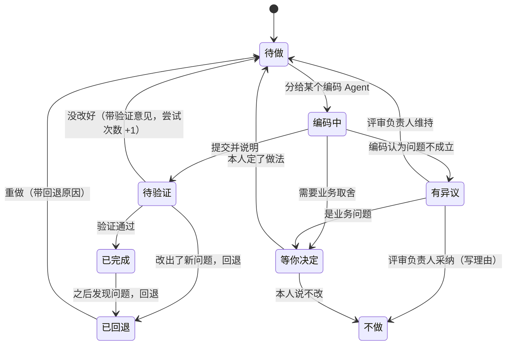
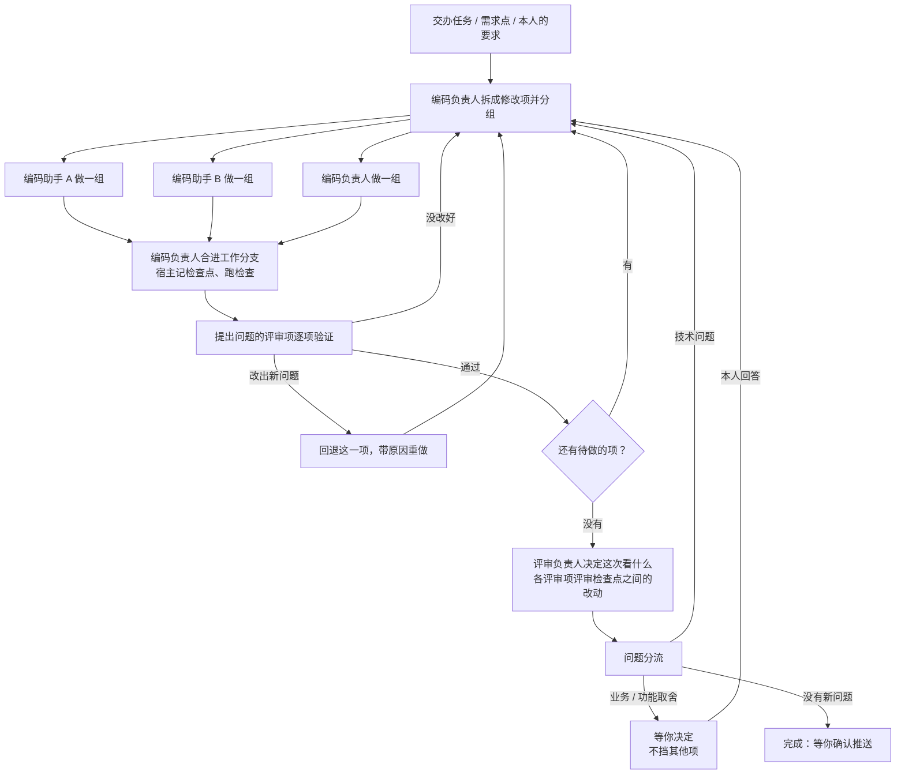

# 编码与评审怎么推进（设计稿，未实现）

状态：2026-10-31 初稿。实现前先按本文核对，有变化改本文。它替换 [review.md](review.md) 里的档位、计划确认和“按轮续改”，保留评审项（Agent 档案）、`submit_review`、需求拆分、分支评审和外部 Agent 编码与评审。

## 1. 要的是什么

本人用下来提出的问题，归成六条要求：

| 要求 | 现在 | 差在哪 |
| --- | --- | --- |
| 1. 推进不卡在本人身上：小问题自己改完，只有业务和功能上的取舍才问本人；要问的不挡住别的事，本人随时可以补充 | 第一轮编码完，「完整」档先停下等本人确认评审计划（`confirmPlan`，默认开）；每次评审结束发一张结果卡片，点“按评审修改”才继续；自动续轮到 3 轮就停 | 每一步都要本人点；没点就一直挂着，开了下一轮旧卡片也还在 |
| 2. 评什么由 AI 按改动判断，不靠死规则 | 按改动行数、文件数、路径命中档位（一万多行、大半是搬动的 mock 资源，也落在「完整」档，五项全跑），之后模型只能升降一档 | 行数说明不了改的是什么：搬 mock 资源和改退款金额的计算行数可能差不多，要看的完全不同 |
| 3. 问题一个个改到位 | 一轮把选中的问题拼成一份任务交给一个编码会话（实际用下来一轮常有二三十个问题）；下一轮评审项各自重看整份 diff | 有的没改、有的改了一半，要等整轮评审才发现；也说不清哪次提交对应哪个问题 |
| 4. 用上多 Agent：并行编码、主编码合并、评审和编码来回沟通 | 每轮一个编码会话；评审项每轮新开会话；编码和评审之间只有修改单 | 难度和数量都只能排队；评审项记不住自己上次说了什么；编码有异议没处说 |
| 5. 能回退：自动或手动，回退一部分，过后发现问题也能回退 | 只能丢弃整个交办 | 改坏一处只能往前修，修不好就整份重来 |
| 6. 本人随时在网页或 VS Code 里看代码，看某几次变更或从头到现在的全部 | 每轮的 diff 都是从起点累计的；按轮切换看到的是累计结果 | 看不了“这个问题改了什么”“上次看过之后又改了什么” |

由此定下的原则：

- **推进的单位是修改项，不是轮。** 每个修改项有自己的完成标准、提交、验证和状态；“一轮”只剩下历史里的分批。
- **只有两类事等本人：业务或功能上的取舍，和对外的动作（推送、确认）。** 其余由 Agent 自己推进到完成，或推进到预算用完、陷入僵持时停下来说明。
- **问本人不挡别的。** 问题挂在修改项上，这一项停着，其他照做。
- **每个改动都能单独看、单独回退。** 一项一组提交，带修改项编号；检查点记下每一步之后的样子。
- **宿主只管状态、调度、预算和 Git 操作；拆分、分组、判断看什么、裁决问题都由 Agent 做**（产品原则：不在宿主里替模型规划）。

## 2. 修改项与检查点

### 2.1 修改项（task）

一次交办（以第一个运行为根）有一张修改项清单，编号 T1、T2…。来源：

| 来源 | 例子 | 完成标准从哪来 |
| --- | --- | --- |
| 交办任务本身 | “退款只按未发货的行计算” | 编码负责人拆分时写；挂了需求点的，用需求点的验收 |
| 评审问题 | 问题 #12：退款单取消后“重新申请”入口消失 | 问题的“触发条件 / 问题 / 建议” |
| 本人的要求 | 补充、在代码上留的修改点、回答问题时写的话 | 本人的原话 |
| 回退后重做 | T7 回退了，重做 | 原来的标准 + 回退的原因 |

状态：



- 尝试次数到 3 次，或同一个原因被打回两次，这一项转成“等你决定”（编码和评审僵持），其他项不受影响。
- “不做”和“等你决定”的结论写进事项时间线（沿用现在“不改”的做法），以后的评审读得到，不再重复提。
- 修改项和评审问题是多对多：一个问题可以拆成几项，几个重复的问题可以并成一项。问题上记 `task_id`，取代现在的 `fixed_by` 和“要改 / 暂不改”。

### 2.2 检查点

每个修改项完成编码、合进工作分支后，宿主记一个检查点：各仓库的提交、包含哪些修改项、谁做的。检查点用 `refs/omem/<交办>/<序号>` 留住（压缩、变基、回退之后旧提交也不会被回收）。看变更、回退、验证都以检查点为界：

- 一个修改项的改动 = 它的提交（提交信息末尾 `Omem-Task: T12`）；
- 两个检查点之间 = `git diff A B`；
- 全部 = 起点到最新检查点（今天看到的累计 diff）。

还在用“未提交改动”方式的旧交办没有提交可依，宿主在检查点用 `git stash create` 记一个快照提交，同样留成 ref。

## 3. 谁做什么

| 谁 | 做什么 | 会话 | 主要工具 |
| --- | --- | --- | --- |
| 编码负责人（`coder`，主编码） | 把交办拆成修改项、分组、决定自己做还是分给编码助手；做难的和跨模块的项；把编码助手的分支合进工作分支、解决冲突；回答编码助手的问题；做完后待命，新的修改项到了接着做 | 整个交办一个，续着用；上下文超过 `codeResumeMaxTokens` 就换新会话，从工作分支和修改项清单接着做（现有机制） | `plan_tasks`、`dispatch_tasks`、`integrate`、`finish_task`、`report_task`、`revert_task` |
| 编码助手（`coder`，第 2–N 个） | 做分到的一组修改项，每项一组提交；有疑问问提出问题的评审项或编码负责人 | 每组一个，组里的项被打回时续着改 | `finish_task`、`report_task`、`consult` |
| 评审负责人（`review-lead`） | 决定每次评审看什么、谁来看、看多深（取代档位）；把问题分成自动改 / 问本人 / 驳回；裁决编码的异议；判断什么时候算完成 | 整个交办一个，续着用 | `plan_review`、`rule_review`、`rule_dispute` |
| 评审项（`reviewer`、`review-business`……和本人建的专项） | 评审一段改动；验证自己提出的问题有没有改好 | 每个评审项在一个交办里一个会话：验证时续着用，记得自己当初为什么提；上下文太大或要求“换个视角”时新开 | `submit_review`、`verify_tasks`、`consult` 的回答 |
| 主助手（`assistant`） | 交办的发起和汇报：完成、暂停、有新问题时在原会话里说明；本人在会话里说的补充转成修改项 | 原会话 | `delegate_code`、`message_code_run`、`work_status` |
| 宿主（推进器） | 修改项状态、调度、预算、工作区和 Git 操作（建分支、合并、回退、检查点），记录每一步 | — | — |

**沟通**：

- `consult`：编码 Agent 对某个问题有疑问（“你说的 X 指的是哪条路径？”），问提出它的评审项；在那个评审项的会话里同步回答（和现在的 `ask_agent` 一样是一条可见的子运行），回答记在修改项上。
- 异议：编码认为问题不成立时 `report_task(disputed, 理由)`，不硬改；评审负责人裁决，裁决和理由记在修改项上，评审项以后看得到。
- 编码助手之间不直接沟通：分组时就避开同一批文件；确实撞上的由编码负责人在合并时处理。

## 4. 推进循环



宿主是一个按事件推进的状态机：修改项状态变了、某个运行结束、本人说了话，都重新算一遍“现在能做什么”，能并行的同时开。

### 4.1 拆分与分组

- 第一次由编码负责人读任务、事项材料和需求点，用 `plan_tasks` 写修改项（标题、完成标准、预估大小、预计改哪些文件、依赖）。挂了需求点的，一个功能点至少一项。
- 分组也是编码负责人定（`dispatch_tasks`），宿主只给参考：各项预计的文件有没有重叠、哪些项互相依赖、有几个空闲工作区和模型名额。原则：改同一批文件的放一组；小项攒成一组；难的、跨模块的留给自己；总共只有两三项就不分。
- 新的修改项（验证打回、评审问题、本人补充）到了，编码负责人决定插进哪一组或开新组；编码助手正在做的组，新项作为补充交给它（沿用 `message_code_run` 的投递）。

### 4.2 并行编码与合并

- 编码助手在自己的工作区里，从工作分支最新的检查点切出 `omem/<交办>/g<n>`，每做完一项提交一次（宿主检查提交信息里的 `Omem-Task`，漏了的由宿主补成该项的提交）。
- 一组做完，编码负责人用 `integrate` 把这组的提交按顺序拣到工作分支上（保持一项一组提交、历史是直的）；冲突交给编码负责人在自己的工作区解决，解决不了的项退回“待做”并写明原因。
- 合进去之后宿主跑这个仓库的检查命令；检查不过，按提交找到引入失败的那一项（`git bisect` 范围只在这组里），打回给做它的 Agent。
- 并行上限：设置里的“同时编码”（默认 3），再受工作区池（每仓库最多 4 个）和模型名额（capacity）限制，超出的组排队。工作区复用依赖缓存，所以开编码助手的主要成本是模型名额。
- 多仓库的交办：一组可以跨仓库，宿主为这组涉及的每个仓库各借一个工作区。

### 4.3 逐项验证

- 每个“待验证”的项交给提出它的评审项（一个项来自几个问题时，各自验证自己那条）；本人提的和拆分出来的，由评审负责人指定谁验证。同一个评审项的几项一起验证，一次运行。
- 验证读的材料：问题原文、修改项的提交（只这一段 diff）、编码的说明和 `consult` 记录。评审项续用自己的会话，所以记得当初的判断；会话太大或连续两次判断不一致时新开会话，避免一直坚持错的结论。
- 结论（`verify_tasks`）：通过 / 没改好（写还差什么）/ 改出了新问题（写证据，可以同时用 `submit_review` 报新问题）/ 问题本身不成立（撤回）。
- 验证只看这一项的改动，不重看整份 diff；整体的事交给阶段评审。

### 4.4 阶段评审：AI 决定看什么

“待做”清空时（或改动累积较多时，由评审负责人判断），评审负责人决定这一次评审，取代档位：

- 宿主只给事实，结论由它自己下：
  - 上次评审之后的改动，按类别（源代码、测试、样式、配置、文档、mock 与资源、二进制、锁文件）和目录汇总，移动和重命名单列，不算代码改动；
  - 涉及哪些修改项和需求点；
  - 之前各评审项看过哪些文件，提过多少问题，多少被采纳；
  - 本人的评审偏好（设置里写的一段话，加上这次交办里本人说的）；
  - 还剩多少预算。
- 它用 `plan_review` 给出：哪些评审项参加、各看哪些文件 / 修改项 / 变更点、重点问什么、续会话还是新开；没参加的写一句为什么。例：只搬了 mock 资源 → 只让功能评审确认引用路径都改了；改了退款状态流转 → 业务、功能必看，历史评审查以前退款类的案例。
- 宿主只校验：评审项存在、不超预算；本人点名要的（“加上安全评审”）必须在里面。
- 交办第一次阶段评审时同时做需求拆分（现有的 `submit_change_points`）；之后只在改动涉及新的需求点时更新拆分。
- 收尾时如果之前每次阶段评审都只看了局部，评审负责人再决定要不要对全部改动做一次整体的检查（通常是架构和业务各看一眼）。

设置里的“档位”去掉，换成两项：**评审偏好**（一段话，例如“业务评审每次都要；规范评审只看新增文件”）和**预算**（见 4.6）。评审项本身（内置五项和专项档案、阻塞级别）保持不变。

### 4.5 问题分流

每条新问题由评审负责人分到三处之一（`rule_review` 扩展）：

| 分到 | 什么样的问题 | 之后 |
| --- | --- | --- |
| 自动改 | 缺陷、边界、遗漏的测试、和约定不符、多余改动这类有明确对错的技术问题 | 变成修改项，直接做 |
| 问本人 | 需求没说清或材料互相矛盾；用户看得到的行为有几种合理做法；超出原需求的范围；数据迁移、对外接口、性能与成本的取舍 | 变成“等你决定”的修改项，附问题、几个选项和各自的影响 |
| 驳回 | 误报、和本人已定的不改相冲突、只是风格偏好且项目没有约定 | 写理由，不做 |

评审项提交问题时可以自己标“需要本人决定”并写出问题，评审负责人确认。“提示”级的问题默认不做，只在同一处本来就要改时顺带。

### 4.6 什么时候停

- **完成**：没有待做的项，最近一次阶段评审没有新的要改的问题，检查通过。状态是“完成，等你确认”；还有“等你决定”的项时一并列出。确认（推送、应用）仍由本人做，Agent 不做对外的动作。
- **预算到了**：每次交办在本人上次说话之后最多用多少 Agent 运行（默认 40 个）和多长时间（默认 4 小时），到了就暂停并汇报做到哪、剩什么；本人说“继续”就再给一份预算。取代现在“自动最多 3 轮”。
- **僵持**：见 2.1，只停那一项。
- **不收敛**：连续三次阶段评审，要改的问题数都没有减少，暂停并请评审负责人写一段“方案复核”（沿用现在的升级），交给本人。
- **外部阻塞**：检查命令或依赖因为权限、配额失败两次以上（比如拉接口定义 403），这一项转“等你决定”并写明是什么挡住了。

## 5. 回退

### 5.1 能回退什么

| 单位 | 怎么做 | 冲突时 |
| --- | --- | --- |
| 一个修改项 | 在工作分支上 `git revert` 它的提交，生成一个“回退 T7”的提交 | 后面的项改过同一处：交给编码负责人解决，解决不了就提示连同后面相关的项一起回退 |
| 一个检查点之后的全部 | 把工作分支移回那个检查点；之后的提交留在 `refs/omem/<交办>/undo/<n>`，可以撤销 | 无（只移动分支） |
| 一个文件 | 把这个文件恢复成某个检查点（或起点）的样子，提交 | 无 |
| 选中的几行 | 网页或 VS Code 里选中 diff 的几行，反向应用这一小段（`git apply -R --3way`），提交 | 应用不上就交给编码负责人按说明手工回退 |

- 回退都是新的提交，历史里看得到谁、什么时候、为什么回退；只有“回到检查点”是移动分支，并留着撤销的入口。
- 回退的修改项状态变成“已回退”；选“回退并重做”时生成一个新项，带上原来的完成标准和回退原因，编码 Agent 能看到失败的那次尝试。
- 回退之后受影响的验证结论作废：宿主找出改过同一批文件的已完成项，交给它们的评审项重新验证。

### 5.2 自动回退

验证结论是“改出了新问题”时，由编码负责人决定往前修还是回退重做；宿主的默认：这一项的提交之后没有别的项改同一批文件，就自动回退并重做一次；否则往前修。同一项最多自动回退一次，再出问题就转“等你决定”。

### 5.3 本人回退

任何时候（包括交办完成、推送之后）都可以在修改项、检查点、文件或选中的行上点“回退”，可以附一句原因。交办已经确认推送的，回退会让交办重新打开（工作分支还在），回退的提交照常经过验证和确认。

## 6. 本人随时介入

- **补充要求**：在运行页、需求页、VS Code 或会话里说；编码负责人把它变成新的修改项或改已有项的完成标准。正在做相关项的 Agent 立刻收到（现有的补充投递）。
- **在代码上留意见**：网页选中代码“加入修改点”、VS Code 的评论线程，直接成为修改项；“提问”仍是只读的问答。
- **回答问题**：所有“等你决定”的项集中在一处（运行页顶部、首页、飞书的交办卡片），每个独立回答，不用等别的；一项已经因为别的原因不需要决定了（比如相关代码被回退）就自动收起。
- **自己改代码**：本人在工作区或检出的仓库目录里改了、提交了，宿主在下一次调度前把它记成一个“本人的修改”检查点（没提交的先替本人提交），之后的评审会看到，Agent 不会覆盖或回退它，除非本人要求。
- **暂停 / 继续**：一个开关；暂停时正在跑的 Agent 做完手上这一项就停，不再开新的。

通知：一个交办一张卡片（飞书）一直更新：进度（几项完成 / 共几项）、现在谁在做什么、等你决定的问题（每个带选项）。第一次出现要你决定的事、完成、暂停时提醒一次，不按轮发新卡片。首页“需要你回答”按交办聚合。

## 7. 看变更

- **范围**：全部（从起点到现在）/ 我上次看过之后（按本人记住每个交办最后看到的检查点）/ 某几个修改项 / 两个检查点之间 / 某个 Agent 做的。选几个不相邻的修改项时按项分段显示，每段是它自己的提交。
- 每个文件标出新增、删除、移动（从哪儿来）、二进制；图片显示改动前后，其他二进制给下载（已实现，2026-10-31）。
- 每段改动旁边是它对应的修改项、来源问题、验证结论；变更点视图照旧，也能按范围看。
- **VS Code**：插件侧栏列出修改项和检查点，点一项或选两个检查点，用 VS Code 的多文件对比打开那一段（左边是 `git` 里的旧版本）；工作分支本身就在工作区里，源代码管理面板、`git log`、时间线都能直接用。修改项上“回退”、评论线程“加入修改点”和网页一致。

## 8. 界面

- **运行页（编码交办）**：顶部一行状态（推进中 / 暂停 / 完成，等你确认）、预算用了多少、现在各 Agent 在做什么；下面“等你决定”。标签：
  - 概览：修改项清单，按状态分组，每项显示来源、谁做的、提交数、验证结论、尝试次数，可以回退、重开、改成不做、提问；
  - 变更：范围选择 + 文件树 + diff（第 7 节）；
  - 评审：每次阶段评审（谁参加、为什么、看了什么、结论）和逐项验证的记录；
  - 活动：所有运行的过程，加上合并、回退、检查点这些宿主的操作。
- 去掉：开始修改时的档位和评审项选择、评审计划确认卡片、每轮结束的“按评审修改 / 先不改”卡片、轮次切换（历史里按检查点看）。
- **需求页**：一次交办仍算一项，阶段换成修改项进度（“12/15 完成 · 等你 2”）；需求点上的状态按验证结论更新，不再等整轮评审。
- **首页**：“需要你回答”按交办聚合问题。

## 9. 数据与接口（草案）

```sql
create table code_tasks (
  id integer primary key autoincrement,
  work_id text not null references runs(id),   -- 交办的第一个运行
  seq integer not null,                        -- T1、T2…
  title text not null,
  done_when text not null default '',          -- 完成标准
  kind text not null,                          -- build | fix | owner | redo | revert
  origin text not null default '{}',           -- {findings:[…], reqs:[…], note, redoOf}
  state text not null,                         -- todo | coding | verify | done | owner | disputed | wontdo | reverted
  question text, options text, answer text,    -- 等你决定时
  lane text,                                   -- lead | g1 | g2…
  coder_run text, verifier text,               -- 正在做的运行；谁验证（评审项名）
  attempts integer not null default 0,
  commits text not null default '{}',          -- {仓库空间: [sha…]}
  checkpoint integer,                          -- 合进去时的检查点
  notes text not null default '[]',            -- 验证意见、consult、异议与裁决
  created_by text not null, created_at text not null, updated_at text not null,
  unique(work_id, seq)
);
create table code_checkpoints (
  work_id text not null references runs(id),
  seq integer not null,
  heads text not null,                         -- {仓库空间: sha}
  tasks text not null default '[]',
  by text not null,                            -- 运行 id、owner、revert
  label text not null default '',
  created_at text not null,
  primary key (work_id, seq)
);
alter table review_findings add column task_id integer references code_tasks(id);
```

- 运行：编码负责人、编码助手是 `code` 运行（`input.lane`、`input.taskIds`），验证和阶段评审是 `review` 运行（`input.mode: verify | stage`）；都挂在交办的第一个运行下面。推进器的状态（预算、暂停、本人上次说话的时间）放在第一个运行的 `output.work`，重启后按修改项状态恢复。
- 工具（`code` 分组，只给对应角色的放 `ROLE_TOOLS`）：`plan_tasks`、`dispatch_tasks`、`integrate`、`finish_task`、`report_task`、`revert_task`、`consult`、`verify_tasks`、`plan_review`、`rule_dispute`；本人和主助手用 `work_status`、`answer_task`、`revert_code`、`pause_code_work`。
- 接口：`GET /api/runs/:id/tasks`、`POST /api/runs/:id/tasks`（本人加项、改状态、回答）、`GET /api/runs/:id/diff?from=&to=&tasks=`、`POST /api/runs/:id/revert`（`{task | checkpoint | file | patch}`）、`POST /api/runs/:id/pause`。VS Code 插件同样只用这些接口。
- 外部 Agent（`omem tool --peer`）：编码时认领修改项、`finish_task`；评审时 `submit_review` / `verify_tasks`，和本机的 Agent 一样进推进循环。

## 10. 和现在的关系

| 现在 | 之后 |
| --- | --- |
| 档位（条件、评审项、轮数、计划确认、轮换模型） | 评审负责人每次决定；设置里只剩评审偏好和预算；轮换模型变成“换个视角时新开会话用另一个模型”的选项 |
| 自动续轮最多 3 轮 | 预算（运行数、时间） |
| 评审计划确认卡片、结果卡片、停下卡片 | 只有“等你决定”的问题和完成 / 暂停的提醒 |
| 按轮的修改单（`changeRequest`） | 修改项 |
| 问题的“要改 / 暂不改 / 不改” | 自动分流；本人仍可以把任何问题改成“不改”（写理由）或“以后再说” |
| 评审项每轮新会话、重看整份 diff | 逐项验证续会话；阶段评审只看新的改动 |
| 每轮累计 diff | 按修改项和检查点看，任意范围 |
| 只能丢弃 | 按修改项、检查点、文件、几行回退 |
| 分支评审（只评不改） | 不变：只出问题；本人说“改”时，选中的问题成为一个新交办的修改项 |

已有的交办（按轮的）照旧跑完；本人在旧交办上开始修改时，选中的问题转成修改项，从那一刻起按新的方式推进。

## 11. 分阶段

1. **修改项、逐项验证、检查点（单个编码 Agent）。** 修改项清单和状态机；编码负责人一项一组提交；提出问题的评审项逐项验证（续会话）；阶段评审由评审负责人决定看什么（去掉档位和计划确认）；问题分流和“等你决定”不阻塞；预算和暂停；按修改项和检查点看 diff、“上次看过之后”；回退修改项和回到检查点。验收：交办一个十来项的需求，中间不点任何按钮能做到“完成，等你确认”；故意让一项改坏，看到它被自动回退重做；本人回答一个问题时其他项一直在推进。
2. **并行编码与沟通。** 编码助手、分组与合并、检查失败按提交定位、`consult` 和异议裁决。验收：二十项以上的修复分三组并行，合并冲突由编码负责人解决，每项仍有自己的提交和验证。
3. **VS Code 和细粒度回退。** 插件的修改项与检查点视图、多文件对比、回退、评论线程转修改项；网页按文件和选中的行回退；本人自己的修改记成检查点。
4. **调优。** 统计每个评审项提的问题被采纳、被打回、被驳回的比例，交给教练复盘（评审项的说明、评审负责人的取舍）；预算按实际用量给建议。

每阶段一个可提交的功能切片，跑 `pnpm run check`，用真实 Agent 在一个真实交办上走一遍。

## 12. 需要本人定的

1. **默认预算**：本人上次说话之后最多 40 个 Agent 运行、4 小时。偏大还是偏小？
2. **自动回退**：按 5.2，提交之后没有别的项改同一批文件就自动回退重做一次。可以，还是回退都先问？
3. **“提示”级问题**：默认不做（只在同一处本来要改时顺带）。还是也自动做？
4. **第一阶段先不做并行**：先把修改项、验证和回退做扎实，第二阶段再并行。原因是没有逐项提交和验证时并行只会放大“没改完、说不清改了什么”的问题，合并也没法审。可以接受，还是并行要放进第一阶段？
