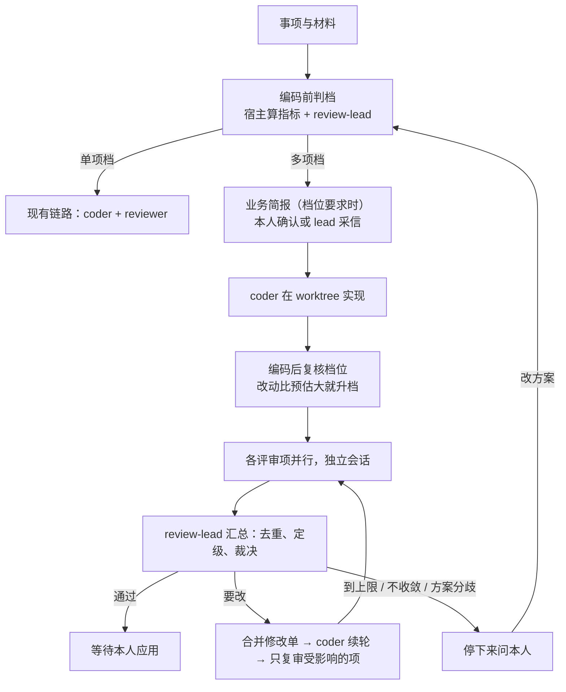

# 分档、多角度的评审方案（设计稿，未实现）

状态：2026-10-24 初稿，同日修订；第一、二阶段已实现（见 8 节和 4.4），其余仍是设计。实现前先按本文核对，有变化改本文。现有实现是交办编码链：worktree → 检查 → 单个 `reviewer` → 自动续轮（最多 3 轮），见 architecture.md 第 5 节和 `src/agents/code-chain.ts`；本文是它在中大型改动上的扩展，不替换小改动的链路。

可点击原型：`docs/v2/design/review-prototype.html`（直接用 `web/src/styles.css`，和网页同一套样式；1440 / 390 截图在 `design/screens/`）。

## 0. 修订要点（相对初稿）

初稿把档位阈值、每档跑哪些赛道写在 `config.review` 的 JSON 里，五个赛道是写死的五个角色文件，界面是一套独立的三栏页面。修订后：

1. **档位和评审项都是用户能改的数据。** 档位是一张有序清单（默认“轻 / 标准 / 完整”三档），每档的触发条件、做哪些评审、最多几轮、要不要先给本人看计划都能在网页上改，也能加档、删档。评审项（初稿叫“赛道”）就是 Agent 档案：内置五项是内置角色，可以像其他内置角色一样自定义；“安全评审”“性能评审”这类专项新建一个档案、勾上“用作评审项”即可。
2. **设置放在 Agent 页。** 列表顶部在“Agent 档案 / 技能”之外加“评审”标签：上半是档位，下半是评审项。评审项同时出现在 Agent 档案列表里（带“评审”徽标），提示词、默认 AI、技能、记忆都走档案原有的编辑和学习机制，不另建一套。
3. **触发条件复用规则的条件编辑器。** 档位“什么时候用”和专项“额外在什么时候加上”都用 `RuleConditions`，字段是宿主算好的改动指标（改动行数、文件数、仓库数、改动路径、检查是否通过、事项标签……）。初稿的 `sensitivePaths` 清单变成档位条件里的“改动路径包含”，不再是单独的配置项。
4. **工作集并入事项。** omem 已经用事项表示“一件事”（有时间线、关注、提醒、引用）。初稿另建 `worksets` 容器，用户要分清两个几乎一样的东西。改为给事项加“材料清单”（文档、群、会话、仓库 + 分支），业务简报和变更视图都挂在事项上。
5. **界面回到现有风格。** 不再做带独立侧栏的三栏页面。评审结果放在运行详情（编码交办）里，分“概览 / 变更 / 评审 / 活动”四个标签；讲解和就地提问用右侧抽屉（和引用抽屉同一交互），代码区不被常驻第三栏挤窄。去掉首次进入的三步引导和行内气泡，用行号旁的变更点标记加一行图例代替。
6. **落地顺序调整。** 先做“可配置的多评审项 + 结构化结论”（马上能用，不依赖简报），再做 review-lead 协调，再做事项材料与业务简报，最后做变更视图。

## 1. 要解决的问题

现有一个内置评审角色能审功能是否实现、正确性、破坏性和多余改动，对小改动够用。中大型改动的缺口：

1. **评审角度互相干扰。** 功能正确性、风格规范、架构取舍、业务理解、历史问题回扫要查的材料和判断标准不同；塞在一个会话里，上下文互相挤占，结论还会互相覆盖。
2. **评审角度固定。** 不同仓库、不同团队要的专项不一样（安全、性能、数据迁移、接口兼容……），现在只能改 reviewer 的提示词，改了又影响所有改动。
3. **缺少项目上下文。** 一个需求要同时对照需求文档、讨论群、设计稿、各仓库的目标分支才能评审；事项现在只有扁平的 `source_refs`，登记不了仓库和分支。
4. **业务理解没有基线。** “代码实现的业务和需求约定的是否一致”需要先有一份需求业务语义的基线，否则只能让评审现场通读文档，结论随发挥漂移。
5. **没有成本分级和协调者。** 每个改动都跑全部评审项是浪费；意见互相矛盾、评审和编码来回修改时，没有负责人判断哪些意见成立、是否该回到方案层。
6. **人看不懂。** 运行页能看到 diff 和评审原文，但“需求 → 变更点 → 哪些代码 → 为什么这么写”没有视图。

## 2. 全貌

四个部件：

1. **评审设置**：档位清单 + 评审项（Agent 档案），本人在 Agent 页维护。
2. **评审负责人 `review-lead`**：编码前后各判一次档，按档启动评审项；多项并行时汇总去重、裁决、安排修改轮和复审，带上限和“回到方案”升级。
3. **事项材料与业务简报**：事项的材料清单 + `business-analyst` 写的简报（业务规则、编号变更点），作为业务评审的基线。
4. **评审结果与变更视图**：运行详情里的“本次评审”摘要和“变更”标签（变更点 ↔ 代码双向定位、分轮查看、就地提问）。

### 2.1 端到端流程



只含一个评审项且不开协调的档位，行为完全等于今天的链路；默认的“轻”档就是这样，是兜底档。

## 3. 评审设置：档位与评审项

### 3.1 评审项 = Agent 档案

评审项不新增实体：内置的是内置角色，专项是普通档案。实现时评审项的设置（简称、阻塞级别、额外加入的条件和说明）统一放在 `config.review.checks`，内置和专项一样处理，不写进档案 frontmatter；下面是最初设想的写法，作用相同：

```yaml
---
name: security-review
description: 只看鉴权、注入、密钥和越权
tools: [search, scan, read_source, find_symbol, read_page, recall]
review:
  label: 安全          # 列表和结论里显示的短名
  blocks: major        # 这一级及以上的问题挡住应用：blocker | major | minor
  when:                # 可选：任何档位下满足就额外加上
    any:
      - { field: change.paths, op: contains, value: auth }
      - { field: change.paths, op: contains, value: permission }
---
（提示词：审什么、不审什么、依据从哪找）
```

- **内置五项**是内置角色：`reviewer`（功能）、`review-style`（规范）、`review-arch`（架构）、`review-business`（业务）、`review-history`（历史问题回扫）。它们走现有的“自定义 / 恢复源码版 / 三方合并”，默认 AI 在档案页设置。内置项的 `review` 段写在角色文件的 frontmatter 里，本人改的是自定义后的副本。
- **专项**是普通档案勾上“用作评审项”。保存时宿主强制：`writes: false`，工具清单只能是只读工具加 `submit_review`，不能发消息、不能交办、不能写库——和内置评审项同一条边界，不因为档案是本人写的就放宽。
- 评审项照常积累档案记忆、参加复盘（coach），“这个评审老报误报”之类的改进走档案的改进提案，不另建评审知识库。

各项审什么：

| 评审项 | 审什么 | 主要材料 |
| --- | --- | --- |
| 功能（`reviewer`） | 需求是否真正实现、边界 / 错误处理 / 并发泄漏 / 安全、测试覆盖、多余改动 | diff、检查输出、需求 |
| 规范（`review-style`） | 只报违反项目明确约定的问题：AGENTS.md、lint / 类型约定、命名、测试与文档约定；没有明确依据不报 | 仓库约定文件、diff |
| 架构（`review-arch`） | 模块边界、依赖方向、抽象取舍、和既有架构（Wiki）是否冲突、跨仓库接口是否对上 | Wiki 架构页、调用图、相关空间 |
| 业务（`review-business`） | 业务规则和变更点是否被正确实现、有没有需求外行为、边界案例是否符合约定 | 业务简报、事项材料、diff |
| 历史（`review-history`） | 类似改动以前踩过的坑：案例页、经验记忆、被更正的旧约定、过去的评审结论 | recall（含历史）、cases、过去 run、git 历史 |

### 3.2 档位

档位存在 `config.review.tiers`，有序，从上往下第一个条件命中的档生效，最后一档条件为空（兜底）：

```json
{
  "review": {
    "tiers": [
      { "id": "full", "name": "完整", "when": { "any": [
          { "field": "change.repos", "op": "gte", "value": 2 },
          { "field": "change.lines", "op": "gte", "value": 600 },
          { "field": "change.paths", "op": "contains", "value": "migration" } ] },
        "checks": ["reviewer", "review-business", "review-arch", "review-history", "review-style"],
        "lead": true, "maxRounds": 3, "confirmPlan": true, "brief": "wait" },
      { "id": "standard", "name": "标准", "when": { "any": [
          { "field": "change.lines", "op": "gte", "value": 80 },
          { "field": "change.files", "op": "gte", "value": 3 } ] },
        "checks": ["reviewer", "review-business", "review-style"],
        "lead": true, "maxRounds": 2, "confirmPlan": false, "brief": "optional" },
      { "id": "light", "name": "轻", "when": null,
        "checks": ["reviewer"], "lead": false, "maxRounds": 3, "confirmPlan": false, "brief": "off" }
    ],
    "rereviewAllEvery": 2
  }
}
```

| 字段 | 含义 |
| --- | --- |
| `name` | 显示名，可改 |
| `when` | 条件，结构同规则（`all / any / not` + 叶子）；为空表示兜底 |
| `guide` | 一句话说明什么时候用（条件写不出来时），第一轮由模型对照改动判断；只能让档位变重 |
| `checks` | 这一档跑哪些评审项（档案名） |
| `lead` | 是否由 review-lead 协调；关掉时只跑第一项，等于现有链路 |
| `maxRounds` | 自动续轮上限（取代这一档的 `autoAdvance.codeRounds`） |
| `confirmPlan` | 开始评审前把计划（档位、评审项、理由）给本人看一次 |
| `brief` | 业务简报：`off` 不写 / `optional` 写但不等确认 / `wait` 等本人确认 |

规则：

- 条件字段由宿主确定性计算（见 3.3），模型不凭感觉判档。review-lead 只能在命中档的基础上升或降一档，并写明依据；本人可以在计划里直接改档。
- 专项的 `when` 命中时，不论哪一档都把它加进本次评审（例如“改到 auth 就加安全评审”）。专项也可以写 `guide`（如“改了数据库查询或循环里有 IO”），由模型判断是否加上。
- 有说明的档位和评审项在第一轮编码完成后一起问一次模型（`refineReviewPlan`），回答不了就只按条件；本人点名的档位不被说明改变。
- 编码前用预估指标判一次（来自任务和事项材料，可能为空），编码后用实际 diff 再判一次，只升不降。
- 本人在任务里点名“完整评审”“加上安全评审”时以本人为准，记入计划理由。
- 删除评审项档案时，引用它的档位标出“缺少评审项”，不静默跳过。

### 3.3 条件字段

| 字段 | 说明 |
| --- | --- |
| `change.lines` / `change.files` / `change.repos` | 增删行数、文件数、仓库数（`git diff --stat`，已有） |
| `change.codeLines` | 有效代码改动行数：只算源代码文件（`chunk.ts` 的 `isSourceFile`，按扩展名，不含文档、锁文件、JSON/YAML、样式和压缩文件）。迁移、带大量 mock 或锁文件变动的分支用它比 `change.lines` 准 |
| `change.paths` | 改动文件路径（数组，`contains` 任一命中） |
| `change.checksPassed` | 检查命令是否全部通过 |
| `item.tags` / `item.priority` | 关联事项的标签、优先级 |
| `item.repos` | 事项材料里的仓库数 |
| `task.text` | 交办任务原文（关键词） |

比较运算在现有 `equals / contains / startsWith / endsWith / in / is` 之外加 `gte / lte`（数值字段）。字段说明和选项通过 `/api/review-options` 给前端，`RuleConditions` 已支持字段说明和下拉选项。

### 3.4 设置界面（Agent 页 → 评审）

左列表：

- **档位**：按匹配顺序列出，每行“名称 · 几项评审 · 最多几轮”，选中可上移；底部“＋ 新建档位”。
- **评审项**：内置在前、专项在后，每行“短名 · 档案名 · 默认 AI”；底部“＋ 新建专项评审”（建一个带评审模板的档案）。

右侧编辑档位：

1. 名称；
2. **什么时候用**：条件编辑器，下方一行“最近 30 次编码交办里有 N 次落在这一档”帮助判断阈值；
3. **做哪些评审**：评审项勾选（卡片式，显示短名、说明、默认 AI），勾选顺序即汇总时的展示顺序；
4. **怎么推进**：由负责人协调（开关）、最多几轮（数字）、开始前给我看计划（开关）、业务简报（不写 / 写但不等 / 等我确认）；
5. 粗略成本：每轮 N 个评审运行 + 1 个协调运行。

右侧编辑评审项：短名、挡住应用的级别、额外加入条件，下方链接“编辑提示词、默认 AI 和技能 →”跳到档案。内置项显示“内置 · 已自定义 / 源码版”。

## 4. 评审负责人与结构化结论

### 4.1 review-lead

新内置角色 `review-lead`（只读 + 编排工具，不写代码、不直接改库）：

- 编码前判档：读任务、事项材料和宿主算的指标，产出评审计划；
- 编码后复核：拿实际 diff 和检查结果，必要时升档；
- 每轮汇总：去重合并、裁决、打包修改单、决定复审范围；
- 到停止条件时写“方案复核”，用 `ask_owner` 给本人选项。

计划存在发起 run 的 `output.reviewPlan`：`{tier, reasons, checks, estimatedRounds, briefRunId, createdAt}`，网页和飞书卡片都能看到；`confirmPlan` 的档位等本人点“开始”或改档后开始。

### 4.2 结构化结论

评审项第一行仍写结论，随后用新工具 `submit_review(verdict, findings[])` 提交（评审项名由运行上下文决定，不让模型自报）。`findings` 每条：

```json
{
  "severity": "blocker | major | minor | nit",
  "file": "src/refund.ts",
  "line": 88,
  "title": "一句话问题",
  "detail": "问题与依据",
  "suggestion": "建议怎么改",
  "evidence": ["src:<id>#L10-L20", "mem:<id>"],
  "change": "C2",
  "confidence": "high | medium | low"
}
```

```sql
create table reviews (
  id text primary key,
  code_run_id text not null references runs(id),
  item_id text references items(id),
  round integer not null default 1,
  check_name text not null,     -- 评审项档案名
  run_id text references runs(id),
  profile_id text, model text, effort text,
  verdict text not null,        -- approved | changes_requested | failed
  summary text not null default '',
  status text not null default 'done',  -- done | superseded
  created_at text not null
);
create table review_findings (
  id integer primary key autoincrement,
  review_id text not null references reviews(id) on delete cascade,
  severity text not null,
  file_path text, line integer,
  title text not null, detail text not null,
  suggestion text not null default '',
  evidence text not null default '[]',
  change_ref text,
  confidence text not null default 'medium',
  state text not null default 'open',  -- open | accepted | rejected | merged | fixed | stale
  merged_into integer,
  triage_note text not null default ''
);
create index review_findings_review on review_findings(review_id);
create index reviews_run on reviews(code_run_id, round);
```

单项档也写 reviews（reviewer 切到 `submit_review`，正则判结论保留作兜底），这样“本次评审”摘要对所有档位一致。

### 4.3 汇总、协调与防死循环

每轮评审结束后：

1. **去重合并**：不同评审项报的同一问题合成一条，保留来源；
2. **裁决**：逐条接受 / 驳回（写理由）；评审项之间冲突（架构要抽象、功能要最小改动）依据需求与约定裁决，拿不准就升级本人，不自己挑一个；
3. **打包**：接受的、达到该评审项 `blocks` 级别的问题合成一份带编号的修改单，coder 在原会话续轮（复用 `queueNextCodeRound`）；以下的级别列出但不阻塞；
4. **复审范围**：下一轮只重跑受影响的评审项（coder 说明改了哪些文件 / 变更点，lead 映射到评审项）；每 `rereviewAllEvery` 轮全部重跑一次。

自动停止（任一命中就不再续轮，记 `awaiting-owner` 并通知本人）：

- 到这一档的 `maxRounds`；
- 本轮接受的阻塞问题数不比上一轮少（没有收敛）；
- 同一问题连续两轮被报未修（coder 和评审僵持）；
- 根源是需求或方案分歧（业务评审说需求要 A，简报显示没定；或架构意见要求换方案）；
- 检查命令持续失败且两轮没修好。

升级时 lead 写“方案复核”：分歧点、双方依据、建议（改需求 / 改方案 / 拆小 / 接受技术债），本人选择后可以改简报重评、调整方案后重新判档，或明确接受并应用。不允许 lead 靠反复续轮把方案问题磨过去。本人仍可手动 `continue_code_run` 突破上限。

任一评审项运行失败不阻塞其他项：lead 标“失败”并重试一次，仍失败就在结论里写明缺了哪一项。

## 5. 事项材料与业务简报

### 5.1 材料清单（取代初稿的工作集）

```sql
create table item_materials (
  id integer primary key autoincrement,
  item_id text not null references items(id) on delete cascade,
  kind text not null,      -- source | message | conversation | repo | page
  ref text not null,       -- 原件 id / msg:<id> / 会话 id / 仓库空间 id / space:slug
  title text not null default '',
  note text not null default '',
  spec text,               -- kind=repo：{"branch":"feature/x","base":"main"}
  line_start integer, line_end integer,
  version text,            -- 简报时的快照：原件 hash、会话最新消息时间、commit
  added_by text not null default 'agent',
  created_at text not null,
  unique(item_id, kind, ref)
);
```

- 只存引用不复制正文；权限按成员所在空间解析，读不到的标“不可用”，不因为加进事项就获得权限。
- 工具：`update_item` 增加 `materials_add / materials_remove`，`read_item` 返回材料（带当前是否可读、简报后是否变化）；新增 `search_item(item_id, query)`，在材料原件和材料仓库空间内检索、材料优先排序。
- 建立途径：助理按本人消息建事项并加材料；事项详情“材料”区手动加（原件、会话、仓库 + 分支选择器）；原件和会话详情“加到事项”。
- 仓库分支本期只作评审上下文；编码仍从仓库当前 HEAD 建 worktree。

### 5.2 业务简报

`business-analyst` 在档位要求时（`brief` 不为 `off`）编码前跑一次，用 `write_file` 写工作文件 `item/<id>/brief`，挂在事项上：

- 需求要解决的问题和适用场景；
- 业务规则：每条一个可核对的命题，带 `src:` / `msg:` / `mem:` 引用；
- 变更点（C1、C2…）：每个给出预期触及的代码区域；
- 不确定与冲突单独列，不猜；
- 可选的 Mermaid 流程图（第一版由 analyst 写）。

`brief: wait` 时用 `ask_owner` 请本人确认或指出问题让 analyst 改一轮；`optional` 时 lead 记“未确认”直接开始，业务评审按“待确认”给意见。编码完成后由业务评审回填每个变更点的实际实现位置（文件 / 行段 / 置信度），作为变更视图的映射。简报是工作文件不是记忆；其中长期稳定的业务规则照常由 ingest 沉淀为记忆 / Wiki。

## 6. 评审结果与变更视图（运行详情）

编码交办的运行详情顶部：标题、档位徽标、结论徽标、轮次切换（第 1 轮 / 第 2 轮 / 最终）、“应用到仓库 / 丢弃”。下面四个标签：

- **概览**：“本次评审”卡片——总体结论；每个评审项一行（状态、短名、模型、问题数按级别着色、耗时）；待处理问题（编号、级别、评审项、`文件:行`、一句话标题、状态，展开看建议和依据，依据走 CitationDrawer）；相对上一轮新出现 / 已修复 / 仍存在的数量。
- **变更**：左侧变更点列表（编号色点、一句话、实现状态），右侧按仓库分组的文件 diff（复用 Runs 现有渲染，可切“完整文件”用 CodeView）。行号旁有变更点小标记，图例一行写在列表上方。点变更点：只高亮它的行段并滚到第一处；点标记：右侧抽屉打开讲解。映射找不到精确行时退到文件级，标“文件级”。低置信映射不在代码里画标记，只在抽屉里说明。
- **评审**：按轮 × 评审项列出每个评审运行（状态、模型、结论、问题数），点开是该运行的完整活动；lead 每轮的汇总也是一行。
- **活动**：现有运行事件流，不变。

**讲解抽屉**：右侧滑出，和引用抽屉同一交互（Esc 逐层返回、关闭归还焦点）。内容：这条变更点 / 这段代码为什么这么写（coder 说明 + lead 汇总）、相关问题、依据引用；底部“就地提问”输入框，提问带事项 id 和锚点（`C2` 或 `仓库:文件:行`）开一个只读问答回合，回答留在事项的问答记录里。

**手机（≤760px）**：标签保留；“变更”标签里用分段控件在“变更点 / 代码”间切换；抽屉全屏。只有代码块内部允许横向滚动。

**应用之后**：worktree 删除后视图仍可打开，代码从仓库原件读，映射允许行号漂移（退到文件级）。

## 7. 配置、角色与工具清单

- 配置：`config.review.tiers`、`rereviewAllEvery`（3.2）；网页在 Agent 页“评审”标签编辑，`omem setup` 不涉及。
- 档案：`agentSpecSchema` 加可选 `review: { label, blocks, when }`；保存时对评审项强制只读工具。
- 内置角色：`review-lead`、`business-analyst`、`review-style`、`review-arch`、`review-business`、`review-history`；`roleNames` 同步加上。`reviewer` 输出切到 `submit_review`。
- 工具：`submit_review`、`read_reviews(run_id)`；`update_item` / `read_item` 的材料参数、`search_item`；`delegate_code` 加 `item_id?`、`tier?`（不传则判档）。
- 接口：`GET/PUT /api/review-settings`、`GET /api/review-options`、`GET /api/runs/:id/reviews`。
- 存储：`reviews`、`review_findings`、`item_materials` 三张表，迁移加在 db.ts 末尾；协调状态放在发起 run 的 `output.reviewChain`，重启可恢复。
- 权限：新表查询按空间和 userId 过滤；评审运行的读范围 = 事项材料所在空间 + 相关空间 + worktree 临时空间，没有写权限。

## 8. 分阶段落地

1. **可配置的多评审项（已实现，2026-10-24）。** `review` 档案字段与只读校验、`config.review.tiers`（先只有条件、评审项、轮数）、Agent 页“评审”标签、`submit_review` 与两张评审表、多评审项并行跑（宿主按“任一阻塞就要改”合并修改单，暂不去重）、运行详情“概览”标签的“本次评审”卡片。验收：本人新建“安全评审”专项并挂到“标准”档，改动命中时它和功能评审各自独立运行、结论结构化展示。
2. **review-lead 协调（已实现，2026-10-24）。** 编码前后判档、计划确认、去重裁决、增量复审、停止条件与方案复核、飞书进度卡片加评审项行。验收：四种停止条件都会停下来问本人，不自动排下一轮。
3. **事项材料与业务简报（材料已实现，2026-10-25；业务简报未做）。** `item_materials`、材料工具与事项详情“材料”区、`business-analyst`、`review-business` 用简报评审。目前 `review-business` 直接从事项材料拆变更点。验收：文档 + 群 + 多仓库分支归到一个事项，简报带引用和变更点，材料变化有“依据可能过期”提示。
4. **变更视图（已实现，2026-10-25）。** “变更”标签、变更点 ↔ 代码映射、分轮查看、讲解抽屉与就地提问。变更点由业务评审用 `submit_review` 的 `change_points` 提交。需求大时变更点用 `parent` 成树（页面或模块 → 变更点，最多 4 层），网页按文件夹折叠；已有拆分可按本人的要求重新整理（只重做拆分，不重跑评审，原来的变更点和要求一起交给拆分者）。验收：从变更点能定位到行、从行能回到变更点，提问回答带可点开的引用；1440 / 390 无横向溢出。

每阶段一个可提交的功能切片，跑 `pnpm run check` 和真实 Agent 抽查。

## 9. 验收要点

- 默认“轻”档行为与今天一致（同一假 ACP 夹具回归）。
- 档位按顺序匹配，兜底档必在最后；删除被引用的评审项后档位显示“缺少评审项”。
- 专项评审档案即使本人勾了写权限或写类工具，作为评审项运行时也只有只读工具。
- 多评审项是独立运行，可配不同模型；任一失败不阻塞其他项。
- 问题去重、合并、驳回、复审状态流转有确定性测试。
- 到上限、不收敛、僵持、方案分歧都停下来问本人。
- 材料被删或无权限时评审报“依据不可用”，不越权读到内容。
- 新界面全部在应用外壳内，引用走 CitationDrawer，1440 与 390 截图无横向溢出。

## 10. 不做的事

- 不自动应用评审建议、不让机器人合并代码；应用补丁始终本人确认。
- 不做精确费用核算，只记录运行数、模型和耗时。
- 不自动生成流程图 / 架构图；不做语音或视频讲解。
- 不新建“评审知识库”；历史经验继续用案例页和记忆。
- 不做跨仓库目标分支的自动 checkout / 变基。
- 通用代码不按项目或仓库名特判评审项；是否启用只由档位条件、专项条件和本人指定决定。

### 4.4 第二阶段的实现要点（2026-10-24）

- **编码前判档**：任一档开了负责人时，第一轮编码前用一次模型调用（`estimateReview`）按任务估一个档位，记在 `output.reviewEstimate`，在进度卡片和运行页显示；编码后它作为“可以换成的更重档位”之一交给判档。
- **编码后判档**：`refineReviewPlan` 同时权衡档位 / 评审项的说明、编码前预估；开了负责人的档位还可以降一档（要写理由）。本人点名的档位不变。
- **计划确认**：`confirmPlan` 的档位在第一轮编码后停下（`verdict: awaiting-plan`、`waitReason: plan`），用提问卡片列出“按计划开始评审 / 改用某档”，也可以回一句补充要求。答复由 `registerAskHandler` 注册的处理器接住，另开 `review` 运行在同一工作区评审，结果仍写在编码运行上。
- **裁决**：评审项都结束后，`review-lead` 只读加 `rule_review`，逐条 `accept / reject / merge`（驳回必须写理由，合并只能合到本轮另一条），给出 `approve / revise / escalate`、修改单和下一轮复审的评审项。负责人没提交或失败时退回第一阶段的合并规则。
- **增量复审**：下一轮的 `input.reviewOnly` 是负责人指定的评审项；每 `config.review.rereviewAllEvery` 轮全部重审。
- **停止**：`stopReason` 按顺序判断负责人 `escalate`、到轮数上限、同一问题（评审项 + 文件 + 去标点的标题）连续三轮被接受、本轮要改的阻塞问题不比上一轮少。停下时写 `output.reviewStop`，链的 `waitReason` 取同名，发提问卡片：按修改单再改一轮 / 负责人给的做法 / 接受现在的改动 / 先停下；直接回复的文字作为下一轮任务。
