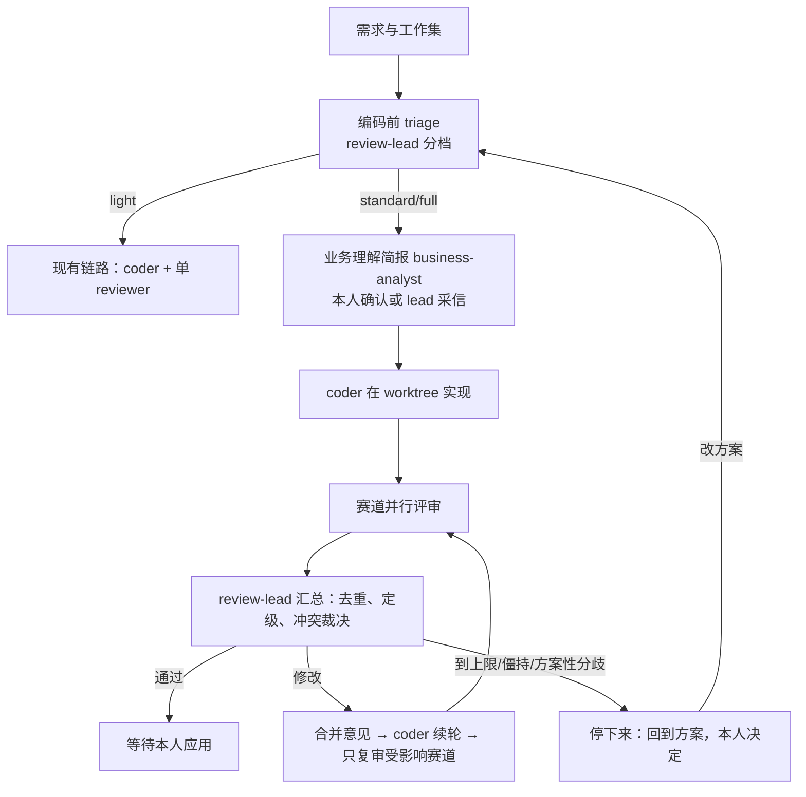

# 分档、多角度的评审方案（设计稿，未实现）

状态：设计，2026-10-24。实现前先按本文核对，有变化改本文。现有实现是交办编码链：worktree → 检查 → 单个 `reviewer` → 自动续轮（最多 3 轮），见 architecture.md 第 5 节和 `src/agents/code-chain.ts`；本文是它在中大型改动上的扩展，不替换小改动的链路。

## 1. 要解决的问题

现有一个内置评审角色能审功能是否实现、正确性、破坏性和多余改动，对小改动够用。中大型改动的缺口：

1. **评审角度互相干扰。** 功能正确性、风格规范、架构取舍、业务理解、历史问题回扫要查的材料和判断标准不同；塞在一个会话里，上下文互相挤占，结论还会互相覆盖。
2. **缺少项目上下文。** 一个需求要同时对照需求文档、讨论群、设计稿、各仓库的目标分支才能评审；现在事项只有 `source_refs`（扁平证据列表）和 `watch.sources`，没有一个"把这些材料归到同一件事"的容器，也登记不了目标分支。
3. **业务理解没有基线，无法交叉核对。** "代码实现的业务和需求约定的业务是否一致"需要先有一份需求业务语义的基线；现在只能让评审现场通读文档，结论随上下文和发挥漂移。
4. **没有成本分级和协调者。** 每个大需求都跑五个赛道是浪费；评审意见互相矛盾、评审和编码来回修改时，没有负责人判断哪些意见成立、是否该回到方案层。
5. **人看不懂。** 运行页能看到 diff 和评审原文，但"这个需求 → 业务语义 → 哪些代码实现它 → 为什么这么写"没有视图；飞书里只有一张进度卡片。

## 2. 结论（先给设计全貌）

四个部件：

1. **工作集（workset）**：一个需求的上下文容器。关联多类材料和目标仓库/分支，不复制内容；从上下文里产出一份业务理解简报（带版本、变更点），作为业务评审的基线。
2. **评审负责人 `review-lead`**：编码前后各做一次分档（light / standard / full），按档决定跑哪些评审赛道；full 档各赛道独立会话并行评审，lead 汇总去重、定优先级、安排修改轮和复审，带硬上限和"回到方案"升级。
3. **评审委员会**：功能、风格与规范、架构、业务理解、历史问题回扫五个赛道，各自一个只读角色文件、独立会话、可单独配模型和强度；赛道清单是数据不是代码分支。
4. **变更解读视图**：以需求维度组织的网页视图，业务要点 ↔ 代码改动双向定位（高亮、气泡、图例、引导、流程图），diff 与完整代码同屏，可就地提问；运行记录保持现有详情粒度，新增"本次评审"摘要层。

### 2.1 端到端流程



分档只决定评审形态，不改变现有的 worktree、检查命令、补丁应用机制；light 完全等于今天的链路，是默认值。

## 3. 工作集：一个需求的项目上下文

### 3.1 定位与边界

工作集是**材料的引用容器和需求基线**，不是第二种知识库，也不是一个空间：

- 成员都是已有原件 / 会话 / 仓库空间对象，只存 id 和指针（含可选的分支、行段、备注），不复制正文；
- 检索仍在原件上做，工作集只提供"限定范围 + 候选清单"；
- 工作区是临时的（worktree 空间，随补丁应用删除），工作集是持久的：应用后仍保留，之后回查"这个需求为什么这么做"还能打开，成员里的代码引用指向应用后的仓库原件；
- 权限按成员解析：一个成员现在读不到（被删、空间权限收回），评审任务里标"不可用"并说明，不因为加入了工作集就获得权限。

### 3.2 数据模型

```sql
create table worksets (
  id text primary key,               -- w_…
  space_id text not null references spaces(id),  -- 归属空间，通常是项目空间
  item_id text references items(id),              -- 可挂到事项，也可独立
  title text not null,
  detail text not null default '',
  brief_source_id text,              -- 业务理解简报对应的 work 原件 id
  status text not null default 'open',   -- open | in_progress | done | cancelled
  created_by text not null default 'agent',
  created_at text not null,
  updated_at text not null,
  closed_at text
);

create table workset_members (
  id integer primary key autoincrement,
  workset_id text not null references worksets(id) on delete cascade,
  kind text not null,      -- source | message | conversation | repo | item | page
  ref text not null,       -- 原件 id / msg:<id> / conversation id / 空间 id（repo）/ 事项 id / space:slug（page）
  ref_title text not null default '',
  note text not null default '',       -- 人或助理写的一句说明
  -- kind=repo 时：
  ref_spec text,          -- {"branch":"feature/x","base":"main","commit":"…"}
  -- 行段、片段等定位信息：
  line_start integer,
  line_end integer,
  added_by text not null default 'agent',
  created_at text not null,
  unique(workset_id, kind, ref)
);
create index workset_members_workset on workset_members(workset_id);

-- 成员版本快照：判断简报/评审依据是否过期（同 page_cites 的做法）
create table workset_member_snapshots (
  workset_id text not null,
  member_id integer not null,
  source_hash text,       -- sources.hash；非原件类存可比较的版本标记（如会话最新消息时间、commit）
  checked_at text not null,
  primary key(workset_id, member_id)
);
```

不用新空间类型的原因：空间是检索域，工作集只是跨空间的一份材料清单（成员可在项目空间、相关仓库空间、个人空间），检索域已经由空间及 `space_relations` 表达。

### 3.3 怎么建立和维护

新增 MCP 工具（列在工具清单，权限走现有 `scopeFor`/`accessibleSpaces`）：

- `create_workset(title, space?, item?, members?, detail?)`：建工作集；`members` 每项 `{kind, ref, note?, branch?, base?}`。工具层逐个校验引用存在且本次可读（复用 `validateItemRefs` 的解析逻辑）。
- `update_workset(workset_id, add?, remove?, title?, detail?)`：增删成员；删除只删关联，不删原件。
- `read_workset(workset_id)`：返回元信息、成员（带标题、类型、空间、当前是否可读、自简报后是否变化）、简报与状态。
- `list_worksets(status?, space?)`。

建立路径：

1. **助理主动**：本人说"评审一下这个需求，材料有 <文档>、<群链接>，要改 A 和 B 仓库的 feature/x 分支"，助理创建工作集并把消息里引用的原件、会话、仓库（带分支）加进去。
2. **从事项转入**：事项详情加"工作集"区，可新建并自动带上事项的 `source_refs`。
3. **网页手动**：工作集页加成员（原件选择器、会话选择器、仓库空间 + 分支），或在原件/会话详情上"加到工作集"。

目标分支：成员里 `kind=repo` 的 `ref_spec.branch/base` 既是上下文（让业务和架构评审知道改动要落到哪），也作为将来 `delegate_code` 的基准；本期编码仍从仓库当前 HEAD 建 worktree（与现状一致），分支比对范围（见 3.5）只影响评审看到的历史，不改 worktree 机制。

### 3.4 运行时怎么用这份上下文

评审和编码角色的任务里不再拼几十份材料全文，而是附"工作集清单"（成员类型、标题、空间、备注、可读状态），需要内容时用现有工具读：

- 文档/文件：`read_source`（支持行段）；
- 群聊：`read_conversation` 读消息，或 `read_source("msg:<id>")` 读单条；
- 代码：`search` / `find_symbol` / `read_source`（仓库空间 + worktree 临时空间 `space:"*"`，沿用现状）；
- 约定：`recall` + Wiki `read_page`。

新增一个限定检索工具 `search_workset(workset_id, query)`：只在成员原件和成员仓库空间（含其相关空间）内检索，返回带成员标注的线索。它不是新检索通道，只是对现有 search 的结果加一层"属于工作集成员"过滤 + 成员优先排序，供赛道评审在范围内深挖。

成员版本：简报完成时给成员存快照（`source.hash`、会话最新消息时间、仓库 commit）。评审前检查快照，成员已变化的在任务里标出"依据可能过期"（同 Wiki `page_cites` stale 的思路），评审要重读变化的成员，不静默用旧内容。

### 3.5 基于工作集提取业务知识和业务变更

这是"业务评审能做"的前提，分两步，且明确**不产出第二份知识**：

1. **业务理解简报（基线）。** 新角色 `business-analyst` 在编码前跑一次：读工作集里的需求文档、讨论、设计稿和相关空间里的 Wiki/记忆，产出一份工作文件（复用 `write_file`，uri 如 `workset/<id>/brief`，挂在工作集上），内容是：
   - 需求要解决的问题和适用场景；
   - 业务规则清单：每条一个可核对的命题（名词、条件、数字、边界），带来源引用（`src:`/`msg:`/`mem:`，沿用统一引用格式）；
   - 涉及的实体、状态流转、对外行为；
   - 与现状相比要变的点（change points，编号 CP-1、CP-2…）；
   - 不确定与冲突（文档和讨论说法不一致、没定的事）单独列，不猜。
   - 简报是**工作文件不是记忆**：长、结构化、属于这一件事；其中长期稳定的业务规则由正常的 ingest 流程沉淀为记忆/Wiki，简报本身随工作集保留，应用后可归档不过期。
2. **本人确认或 lead 采信。** 简报完成后给本人一次确认（`ask_owner`：确认 / 指出不对的地方让 analyst 改一轮）。本人不在线时 standard 档可由 lead 记录"未确认"直接开始（业务赛道按"待确认"给意见），full 档默认等确认（可配置）。
3. **业务变更与代码的映射。** analyst 在写 change points 时，对每个 CP 给出它预期触及的代码区域（仓库、文件或符号，依据是工作集里的代码线索）；编码完成后 lead 让 analyst（或业务赛道）对照 diff 回填"实际实现位置"，形成 CP ↔ 文件/符号的映射表。这份映射是变更解读视图和业务评审的共同数据（见 7.4）。

业务评审（business-review 赛道）做的是 cross review：逐条拿简报的业务规则和 CP 去 diff 里找实现，判断"实现了 / 实现错（错在哪个规则）/ 没实现 / 实现了需求没说的行为"，两边不一致时引用具体代码行和简报条目。业务规则的**存储**仍走现有记忆和 Wiki（空间级、跨需求复用、有版本链），简报只负责"这次需求要的是什么"。

## 4. 评审分档与负责人

### 4.1 review-lead 的两次分档

新内置角色 `review-lead`（只读 + 编排工具，不写代码、不直接改库）：

- **编码前 triage**：读需求、工作集成员和改动预估，决定档位并给出理由，产出评审计划。
- **编码后 triage**：拿到实际 diff 规模和检查结果，确认档位（比预估大就升档）。

档位（配置在 `config.review` 里给默认阈值，lead 可在理由中调整，full 档启动前默认把计划给本人确认一次）：

| 档 | 触发（默认） | 形态 |
| --- | --- | --- |
| light | diff < 约 80 行、≤ 2 文件、单仓库、无业务规则变更、检查命令通过 | 现有链路：`reviewer` 单评审，自动最多 3 轮 |
| standard | 中等：跨 2–3 模块、改了对外接口/配置/持久化、有业务规则变化但需求材料集中 | reviewer（功能）+ 业务赛道 + 风格规范赛道；一次集中汇总 |
| full | 任一：多仓库、跨模块架构改动、状态机/权限/并发/数据迁移、需求大且讨论分散、涉及关键业务规则、standard 历史上在这类目录常出问题 | 五个赛道全部独立会话并行，lead 多轮协调，上限和升级见 5.4 |

确定性预筛（宿主先算，便宜且可解释，不让模型凭感觉）：仓库数、文件数、增删行数（`git diff --stat`，已有）、改动路径是否命中配置的敏感清单（如迁移、权限、公共 API、调度）、检查命令是否通过、工作集里 repo 成员数量。预筛结果连同 lead 的判断一起写进计划；lead 只能在预筛基础上升/降一档并说明依据，不能跳过预筛。

计划存在发起 run 的 `output.reviewPlan`：`{tier, reasons, tracks, estimatedRounds, briefRunId, createdAt}`，网页和飞书卡片都能看到；本人可改档后开始。

### 4.2 赛道：五个独立评审角色

新增内置角色文件，全部只读（同 reviewer 的 tools：search/scan/read_source/find_symbol/read_page），各自只能用 omem 工具和文件读取，不能写库、不能发消息、不能再交办：

| 角色（文件名） | 审什么 | 主要材料 |
| --- | --- | --- |
| `reviewer`（现有，功能赛道） | 需求是否真正实现、边界/错误处理/并发泄漏/安全、测试覆盖、多余改动 | diff、检查输出、需求 |
| `review-style`（风格与规范） | 只报违反项目明确约定的问题：AGENTS.md、lint/类型约定、命名、测试与文档约定 | 仓库约定文件、diff；没有明确依据不报 |
| `review-arch`（架构） | 模块边界、依赖方向、抽象取舍、可维护性、与既有架构（Wiki）是否冲突、跨仓库接口是否对上 | Wiki 架构页、调用图、相关空间 |
| `review-business`（业务理解） | 业务规则和 CP 是否被正确实现、有没有需求外行为、边界案例是否符合约定 | 业务简报、工作集成员、diff |
| `review-history`（历史问题回扫） | 类似改动以前踩过的坑：案例页（cases/）、经验记忆、被 supersede/撤回的旧约定、相关评审历史 | recall(含历史)、cases、过去 run 的评审结论、git 历史 |

赛道是**数据驱动的清单**：`config.review.tracks`（或角色目录约定）列出"档 → 赛道角色"的映射；本人/助理可以建自定义赛道档案挂进去（例如某仓库专用的安全评审），lead 不按赛道名做代码特判，通用代码不识别具体项目（遵守"不按项目名特判"原则）——是否启用某赛道只由分档规则、路径清单和工作集配置决定。

每个赛道可像现在 reviewer 一样单独配后端/模型/强度（`agents.roles`、`roleModels` 已有机制）：功能和架构用强模型中高 effort，风格和历史回扫用小模型低 effort 控成本。赛道 run 是独立 `kind:"review"` 的 run（RunKind 里已有 review），parent 指向本次编码 run，互不共享会话——这正是"不能在同一个会话里做"的落点。

### 4.3 赛道输出格式（结构化，便于汇总）

统一要求第一行结论，随后用**提交评审结果的工具**而不是纯文本，新增 `submit_review(track, verdict, findings[])`，`findings` 每条：

```json
{
  "severity": "blocker | major | minor | nit",
  "file": "src/agents/code.ts",
  "line": 226,
  "title": "一句话问题",
  "detail": "问题与依据",
  "suggestion": "建议怎么改",
  "evidence": ["src:<id>#L10-L20", "mem:<id>", "wt-…#L…"],
  "cp": "CP-2",
  "confidence": "high | medium | low"
}
```

结果存新表：

```sql
create table reviews (
  id text primary key,
  code_run_id text not null references runs(id),
  workset_id text references worksets(id),
  round integer not null default 1,
  track text not null,          -- functional | style | architecture | business | history | 自定义
  profile_id text, model text, effort text,
  verdict text not null,        -- approved | changes_requested
  summary text not null default '',
  status text not null default 'done',  -- done | superseded（复审后旧记录标记）
  created_at text not null
);
create table review_findings (
  id integer primary key autoincrement,
  review_id text not null references reviews(id) on delete cascade,
  severity text not null,
  file_path text, line integer,
  title text not null, detail text not null,
  suggestion text not null default '',
  evidence text not null default '[]',
  cp text,
  confidence text not null default 'medium',
  -- lead 汇总后回填：
  state text not null default 'open',  -- open | accepted | rejected | merged_into | fixed | stale
  triage_note text not null default ''
);
create index review_findings_review on review_findings(review_id);
create index reviews_run on reviews(code_run_id, round);
```

结构化的原因：lead 要去重合并、按严重级排序、判断哪些在复审里消失；纯文本做不了。赛道仍可以在 run events 里保留完整叙述（人要看过程）。

### 4.4 lead 的汇总、协调与防死循环

每轮评审结束后 lead 跑一次协调回合（full 档由独立协调 run 承担，standard 档由编码链收尾时合并）：

1. **去重合并**：不同赛道报的同一问题合成一条，保留来源赛道；`state=merged_into` 指向主条。
2. **裁决**：逐条 `accepted`（要改）/ `rejected`（不成立或属个人偏好，写理由）；赛道之间冲突（架构说要抽象、功能说最小改动）由 lead 依据需求与约定裁决，拿不准就升级给本人而不是选一个。
3. **定级与打包**：只把 accepted 的 blocker/major 交给 coder 续轮，minor 列出但可累积，nit 默认不阻塞。意见合成一份带编号的修改单，coder 在原会话续轮（复用现有 `queueNextCodeRound` 机制）。
4. **复审范围**：下一轮只重跑受影响赛道（coder 说明改了哪些文件/CP，lead 映射到赛道）；每 2 轮强制全部赛道重跑一次，防止局部修复引入别的问题。

循环控制（扩展现有 `autoAdvance.codeRounds`，不是新造一套）：

- `config.review`：`maxRounds`（full 默认 3，可到 5）、`maxAcceptedBlockersPerRound` 硬上限、成本额度（赛道 run 数 × 模型档的粗预算，先按 run 数估，不做计费）。
- **自动停止条件**（任一命中就不再自动续轮，状态记 `awaiting-lead`，通知本人）：
  - 到轮数上限；
  - 本轮 accepted blocker/major 数不比上一轮少（修改没有收敛）；
  - 同一 finding 连续两轮被报为未修（coder 和评审僵持）；
  - 问题根源是需求/方案分歧（业务赛道说需求要 A，简报和讨论显示没定；或架构意见要求换方案）；
  - 检查命令持续失败且 coder 两轮没修好。
- **升级动作**：lead 输出"方案复核"报告：哪些意见、分歧双方依据、建议（改需求/改方案/拆小需求/接受技术债），用 `ask_owner` 给本人选项；本人拍板后可：改简报重评、调整方案后重新 triage（回到编码前）、或明确接受并应用。**不允许 lead 通过反复续轮把方案问题磨过去。**
- 本人随时可像现在一样手动 `continue_code_run` 突破上限（沿用现有机制）。

light 档完全不经过 lead 协调，保持今天"reviewer 结论 → 自动续轮"的简单路径；standard/full 才建 reviews 记录。

## 5. 运行记录：既要详细过程，也要简要结论

两层展示，复用现有 run 体系，不另建日志系统：

1. **详细层（现有 Runs 详情，扩展）。** 每个赛道是独立子 run：任务、工具调用、检索到的证据、完整叙述都在 `run_events`（现状）。Runs.vue 在编码 run 详情里增加"评审轮次"区：按轮 × 赛道显示每个 review run 的状态徽标、耗时、模型、verdict、finding 数，点开进该 run 的完整活动；每轮 lead 的汇总也是一个可点开的 run。
2. **摘要层（新增"本次评审"卡片）。** 编码 run 详情顶部和飞书进度卡片上，显示 lead 最近一次汇总：
   - 总体结论（通过 / 需修改 / 已升级方案复核）；
   - 各赛道一行（通过 N、问题 N，按严重级着色）；
   - 未决问题清单（编号、严重级、赛道、文件:行、一句话标题、状态），可展开建议和依据；
   - 轮次变化：第 2 轮相对第 1 轮新出现 / 已修复 / 仍存在的数量（从 finding 的 state 和复审结果现算）。
   - 飞书卡片沿用现有"编码交办"卡片（`lark-code-progress.ts` 已支持跨轮更新和折叠最近三轮），加赛道行和未决数；完整内容仍在网页。
3. **成本可见**：每条评审记录带模型/强度/耗时，摘要里给本次 full 评审共跑了多少赛道 run（粗略成本），让本人能判断分档是否值得；不做精确计费。

数据都在 runs/run_events/reviews/review_findings 里，重启可恢复（同 codeChain 持久化思路）：协调状态（当前轮、各赛道 run id、finding 状态）放在发起 run 的 `output.reviewChain`。

## 6. 变更解读视图：以需求维度看懂最终代码变更

入口两处：工作集详情页（"变更"标签，应用前后都能看）、运行详情页（full/standard 完成后）。移动端 390 宽可用（单列、抽屉代替分栏）。

### 6.1 布局（桌面三栏）

```
┌ 需求标题 · 状态 · 应用情况 · [在工作集中提问] ───────────────┐
│ 左：需求/业务          │ 中：代码               │ 右：讲解   │
│ 业务要点(CP)列表        │ 文件树 + diff/完整代码  │ 选中项说明 │
│ 流程图（状态/流程）      │ 行内彩色标记与气泡      │ 依据、提问 │
│ 评审结论与未决问题      │                        │           │
└──────────────────────────────────────────────────────────┘
```

- **左栏 需求侧**：简报里的业务规则和 CP 列表（每条标注：已实现 / 有争议 / 未实现，来自业务赛道结论）；一个 Mermaid 流程图（状态流转或关键流程，简报里由 analyst 起草、lead 校对，第一版不做自动生成）；评审未决问题列表。
- **中栏 代码侧**：改动文件按仓库分组的文件树（增删改图例），点开是统一 diff（复用 Runs 现有的 diff 渲染），可切换"完整文件"（读 worktree 或应用后的仓库原件，用现有 CodeView 带行号）；改动行有颜色图例（新增/删除/修改），命中 CP 映射的行段有彩色边条。
- **右栏 讲解侧**：点左栏 CP 或中栏标记，显示这条业务规则/这行改动的讲解：为什么这么改（lead 汇总的 coder 说明 + 评审结论）、依据引用（点引用走现有 CitationDrawer 逐层打开原文）、关联的其他 CP 和文件。
- **气泡与引导**：首次进入用 3 步引导（业务要点 → 点一个 CP 看代码落点 → 就地提问），走完存本地偏好不再弹；行内小气泡只在有映射的行段出现（数量受控），不遮挡代码，可关。
- **双向定位**：点 CP → 中栏滚到对应文件行并高亮（同 CodeView 现有 `#L` 高亮）；点代码标记 → 左栏高亮对应 CP 并在右栏给讲解。映射找不到精确行（补丁已变动）时退到文件级，并标"文件级关联"。
- **时间维度**：顶部可切"第 1 轮 / 第 2 轮…/最终"，左栏和中栏联动显示那一轮的 diff 与当时评审结论，看得出"为什么改了三轮"（补丁按轮已存在 patches 目录；评审记录有 round）。
- **就地提问**：右栏和每个 CP/文件行都有"问一下"。提问带着当前工作集 id 和选中对象（CP 编号或 `源:文件:行`）开一个只读问答回合：新角色/复用 assistant 在该工作集范围内查简报、diff、工作集成员后回答，引用可点开；不修改代码，回答留在工作集的问答记录里。它是普通 ask run（input 带 `worksetId` 和 `anchor`），不引入新通道。

### 6.2 数据来源与可信度

视图不生成任何新论断，全部引用已有产物：

| 视图内容 | 数据 |
| --- | --- |
| 业务要点 / CP / 流程图 | 业务简报（work 文件） |
| CP ↔ 代码映射 | analyst 初标、lead 复核后的映射（存在 workset 的 briefing JSON 或 review 输出） |
| 实现状态 | business/functional 赛道的 finding（accepted 结论） |
| diff / 完整代码 / 文件树 | patches/*.patch 与 worktree（或应用后仓库原件） |
| 讲解 | coder 说明（`coderSummary`）+ lead 汇总 + finding 建议 |
| 依据气泡 | finding.evidence、简报 CP 的 source_refs（统一走 CitationDrawer） |

映射置信度要显式标出：高（CP 与具体行互相印证）/ 中（文件级）/ 低（模型推断）；低置信的默认不展示行内气泡，只在右栏说明，避免把猜测画成代码注释。所有采集内容渲染照旧过 DOMPurify（网页既有约定）。

### 6.3 组件与约束（遵守 omem-design）

- 新增视图 `web/src/views/Workset.vue`（列表 + 详情）和 `web/src/components/ChangeMap.vue`（三栏主体），CP/映射/提问拆小组件；diff 与代码高亮复用现有 `CodeView` 和 Runs 的 diff 解析，引用统一走 `CitationDrawer`，不新开一套弹层（Esc 逐层返回、焦点归还沿用）。
- token 走 styles.css，浅色/深色；正文限宽，标题衬线；长列表用 `VirtualList`（文件树、finding 列表）；不用原生控件（分支选择用 UiSelect 等）。
- 大 diff 性能：默认只渲染展开文件的行（现状已是），标记按行段索引而非逐行气泡；≤760px 单列（左栏变顶部摘要、右栏变底部抽屉），不横向滚动代码以外的区域；改完用 `scripts/screens.ts` 截 1440 和 390 检查。
- 应用补丁、删除 worktree 后：视图切到"已应用"状态，代码从仓库原件读，映射行号允许漂移（文件级兜底），worktree 临时空间消失不影响视图。

## 7. 配置、角色与工具改动清单

### 7.1 配置（`config.review`）

```json
{
  "review": {
    "light": { "maxChangedLines": 80, "maxFiles": 2, "maxRepos": 1 },
    "sensitivePaths": ["migration", "auth", "permissions", "scheduler"],
    "defaultTier": "light",
    "fullConfirm": true,
    "standardTracks": ["functional", "business", "style"],
    "fullTracks": ["functional", "business", "architecture", "history", "style"],
    "maxRounds": { "standard": 2, "full": 3 },
    "rereviewAllEvery": 2,
    "brief": { "waitOwnerOnFull": true, "waitMinutes": 240 }
  }
}
```

阈值只做预筛，lead 可给理由调整；`sensitivePaths` 是路径片段清单不是项目名特判。

### 7.2 新角色（roles/，全部走内置角色自定义、记忆与教练机制）

- `review-lead.md`：分档、汇总、裁决、升级；tools 只读 + `submit_review` 编排类 + `ask_owner`，writes false。
- `business-analyst.md`：写简报（唯一有 `write_file` 的新角色，写工作集工作文件）和 CP/代码初映射。
- `review-style.md` / `review-arch.md` / `review-business.md` / `review-history.md`：四个赛道，只读，输出走 `submit_review`。
- 现有 `reviewer.md` 改为功能赛道说明，输出格式切到 `submit_review`（light 档保持文本结论兼容，code.ts 现在用正则判通过，改为读结构化 verdict 并保留文本兜底）。

`roleNames` 加这六个；`agents.roles` 默认模型可不配（走 default），文档建议功能/架构/业务用强模型，风格/历史用小模型。

### 7.3 新工具（src/agents/tools.ts）

- 工作集：`create_workset` / `update_workset` / `read_workset` / `list_worksets` / `search_workset`。
- 评审：`submit_review`（赛道写 findings）、`read_reviews(run_id)`（lead 读各赛道结论）。
- `delegate_code` 扩展入参：`workset_id?`、`tier?`（light/standard/full，不传则 lead triage）。带 workset 时 code.ts 在工作集工作目录、成员仓库上建 worktree，评审阶段按档启动赛道并由 lead 协调。
- 就地提问不新增工具，是带 worksetId 的普通 ask（服务端在任务前注入工作集清单与搜索范围）。

### 7.4 存储与与现有机制的关系

- 新表见 3.2、4.3；迁移加在 db.ts migrations 末尾。
- 工作集可挂事项（`item_id`），事项时间线记录工作集关键事件（简报完成、评审升级、应用）。
- 评审发现的长期问题走老路：反复出现的坑由 lead/做梦沉淀为案例页和经验记忆（现有机制），review-history 下次能召回；不新增"评审知识库"。
- 多仓库 worktree、临时索引、补丁一起应用/全部不应用、应用确认均沿用 code.ts，不改。
- omem pull：工作集与评审表是 omem.db 数据，跟随现有快照；work 文件在知识库 Git 里，已同步。
- 权限：所有新表查询按成员所在空间和 userId 过滤；赛道 run 的 token 空间范围 = 工作集成员空间 + 其相关空间（只读），写权限不给。

## 8. 分阶段落地

1. **阶段一：工作集与业务简报。** worksets/members 表与工具、工作集网页（成员管理、简报展示）、`business-analyst` 角色；`delegate_code` 能带 workset（评审仍走 light 老链路）。验收：能把文档+群+多仓库分支归到一件事，简报带来源和 CP，成员变化有 stale 提示。
2. **阶段二：结构化评审与赛道。** reviews/findings 表、`submit_review`、四个赛道角色、reviewer 切结构化、Runs 页评审轮次区。验收：standard 档三赛道独立 run、结论结构化可汇总。
3. **阶段三：lead 协调与 full 档。** review-lead 两次 triage、预筛、去重裁决、增量复审、循环上限与方案升级、飞书卡片赛道行、`config.review`。验收：多轮收敛与四类停止条件、升级后本人改方案能重跑。
4. **阶段四：变更解读视图。** Workset/ChangeMap、CP↔代码映射、气泡图例引导、时间维度轮次、就地提问；1440/390 截图无横向溢出。验收：从 CP 能定位到行、从行能回到 CP，就地提问答案带可点开的引用。

每阶段一个可提交的功能切片，跑 `pnpm run check` 和真实 Agent 抽查（沿用 AGENTS.md 的验证要求），不等四个阶段全做完。

## 9. 验收要点（实现时细化进 acceptance.md）

- light 档行为与今天完全一致（同一假 ACP 夹具回归）。
- full 档五赛道是五个独立 run，可配不同模型；任一赛道失败不阻塞其他赛道，lead 标注失败并重试一次。
- finding 去重、合并、驳回、复审状态流转有确定性测试（不依赖真实模型）。
- 到上限、连续两轮不收敛、僵持、方案分歧四种情况都停下来问本人，且不会自动再排下一轮（同 code-chain 旧回调不排新轮的做法）。
- 成员被删/跨空间无权限时评审报"依据不可用"，不越权读到内容。
- 变更视图在补丁应用、worktree 删除后仍能打开（代码读仓库原件，映射文件级兜底）。
- 所有新页面 1440 与 390 宽度截图无横向溢出；引用全部走 CitationDrawer。

## 10. 不做的事（YAGNI）

- 不做评审意见的行内自动修复建议应用、不做机器人自己合并代码；应用补丁始终本人确认。
- 不做精确 token/费用核算，只记录 run 数、模型和耗时。
- 不做自动生成流程图/架构图（第一版由 analyst 写 Mermaid）；不做变更的语音/视频讲解。
- 不引入图数据库和新的评审知识产品；历史经验继续用案例页 + 记忆。
- 不做跨仓库目标分支的自动 checkout/变基；本期分支只作为评审上下文，编码仍基于当前 HEAD，分支策略以后单独立项。
- 不按项目/仓库名硬编码赛道规则；赛道启用只由通用阈值、敏感路径清单和工作集配置决定。
