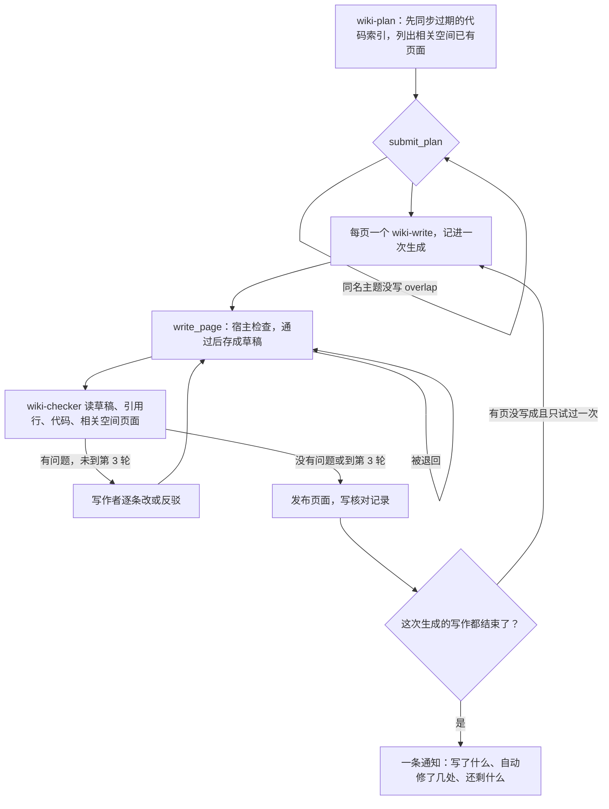

# Wiki 生成时的检查与核对

模型自动规划和写 Wiki，常见的错误本人没有时间逐页核对。这里把错误分成两类：能从数据确定的由宿主在写入时拦下，要读懂内容才能判断的交给一个不写页面的核对角色。最后一次生成只发一条消息，只列确实没解决的。

代码：`src/wiki/checks.ts`（宿主检查）、`src/wiki/verify.ts`（草稿、核对循环、核对记录、生成对账与报告）、`roles/wiki-checker.md`、`submit_page_check` 工具；挂接在 `write_page` / `read_page` / `submit_plan`（`src/agents/tools.ts`）、`wiki-plan` / `wiki-write` 处理器（`src/agents/jobs.ts`）、`generateWiki` 的 `pages`（`src/wiki/generate.ts`）、运行结束时的 `settleWikiWrite`（`src/agents/runs.ts`）。

## 1. 流程



- **草稿**：写作运行（`wiki-write`）里，提交的正是计划里那一页时，`write_page` 不落盘，把页面存进运行的 `draft`；同一运行里 `read_page` 读到的也是草稿。核对结束后 `writePage` 一次发布并提交 Git。其他页面、其他角色的写入照常直接保存（同样经过宿主检查）。
- **核对**：在同一个运行里调 `wiki-checker`（`runRole` 的 `ownAI`：用这个角色在 Agent 页选的 AI，不跟写作这次运行的 `ai`，也不走任务选型）。任务里有草稿全文、宿主按引用摘出的原件行（约 14000 字以内）、可查的代码空间、相关空间的页面列表和标题相近的页面、写入时的提示、前几轮的问题和写作者的回复。它用 `submit_page_check` 交结构化结论：每条是原句、类型（cite / code / negative / duplicate / conflict / wording / length / other）、问题、依据、建议。
- **来回**：有问题就把问题和上一版全文交回写作者（复用写作的后台会话），成立的改、不成立的写依据反驳；最多核对 3 轮（`CHECK_ROUNDS`），第 3 轮仍有的问题记为未解决，页面照常发布。核对角色出错或没交结论时记“没有核对完”，页面也发布。
- **核对记录**：kv `wiki-checks:<空间>/<路径>`，每页保留最近 10 次（状态、轮数、改正数、写入时被拦次数、补回入口数、未解决的问题、每轮结论）。`GET /api/wiki/:space/page/*` 的 `checks`，网页页面右栏“核对”。页面移动后按旧路径记的也能读到。
- **一次生成**：规划的页面（规划运行 id 作生成 id）或 `generate_wiki` 的 `pages` 各记一条 kv `wiki-gen:<id>`。每个写作运行结束（完成、失败、取消）时 `settleWikiRun` 看这次生成是否都结束了：没写成的页（失败，或完成了但没有页面）且不是被取消的，再排一次写作（`WRITE_ATTEMPTS` = 2）；都结束后生成报告，写进规划运行的输出 `report`，发一条通知。单独排的写作运行（网页“新建页面”）当作只有一页的生成。

## 2. 八类问题由哪一层处理

| 问题 | 宿主（确定性） | 核对角色 | 角色说明与技能 |
| --- | --- | --- | --- |
| 1. 重写首页丢了目录入口 | `lostEntries`：首页和目录页（`index`、`*/index`、kind=index）改写前后对比链接，丢了仍然存在、新正文也没有经所在目录 index 到达的页面时，运行里第一次退回并列出；同一运行再提交仍缺就补在页尾“其他页面”；不在运行里的写入直接补 | — | 规划：重写 index 先读、保留入口 |
| 2. 同一主题在相关空间各写一遍 | `submit_plan`：标题和相关空间页面相同或互相包含（≥4 字）却没写 `overlap` 的页面退回；`reuse` 记链接过去的主题。写新页面时 `write_page` 提示标题相近的页面 | duplicate / conflict：读相关空间同主题页面，重复的建议改链接，冲突的列出两边说法 | 规划、写作：先读那边，讲过的链接 |
| 3. 流程步骤和代码不符 | — | code：读代码数步骤、顺序、字段 | 写作、技能：按代码数，不照抄文档 |
| 4. 规划了没写，也没提示 | 生成对账：没写成的重试一次，仍没有的进报告“没写成”；写作运行里没交草稿先提醒一次 | — | — |
| 5. “转写未取得”但原件里有 | — | negative：自己去搜、读原件全文 | 写作、技能：写“没有”之前先找 |
| 6. 引用个人空间、临时分支的原件 | `citeIssues`：共享空间的页面引用个人空间、交办分支索引（`worktree`）、有读者没权限的空间里的原件时退回，并找出本空间或相关业务空间里同一份（同内容 → 同路径 → 同标题）；原件不存在、已删除、行号超出也退回 | — | 写作、技能：只引用业务空间的原件 |
| 7. 代码索引过期，引用只能写纯文本 | `refreshCodeIndexes`：规划和每页写作前，相关代码空间的索引落后于仓库 HEAD（或没建过）就先同步（最多等 10 分钟），没同步成的进报告。`codeRefIssues`：`路径:行号` 能唯一对上索引里的文件、`` `符号` `` 只在一个文件定义且页面没引用这个文件时退回，给出现成的 `src:` 写法；对不上的交给核对 | code：对不上的代码位置 | 写作、技能：代码写成引用 |
| 8. 页面过长、过程性语言 | 超过 12000 字（不计链接地址，index 除外）拒写；超过 6000 字由宿主每轮记一条 length（见第 11 类） | length、wording、hedge（见第 9 类） | 写作、技能：6000 字以上拆，写完自查“本次”“经核对” |

宿主只做能确定的：不按正则清单挑“过程性语言”，那是核对角色和技能的事。

### 本人看过一批页面后追加的四类

| 问题 | 宿主（确定性） | 核对角色 | 角色说明与技能 |
| --- | --- | --- | --- |
| 9. 过程性和防御性语言（“本次整理”“经核对”“根据现有材料”；结论上堆“可能”“以实际为准”“建议进一步确认”） | 不做（不堆正则） | wording / hedge：逐条指出，`fix` 给改后的句子；只提整理过程、写给审稿人的话、退路、先立误解再推翻、冒号前的提示语、起手式这几类，不提小标题编号、“这意味着”、句子长短 | 技能 wiki-writing 第 5 条、“整理过程、防御性的话：改写对照”表和写完自查；写作角色同样要求。这些要点从开发用的表达检查技能里挑了对知识页面适用、配对复测站得住的几条，改写成针对 Wiki 的说法 |
| 10. 没查清的写进页面、页尾“待确认”清单 | 存成页面的未决问题（`wiki_questions` 表，见第 5 节），不在正文里：`write_page` 的 `questions`、核对的 `unsure` 都进这张表；先由 Agent 查（`wiki-resolve`），查不清的才问本人，一次最多 5 个；旧页面的“还没查清”一节升级时迁出（第 6 节） | unsure：拿不准的段落和“待确认”小节建议从页面拿掉，`question` 写一句本人能直接回答的问题 | 写作、规划、技能第 4 条：拿不准的整句不写；Wiki 页面不留“待确认/还没查清”小节；案例页模板去掉“还没查清”。distiller、`_common.md` 的案例页、wiki-linter 同样用 `write_page` 的 `questions` |
| 11. Wiki 被当成材料堆放处（四万字的流程页） | 超过 12000 字拒写；超过 6000 字的页面每轮核对由宿主自己加一条 length（不看核对角色怎么判），所以 6000 字以上的页面发布前一定被退回去拆，到最后一轮还超就进报告 | log：某天谁说了什么、沟通流水、临时安排、个人待办，能提炼就改成结论、不能就移出；length：一页回答几个问题时写清拆成哪几页 | 规划：只规划知识、一页一个问题；写作、技能第 8 条：知识和记录的区别 |
| 12. mermaid 图画不出来 | `mermaidIssues`：在 Node 里用 mermaid 自己的解析器（`mermaid.parse`）检查每个 ```mermaid 块，语法不过拒写，返回第几张图、正文第几行、解析器的报错和常见改法。解析时 mermaid 要用 DOMPurify，Node 里没有 window，宿主给 DOMPurify 补上不做事的 `addHook` / `sanitize`（宿主别处不用 DOMPurify，只检查语法不渲染）；mermaid 加载失败时不检查，并告诉核对角色 | other：宿主没检查成时看图 | 技能写完自查最后一条 |

第 12 类在网页上的另一半原因：`renderMarkdown` 把图的源码放在 `data-mermaid` 属性里，DOMPurify 会删掉值里含 `-->` 的属性（防注释闭合），所以带箭头的流程图一张都没有渲染，显示的是居中的源码。现在属性里放 `encodeURIComponent` 后的源码；`import("mermaid")` 失败不再缓存（下次重试）；渲染失败的图显示“这张图没画出来：<原因>”、靠左的源码和“重试”按钮；路由切换时动态分块取不到（服务更新后旧页面）自动刷新一次（30 秒内不重复），页面里后加载的部分取不到（`vite:preloadError`）时提示刷新。

实测过哪些写法会错（mermaid 11.17 的解析器）：节点或连线文字里不加引号的括号（`A[调用 apply(order)]`、`-->|成功(200)|`）、以 `/` 开头的方括号文字（`A[/api/refund 接口]`，被当成平行四边形）会错；文字中间的斜杠（`A[退款/取消]`）、平行四边形里带 `<br/>`（`A[/输入<br/>订单号/]`）、加了双引号的括号能解析。

## 3. 默认值（本人可改的地方）

| 项 | 默认 | 在哪 |
| --- | --- | --- |
| 核对 | 开 | 空间设置 `wikiVerify: false` 关闭（`PATCH /api/spaces/:id`）；关了照常写，核对记录状态为“关了核对” |
| 核对轮数 | 3 轮（最多改 2 次） | `CHECK_ROUNDS` |
| 没写成的页面 | 再试 1 次 | `WRITE_ATTEMPTS` |
| 首页丢入口 | 先退回，同一运行第二次自动补在页尾 | `write_page` |
| 篇幅 | 超过 12000 字拒写；超过 6000 字每轮核对由宿主记一条 length，必须拆 | `HARD_LENGTH`、`SOFT_LENGTH` |
| 拿不准的问题 | 存成页面的未决问题；先由 Agent 查（一次最多 20 个）；一次生成结束最多问本人 5 个（一张表单），其余留在清单；填了的补进页面 | `RESOLVE_LIMIT`、`ASK_LIMIT`、`wiki-questions` |
| 旧页面的“还没查清” | 升级后自动迁出一次，每批 200 页，可重入 | `MIGRATE_BATCH`、`queueMigration` |
| 重新核对已有页面 | 本人点一次过 10 页，最多 50 页，不定时 | `RECHECK_BATCH`、`RECHECK_MAX` |
| mermaid 语法 | 写入时用 mermaid 解析器检查，不过就拒写 | `mermaidIssues` |
| 代码索引同步 | 写作前自动同步，最多等 10 分钟 | `refreshCodeIndexes` |
| 核对角色的 AI | 角色 `wiki-checker` 的设置（Agent 页），最好选和写作不同的模型 | `config.agents.roles` |
| 通知 | 有没解决的或没写成的：普通通知，标题写“N 条要你看”，每条一行加页面链接；都解决了：只在网页通知里（`silent`） | `deliverReport` |

## 4. 没做的部分

- `wiki-lint`（原件变化后的修正）和 `ingest` 等角色直接改页面时只经过宿主检查，没有核对角色；规划者自己写的 index 也没有。
- 核对记录存在 kv，不进 Git，换设备拉取（`omem peer pull`）不带过去。
- “改正了几处”是估算：前几轮提出、最后一轮不再出现的条数，没有逐条比对。
- 符号检查只认反引号里的、至少 5 个字符、像代码名的写法，且只看是否在一个文件里有唯一定义；同名定义在多个文件的不检查。
- 引用可达只检查个人空间、交办分支和现有成员的权限；以后加入的成员不会回头检查已有页面。
- 代码索引只和本地检出的 HEAD 比，本地仓库本身没拉取最新提交的情况看不出来。
- 没有用真实模型跑过核对角色（只用假 Agent 测了流程），过程性和防御性语言能挑出多少、会不会误伤原件给的条件没验证。
- mermaid 只检查语法，能解析但渲染时出错的（极少）仍在网页上显示“这张图没画出来”。
- 本人回答问题后补写的页面又是一次完整生成，会再发一条通知。
- `wiki-resolve` 直接改页面（`write_page` 不是草稿），只经过宿主检查，没有核对角色。
- 迁移按页面 id 顺序走，迁移开始后新写的页面不会再被扫（新页面已经不写这一节）。
- 重新核对只挑“没有核对记录”的页面；核对过的页面以后的再核对要用 `generate_wiki` 的 `pages`。
- 内置技能只补缺：已有数据目录里的 wiki-writing 不会自动换成新版，要在技能页手动更新（或 `PUT /api/skills/wiki-writing/file`）。

## 5. 未决问题（2026-11-12）

在一个真实使用的库上，784 页里有 711 页带“还没查清”一类的小节或过程性、防御性语言，大多是旧模板要求的页尾“还没查清”。这些不该给读者看：拿不准的点改成页面的未决问题，存在表里，读者看不到。

**表 `wiki_questions`**（迁移加表，`pull-data.ts` 里登记为业务表，多台设备拉取时合并）：

| 列 | 含义 |
| --- | --- |
| `id` | `wq…` |
| `space_id`、`page` | 哪个空间的哪一页（页面移动时 `movePages` 跟着改 `page`） |
| `question` | 问题，一句话，答了就能写进页面 |
| `why` | 为什么拿不准（查过哪里、哪两份材料说法不同） |
| `refs` | 相关引用，JSON 数组（`src:<id>#L起-L止`） |
| `source` | `writer`（`write_page` 的 `questions`）、`checker`（核对的 `unsure`）、`migration`（旧页面迁出） |
| `status` | `open` 还没人查 → `resolved`（Agent 查清并写进页面）或 `needs-owner`（只有本人能定）→ `asked`（放进给本人的表单）→ `answered`（正在写回页面）→ `resolved`；`dropped` 本人说不用管 |
| `importance` | 1–3，Agent 判断，3 是不定就会误导读者；问本人时先问高的 |
| `answer`、`note` | 本人的回答；Agent 查过哪里、写进了哪一段或为什么定不了 |
| `ask_id`、`run_id` | 问本人的那张表单；记下它的运行 |
| `created_at`、`updated_at` | |

同一页同样文字、还没解决的问题只记一条（重写、重试、迁移重跑都不会重复）。

**处理顺序**：
1. 写作运行发布页面时，草稿上的 `questions` 和核对提的 `unsure` 进表（`open`）。写作运行开始时，这页已挂着的问题列进任务，写作者先查，查清了写进页面并用 `settle_wiki_question` 关掉。
2. 一次生成的写作都结束后，这次新记下、还没人查的问题（最多 `RESOLVE_LIMIT` = 20 个）交给一次 `wiki-resolve` 运行（角色 wiki-writer）：读代码和原件，查清了写进页面、标 `resolved`，查不清的标 `needs-owner` 并给出 `importance`；没处理的一律算 `needs-owner`。
3. 然后发那一条通知：写着“自己查清了几个”，`needs-owner` 里最重要的 `ASK_LIMIT` = 5 个合成一张表单（状态 `asked`），其余写一句“另有 N 个留在清单里”，不推给本人。
4. 本人在表单或清单里回答后（`writeAnswers`）：问题改 `answered`，按页面排写作运行（`generate_wiki` 的 `pages`，运行带 `questionIds`），页面发布时这些问题改 `resolved`。表单里留空的回到 `needs-owner`。

**网页**：有写 Wiki 权限的人在页面右栏看到“未决问题 N”和前几条，左侧目录上方有“N 个未决问题”，点开是按页面分组的清单：每条的状态、为什么拿不准、引用；要本人定的可以直接写答案“补进页面”或“不用管”；“让助手先查一遍”（排一次 `wiki-resolve`，最多 20 个）；“重新核对已有页面（10 页）”。只读的人页面接口里没有 `questions`，清单接口 403。接口：`GET /api/wiki/:space/questions`、`POST …/questions/:id/answer`、`…/questions/:id/drop`、`…/questions/resolve`、`POST /api/wiki/:space/recheck`（都要 `wiki.write`）。

## 6. 存量迁移与重新核对

**迁移**（`src/wiki/migrate.ts`，运行 `wiki-migrate`）：升级后第一次启动时排一次（`queueMigration`，kv `wiki-migrate-unresolved` 记下已完成就不再排）。

- 识别规则（只看标题，确定性）：一行是 2–4 级标题，文字正好是 还没查清 / 尚未查清 / 未查清 / 没查清 / 还没确认 / 待确认 / 需确认 / 待核实 / 待查清 / 待查 / 待补充 / 未决问题 / 存疑（可带冒号）。这一节从这个标题到下一个同级或更高级标题（或页尾）为止；代码块里的不算。
- 拆分：每个列表项是一个问题（缩进的续行并进上一项），不是列表的段落各算一个。条目里的 `src:` 引用存进 `refs`，条目原文（含链接）存成问题，`why` 写“旧页面‘还没查清’一节的条目，迁移时移出正文”。
- 改写：只删这一节，页面其余内容一个字不动；用 `rewritePageBody` 写回，保留其余引用“写作时原件是什么状态”的记录（原件变化提示还在），元数据和旧路径不变；每 50 页提交一次 Git，提交信息写明移出了什么，旧版本在知识库历史里。
- 可重入：先写问题再改页面（中途停下，重跑时同样的问题不会重复），按页面 id 顺序每次 `MIGRATE_BATCH` = 200 页，进度（看了多少页、移出多少页、多少问题、停在哪一页）记在 kv，下一批自己排成新的运行；重启后从停下的地方接着走。网页清单上显示“升级时从 N 页移出了旧的‘还没查清’一节，变成 M 个问题”。
- 不做：正文中间的过程性、防御性语言不自动改，等页面下次被写作或重新核对时由核对角色处理。

**重新核对已有页面**（`recheckPages`）：每次挑本空间里没有核对记录的页面（不含目录页），最久没改的先，默认 10 页（`RECHECK_BATCH`），一次最多 50 页（`RECHECK_MAX`），同一页已经在写的不重复排；交给写作运行，要求“去掉整理过程和退路、流水记录提炼或移出、拿不准的交成 questions、超长的拆开，事实、引用和结构不动”，再经核对角色。这一批算一次生成，照常只发一条通知。入口：清单里的按钮、`POST /api/wiki/:space/recheck`。不自动定时跑，预算由本人点几次决定。
